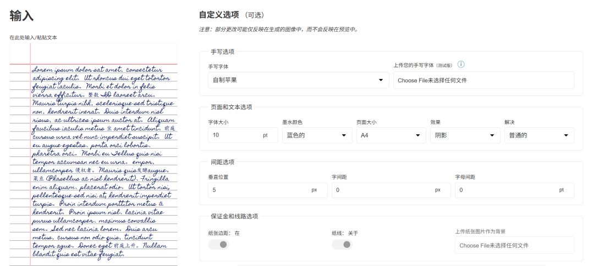

# GitHub 小众开源项目养活了一大批人：电子文本一键变手写稿——text-to-handwriting
> 💡 备注属性未写入，可能是备注属性名称或者类型被修改了，建议将字段类型设置为 rich_text，可以在小程序-操作-修改文章数据库页面进行调整
> 💡 原文链接:[https://mp.weixin.qq.com/s?__biz=MzUxNDAzODgzOQ==&mid=2247486879&idx=1&sn=dd6c4cb4eb711787df7c43117f3b7192&chksm=f8c76e7d12096affd048c0f9f85fb602a27702b0768f389cc5538231cd7c57e9b271795e9b78#rd](https://mp.weixin.qq.com/s?__biz=MzUxNDAzODgzOQ%3D%3D&mid=2247486879&idx=1&sn=dd6c4cb4eb711787df7c43117f3b7192&chksm=f8c76e7d12096affd048c0f9f85fb602a27702b0768f389cc5538231cd7c57e9b271795e9b78#rd)
打开text-to-handwriting的 GitHub 简介，一句玩笑话直接戳中场景：“老师让你提交手写作业？不想手写？这个工具帮你把文本转成手写笔迹。”乍一看是学生党偷懒神器，但深挖后会发现，它的商业落地空间远超想象。

**什么是 Text to Handwriting？**
Text to Handwriting 是一款**浏览器端开源文本转手写体工具**，不需要后端服务，所有渲染工作在本地浏览器完成，输入普通文字，直接输出高度仿真的手写页面图片 / PDF 文件。
区别于网上一堆网页版手写生成工具，它最大的亮点：**原生支持中文手写字体，高度开放的自定义能力**，源码完全公开，任何人都可以拿来二次改造、集成到自己的业务系统里。
### 自由度拉满，几乎全部参数都可以自定义
项目提供了非常丰富的可调参数，上手简单，定制上限很高：
- **字体能力**：支持中英文手写字体，还可以上传自定义 TTF 手写字体，复刻属于自己的笔迹；
- **墨水样式**：自由修改墨水颜色，模拟蓝黑钢笔、黑色签字笔等真实书写效果；
- **页面设置**：可调整纸张尺寸，横线本、方格纸、空白纸、复古做旧纸张多种背景模板；
- **排版细节**：字体大小、字间距、行间距、页边距全部可调；
- **真实感优化**：字符轻微偏移、旋转、透明度随机抖动，避免生成的文字过于工整，复刻真人手写的自然瑕疵；
- **导出格式**：支持 PNG 图片、PDF 文件导出，直接保存打印或者上传提交。
整个工具纯前端运行，**不上传你的原始文本到服务器，数据全部留在本地浏览器**，隐私安全性相比很多在线网页工具要好很多
### 一个小小的开源项目，衍生出一堆生意
这就是小众开源项目的魅力：核心代码不多，解决一个垂直痛点，无数开发者基于它做包装变现。
#### 1、ToC 小工具站点
大量个人开发者基于这套源码简单改一改，套上 UI、部署网页，做成在线文本转手写网站，靠广告、会员付费赚钱。 用户只需要粘贴文字，付费解锁更多字体、高清导出，成本几乎只有服务器，流量上来收益十分可观。网上你搜到的不少 “手写生成器”，底层原型都来自这个开源仓库。
#### 2、教育类 SaaS 系统集成
很多教育平台、作业系统、备课工具，会把 Text to Handwriting 的能力集成进去：
- 老师批量生成手写例题、手写批注试卷；
- 在线教育系统模拟手写答题效果；
- 培训机构生成手写讲义素材。 不用从零开发手写渲染算法，直接复用开源能力，节省大量研发成本。
#### 3、小程序、APP 二次封装
不少小程序、移动端 APP，核心功能就是文字转手写，底层内核就是改造后的 Text to Handwriting。 面向学生、文案创作者，按次数收费、开通会员，做轻量化工具产品。
#### 4、创意内容生产
自媒体、海报设计师，用它生成手写风文案、手写信、便签素材，用于短视频封面、图文配图，省去自己手写拍照的麻烦。
> 很多人对开源的理解还停留在 “免费拿来玩”，但现实是：**大量中小开发者，就是靠挖掘这类轻量小众开源项目，做封装、做集成、做 SaaS，以此作为收入来源**。没有轰轰烈烈，但是实实在在养活团队。
> 
当然这里也要客观提醒：工具是技术产物，**不鼓励利用工具抄袭、伪造手写作业，建议用于笔记制作、创意素材、备课等合理合规场景**。技术本身无罪，如何使用取决于使用者。
### 适合谁去玩这个项目
1. 前端开发者：拿来学习 Canvas、前端图片导出、字体渲染相关技术；
1. 独立开发者：想做一款小工具产品，这个项目可以大幅降低开发成本；
1. 教育行业从业者：需要手写风格素材，直接部署本地实例，不用依赖第三方网站；
1. 内容创作者：快速产出手写质感图文素材。
整个项目部署门槛很低，克隆仓库，简单配置，就可以本地跑起来，也可以直接部署到 Vercel 等平台对外提供服务
GitHub 上无数像 Text to Handwriting 这样的小众宝藏。把别人做好的轮子结合业务场景做包装、做体验优化，变成面向用户的产品，这也是开源世界一种非常现实的生存方式。
项目地址公众号下面评论 **Handwriting** 获取，建议收藏备用。
