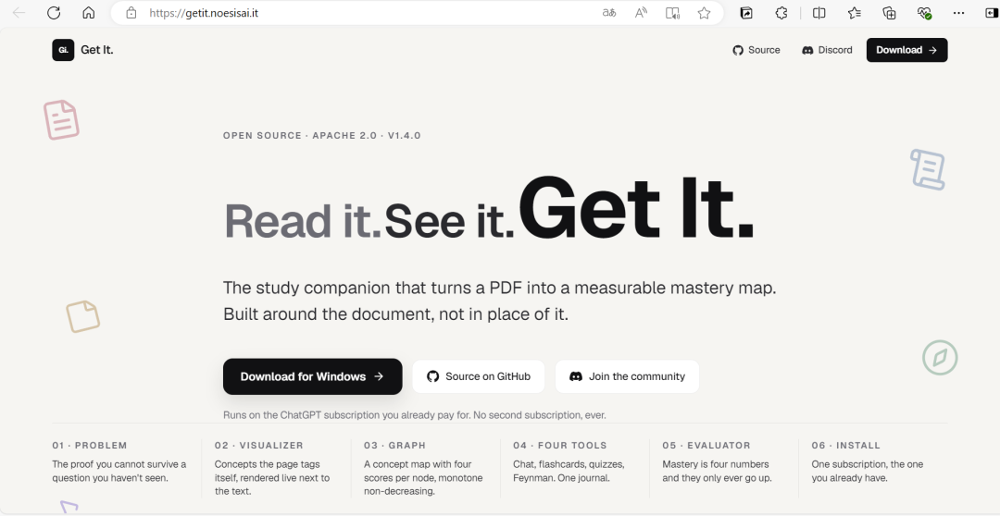
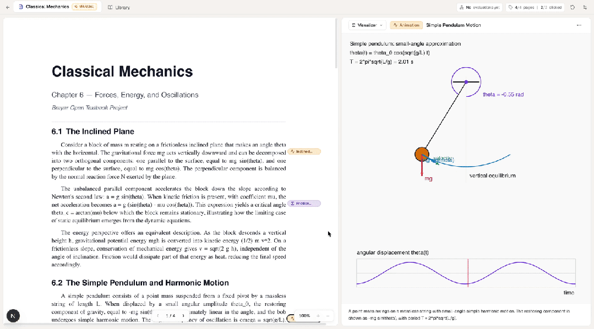

# GitHub 挖到一个开源学习神器：它能把 PDF 彻底读透，还给每个概念打分
> 💡 备注属性未写入，可能是备注属性名称或者类型被修改了，建议将字段类型设置为 rich_text，可以在小程序-操作-修改文章数据库页面进行调整
> 💡 原文链接:[https://mp.weixin.qq.com/s?__biz=Mzg4Njg3OTg2NQ==&mid=2247486470&idx=1&sn=1aaf350f08d1b2451f7378f0b37c7d9e&chksm=ce94e07a5b65249ba74c235ba978d6f814844615def0d07a65a629900f5bceff8f87bc77b349#rd](https://mp.weixin.qq.com/s?__biz=Mzg4Njg3OTg2NQ%3D%3D&mid=2247486470&idx=1&sn=1aaf350f08d1b2451f7378f0b37c7d9e&chksm=ce94e07a5b65249ba74c235ba978d6f814844615def0d07a65a629900f5bceff8f87bc77b349#rd)
**PDF 最大的问题，不是读不完，是读完不知道记住了没有。这个开源工具换了个思路：在你的 PDF 上自动标注关键概念，点一下能生成 3D 演示、动画、公式推导，再顺手建一张知识图谱——最后从记忆、理解、结构、应用四个维度，给每个概念打分。**
---
先问你一个扎心的问题：
**你书架里那些 PDF，看完之后，还能给别人讲明白几个？**
**大部分学习工具的毛病，是它们只量"表面功夫"：**
•
**闪卡**，量的是"当下能不能记住"；
•
**思维导图**，量的是"你画了多少"；
•
**AI 摘要**，量的是"模型有多耐心"。
**唯独不回答考试那天唯一重要的问题：**
**换一道我没见过的题，我还答得上来吗？**
今天这个开源项目，就是冲着这个问题去的。
---
#### 它是什么
**Get It.**，一句话概括它自己的定位：
**"把一份 PDF，变成一张可衡量的掌握度地图。围绕文档，而不是取代文档。"**
**它不是又一个"帮你总结"的工具。它的原话很有意思：学生手里已经有 PDF 了，他们不需要另一份摘要，他们需要看见"课本不肯画出来的那部分"，并且需要一个办法向自己证明——我是真的懂了。**
仓库地址：**github.com/beltromatti/get-it**
**1,000+ Star，Apache-2.0 开源，是个桌面应用（Electron + Next.js 打包），macOS / Windows / Linux 都能装。**
**它的出身也挺有意思：四个米兰理工和帕多瓦大学的学生，24 小时黑客松里做出来的原型，之后被一步步打磨成了现在能直接安装使用的成品。**

---
#### 它到底怎么"读透"一份 PDF
**你把 PDF 拖进去，同时会发生三件事：**
**① 页面自己把自己标注了。**
**一个"概念侦探"Agent 会逐页扫过去，在那些"光靠文字讲不清"的词上，种下一枚枚小心心（tag）。**
**每枚 tag 背后都指定了一种呈现方式：3D 场景、2D 动画、公式走查、函数图像，或者一条带出处的引用。**
**② 点一下，右侧就把这个东西"画"出来。**
•
**3D 场景**用 Three.js——**解剖、分子结构这种，直接转起来给你看**；
•
**2D 动画**用 Canvas——**物理、化学过程一步步演示**；
•
**公式**用 KaTeX 排版，**推导尽量不跳步**；
•
**函数和分布**有专门的绘图引擎；
•
**法律条文、名家论文**，则给你带出处的原文引用。
**更细节的一点：如果生成的演示代码跑崩了，Agent 会自己读报错信息、自己改了重发——你看到的是"修复中"，而不是一屏红色错误。**
**③ 一张知识图谱自己长出来。**
**6 到 25 个概念节点，带类型的连线，节点大小=掌握程度，颜色=进度状态，点开就能看到四个维度的分数。**
---
#### 四个工具，一本账
**标注和可视化是"看"，真正让知识留下来的是"练"。Get It. 内置四种练习方式，全部汇总进同一本学习日志：**
| **工具** | **它测的是什么** |
| 💬 **对话问答** | 复述和引用——**多轮、多线程，只针对当前这份文档** |
| 🎴 **闪卡记忆** | 自评式回忆——**每张卡走 Again / Hard / Good / Easy** |
| ✅ **选择题测验** | 强制辨析——**一个正确答案配三个像模像样的干扰项** |
| 💡 **费曼模式** | **角色反转：Agent 扮成一个好奇的八岁小孩，你来当老师** |
**最后那个"费曼模式"，是他们认为最强的理解信号——因为能讲明白，才是真的懂。**
---
#### 最特别的一点：它给每个概念打分，而且分数只升不降
**每完成一轮练习，一个"评估者"Agent 会把你的学习日志从头读一遍，然后更新知识图谱上每个概念节点的四个分数：**
**记忆（memory）、理解（comprehension）、结构（structure）、应用（application）。**
**每项 0 到 100 分。**
**官方对"分数只升不降"这件事毫不遮掩——这是他们主动加的机制：分数在运行时被"钳住"，只能往上，不能往下。**
**为什么这么做？因为学习的挫败感，常常就来自"分数掉了"。他们选择让你只看得到进步。**
**不过这里也要说句实在话：正因为分数被设计成"只升不降"，它更像是一把"给你信心、帮你看趋势"的尺子，而不是一次严格的考试评分。想要那种残酷的自我检验，还得靠自己。它原话也承认——这四个数字，是"学习 App"和"测量仪器"之间的分界线。**
---
#### 「自带 AI」：不卖你第二份订阅
**这一点我觉得写得非常有骨气。**
**市面上很多 AI 学习工具，套路是：把模型 API 包一层，再加价卖你一份订阅。**
**Get It. 反过来：它不碰你的 AI 账单。**
**它随应用内置了四种引擎，你选一个自己已经有的账号登进去就行：**
•
**OpenAI Codex**——**你的 ChatGPT Plus / Pro / Team / Enterprise / Edu 账号，或一个 OpenAI key**；
•
**Anthropic Claude**——**Claude Pro / Max 订阅，或一个 API key**；
•
**Google Gemini**——**一个 API key**；
•
**或者"自带"**——**任何兼容 OpenAI 的接口，包括用 Ollama 跑完全本地的大模型。**
**官方写得很清楚：没有 Get It. 服务器，没有共享 key 池，没有按条计费，没有"AI 点数"钱包，没有第二份订阅，也没有任何要出这套东西的计划。**
**你想换引擎随时换，App 会从中断的文档位置接着往下走。**
**而数据这块，是它另一条底线：**
**你的文档和学习日志，永远不离开你的电脑。没有账号，没有云同步，不上传文档，你的内容也不会经过他们的服务器。**
**唯一往外发的，是一个匿名"开/更新"心跳——随机安装 ID、版本号、操作系统，就这些。想彻底关掉，设一个环境变量 GETIT_DISABLE_ANALYTICS=1 就行。你的学习日志，就是本地一个 JSON 文件，右侧菜单一键就能下载走。**
---
#### 上手门槛，和几条必须看清的边界
**这段很重要，尤其对中文用户。**
**第一，它只认"文字版" PDF，扫描版直接拒收。**
**官方原话：它读的是文字，不是图片。你拖进一份"扫描件/纯图片 PDF"，它会明确告诉你不行。**
**这一点必须提醒：** 网上大量流传的教材 PDF、古籍影印本、拍照扫描版，**恰恰都是图片型的——那些它用不了。** 能用的是原生的、文字可选的电子版 PDF。
**第二，它用你自己账号，所以"额度是你自己的"。**
**免费档能登录，但额度被"故意做得很小"；想要顺畅，得有一个付费档（比如 ChatGPT Plus / Claude Pro）。** 另外它驱动各家模型走的是**官方 CLI**（Codex CLI、Claude Code、Gemini CLI 等）——**这意味着你得先有对应服务的正常访问条件**，懂的都懂。
**第三，这个项目最近更新得不算勤。**
**仓库 2026 年 6 月底之后就没再推新代码了，到现在大约三个月。** 它功能是完整的、安装包也在，但**"还活不活跃"这件事，你得自己心里有数。** 好的一面是它 Apache-2.0 开源、文档齐全，真断了也有人能接。
**第四，Windows 版没有代码签名。**
**第一次打开会弹 SmartScreen 的"Windows 已保护你的电脑"，点 更多信息 → 仍要运行 即可。** macOS 版则是**正规签名 + 苹果公证**的，双击不会有任何拦截。
**第五，它是个黑客松出身的产品。**
**24 小时做出来的底子，之后精修成成品。** 想法很完整、完成度意外地高，**但它不是那种背后有大公司、天天迭代的商业软件。** 拿来当主力学习工具之前，建议先用它自带的 5 个示例文档（解剖、经典力学、意大利宪法、微积分、有机化学）试试手感。
---
#### 写在最后
**我们这代人最不缺的就是 PDF。** 缺的从来不是"资料"，而是**"我怎么知道自己到底学没学会"。**
**Get It. 最打动我的地方，是它把"学习"这件很虚的事，硬生生做成了可观测的东西：** 标注、可视化、图谱，都还在"读"的层面；**真正让它跳出来的，是那四个分数——它逼着你去面对"我到底掌握了多少"。**
**至于分数只升不降——有人会觉得是自我安慰，也有人会觉得是恰到好处的鼓励。我的看法是：学习本来就是场长跑，能让你一直看到进步、一直愿意坐下来练，这套设计就赢了。**
**如果你常靠 PDF 学习，值得试试：**
•
**GitHub**：github.com/beltromatti/get-it
•
**官网（可直接下载安装包）**：getit.noesisai.it
**装的时候记得两件事：① 准备好自己的 AI 账号；② 手里的 PDF 得是文字版的。**
---
**觉得有意思的话，点个赞 or 分享给身边还在跟一堆 PDF 死磕的朋友。**

## 摘要

（待补充）

## 我的笔记

（待补充）
