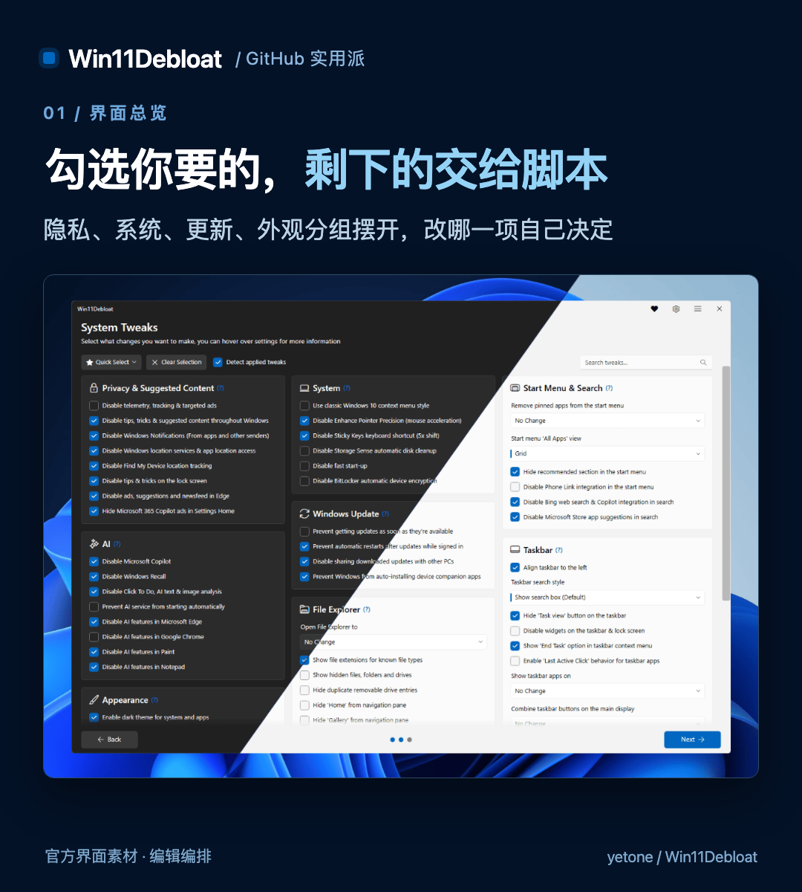
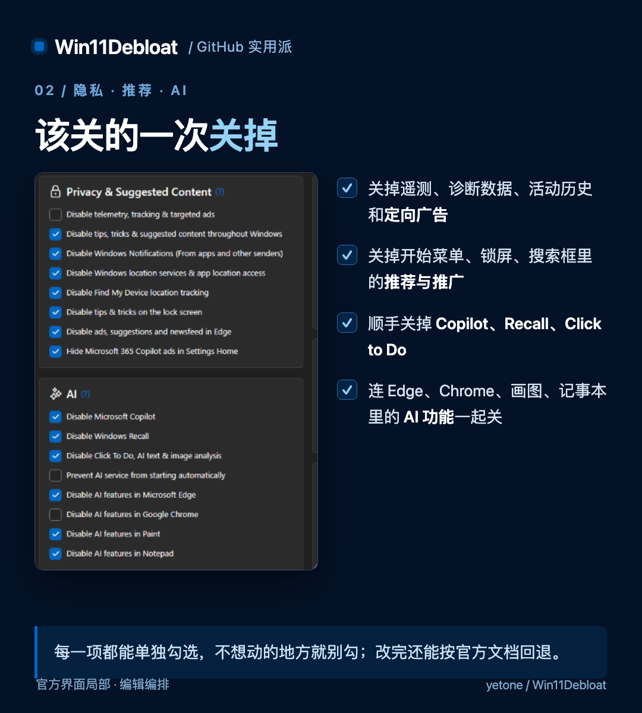

# GitHub 挖到宝了：新装的 Windows 11，总算能一键清干净了
> 💡 备注属性未写入，可能是备注属性名称或者类型被修改了，建议将字段类型设置为 rich_text，可以在小程序-操作-修改文章数据库页面进行调整
> 💡 原文链接:[https://mp.weixin.qq.com/s?__biz=MzYyNDQ0NzE3OQ==&mid=2247485260&idx=1&sn=3caeec595cf300559aa723900109f177&chksm=f11813b60f47ca191bc23210937546cdfd4a2b0780d6862ee61c4374e2f14cd49c329ec23f3e#rd](https://mp.weixin.qq.com/s?__biz=MzYyNDQ0NzE3OQ%3D%3D&mid=2247485260&idx=1&sn=3caeec595cf300559aa723900109f177&chksm=f11813b60f47ca191bc23210937546cdfd4a2b0780d6862ee61c4374e2f14cd49c329ec23f3e#rd)
GitHub 项目推荐
新电脑装好 Windows 11，开始菜单塞满用不上的应用，设置里全是推荐内容，右下角还老弹 Copilot 的招呼。
今天分享 **Win11Debloat**，一个免安装的 PowerShell 脚本：**把该关的一次关干净，该删的一次删掉。**

官方界面素材 · 编辑编排
### 01　界面就是一张清单
打开后是一页勾选清单：隐私、系统、更新、外观、任务栏分组摆开，鼠标悬停还有说明，改哪几项全由你决定。

官方界面局部 · 编辑编排
### 02　推荐内容和 AI，一并关掉
遥测、诊断数据、活动历史、定向广告、定位服务可以一次关停；开始菜单、锁屏、搜索框里的推广也能清掉。Copilot、Recall、Click to Do，连 Edge、Chrome、画图、记事本里的 AI 功能也能关掉。
预装应用能批量移除，被删的大多能从 Microsoft Store 装回来；还能换回 Windows 10 的右键菜单、关掉鼠标加速、禁止更新后自动重启。
### 03　怎么开始？

中文场景示意 · 非软件截图
最省事是在 PowerShell 里跑一行命令，脚本会自动下载并启动；也可以从 Releases 下载压缩包，解压后双击 Run.bat，在 UAC 弹窗里授权。进阶用户用管理员 PowerShell 执行脚本。
### 免费，但有边界
MIT 协议开源，不收钱；但它要管理员权限，会改注册表和系统设置，官方也写明请自行评估风险。好在大部分改动可以回退。
最新版本 2026.10.30 给图形界面加了 13 种语言。Windows 刚装完、又被推荐内容和 Copilot 折腾烦了，可以先拿备用机试试。
**想清干净一台新电脑？先做这一件小事。**
**项目与资料**
[1] GitHub 仓库 / 项目与安装
https://github.com/Raphire/Win11Debloat
[2] 官方文档 / Wiki
https://github.com/Raphire/Win11Debloat/wiki
[3] 最新发布 / 下载
https://github.com/Raphire/Win11Debloat/releases/latest
