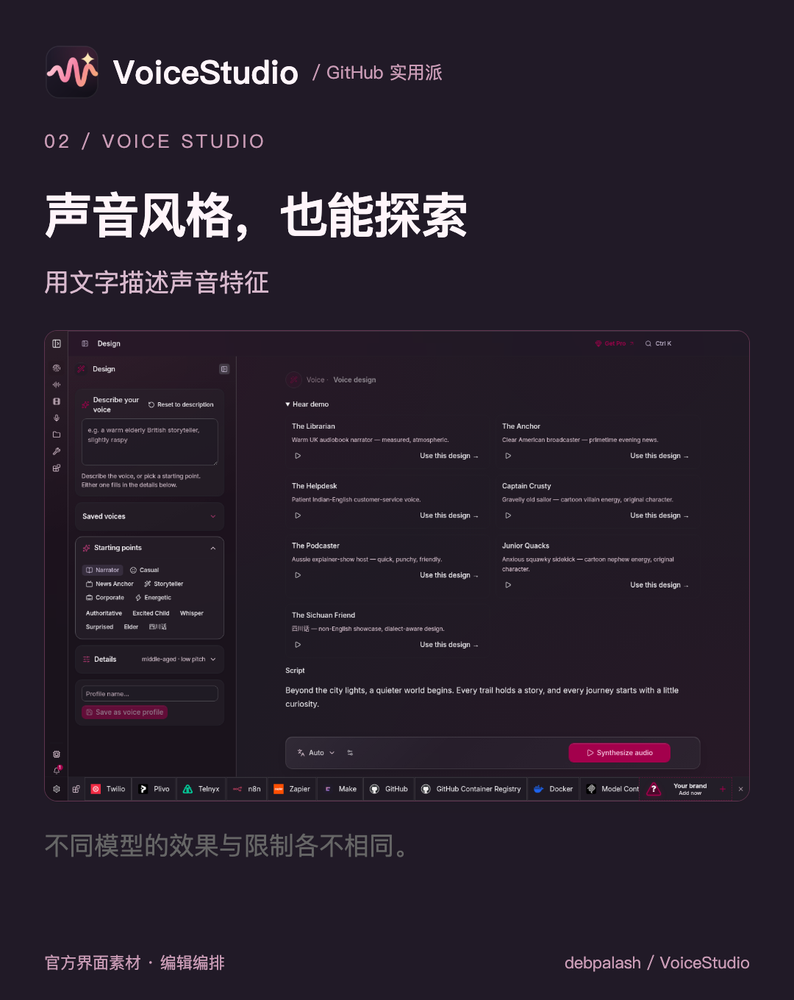
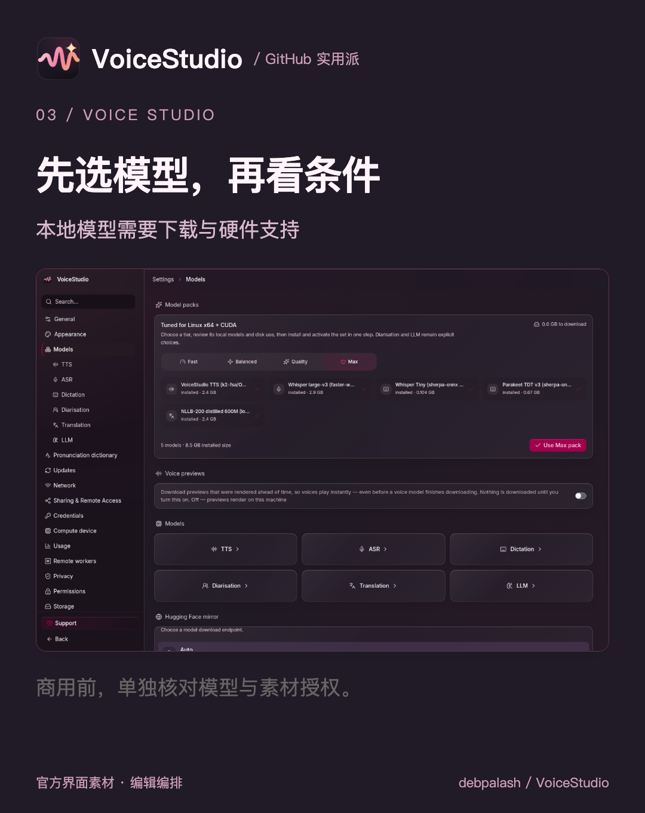

# GitHub 挖到宝了：配音、转写、有声书，把 AI 声音工作室搬进电脑
> 💡 备注属性未写入，可能是备注属性名称或者类型被修改了，建议将字段类型设置为 rich_text，可以在小程序-操作-修改文章数据库页面进行调整
> 原文链接:[https://mp.weixin.qq.com/s/_nekyl6wZQu_5ZDfZFBbhg](https://mp.weixin.qq.com/s/_nekyl6wZQu_5ZDfZFBbhg)
文案写好了，读出来才发现句子太长、停顿不顺。每改一版都重新录音，也会变成负担。
今天分享 **VoiceStudio**，一个开源语音工作台：把文字做成配音试稿，听一听，再决定怎么改。
### 先让文案“开口”
在语音生成页面选择声音、输入文本，安装所需模型后生成音频。先用一小段开场白，检查是否顺口，再调整文案。

官方语音生成界面，编辑编排
也可以添加自己的清晰参考录音。克隆他人声音须获授权，不可冒充本人；录音质量也会影响结果。
### 声音风格，也有尝试空间
它还提供声音设计入口，可以用文字描述声音特征。适合探索不同表达方向，但结果要试听，不能保证自然度和情绪表现。

官方声音设计界面，编辑编排
### 本地运行，要看电脑条件
本地语音流程首次使用需下载模型和依赖。支持 NVIDIA CUDA 和 Apple Silicon 加速；CPU 也能运行，但通常更慢。不同引擎的内存、显存需求不同，不是任何电脑都能流畅生成。
Intel Mac 需要连接远程后端，不能与 Apple Silicon 的本地体验混为一谈。远程服务是可选项，启用后也不能再笼统说数据都留在本机。

官方模型管理界面，编辑编排
### 开源，不等于所有模型可商用
应用采用 AGPL-3.0，另有付费 Pro 功能。模型、声音素材和生成内容的使用条件要分别核对：默认 OmniVoice 模型权重标注非商业许可，不能直接把配音用于商业交付。
从 GitHub Releases 下载对应安装包，按平台指南配置，先用自己的短文本和获授权声音试做。发布页提示安装包存在未签名或未公证情况，要核对来源，不要随意关闭系统防护。
愿意配置环境、探索文字转语音的人可以关注；商业配音交付前，先确认授权与效果。
### 项目入口
官方下载
https://github.com/debpalash/VoiceStudio/releases/latest
GitHub 仓库
https://github.com/debpalash/VoiceStudio
