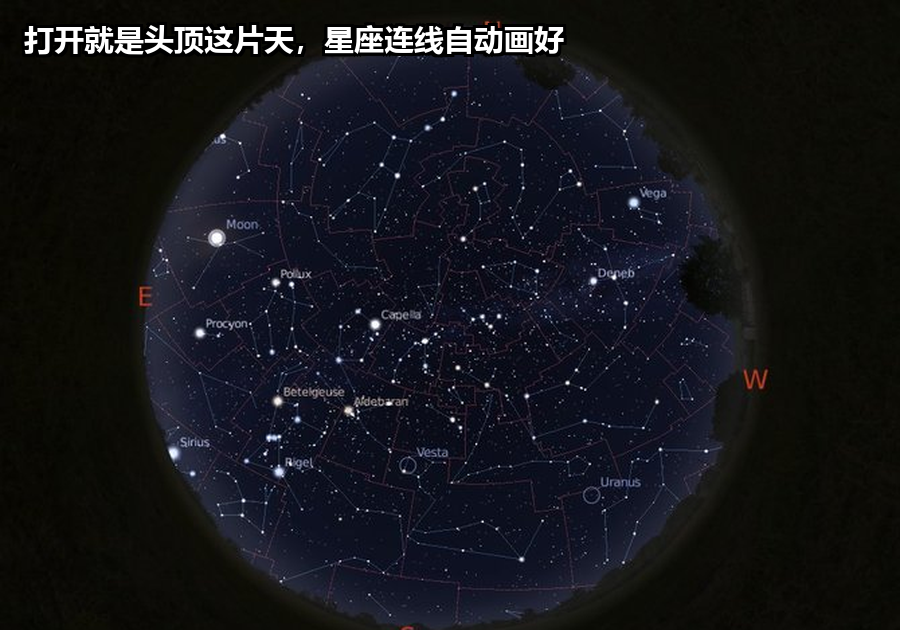
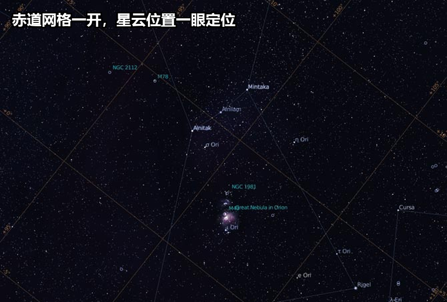

# GitHub上 1 万 star 的开源星空软件：星空真实地搬进屏幕
> 💡 备注属性未写入，可能是备注属性名称或者类型被修改了，建议将字段类型设置为 rich_text，可以在小程序-操作-修改文章数据库页面进行调整
> 💡 原文链接:[https://mp.weixin.qq.com/s?__biz=MzY5MTIzMzM1MQ==&mid=2247485048&idx=1&sn=9e34e066e326bde30e2f93fe83015485&chksm=f50a09fba31b9b7c49a4778f9de0fe07ae648de187df283d8208e2ad6d7fd184d6f9b03b4b4d#rd](https://mp.weixin.qq.com/s?__biz=MzY5MTIzMzM1MQ%3D%3D&mid=2247485048&idx=1&sn=9e34e066e326bde30e2f93fe83015485&chksm=f50a09fba31b9b7c49a4778f9de0fe07ae648de187df283d8208e2ad6d7fd184d6f9b03b4b4d#rd)
抬头看见一片星空，认得出几个？猎户、北斗、仙后有些人在课本里见过，再往下的星座就不行了；想找星座连线图边查边看，手机举着既不方便也不准——图是别人拍的、讲的是别处的夜空。
Stellarium 干的是另一件事：装在电脑上，把现在你头顶那片星空真实地搬进屏幕里，星座连线、行星位置、卫星过境全都标好；抬高望远镜就能用屏幕对照天空。10 月看星正合适，9 月 28 号刚发的 v26.3，GPL-2.0 开源，桌面版三个平台全免费，跑了 20 年的项目，稳定得很。
### 先看效果

打开就是一个铺满屏幕的夜空：地平线在屏幕下方，星星按星等大小不一，星座连线按你选的 skyculture 自动画出。鼠标拖一下能换方向，时间在右下角走，可以快进到晚上 9 点、半夜、凌晨——看不同时刻的星象走位。
一眼说给同事听，就是这句：对着夜空，星座连线自动画出来——电脑桌面就是一座天文馆。
### 装上就是一座天文馆
这是我留下它的理由。
**自带星表，几亿颗星都在。** 默认安装包含超过 6 亿颗星的星表（来自 Gaia、Tycho-2、HIPPARCOS 等星表），加上星云、星团、星系、行星、卫星——这是它和「星座大全绘本」最大的不同。你点屏幕里任何一颗星，立刻显示它的名字、星等、赤经赤纬、距离。

**位置和时间是真的准。**
 启动时自动读你的 GPS / IP 定位作为观测点（也可手输城市名），时间默认是系统当前时刻。你打开看到的就是此刻你能看到的星空——务必确认下右下角时间对得上你所

有西方星座、中国星宿（三垣二十八宿）、波利尼西亚、阿拉伯、印度等多套。你切到「Chinese」会把天空画成「紫微垣」「太微垣」「天市垣」的传统连线——这是它最神奇的地方。
**新版本加了「Object visibility」插件。** v26.3（9 月 28 号）的更新里新增 Object visibility 插件，能算天体在你所在地何时升起、何时落下、何时过中天——对追特定彗星、行星、卫星过境的人实用。AstroCalc/Eclipses 工具也加了 NASA / Espenak 历表，日食月食时间算到秒。
配角一个，同样值得说：
**不只看，还能控望远镜。** Stellarium 自带 Telescope Control 插件，按 ASCOM / INDI 协议能直接连常见电脑望远镜，屏幕上点一颗星，望远镜自己转过去——这是真天文爱好者会用到的功能，普通人不碰也没关系。
### 我的判断：谁该试，谁别碰
值得装的是这几类人：抬头看星想认星座的、带娃做天文启蒙的、追 ISS 过境和日食月食时间的、想用望远镜对星的天文爱好者；以及做地理、历史课素材的一线教师。
但下面几条，我认为必须写在前头。
**桌面版三个平台全免费；手机版是另一家公司的付费 App。** 这一点必须写在前头：Stellarium 桌面版（Windows / macOS / Linux）由 Stellarium 团队开发，GPL-2.0，完全免费；App Store / Google Play 上的「Stellarium Mobile」由 Noctua Software 开发，是付费 App（关联项目，但不是同一家、不是开源）。本文只推桌面版——桌面上想要的全部免费、且开源。
**首次启动可能要补装附加星表。** 默认包带的是基础星表；想看更暗的星，需要在「配置 → 工具 → 附加组件」里下载额外的星表数据包（几 GB 量级，按需下载）。普通看星座连线不必装。
**Qt + OpenGL 渲染需要中等以上显卡。** 老 GPU 或虚拟机的虚拟显卡可能跑不动 3D 星空；办公室低端集显也试一下，跑不顺的话 README 里有降渲染参数的方法。本号 Qt 系工具（CopyQ、Stellarium）实拍经验：Qt 在自动化截图环境里截不到画面——本篇配图走官方素材路线（见附录）。
**不是天体摄影后期工具。** 想做星空照片后期处理的人请走另一条路（darktable、PixInsight 之类）；这个工具看的是数字星图，不修照片。
门槛低：官网下载一路下一步，启动时选你所在城市，时间调到现在，对着夜空就能用。
### 怎么开始
**装桌面版（三平台通用）**
- ✦官网下载页 https://stellarium.org/download ：Windows 有 exe 安装包，macOS 有 dmg，Linux 有 AppImage / flatpak / snap
- ✦也可以从 GitHub Releases 下：https://github.com/Stellarium/stellarium/releases
- ✦装好后打开 → 在「位置」面板里选你所在城市（或输入经纬度）→ 在「时间」面板调到当前 → 屏幕上就是此刻你头顶的星空
**看第一组星座**
- ✦启用「星座连线」按钮（底部工具栏）→ 启用「星座名称」
- ✦切换「skyculture」：右侧或设置面板 → 选「Chinese」看传统星宿，或「Western」看西方星座
- ✦想看晚上 9 点的星：把时间往前调到 21:00；想看明天凌晨的星：调到 03:00
- ✦「地景」按钮可以隐去地平线以下只看天空，更直观
**进阶两个小试**
- ✦找 ISS 过境时间：AstroCalc → Satellites → 选 ISS → 看下次过境你所在地的时刻与方位
- ✦找近期日食月食：AstroCalc → Eclipses → 列出未来事件 → 点击要看具体的时刻和可见区域
前两步十分钟走完。成功标准：**对着夜空，在屏幕上找到你头顶那颗最亮的星，名字对得上**——这意味着 Stellarium 的定位是真的准。装不上或跑不动，留言 **系统版本 + 显卡型号**，我一条条看。
### 项目地址
- ✦**项目名称**：Stellarium
- ✦**GitHub**：https://github.com/Stellarium/stellarium
- ✦**官网**：https://stellarium.org
- ✦**Star**：约 1.0 万（截至发文，以仓库为准）
- ✦**许可**：GPL-2.0（桌面版）
仰望星空本来就是免费的事——能把它搬到桌面、还附带星座连线和卫星过境预测的，反而成了稀缺的工具。给娃讲一次星座，他记一辈子。
如果你觉得今天的内容有帮助，点击上方账号名片关注我，每天更新精选开源项目，让你少走弯路。

## 摘要

（待补充）

## 我的笔记

（待补充）
