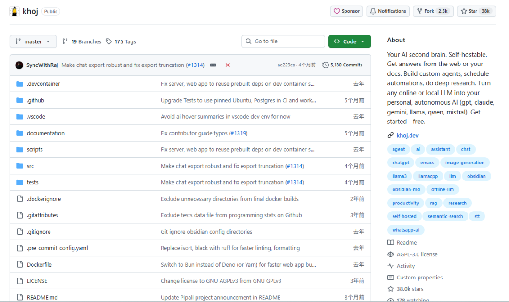
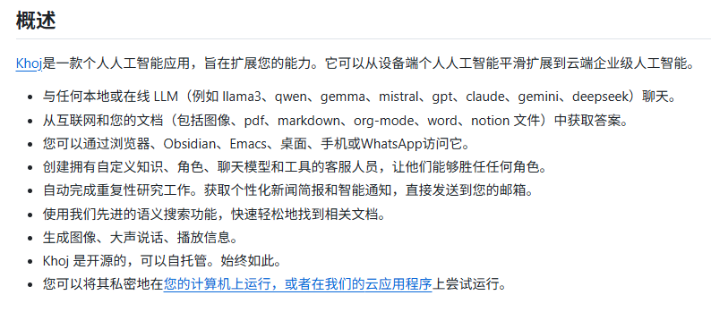
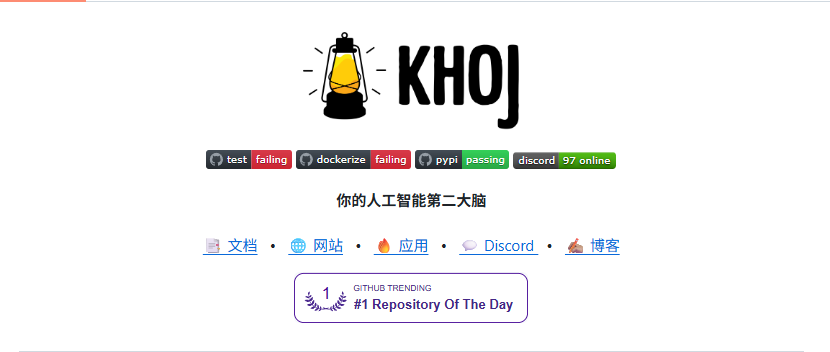

# GitHub上3.8 万 Star！笔记、PDF、Notion 全喂进去，有问题直接问！
> 💡 备注属性未写入，可能是备注属性名称或者类型被修改了，建议将字段类型设置为 rich_text，可以在小程序-操作-修改文章数据库页面进行调整
> 💡 原文链接:[https://mp.weixin.qq.com/s?__biz=MzE5ODM3MzM4Ng==&mid=2247484600&idx=1&sn=edc6f372f4e246c112642bcdabfd87ad&chksm=977188a17337b0fd7ea99f6b01cb6454563e4a9ee9d64f76f8b24471b337e979648c6eec0a9f#rd](https://mp.weixin.qq.com/s?__biz=MzE5ODM3MzM4Ng%3D%3D&mid=2247484600&idx=1&sn=edc6f372f4e246c112642bcdabfd87ad&chksm=977188a17337b0fd7ea99f6b01cb6454563e4a9ee9d64f76f8b24471b337e979648c6eec0a9f#rd)
你有没有过这种时候，PDF 下载了一大堆，笔记写了几十篇，收藏夹还分好了类。
真要找一个结论，怎么都想不起来它在哪。
打开搜索框，换三组关键词，翻五个文件夹，最后气一泄，重新上网搜一遍。
想让 AI 帮忙更费劲。得先找到文件，再上传，再从头交代一遍背景。
Khoj 就是冲着这件事来的。
你把资料接进去，之后直接开口问，它自己翻。
GitHub 上现在 3.8 万 Star，2021 年 8 月就建库了，代码上个月还在更。

### 01 它是什么
Khoj 是一个开源的个人 AI 助手，官方管它叫第二大脑。
跑法有两种。你可以在自己机器上部署，也可以直接用官方云端。
PDF、Markdown、Word、org-mode、Notion，还有图片，都能喂进去。
然后你在浏览器里提问，它先在你的资料里找，再把答案组织出来。
客户端铺得挺开。浏览器、Obsidian、Emacs、桌面 App、手机、WhatsApp，六个入口。
后端是 Python 写的，Django 加 Postgres，跑起来占一个 42110 端口。

### 02 找东西不用先想起关键词
我遇过好几次这种情况。明明写过一段怎么减少会议的内容，但标题叫团队沟通流程优化，搜会议，搜不到。
普通搜索盯着你的原词。Khoj 用语义搜索，你描述意思就行。
它去捞内容相关的片段，不要求你撞对某个词。
捞完交给模型组织答案，顺手把引用了哪几条笔记列出来。
你可以点回去看原文，确认它有没有理解偏。光这一点，就比只丢给你一段答案强。
资料混在一个大库里也不怕。用文件筛选限定范围，只让它在当前项目那几份文件里找。

### 03 给不同的事配不同的助手
写东西和查资料，适合的回答方式不一样。
Khoj 能建自定义智能体。知识范围、角色提示、模型、工具，都能单独设。
写作那个定好语气，学习那个让它多追问、少直接甩答案。设一次，下次进这个角色不用重讲。
每周都要追的方向，可以挂成自动任务。
指定时间和频率，它自己跑研究，结果发到你邮箱。
任务在页面里能改能删。不过自托管时想让邮件真发出去，得自己配好邮件服务和身份认证。
### 04 模型挑自己的，装法有两条
想先试试水，直接开 app.khoj.dev，一行都不用装。
想自己攥着数据，走 Docker。麻烦些，东西全在你机器上。
先把配置文件拉下来
```
mkdir -p ~/.khoj
cd ~/.khoj
curl -L https://raw.githubusercontent.com/khoj-ai/khoj/master/docker-compose.yml -o docker-compose.yml
```
打开这个文件，改两个必填项，KHOJ**ADMIN**PASSWORD 和 KHOJ**DJANGO**SECRET_KEY。
再填模型。用 OpenAI 就填 OPENAI**API**KEY，Anthropic 填 ANTHROPIC**API**KEY，Gemini 填 GEMINI**API**KEY。
想用本机的 Ollama，把 OPENAI**BASE**URL 那行注释去掉，指过去就行。vLLM、LMStudio 这类 OpenAI 兼容接口也能填。
然后起服务
```
docker compose up -d
```
浏览器开 http://localhost:42110，看到 Khoj is ready to engage 就算好了。
第一次启动完还得再重启一次，不然有些设置不生效。这步文档里写了，但很容易漏。
用 Windows 的话，得先备好 WSL2 和 Docker Desktop。不想用 Docker 也能 pip 装，建议走 pipx，能躲开依赖冲突。
我头一次就漏了这步，还以为是哪里装错了。
### 05 几处要留意的局限
自托管不等于全本地。你接了 GPT 或者 Claude，笔记片段照样会发到人家的服务器。想资料一点不出门，只能配本地模型，再把联网关掉。
协议是 AGPL-3.0。自己用没事，改完对外提供服务，改动部分得开源。这条跟 MIT 那些不一样，公司里用要先问清楚。
Docker 内存给小了会直接挂。官方 troubleshooting 里专门有一条，报错就一个词，Killed。
管理后台有个坑。必须用 localhost 访问，换成 127.0.0.1 会报 CSRF 错。Mac 上用 Safari 还可能压根登不进去，得换 Chrome 或者 Firefox。
pip 装也不总顺。卡在 tokenizers 编译的话，得先装 Rust。
还有个数字得摆出来，issue 开着 170 个。五年了还在更，这点不容易。边角上的毛病也确实还有。
开源地址 https://github.com/khoj-ai/khoj
