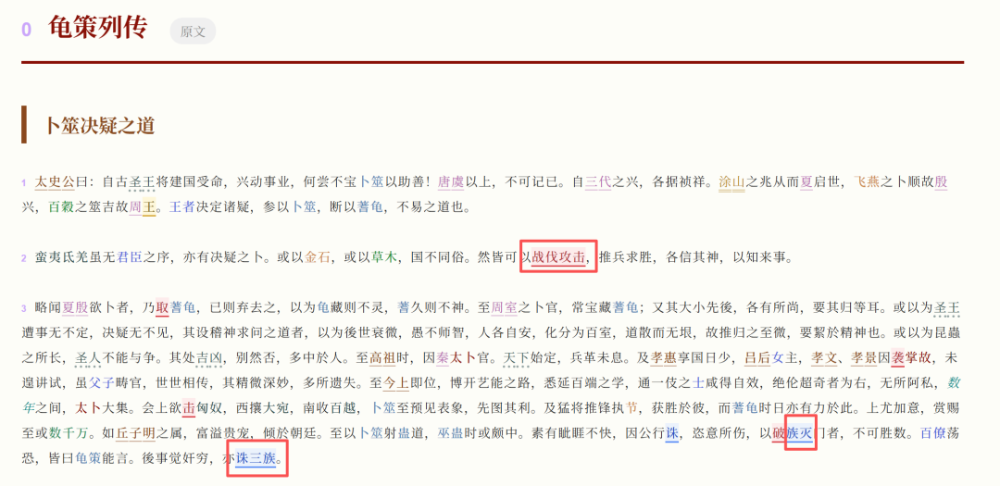
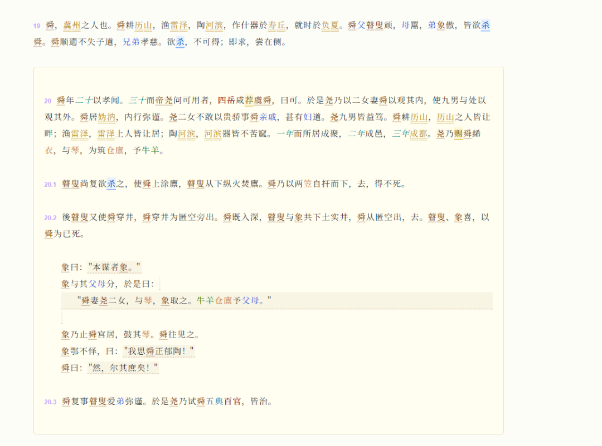

# GitHub上开源项目把57万字《史记》做成了知识库，读史记不用再来回翻
> 💡 备注属性未写入，可能是备注属性名称或者类型被修改了，建议将字段类型设置为 rich_text，可以在小程序-操作-修改文章数据库页面进行调整
> 💡 原文链接:[https://mp.weixin.qq.com/s?__biz=MzY5NjQwOTcwMw==&mid=2247484280&idx=1&sn=3a6f0305c53be6acec2320d9ea3ba279&chksm=f5dd362f8e96f5262ea2e42846ea2ac670796b36ab2ad1a76f5dea11e20983e226ac8baa5d1f#rd](https://mp.weixin.qq.com/s?__biz=MzY5NjQwOTcwMw%3D%3D&mid=2247484280&idx=1&sn=3a6f0305c53be6acec2320d9ea3ba279&chksm=f5dd362f8e96f5262ea2e42846ea2ac670796b36ab2ad1a76f5dea11e20983e226ac8baa5d1f#rd)
最近在GitHub上发现了一个很有趣的项目叫shiji-kb。
读史记的时候，我们会经常遇到这样的情况：这一段还可以理解，换到另一篇文章里，同一个人又换了一个名字。要想弄明白他和谁有关、前后发生了什么事，就要在几篇文章中来回查找。
做历史选题也是如此。资料很多，但是要写稿子的时候，还得再找一遍人名、对时间、查出处。
该项目要解决的就是来回查找的麻烦。
### 项目是什么
shiji-kb 的中文名是“史记知识库”。把《史记》130篇文章、大约57万字的内容整理成可以检索、可以跳转的阅读器和知识库。
里面使用了“知识图谱”。也就是把人物、地点、事件之间关系整理出来。可以顺着一个名字往下查，看看相关的记载分散在哪些篇章里，然后再回到原文去读上下文。
并且把古籍处理的方法文档也公布了。这些文档叫做SKILL，可以理解为给AI的操作说明：如何标注人名、如何提取事件、发现错误之后如何复查。一般的读者可以直接使用网页，而想研究古籍整理的人则要深入一层。

图1首页有全文检索功能，下面有知识索引、专项索引、知识图谱以及史记Wiki入口。*
### 能做什么
比较直观的做法就是给古文加上高亮。人名、地名、官职等用不同的颜色、样式来表示。读到一长串陌生的词语的时候，至少可以分辨出哪些是人名，哪些是地名。
下一部分就是分类查找了。要找的人物就去人名索引里找，有关制度、器物的也有相应的分类。做笔记的时候可以围绕一个对象搜集材料，不必按照篇章的顺序来。
时间轴也是可以看的。把各个章节里的事件做成“史记地铁图”，一条线上的站点就是事件，可以进行搜索、缩放和拖动画面的操作。遇到同时期的多条叙述时，用它来整理先后顺序会比较容易。
Wiki 会把资料组织成人物、事件、地点等页面。写一个人物小传，先找到相关的条目，然后查找引文和章节，按照一个名字从头到尾搜索会有方向。原文的段落还有编号，做笔记的时候可以把具体的位置记下来。

图2索引演示图中包括人名、地名、官职、邦国、时间等分类。图中的人名有3630个条目，地名有1865个条目，属于该演示版本的统计。*
### 快速上手
读书可以从仓库介绍中“在线阅读”进入。进入到首页之后，先挑选一篇自己比较熟悉的文章，比如《刺客列传》，看看它的颜色、段落编号以及索引是否符合自己的阅读习惯。
也可以在首页的搜索框里输入关键词。框内提示为，多个关键词之间用空格隔开。以一个人的名字为起点，找到相关的段落之后，再读前后几句话，不要只凭搜索命中的半句话来下结论。
习惯于本地浏览的话，在电脑上安装好 Git 和 Python 后，在终端里依次输入：
git clone https://github.com/baojie/shiji-kb.git cd shiji-kb python -m http.server 8000 --directory docs
把仓库里已经生成的网页放到本地浏览。在浏览器地址栏中输入 `http://localhost:8000`，就可以打开阅读器了；如果在地址后面加上 `/wiki/`，就可以访问到 Wiki。有些电脑的 Python 命令是 `python3`，把第三行开头改成这个就可以了。
看完之后回到终端，按 Ctrl+C 停止。重新做古籍标注、让AI来维护知识库，这是另外一种工作方式，仍然要继续看方法文档、运行条件；浏览现成页面的时候不需要做这些事情。
### 实测展示
把公开使用的反馈以及项目演示放在一起看，可以发现省在什么地方，也可以看出哪些地方需要改进。
**颜色有帮助，也可能分散注意力。**
一位用户把《龟策列传》的阅读画面发了出来。原文已经按照类别进行着色，并且用红色框把带有背景色的词标出来。该用户的疑问也很有道理：长时间阅读文章的时候，背景色过于突出，会不会影响到阅读呢？

图3：《龟策列传》画面中的“战伐攻击”“诛三族”内容有底色，红框为反馈截图已经有的标记。人名、邦国等词也用不同的颜色和下划线表示。*
如果你要找的是人名的话，这些标记就很好用了。读几页之后再注意一下自己的感觉。项目说明中包含语法高亮开关，在不习惯的情况下可以关闭，然后恢复到正常的阅读模式。
**句子之间的关系，也能摆出来。**
项目阅读器原型演示中有一张《五帝本纪》的语义排版图。“语义排版”说白了就是根据句子的意思来调整排列方式，并用连线来表示前后的关系。

图4：演示的时候“语义排版”“关系连线”是打开的，正文出现了“因”“递”“续”等虚线提示；“阪泉之野”还连接到了右边的《正义》注释卡片。*
看这张图可以很快找到叙述的转承之处。但是连线是系统对文本的整理，读到重要的因果关系，还要核对原文。这张是原型的画面，不能把所有的按钮都当成当前在线版已经存在的功能。
**注释可以贴着词语看。**
另一张演示把三家公司注都做成弹窗了。所谓“三家注”就是《集解》《索隐》《正义》这三种注释方法。画面保留了正文，但是展开词语对应的解释，不要把正文和注释分开来寻找。

图5 右上角选中“弹窗”，正文“黄帝者”旁展开注释框，依次列出《集解》《索隐》《正义》的内容。*
这样的表现方式很有趣，读古文的时候少动几次眼睛，确实方便。但是在线首页仍然把三家注整合列入了计划项。这张图所展示的是原型的效果，全部铺开到全书也不能画等号。
**排版出错，也有具体反馈。**
《五帝本纪》曾经有用户反映，第20节的格式有问题。截图中，舜的早年经历被塞进一个大色块里，正文与注释混在一起。

图6 历史反馈截图中，第20-20.3段被浅黄色框包裹，里面还有对话式的排版。该反馈之后被维护人员标记为已经修复。*
维护者后来解释说，由于文稿中多出的标记把正文套成了注释框，删除这些标记并重新生成页面之后就修复好了。该例子也告诫我们，在遇到奇怪的颜色或者段落样式的时候，要先核对原文，不要把排版的效果当作内容本身。
### 最后说两句
我把它分为两类：一是想要把《史记》读得更明白的人，二是经常需要查阅历史资料的人。高亮、索引、时间线可以减少我们寻找内容的时间，从而有更多的精力去阅读文字。
但是，AI整理出的人物指代、事件年代以及关系仍然可能存在错误。写作的时候把这当作查资料的入口比较安全，重要的判断还是要回到原文以及可靠的注释本中去核实。
仓库说明中有一个容易被忽略的地方，就是把分析脚本和标注数据分开许可，并且标注数据采用署名、非商业使用、相同方式共享的要求。把数据用作商业产品或者批量搬运到自己的付费内容中去之前，要先和作者取得联系并获得授权。
选择一篇自己读过的作品，看看它是否可以帮你理清之前没有整理好的人物关系。解决了这个小问题，就有继续使用的理由了。
### 仓库地址
`https://github.com/baojie/shiji-kb.git`
