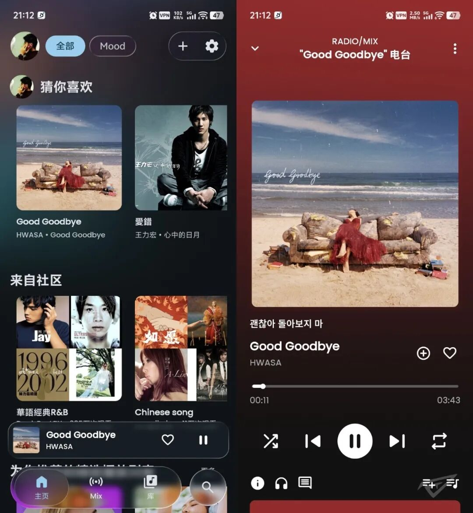
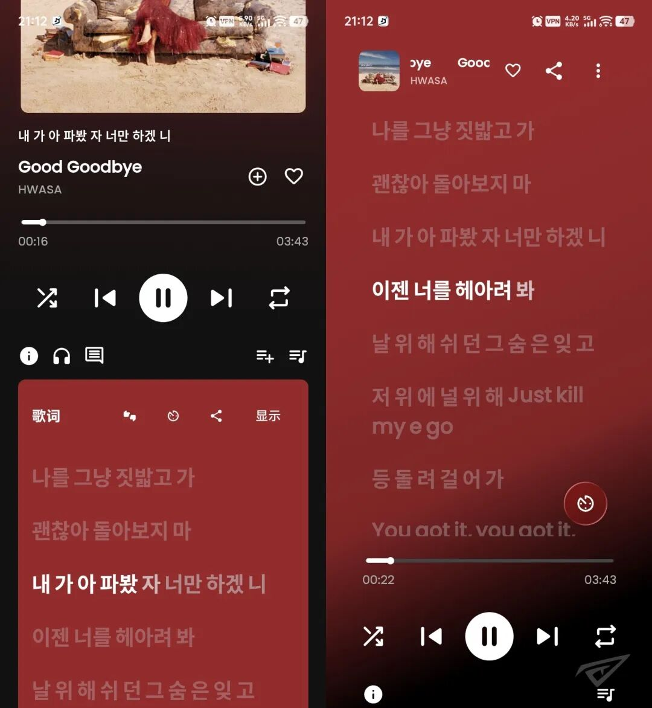
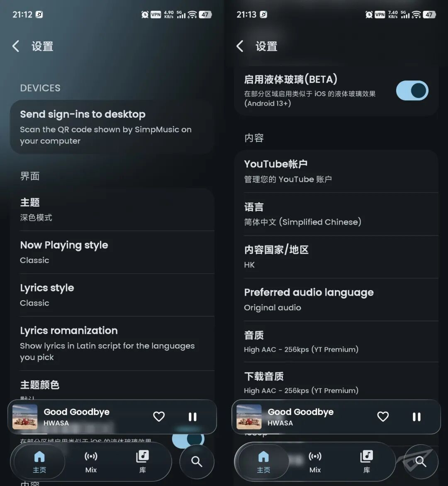
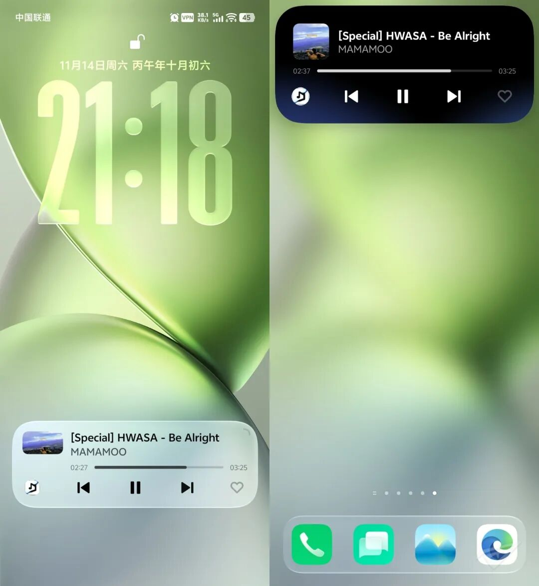
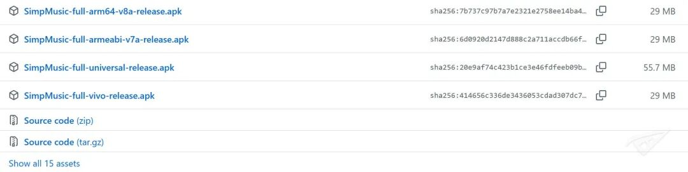

# GitHub开源音乐神器 SimpMusic 爆红：多平台曲库、无广告
> 💡 备注属性未写入，可能是备注属性名称或者类型被修改了，建议将字段类型设置为 rich_text，可以在小程序-操作-修改文章数据库页面进行调整
> 💡 原文链接:[https://mp.weixin.qq.com/s?__biz=MjM5NjI0MjU2MQ==&mid=2649533136&idx=1&sn=94a3c1cfc98ef21078d50829bfc65400&chksm=bfddc4b13c413448f9b0ac5b7b17e79cf24ada9bcffaeeb61c9b51df902e687078d556deeede#rd](https://mp.weixin.qq.com/s?__biz=MjM5NjI0MjU2MQ%3D%3D&mid=2649533136&idx=1&sn=94a3c1cfc98ef21078d50829bfc65400&chksm=bfddc4b13c413448f9b0ac5b7b17e79cf24ada9bcffaeeb61c9b51df902e687078d556deeede#rd)
爱黑武消息，2026年11月14日，在主流音乐平台普遍存在广告干扰、会员体系繁杂以及跨端同步受限的当下，一款名为 **SimpMusic** 的开源跨平台音乐客户端正在 GitHub 开发者社区迅速走红。
该项目由独立开发者 maxrave-dev 发起并维护，采用 GPL-3.0 开源协议，目前已更新至 v2.6.0 版本，全面覆盖 **Android、Windows、macOS 及 Linux** 四大主流系统。不过请注意，**SimpMusic 需要“你懂的”才能使用。**

技术架构与多源数据整合是该项目的核心亮点。SimpMusic 基于 Kotlin 语言与 Compose Multiplatform 框架开发，实现了移动端与桌面端的代码高度复用。

应用本身不存储任何音视频文件，而是通过聚合各大平台的公开接口构建起完整的媒体生态：
**• 核心曲库与音视频流：**直接解析自 YouTube 与 YouTube Music，免费提供海量歌曲、榜单与 MV 资源。
**• 动态视觉封面：**同时接入 Apple Music 动态专辑封面与 Spotify Canvas 短视频接口，带来沉浸式播放界面。
**• 多源歌词和翻译：**整合自建的 SimpMusic Lyrics、开源歌词库 LRCLIB、BetterLyrics 及 YouTube 字幕数据，并支持接入用户自有 AI 密钥实现实时翻译。
**• 智能混音数据：**其自动淡入淡出功能还会查询 Tidal 曲库，以获取精准的歌曲 BPM 与调性信息。
**• 无广告可缓存：**SimpMusic 实现了免订阅无广告播放、后台持续聆听与离线缓存
在实际体验上，SimpMusic 集成了 SponsorBlock 广告片段跳过、Shazam 听歌识曲、10 段均衡器、Android Auto 车载模式以及局域网扫码同步等实用功能。

SimpMusic 自带简体中文，可以在设置里面管理账号、音质、显示界面等，**目前最新的版本已经可以开启“液态玻璃”UI界面**，更加有质感更高级。

值得一提的是，该作者非常贴心，**给 vivo 手机做了专用版本，用于适配 vivo 手机系统的原子岛（Origin Island）与桌面音乐组件。**
目前，该项目的完整源代码与各平台安装包均已在 GitHub 及 SimpMusic 官方网站免费开放下载，小黑黑也提供一个**爱黑武论坛**的下载地址，大家可以点击下方【阅读原文】进入下载。

**SimpMusic 的版本太多，不知道怎么选？小黑黑教你：**
**• arm64-v8a：**适用于2017年以后出的手机
**• armeabi-v7a：**适用于2017年之前的老手机
**• x86_64：**Intel芯片的，主要是安卓模拟器或者 ChromeOS 设备
**• universal：**不确定自己设备是哪种就选这个
**• vivo：**这个就是 vivo 专版
⬇️⬇️⬇️戳下面这里【阅读原文】
