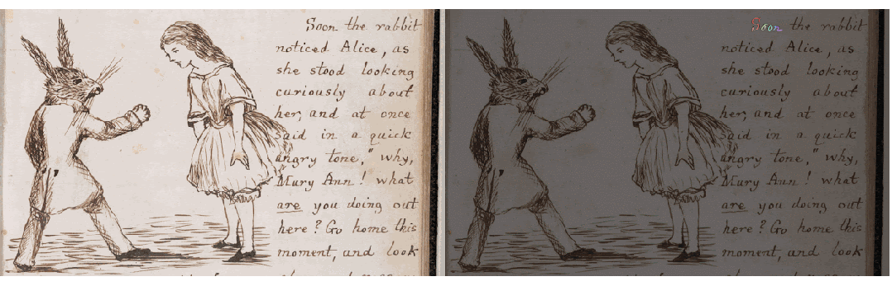
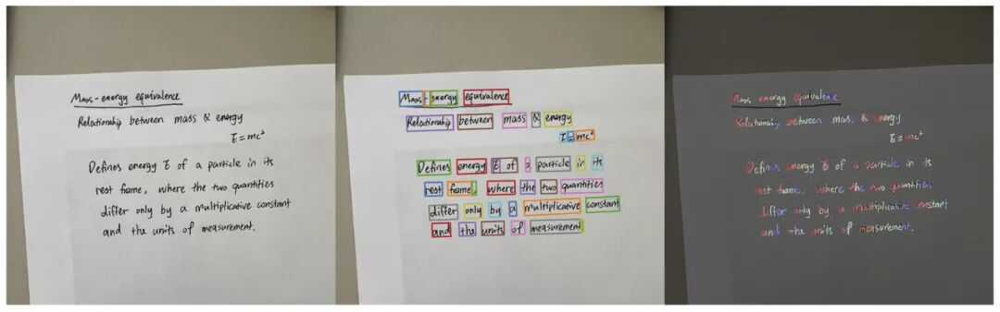
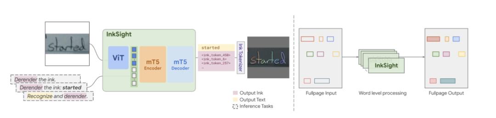
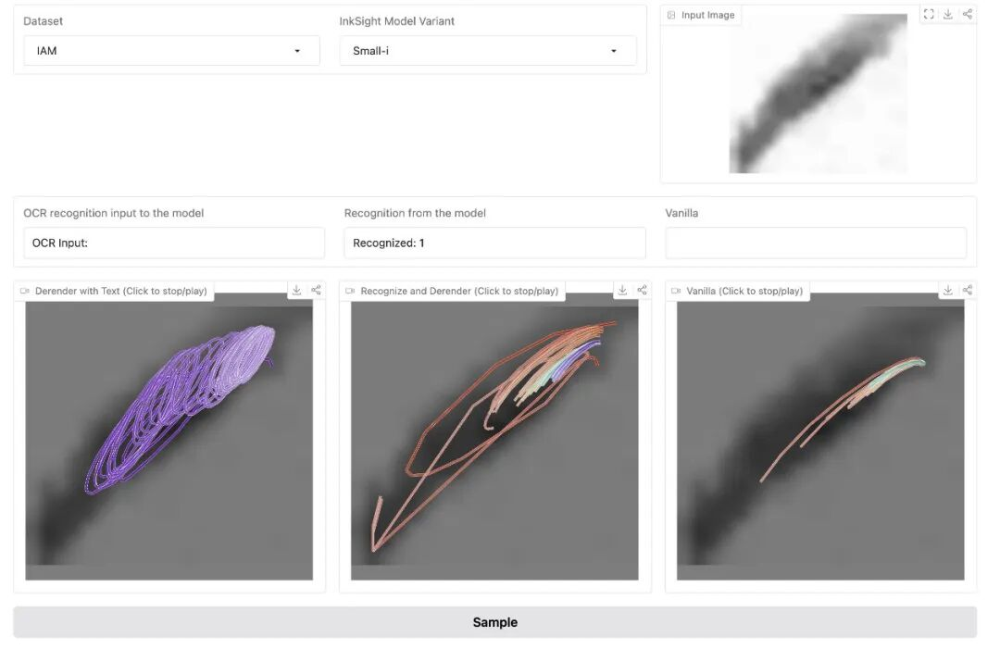
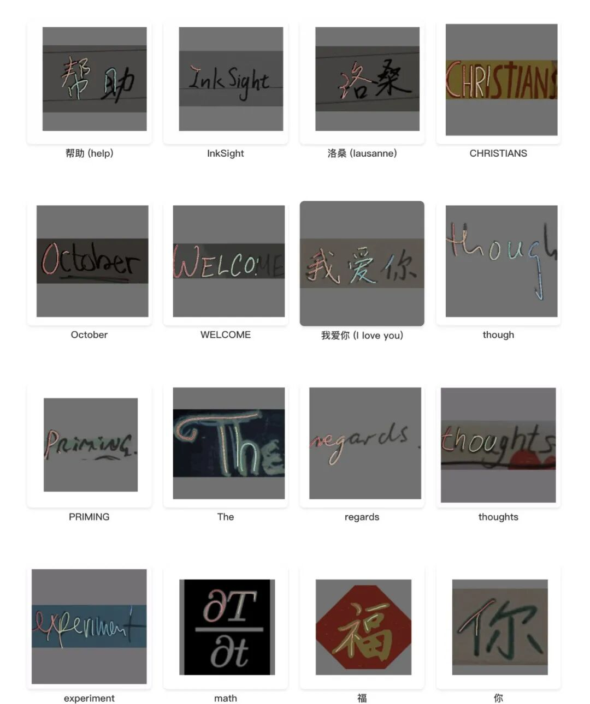
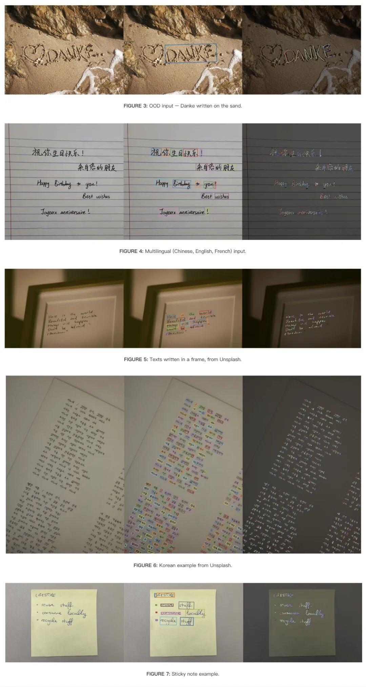

# Google 开源 InkSight，把手写笔记直接变成可编辑数字笔记！
> 💡 备注属性未写入，可能是备注属性名称或者类型被修改了，建议将字段类型设置为 rich_text，可以在小程序-操作-修改文章数据库页面进行调整
> 💡 原文链接:[https://mp.weixin.qq.com/s?__biz=MzkwMjQ0NzI0OQ==&mid=2247504365&idx=1&sn=41d67ad57ea3975ab90ff294bee6d2be&chksm=c1957aecedeeeeeeefbe295eb369c4ff705ef3374363a7b75f620ac8fce9e86112c20b7e479d#rd](https://mp.weixin.qq.com/s?__biz=MzkwMjQ0NzI0OQ%3D%3D&mid=2247504365&idx=1&sn=41d67ad57ea3975ab90ff294bee6d2be&chksm=c1957aecedeeeeeeefbe295eb369c4ff705ef3374363a7b75f620ac8fce9e86112c20b7e479d#rd)
不知道大家有没有过这种经历。
课上、会议里、灵感来了的时候，随手在纸上记下来的东西，永远是最顺的。
但一旦你想整理、搜索、复用这些笔记麻烦就来了。
- • 拍照存云盘？只能看，不能改
- • 用 OCR 转文本？字是出来了，但笔迹、重点、结构全没了
直到我最近在 GitHub 看到 Google 开源的 **InkSight**，才认识到还有“手写数字化”的途径。

它通过强大的 AI 模型，能够将任何手写照片直接转换为数字墨迹。
这意味着，你在一张皱皱巴巴的餐巾纸上写的草稿，经过 InkSight 处理后，可以变成 SVG 或其他矢量格式。

你可以像在 iPad 的 GoodNotes 里一样，擦除某个写错的字、改变笔迹颜色、甚至重新排列段落，而这一切，原本只是你手机拍的一张照片！
InkSight 不只是 OCR，不是**「识别你写了什么」**，而是**「还原你是怎么写的」**。
这也是它和传统 OCR 本质上的区别。
**主要功能**
- • **离线转在线**：将照片中的离线手写文字转换为在线手写文字
- • **支持多语言**：多语言支持及强大的后台处理能力
- • **保留原始笔记结构**：具备词级和整页文本处理能力
- • **支持编辑搜索**：转换为数字墨迹后，支持编辑和搜索
- • **全新的输出格式**：矢量笔迹（SVG + 墨水轨迹）
**技术实现**

InkSight 的核心在于一个很巧妙的训练思路：「阅读 + 书写」双重训练。
它不是只训练模型「看字」，而是同时训练：
- • 阅读（Reading）：理解手写内容
- • 书写（Writing）：还原书写轨迹
底层架构是：
- • 视觉转换器（ViT）：负责看图
- • mT5 编码-解码结构：负责生成笔迹序列
这让它具备一个非常罕见的能力：从结果，反推过程。
**快速入手**
可体验 InkSight 在 Hugging Face Space 上的在线演示。
HF在线Demo: https://huggingface.co/spaces/Derendering/Model-Output-Playground

也可在本地使用 uv 进行部署：
```
# Install uv if you haven't already
curl -LsSf https://astral.sh/uv/install.sh | sh

# Clone and set up the project
git clone https://github.com/google-research/inksight.git
cd inksight
uv sync
```
对于开发或自定义推理，请在本地运行 Gradio playground：
```
git clone https://huggingface.co/spaces/Derendering/Model-Output-Playground
cd Model-Output-Playground
pip install -r requirements.txt
python app.py
```
**示例效果**


**写在最后**
InkSight 支持多语言、能处理不同书写风格、不怕复杂背景/拍歪/光线不均，并且提供两种模式：
- • 单词级转换：适合精细编辑
- • 整页转换：适合快速归档
这对真实世界的手写场景非常重要。
更重要的是 InkSight 的输出结果是可编辑、可搜索的矢量笔迹数据。
意味着你可以导入笔记应用、做长期知识管理、把纸质笔记纳入你的数字体系。
从此，拍照不再是终点，而是入口。
GitHub：https://github.com/google-research/inksight

如果本文对您有帮助，也请帮忙点个 **赞👍 + 在看** 哈！❤️
**在看你就赞赞我！**

