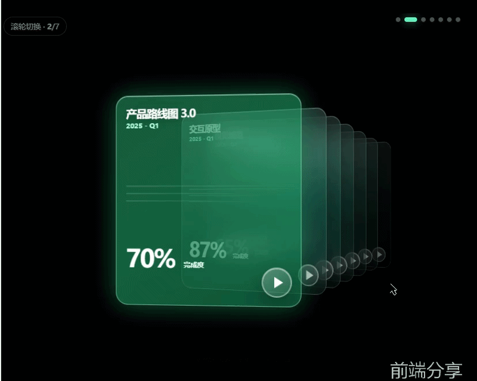

# HTML 实现玻璃卡片滚动切换效果（附源码）
> 💡 备注属性未写入，可能是备注属性名称或者类型被修改了，建议将字段类型设置为 rich_text，可以在小程序-操作-修改文章数据库页面进行调整
> 💡 原文链接:[https://mp.weixin.qq.com/s?__biz=Mzk0Mjg3NTE2Mg==&mid=2247484860&idx=1&sn=cdcbc8e4f774d5a17714908820132cb3&chksm=c249b23ee6984e1a469d9187bb8bb3a64301b4457f94cbf773437df4f4af17e1bf9dcb051cc1#rd](https://mp.weixin.qq.com/s?__biz=Mzk0Mjg3NTE2Mg%3D%3D&mid=2247484860&idx=1&sn=cdcbc8e4f774d5a17714908820132cb3&chksm=c249b23ee6984e1a469d9187bb8bb3a64301b4457f94cbf773437df4f4af17e1bf9dcb051cc1#rd)
### 源码获取
私信回复`玻璃卡片`获取完整源码
### 演示效果

### 完整代码
```

  
  
  玻璃卡片滑轮切换
  
    * {
      box-sizing: border-box
    }

    html,
    body {
      height: 100%;
      margin: 0
    }

    body {
      display: grid;
      place-items: center;
      overflow: hidden;
      background: #000;
      color: #fff;
      font-family: Inter, "PingFang SC", "Microsoft YaHei", sans-serif
    }

    .scene {
      position: relative;
      width: min(100vw, 1100px);
      height: min(76vw, 780px);
      min-height: 560px;
      overflow: hidden;
      isolation: isolate;
      background: radial-gradient(circle at 56% 43%, rgba(0, 255, 174, .18), transparent 34%), radial-gradient(circle at 72% 50%, rgba(0, 179, 158, .13), transparent 31%), linear-gradient(115deg, #010705, #000)
    }

    .scene:before {
      content: "";
      position: absolute;
      inset: 0;
      pointer-events: none;
      background: radial-gradient(circle at 50% 50%, transparent 30%, rgba(0, 0, 0, .62) 100%)
    }

    .counter {
      position: absolute;
      top: 18px;
      left: 16px;
      z-index: 30;
      padding: 7px 12px;
      border: 1px solid rgba(255, 255, 255, .12);
      border-radius: 20px;
      background: rgba(0, 0, 0, .32);
      color: rgba(255, 255, 255, .48);
      font-size: 13px
    }

    .dots {
      position: absolute;
      top: 16px;
      right: 30px;
      display: flex;
      gap: 7px;
      z-index: 30
    }

    .dot {
      width: 8px;
      height: 8px;
      padding: 0;
      border: 0;
      border-radius: 50%;
      background: rgba(255, 255, 255, .3);
      cursor: pointer;
      transition: .35s
    }

    .dot.active {
      width: 22px;
      border-radius: 8px;
      background: #50e4bd;
      box-shadow: 0 0 18px rgba(80, 228, 189, .55)
    }

    .deck {
      position: absolute;
      inset: 65px 0 35px;
      perspective: 1350px;
      transform-style: preserve-3d
    }

    .card {
      --x: 0;
      --z: 0;
      --ry: 0;
      --scale: 1;
      position: absolute;
      left: 50%;
      top: 50%;
      width: 570px;
      height: 630px;
      padding: 42px 38px;
      border-radius: 35px;
      overflow: hidden;
      transform: translate(-50%, -50%) translateX(var(--x)) translateZ(var(--z)) rotateY(var(--ry)) scale(var(--scale));
      transform-origin: center;
      transition: transform .72s cubic-bezier(.2, .8, .2, 1), opacity .55s, filter .55s;
      cursor: pointer;
      background: linear-gradient(145deg, rgba(36, 255, 185, .43), rgba(0, 98, 73, .7));
      border: 2px solid rgba(181, 255, 231, .38);
      box-shadow: inset 0 1px rgba(255, 255, 255, .35), inset 0 -40px 80px rgba(0, 48, 37, .2), 0 30px 75px rgba(0, 0, 0, .62), 0 0 45px rgba(0, 255, 180, .08);
      backdrop-filter: blur(22px) saturate(150%);
      -webkit-backdrop-filter: blur(22px) saturate(150%)
    }

    .card:before {
      content: "";
      position: absolute;
      inset: 0;
      border-radius: inherit;
      pointer-events: none;
      background: linear-gradient(125deg, rgba(255, 255, 255, .15), transparent 30%, transparent 70%, rgba(255, 255, 255, .05))
    }

    .card.active {
      --x: -145px;
      --z: 130px;
      --ry: 0deg;
      --scale: 1;
      z-index: 20;
      opacity: 1
    }

    .card.next-1 {
      --x: 110px;
      --z: 10px;
      --ry: -3deg;
      --scale: .9;
      z-index: 15;
      opacity: .66
    }

    .card.next-2 {
      --x: 265px;
      --z: -110px;
      --ry: -5deg;
      --scale: .78;
      z-index: 14;
      opacity: .48
    }

    .card.next-3 {
      --x: 370px;
      --z: -220px;
      --ry: -7deg;
      --scale: .67;
      z-index: 13;
      opacity: .36
    }

    .card.next-4 {
      --x: 450px;
      --z: -310px;
      --ry: -9deg;
      --scale: .58;
      z-index: 12;
      opacity: .29
    }

    .card.next-far {
      --x: 520px;
      --z: -390px;
      --ry: -11deg;
      --scale: .51;
      z-index: 11;
      opacity: .22
    }

    .card.prev-1 {
      --x: -375px;
      --z: -100px;
      --ry: 8deg;
      --scale: .8;
      z-index: 10;
      opacity: 0;
      pointer-events: none
    }

    .card.hidden {
      --x: 560px;
      --z: -500px;
      --ry: -12deg;
      --scale: .46;
      opacity: 0;
      pointer-events: none
    }

    .card h2 {
      margin: 0 0 12px;
      font-size: 30px;
      letter-spacing: -1px;
      text-shadow: 0 2px 14px rgba(0, 0, 0, .25)
    }

    .card .quarter {
      font-size: 19px;
      color: #a4f6da;
      font-weight: 700
    }

    .lines {
      margin-top: 120px;
      display: grid;
      gap: 18px;
      opacity: .2
    }

    .lines i {
      display: block;
      height: 3px;
      background: linear-gradient(90deg, rgba(255, 255, 255, .75), transparent);
      border-radius: 5px
    }

    .lines i:nth-child(2) {
      width: 78%
    }

    .lines i:nth-child(3) {
      width: 61%
    }

    .progress {
      position: absolute;
      left: 38px;
      bottom: 70px;
      display: flex;
      align-items: flex-end;
      gap: 14px
    }

    .progress strong {
      font-size: 62px;
      line-height: .9;
      letter-spacing: -4px
    }

    .progress span {
      font-size: 16px;
      font-weight: 700;
      color: #eafff8
    }

    .play {
      position: absolute;
      right: 28px;
      bottom: 26px;
      width: 72px;
      height: 72px;
      border-radius: 50%;
      border: 2px solid rgba(255, 255, 255, .42);
      background: linear-gradient(145deg, rgba(255, 255, 255, .27), rgba(255, 255, 255, .08));
      box-shadow: inset 0 1px rgba(255, 255, 255, .45), 0 12px 30px rgba(0, 0, 0, .32);
      display: grid;
      place-items: center;
      color: #fff;
      cursor: pointer
    }

    .play:after {
      content: "";
      display: block;
      margin-left: 5px;
      border-left: 20px solid white;
      border-top: 13px solid transparent;
      border-bottom: 13px solid transparent
    }

    .hint {
      position: absolute;
      bottom: 12px;
      left: 50%;
      z-index: 40;
      transform: translateX(-50%);
      color: rgba(255, 255, 255, .35);
      font-size: 12px;
      opacity: 0;
      transition: .3s
    }

    .scene:hover .hint {
      opacity: 1
    }

    .flash {
      animation: flash .5s
    }

    @keyframes flash {
      50% {
        box-shadow: 0 0 65px rgba(83, 255, 198, .7), inset 0 0 55px rgba(255, 255, 255, .16)
      }
    }

    @media(max-width:760px) {
      .scene {
        height: 100vh;
        min-height: 520px
      }

      .deck {
        inset: 75px 0 45px
      }

      .card {
        width: min(76vw, 430px);
        height: min(108vw, 570px);
        padding: 30px 25px;
        border-radius: 26px
      }

      .card.active {
        --x: -10vw
      }

      .card.next-1 {
        --x: 26vw
      }

      .card.next-2 {
        --x: 45vw
      }

      .card.next-3,
      .card.next-4,
      .card.next-far {
        --x: 58vw
      }

      .card h2 {
        font-size: 24px
      }

      .lines {
        margin-top: 90px
      }

      .progress {
        left: 26px;
        bottom: 55px
      }

      .progress strong {
        font-size: 46px
      }

      .play {
        width: 58px;
        height: 58px
      }

      .dots {
        right: 18px
      }

      .hint {
        display: none
      }
    }

    /* Pixel-calibrated against the 576 × 431 reference frame */
    html,
    body {
      width: 100%;
      height: 100%
    }

    .scene {
      width: min(100vw, calc(100vh * 1.33643));
      height: auto;
      min-height: 0;
      max-height: 100vh;
      aspect-ratio: 576/431;
      background: #000
    }

    .counter {
      top: 6px;
      left: 4px
    }

    .dots {
      top: 7px;
      right: 31px
    }

    .deck {
      perspective: 1600px;
      perspective-origin: 38% 50%
    }

    .card {
      left: 50%;
      top: 50%;
      width: clamp(180px, 52%, 300px);
      height: clamp(220px, 86%, 340px);
      padding: 16px;
      border-radius: 20px;
      transform: translate(-50%, -50%) translate3d(var(--x), var(--y), var(--z)) rotateY(var(--ry)) scale(var(--scale));
      transform-origin: center;
      transition: transform .58s cubic-bezier(.34, 1.35, .64, 1), opacity .42s ease, background .38s ease, border-color .38s ease;
      will-change: transform;
      background: linear-gradient(160deg, rgba(255, 255, 255, .16) 0%, rgba(255, 255, 255, .04) 50%, rgba(180, 200, 220, .06) 100%);
      border: 1px solid rgba(255, 255, 255, .22);
      box-shadow: inset 0 1px 0 rgba(255, 255, 255, .35), inset 0 -1px 0 rgba(0, 0, 0, .15), 0 20px 40px rgba(0, 0, 0, .45);
      backdrop-filter: blur(28px) saturate(140%);
      -webkit-backdrop-filter: blur(28px) saturate(140%)
    }

    .card:before {
      display: none
    }

    .card.active {
      --x: -56px;
      --y: 0px;
      --z: 0px;
      --ry: -8deg;
      --scale: 1.08;
      z-index: 7;
      opacity: 1;
      background: linear-gradient(155deg, rgba(52, 211, 153, .55) 0%, rgba(16, 185, 129, .75) 40%, rgba(4, 120, 87, .85) 100%);
      border-color: rgba(167, 243, 208, .55);
      box-shadow: inset 0 1px 0 rgba(255, 255, 255, .45), 0 0 40px rgba(16, 185, 129, .45), 0 24px 50px rgba(0, 0, 0, .5)
    }

    .card.next-1 {
      --x: 24px;
      --y: 1.5px;
      --z: -58px;
      --ry: -29.4deg;
      --scale: .955;
      z-index: 6;
      opacity: .85
    }

    .card.next-2 {
      --x: 66px;
      --y: 3px;
      --z: -116px;
      --ry: -30.8deg;
      --scale: .91;
      z-index: 5;
      opacity: .76
    }

    .card.next-3 {
      --x: 108px;
      --y: 4.5px;
      --z: -174px;
      --ry: -32.2deg;
      --scale: .865;
      z-index: 4;
      opacity: .67
    }

    .card.next-4 {
      --x: 150px;
      --y: 6px;
      --z: -232px;
      --ry: -33.6deg;
      --scale: .82;
      z-index: 3;
      opacity: .58
    }

    .card.next-far {
      --x: 192px;
      --y: 7.5px;
      --z: -290px;
      --ry: -35deg;
      --scale: .775;
      z-index: 2;
      opacity: .49
    }

    .card.next-6 {
      --x: 234px;
      --y: 9px;
      --z: -348px;
      --ry: -36.4deg;
      --scale: .76;
      z-index: 1;
      opacity: .4
    }

    .hit-rail {
      position: absolute;
      inset: 0;
      z-index: 28;
      display: block;
      pointer-events: none
    }

    .card-hit {
      position: absolute;
      top: 12%;
      bottom: 10%;
      padding: 0;
      border: 0;
      outline: 0;
      color: transparent;
      background: transparent !important;
      box-shadow: none !important;
      filter: none !important;
      backdrop-filter: none !important;
      -webkit-backdrop-filter: none !important;
      appearance: none;
      -webkit-appearance: none;
      -webkit-tap-highlight-color: transparent;
      pointer-events: auto;
      cursor: pointer
    }

    .card-hit:hover,
    .card-hit:focus,
    .card-hit:focus-visible,
    .card-hit:active {
      color: transparent;
      background: transparent !important;
      border: 0;
      outline: 0;
      box-shadow: none !important;
      filter: none !important
    }

    .card-hit:nth-child(1) {
      left: 67%;
      width: 12%
    }

    .card-hit:nth-child(2) {
      left: 79%;
      width: 6%
    }

    .card-hit:nth-child(3) {
      left: 85%;
      width: 6%
    }

    .card-hit:nth-child(4) {
      left: 91%;
      width: 6%
    }

    .card-hit:nth-child(5) {
      left: 97%;
      width: 3%
    }

    .card:not(.active) .play {
      width: 40px;
      height: 40px
    }

    .card:not(.active) h2,
    .card:not(.active) .quarter,
    .card:not(.active) .progress {
      opacity: .5
    }

    .deck:before,
    .deck:after {
      display: none !important;
      content: none !important
    }

    .deck:before {
      left: 18%;
      top: 10%;
      width: 65%;
      height: 80%;
      background: rgba(52, 211, 153, .20);
      filter: blur(90px);
      animation: pulseGlow 4.5s ease-in-out infinite
    }

    .deck:after {
      right: 6%;
      top: 25%;
      width: 160px;
      height: 160px;
      background: rgba(34, 211, 238, .10);
      filter: blur(60px)
    }

    .card {
      background: linear-gradient(160deg, rgba(175, 235, 225, .22) 0%, rgba(65, 160, 155, .12) 55%, rgba(8, 60, 60, .10) 100%);
      border-color: rgba(205, 255, 245, .24);
      backdrop-filter: blur(18px) saturate(130%);
      -webkit-backdrop-filter: blur(18px) saturate(130%)
    }

    .card.active {
      background: linear-gradient(145deg, rgba(27, 168, 116, .48) 0%, rgba(12, 157, 110, .56) 46%, rgba(5, 111, 78, .68) 100%);
      backdrop-filter: none !important;
      -webkit-backdrop-filter: none !important;
      transform-style: flat;
      isolation: isolate
    }

    .card:not(.active) h2,
    .card:not(.active) .quarter,
    .card:not(.active) .progress {
      opacity: .76
    }

    .card h2 {
      font-size: clamp(15px, 2.8vw, 18px);
      margin: 0
    }

    .card .quarter {
      font-size: 11px
    }

    .lines {
      margin-top: 34%;
      gap: 10px
    }

    .lines i {
      height: 2px
    }

    .progress {
      left: 16px;
      bottom: 58px
    }

    .progress strong {
      font-size: clamp(36px, 6vw, 40px);
      letter-spacing: -2px
    }

    .progress span {
      font-size: 11px
    }

    .play {
      right: 14px;
      bottom: 14px;
      width: 48px;
      height: 48px
    }

    .play:after {
      border-left-width: 14px;
      border-top-width: 9px;
      border-bottom-width: 9px
    }

    @media(max-width:760px) {
      .scene {
        height: auto;
        min-height: 0
      }

      .deck {
        inset: 7.8% 0 8%;
        perspective: 1600px;
        perspective-origin: 38% 50%
      }

      .card {
        width: clamp(180px, 52%, 300px);
        height: clamp(220px, 86%, 340px);
        padding: 16px;
        border-radius: 20px
      }

      .card.active {
        --x: -56px;
        --y: 0px;
        --z: 0px;
        --ry: -8deg;
        --scale: 1.08
      }

      .card.next-1 {
        --x: 24px;
        --y: 1.5px;
        --z: -58px;
        --ry: -29.4deg;
        --scale: .955
      }

      .card.next-2 {
        --x: 66px;
        --y: 3px;
        --z: -116px;
        --ry: -30.8deg;
        --scale: .91
      }

      .card.next-3 {
        --x: 108px;
        --y: 4.5px;
        --z: -174px;
        --ry: -32.2deg;
        --scale: .865
      }

      .card.next-4 {
        --x: 150px;
        --y: 6px;
        --z: -232px;
        --ry: -33.6deg;
        --scale: .82
      }

      .card.next-far {
        --x: 192px;
        --y: 7.5px;
        --z: -290px;
        --ry: -35deg;
        --scale: .775
      }

      .card.next-6 {
        --x: 234px;
        --y: 9px;
        --z: -348px;
        --ry: -36.4deg;
        --scale: .76
      }

      .card h2 {
        font-size: 16px
      }

      .lines {
        margin-top: 34%
      }

      .progress {
        left: 16px;
        bottom: 58px
      }

      .progress strong {
        font-size: 40px
      }

      .play {
        width: 48px;
        height: 48px
      }

      .dots {
        right: 31px
      }
    }

    .hit-rail {
      display: none !important
    }
  

  
    滚轮切换 · 5/7
    
    
    
    滚动鼠标滚轮 / 拖动 / 使用方向键
  
  
    const data = [
      ['需求分析', '2025 - Q1', 40], ['产品路线图 3.0', '2025 - Q1', 70], ['交互原型', '2025 - Q1', 87],
      ['视觉规范', '2025 - Q2', 65], ['测试用例集', '2025 - Q2', 80], ['发布计划', '2025 - Q2', 92], ['项目复盘', '2025 - Q2', 100]
    ];
    const scene = document.querySelector('#scene'), deck = document.querySelector('#deck'), dots = document.querySelector('#dots'), current = document.querySelector('#current'), hitRail = document.querySelector('#hitRail');
    let active = 4, busy = false, startX = 0, wheelAcc = 0, wheelLock = false, autoPlay = true, autoTimer;
    data.forEach((item, i) => {
      const card = document.createElement('article'); card.className = 'card'; card.innerHTML = `${item[0]}${item[1]}${item[2]}%完成度`;
      card.dataset.index = i; card.addEventListener('click', e => { e.stopPropagation(); if (i !== active) { go(i); return } if (e.target.classList.contains('play')) { card.classList.remove('flash'); void card.offsetWidth; card.classList.add('flash') } }); deck.append(card);
      const dot = document.createElement('button'); dot.className = 'dot'; dot.setAttribute('aria-label', `第 ${i + 1} 张`); dot.onclick = () => go(i); dots.append(dot);
    });
    const cards = [...deck.children], dotList = [...dots.children], hitList = [];
    for (let d = 1; d  { e.stopPropagation(); go(Number(hit.dataset.index)) }); hitRail.append(hit); hitList.push(hit) }
    function updateHits() { const sr = scene.getBoundingClientRect(); let right = cards[active].getBoundingClientRect().right; hitList.forEach((hit, i) => { const index = (active + i + 1) % data.length, r = cards[index].getBoundingClientRect(), start = Math.max(sr.left, right), end = Math.min(sr.right, r.right); hit.dataset.index = index; hit.setAttribute('aria-label', `切换到 ${data[index][0]}`); hit.style.left = `${start - sr.left}px`; hit.style.top = `${Math.max(0, r.top - sr.top)}px`; hit.style.width = `${Math.max(0, end - start)}px`; hit.style.height = `${Math.max(0, Math.min(sr.bottom, r.bottom) - Math.max(sr.top, r.top))}px`; hit.style.bottom = 'auto'; hit.style.display = end > start ? 'block' : 'none'; right = Math.max(right, r.right) }) }
    function render() { cards.forEach((card, i) => { const d = (i - active + data.length) % data.length; card.className = 'card ' + (d === 0 ? 'active' : d === 1 ? 'next-1' : d === 2 ? 'next-2' : d === 3 ? 'next-3' : d === 4 ? 'next-4' : d === 5 ? 'next-far' : 'next-6'); card.setAttribute('aria-current', d === 0 ? 'true' : 'false') }); dotList.forEach((d, i) => d.classList.toggle('active', i === active)); current.textContent = active + 1; requestAnimationFrame(updateHits); setTimeout(updateHits, 650) }
    function go(i) { active = (i + data.length) % data.length; render() }
    function step(dir) { if (wheelLock) return; wheelLock = true; go(active + dir); setTimeout(() => wheelLock = false, 320) }
    scene.addEventListener('wheel', e => { e.preventDefault(); e.stopPropagation(); wheelAcc += e.deltaY; if (wheelLock || Math.abs(wheelAcc)  0 ? 1 : -1; wheelAcc = 0; step(dir) }, { passive: false });
    scene.addEventListener('keydown', e => { if (e.key === 'ArrowRight' || e.key === 'ArrowDown') step(1); if (e.key === 'ArrowLeft' || e.key === 'ArrowUp') step(-1) });
    scene.addEventListener('click', e => { const ar = cards[active].getBoundingClientRect(); if (e.clientX  right && e.clientX  { startX = e.clientX }); scene.addEventListener('pointerup', e => { const dx = e.clientX - startX; if (Math.abs(dx) > 35) { e.preventDefault(); step(dx  { clearInterval(autoTimer); if (autoPlay) autoTimer = setInterval(() => go(active + 1), 4500) }; scene.addEventListener('mouseenter', () => { autoPlay = false; clearInterval(autoTimer) }); scene.addEventListener('mouseleave', () => { autoPlay = true; startAuto() }); window.addEventListener('resize', updateHits); render(); startAuto(); scene.focus();
  

```

## 摘要

（待补充）

## 我的笔记

（待补充）
