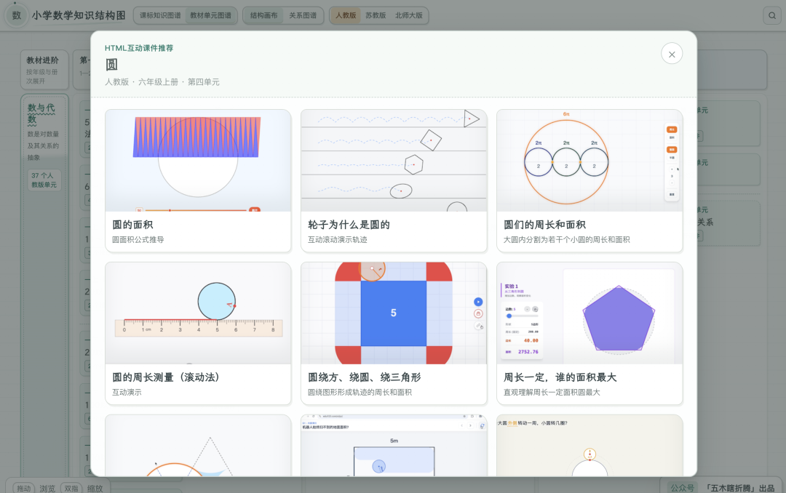
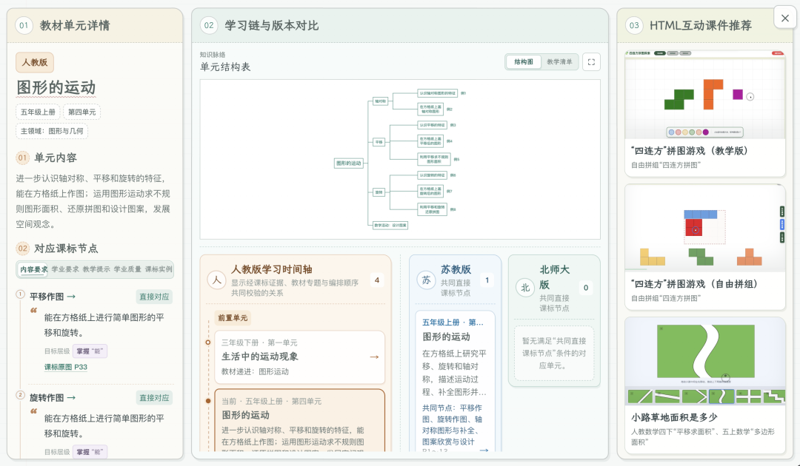

# HTML互动课件，有这些，也可以这样制作
> 💡 备注属性未写入，可能是备注属性名称或者类型被修改了，建议将字段类型设置为 rich_text，可以在小程序-操作-修改文章数据库页面进行调整
> 💡 原文链接:[https://mp.weixin.qq.com/s?__biz=MzI2MTM3NTU1NA==&mid=2247492850&idx=1&sn=fed53a054b70a2d96b4f0078e827557f&chksm=eb83bd0a0d928338608e9a80bb39770ec6291efadd7daf3f8a981f8d6786fd4763db794fc7b8#rd](https://mp.weixin.qq.com/s?__biz=MzI2MTM3NTU1NA%3D%3D&mid=2247492850&idx=1&sn=fed53a054b70a2d96b4f0078e827557f&chksm=eb83bd0a0d928338608e9a80bb39770ec6291efadd7daf3f8a981f8d6786fd4763db794fc7b8#rd)
新学年开学在即，最近 新关注的老师又多了一些 ，私信基本都是 两个问题 ：
**“有哪些互动数学工具？”**
**“如何生成这样的教学动画？”**
所以干脆整理一篇。
**01**
FIND
#### 现成的，这里有
已经把个人制作的 150+ 个 HTML 互动课件，按照教材版本单元进行了一一对应。

**小学数学知识结构图**
https://xiaoshutu.com/
同一页面还可以继续查看 单元结构、前后学习联系和相关课标内容 。

更多介绍：
[知识结构图 3.0：把 149 个互动课件装进单元图谱，助你“见木又见林，教学更直观”](https://mp.weixin.qq.com/s?__biz=MzI2MTM3NTU1NA%3D%3D&mid=2247492146&idx=1&sn=c5768bc5bd7ded74c5073b2ceb3594bf&scene=21#wechat_redirect)
[知识结构图2.0：从“看清知识点”到“摸透教材关联”，见木又见林](https://mp.weixin.qq.com/s?__biz=MzI2MTM3NTU1NA%3D%3D&mid=2247492136&idx=1&sn=e61e2f53c4b354036853284b83908ffc&scene=21#wechat_redirect)
[我给自己做了一张能交互的“小学数学知识结构图”](https://mp.weixin.qq.com/s?__biz=MzI2MTM3NTU1NA%3D%3D&mid=2247492120&idx=1&sn=e0c4503cf490b440a966bcb5559666fd&scene=21#wechat_redirect)
**02**
CREATE
#### 如何做，看合集
如果没有合适的现成工具，想自己尝试生成和制作， 具体方法不在这篇重复展开 。
之前已经把相关文章整理成 公众号合集 ：
公众号合集
**做HTML就是这么简单**
互动 HTML 课件与教学动画的相关文章，集中在这里查看。
[做HTML就是这么简单](https://mp.weixin.qq.com/mp/appmsgalbum?__biz=MzI2MTM3NTU1NA%3D%3D&action=getalbum&album_id=4334693085977690128#wechat_redirect)
[用好HTML没那么简单](https://mp.weixin.qq.com/mp/appmsgalbum?__biz=MzI2MTM3NTU1NA%3D%3D&action=getalbum&album_id=4519582525425565704#wechat_redirect)
可以照着试一试 。
如果您觉得今天这篇有收获，
欢迎 👍**点赞**、 ↗**转发**、 ♥**在看** 三连，我们下篇见。
🎉
