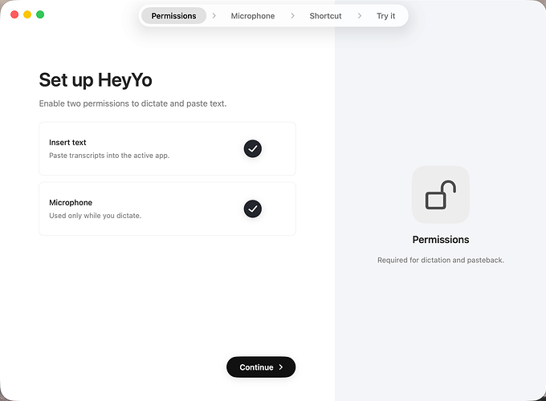
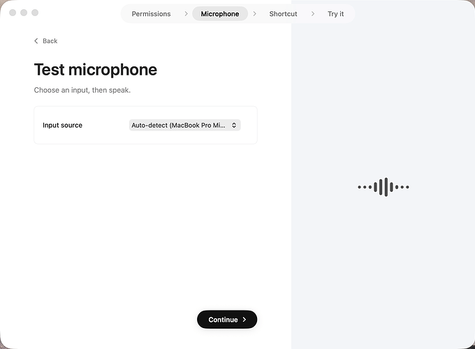
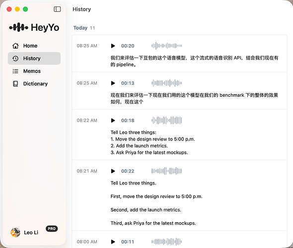
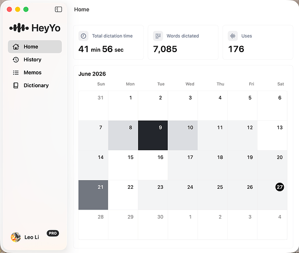
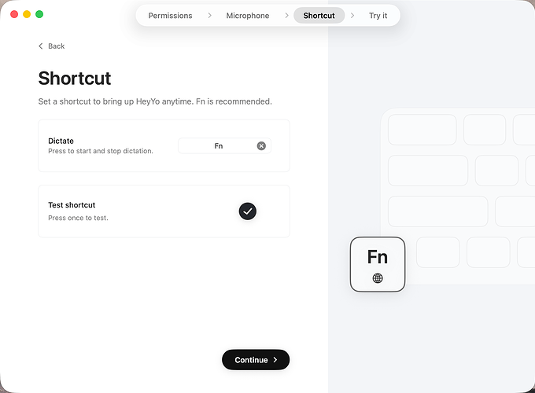
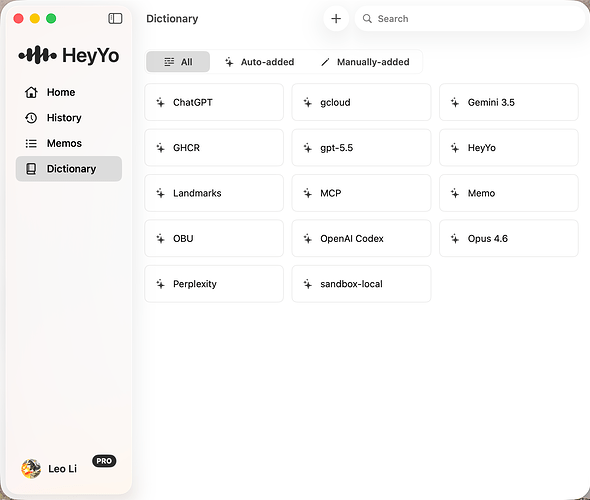
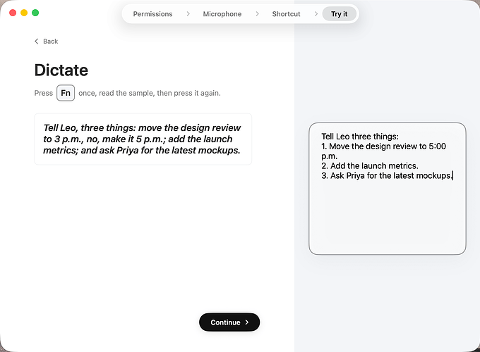

# HeyYo —— HeyYo是一款语音转文字APP，支持全局快捷键唤起录音，自动转写并清理口语化表达，将结果直接插
> 💡 备注属性未写入，可能是备注属性名称或者类型被修改了，建议将字段类型设置为 rich_text，可以在小程序-操作-修改文章数据库页面进行调整
> 原文链接:[https://mp.weixin.qq.com/s/8RoqPypAKkkOgMRbRpyeuQ](https://mp.weixin.qq.com/s/8RoqPypAKkkOgMRbRpyeuQ)
欢迎关注「小七的 AI 产品之路」
本号持续分享各行业 AI 落地实战案例、AI 产品玩法与商业思路。
回复【案例】查看往期精选；后续干货持续更新，期待一起交流成长！
### 一句话看懂
HeyYo是一款语音转文字APP，支持全局快捷键唤起录音，自动转写并清理口语化表达，将结果直接插入当前输入位置。它旨在让用户在写文档、发消息、整理笔记等场景中快速通过语音输入落成文本，不打断当前工作流。
**目标用户：**需要频繁输入文字的知识工作者，如写作者、程序员、学生、商务人士等。

### 功能亮点
- 全局快捷键唤起录音，无需切换应用
- 录音结束后自动转写并清理口语化表达
- 结果自动插入当前输入位置，失败时提供复制兜底
- 本地保留历史记录，支持回看、复制、重试和管理
- 支持自定义词典，提升人名、术语、品牌词识别稳定性
- 支持语言偏好设置
- 提供使用引导和设置页面
- 支持麦克风选择和权限管理
- 时提供复制兜底 - 本地保留历史记录，支持回看、复制、重试和管理 - 支持自定义词典，提升人名、术语、品牌词等识别稳定性 heyyo-permissions1960×1440 134 KB 【截图 1：HeyYo权限设置】 heyo-microphone1960×1440
- 记录，支持回看、复制、重试和管理 - 支持自定义词典，提升人名、术语、品牌词等识别稳定性 heyyo-permissions1960×1440 134 KB 【截图 1：HeyYo权限设置】 heyo-microphone1960×1440 83 KB 【截图 2：HeyY

### 需求 / 使用场景
- 用户需要快速将想法转化为文字，但打字速度慢或不方便
- 用户希望在写文档、发消息、记笔记时通过语音输入提高效率
- 用户需要语音转写结果能直接插入当前工作流，无需手动复制粘贴
- 用户希望转写能处理口语化表达，输出整洁文本
- 用户需要保留历史记录以便回看和复用
- 用户希望自定义词典以提升专业术语的识别准确率
- HeyYo是一个语音输入转文本的APP，目标是让用户在写文档、发消息、整理笔记、处理邮件等工作或生活场景中都可以快速通过语音输入来落成文本内容。内容会经过快速且精准的识别和Refine来达到丝滑的效果
- 本次Demo重点展示macOS桌面端的核心体验：
- 全局快捷键唤起录音，快速完成语音输入
- 录音结束后自动转写，并对口语化表达进行清理

### 痛点洞察
- 现有语音转文字工具通常需要切换到独立窗口，打断工作流
- 口语化表达转写后需要手动清理，效率低
- 转写结果无法直接插入当前输入位置，需手动复制粘贴
- 缺乏对专业术语和品牌词的识别支持，准确率低
- 历史记录管理不便，难以回看和复用
- 多端支持不足，跨设备体验不一致

### 可借鉴机会
- 将语音输入深度嵌入操作系统级快捷键，实现全局无感调用
- 结合上下文理解，针对不同APP（如邮件、笔记、聊天）采用不同的转写策略
- 提供领域词典+个人词典的混合方案，提升专业场景识别率
- 增加录音、转写和历史记录的质量评估与可视化，帮助用户优化使用习惯
如果觉得有帮助，欢迎点赞 + 在看。也欢迎在评论区聊聊你的想法。
— · —
关注本公众号
点击标题下方蓝色账号名关注，或使用下方名片一键打开主页。

#学习工作#AI产品#HeyYo
