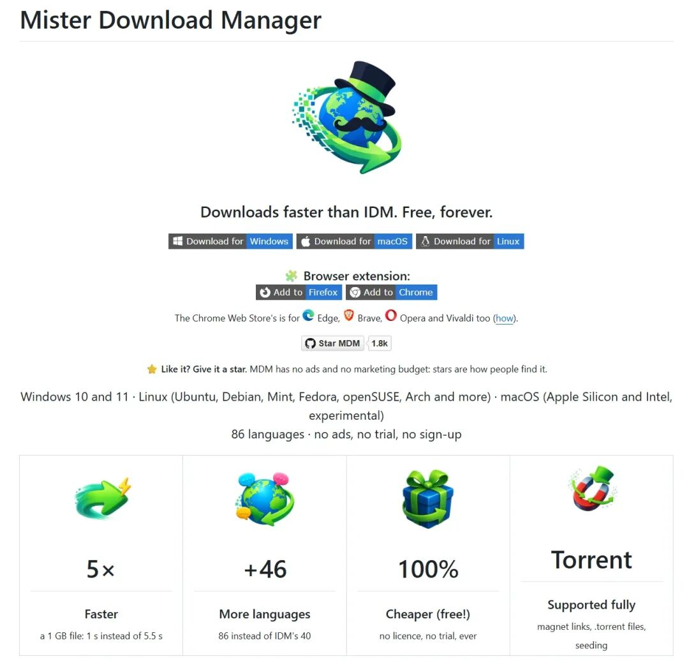
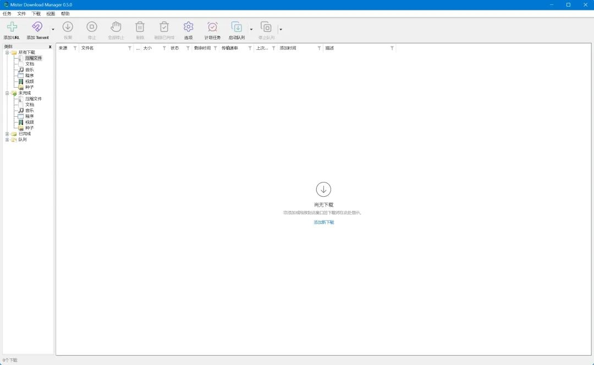
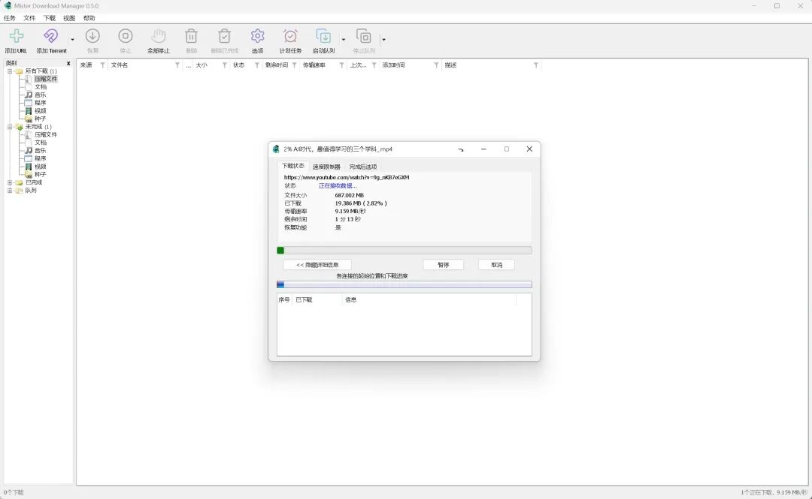
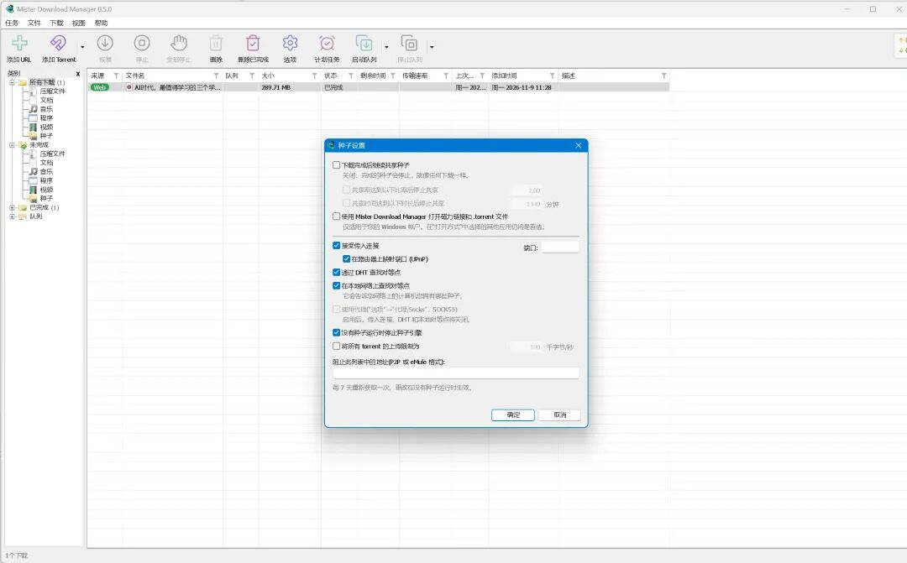
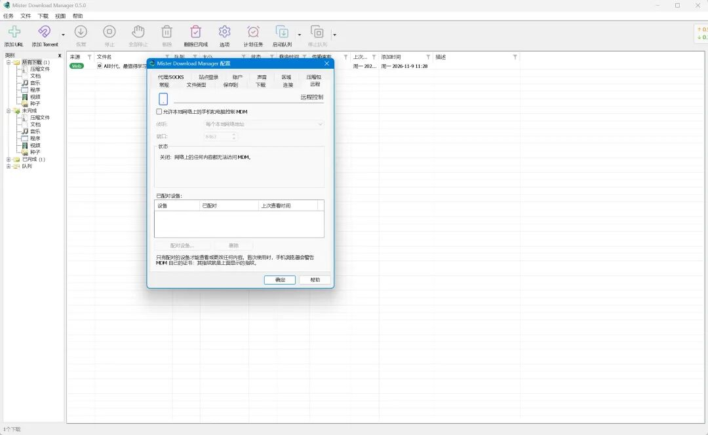

# IDM 最强平替来了！完全免费、开源，视频、磁力链接都能下载
> 💡 备注属性未写入，可能是备注属性名称或者类型被修改了，建议将字段类型设置为 rich_text，可以在小程序-操作-修改文章数据库页面进行调整
> 💡 原文链接:[https://mp.weixin.qq.com/s?__biz=MzY0MDUwNDcxNg==&mid=2247486236&idx=1&sn=7913525471ff64d0bb339e0e34209634&chksm=f176dbb0e8ab253ec085d6bec86e226bfdc67678db23e48f1b964f415976904461c98aa6dfb0#rd](https://mp.weixin.qq.com/s?__biz=MzY0MDUwNDcxNg%3D%3D&mid=2247486236&idx=1&sn=7913525471ff64d0bb339e0e34209634&chksm=f176dbb0e8ab253ec085d6bec86e226bfdc67678db23e48f1b964f415976904461c98aa6dfb0#rd)
大家好我是程序员老李。
说起电脑下载工具，很多人应该都用过 IDM，老李还是他的付费用户。
这款软件确实好用，特别是多线程加速和浏览器下载接管，还支持网页视频嗅探，体验一直不错。
不过，IDM 是收费软件，而且主要支持 Windows。如果想在 Linux 或者 macOS 上使用类似的工具，就得另外找替代品。
最近 GitHub 上出现了一个开源项目，叫 **Mister Download Manager（MDM）**。
开发者直接对标IDM，还在项目首页直接写明了 **比 IDM 更快，而且永久免费！** 这是怼脸开大呀。

这个项目 10 月 29 日才创建，短短十多天就获得了 1800 多个 Star。
我看了一下它的功能，确实有点东西。
### 一、界面几乎就是熟悉的 IDM

打开 MDM，你会发现它的界面跟 IDM 非常接近。
左边是下载分类，上面是工具栏，中间显示下载任务、进度、速度和剩余时间。
基本上不用重新学习，上手就能使用。
它把 IDM 那套常用功能也做了进来，包括多线程加速、断点续传、批量添加链接、任务队列、定时下载和速度限制。
而且支持简体中文在内的 86 种语言，最吸引人的地方当然还是免费。
**没有广告、没有试用期、无需注册账号，所有功能都可以直接使用。**
### 二、开发者宣称下载速度比 IDM 快 5 倍
MDM 使用 Rust 开发，底层实现了一套自己的多线程下载引擎。它可以将一个大文件拆成多个部分，同时建立连接下载。
比较特别的是，它还会动态调整下载任务。
比如某个连接速度特别慢，其他连接已经完成任务，MDM 可以重新拆分剩余部分，让空闲连接接着下载。
开发者还专门拿它跟 IDM 6.42 做了一组性能测试。
在本地测试环境中，下载一个 1GB 文件，IDM 用了约 5.5 秒，而 MDM 只用了约 1 秒。
当然，这个成绩来自开发者提供的本地测试，不代表所有互联网下载场景都能快 5 倍。但至少能看出，MDM 在下载引擎上确实下了功夫。
### 三、网页视频、整个播放列表都能下载
现在很多人下载的已经不只是压缩包、软件安装包了，还有各种网页视频。
老李用它测试了下载一个 687MB 的 YouTube 的视频，只需要将链接贴进去就能自动解析并下载，看下载速度已经很快了。

另外它支持浏览器扩展，可以接管 Chrome、Edge、Firefox 等浏览器中的下载任务，打开软件后会提示你安装 Chrome 或 Edge 浏览器插件，直接允许即可。
浏览网页时，扩展还可以识别页面加载的视频和音频资源，提供不同清晰度的下载选项。
对于视频网站，MDM 集成了著名的开源工具 yt-dlp。这意味着你可以下载单个视频，也可以批量下载播放列表或者频道中的视频。
字幕下载、单独提取音频、保存为 MP3 等功能也都支持。
如果遇到需要登录才能访问的视频，还可以使用浏览器中的登录状态进行下载。
除此之外，它还集成了 gallery-dl，可以批量保存部分图片网站上的图库内容。
对于经常收集视频、图片素材的人来说，一个软件就能处理这么多种下载任务，确实方便。
### 四、磁力链接、BT 种子也能直接下载

MDM 还内置了一套完整的 BT 下载功能，直接把磁力链接或者种子文件拖进去，就可以创建下载任务。
支持选择种子中的部分文件、限制下载和上传速度、管理 Tracker，以及边下边播放等功能。
甚至还支持订阅 RSS，自动添加符合条件的下载任务。
另外，它还支持 Google Drive 文件链接、批量链接抓取，以及下载完成后自动解压部分压缩文件。
以前这些功能可能需要迅雷、IDM、qBittorrent 和其他几个软件配合，现在 MDM 已经把它们整合到一起了。
### 五、连 NAS、手机远程下载都考虑到了
MDM 最新的 0.5.0 版本还加入了远程管理功能。

如果你有 NAS 或者一台长期运行的服务器，可以通过 Docker 部署它的无界面版本。
之后在同一局域网中，通过手机就能添加下载链接、查看任务进度、管理下载队列。
它还提供 MCP 接口，可以让支持该协议的 AI 智能体添加下载任务、查询下载状态。
对普通用户来说，浏览器下载、视频下载和磁力下载已经足够实用。
有 NAS 的用户还可以把它当成一套远程下载工具使用。
目前 MDM 已经提供 Windows、Linux 和 macOS 安装包，其中 macOS 版本仍处于实验阶段。
Windows 用户可以直接下载安装程序，也提供了免安装的便携版本。Linux 用户则可以选择 deb、rpm 或 AppImage 格式。
如果你还在寻找 IDM 的免费替代品，或者不想为了视频、磁力链接、普通文件分别安装好几个下载器，这个开源项目可以收藏起来试试。
**GitHub 项目地址：**
https://github.com/anefzaoui/misterdownloadmanager
**安装包下载地址：**
https://github.com/anefzaoui/misterdownloadmanager/releases/latest
**官方网站：**
https://misterdownloadmanager.com
