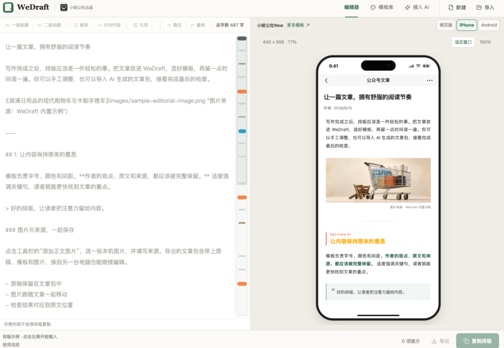

# InkOS，一个面向故事创作的 AI Agent 系统
> 💡 备注属性未写入，可能是备注属性名称或者类型被修改了，建议将字段类型设置为 rich_text，可以在小程序-操作-修改文章数据库页面进行调整
> 💡 原文链接:[https://mp.weixin.qq.com/s?__biz=MzU1NjU4MzU4Mw==&mid=2247485763&idx=1&sn=5b621bcba5b935ca8904b615fcef1719&chksm=fa0bfd4692b59d445f83558dbc25d6d56e962e8fd49774977037a008489171aa1085df93a8f6#rd](https://mp.weixin.qq.com/s?__biz=MzU1NjU4MzU4Mw%3D%3D&mid=2247485763&idx=1&sn=5b621bcba5b935ca8904b615fcef1719&chksm=fa0bfd4692b59d445f83558dbc25d6d56e962e8fd49774977037a008489171aa1085df93a8f6#rd)

一个 1 万星开源项目，把 AI 写长篇从提示词玄学变成了状态工程
如果你试过让 AI 写长篇，大概率撞过同一堵墙。
前三章惊艳，第八章开始角色失忆、伏笔不回收、时间线互相打架。
你以为问题出在模型不够强，于是换更强的模型、写更长的提示词、把更多前文塞进上下文。
然后它崩得更晚一点，但终究还是会崩。
最近我在 GitHub 上翻到一个项目，给出的答案不太一样。
它叫 **InkOS**，仓库在 github.com/Narcooo/inkos，截至 2026 年 11 月 2 日 **10970 星**，TypeScript 编写，AGPL-3.0 协议。
它的自我介绍是「面向长短篇小说、剧本剧作、互动影游、IP 内容与多语言翻译的创作智能体系统」。
这句话里真正值钱的是**「系统」**两个字，不是「创作」。
**01**
**把创作拆成一条可追溯的流水线**
多数 AI 写作工具是一条直线，你给提示词，模型吐正文。InkOS 把它拆成了八个角色，每个角色只干一件事。
**雷达 Radar** 扫平台趋势和读者偏好，用来指导故事方向，可插拔也可以整个跳过。
**规划师 Planner** 读作者意图、当前焦点和记忆检索结果，产出这一章的意图，明确写出 must-keep 和 must-avoid。
**编排师 Composer** 从结构化状态、控制文档和素材里按任务挑上下文，并完整记录保护层级、检索结果和语义压缩的 trace。
**建筑师 Architect** 在建书、导入或番外初始化时生成故事框架、书级规则、角色卡和长期控制文件。
**写手 Writer** 只拿到编排后精简过的上下文写正文，同时受字数治理和对话引导约束。
**状态结算 Settler** 不直接改文件，而是通过类型化工具提交有证据的增量 delta，由宿主校验后再应用。
**审稿 Agent** 对照作者意图、正典、状态、章节计划和审稿 Skill，返回有证据的定性观察。
**修订者 Reviser** 接受明确修改目标，生成并原子落盘新版本。
这里有两个词值得单独拎出来，**原子落盘**，和**可追溯**。
章节正文和故事状态作为同一组产物提交，每章自动创建状态快照，文件锁与 Action 队列防止并发写入，中断会留下可恢复状态。
**02**
**记忆分三层，权威只有一份**
这是整个项目里我觉得设计得最清醒的部分。
**第一层 · story/state/*.json**
权威结构化状态，当前状态、伏笔、章节摘要都在里面，全部经过 Zod schema 校验。
**第二层 · story/*.md**
人类可读投影，包括 current_state、pending_hooks、chapter_summaries、character_matrix，方便你直接打开看。
**第三层 · story/memory.db**
SQLite FTS5 与 BM25 的检索投影，可以随时重建，明确不作为故事事实的权威。
三层各有分工，避开了那种 Markdown 既是存储、又是检索、又是事实来源的混乱。
坏数据会被直接拒绝，伏笔的 lastAdvancedChapter 必须是整数，status 只能在 open、progressing、deferred、resolved 四个值里取值，模型输出的 JSON delta 在写入前要过 immutable 更新和结构校验。
文档里那句「不会滚雪球」，说得挺实在。
**03**
**审稿不替你下结论**
很多写作工具喜欢给章节打个分，判个通过失败。InkOS 明确不做这件事。
它的连续性审查会从角色记忆、物资连续性、伏笔回收、大纲偏离、叙事节奏和情感弧线这些维度，记录具体的 observation。
如果角色记起了从未亲眼见过的事，或者拿出了两章前已经丢失的武器，审计会捕捉到并记下来。
但 observation 只是可追溯的创作反馈，不会把章节改写成某种完成态。改不改，由你或 Agent 显式发起修订。
去 AI 味也是同一个逻辑，由可替换的 inkos-story-deslop Skill 提供语义方法，需要时显式调用 revise --mode anti-detect，不存在一张隐藏词表在背后自动改你的稿。
**这个克制，我挺欣赏。**
**04**
**几个让人眼前一亮的细节**
**剧情多线推演。** 在写下一章之前，可以基于当前正史生成 2 到 5 条彼此隔离的未来分支，横向比较章节节拍、人物决定、预计变化、风险和作者意图匹配度。采用某条分支只会保存一份候选计划，不会修改正文、大纲或正史状态，正史变化之后旧的推演会被标记为过期。
**字数治理。**--words 指定的是目标字数，系统自动推导允许区间，不承诺逐字精确命中，中文按 zh_chars 计数，英文按 en_words 计数。关键是它不会截断正文，也不会因为长度偏差把章节标成失败，只在章节索引和结果里记录结构化遥测。
**输入治理控制面。** 每本书有两份长期可编辑的控制文档，author_intent.md 写这本书长期想成为什么，current_focus.md 写最近一到三章要把注意力拉回哪里。再加上每章的 intent、context、trace 三个运行时文件，brief、卷纲、书级规则和当前任务不再混成一坨提示词，而是先编译、再写作。
**同人与续写。**inkos fanfic init --from source.txt --mode canon 支持 canon、au、ooc、cp 四种模式，内置正典导入器和信息边界管控。inkos import chapters 可以从已有小说文本导入章节，自动重建结构化状态、章节摘要、伏笔和角色关系，支持断点续导。
**多模型路由。** 不同 Agent 可以走不同模型和 Provider，写手用创意强的，审计用便宜快的，雷达用本地零成本的，按 agent 粒度配置，未配置自动回退全局模型。
**守护进程与推送。**inkos up 启动后台循环自动写章，能自动推进的就推进，需要人工判断的暂停并留下可审结果。通知可以推到 Telegram、飞书、企业微信和 Webhook，带 HMAC-SHA256 签名与事件过滤，日志写成 JSON Lines。
**05**
**怎么上手**
需要 Node.js 22.16 或更高版本，一条命令，npm i -g @actalk/inkos。
它提供 Studio 网页端、TUI 和 CLI 三种交互，底层共享同一套执行内核。网页版已经上线，如果你用 OpenClaw 或 Claude Code 这类兼容 Agent，clawhub install inkos 就能把它当 Skill 直接调用，入口是 inkos interact。
想写第一本书，用 inkos book create --brief my-ideas.md 把脑洞、世界观或人设文档丢进去，Architect 会生成故事框架、卷纲、角色卡和书级规则。
**06**
**我的判断**
**AI 写长篇真正的瓶颈，从来不是「生成一段漂亮的文字」，而是「几十万字之后，还记得第二章埋的那把刀」。**
前者是模型能力问题，后者是工程问题。
InkOS 的价值在于，它把后者从提示词玄学变成了状态工程，权威状态只有一份、可校验、可追溯，审稿只给观察不替你下结论，修订永远是可回退的显式动作。
它没有许诺一键出神作，你要真去用它，大概率还是得自己改稿、自己拍板。但它给了你一本不会越写越乱的账本，对真的在写长篇的人来说，这才是最稀缺的东西。
项目目前仍在快速迭代，2.0 版本刚把底层统一到 pi-agent harness。有兴趣可以去仓库看看，也可以留意它的后续更新。
· · ·
我是 DrinkCode，写代码，也写代码之外的事。
如果觉得今天这篇有收获，欢迎点赞、在看、转发三连。
