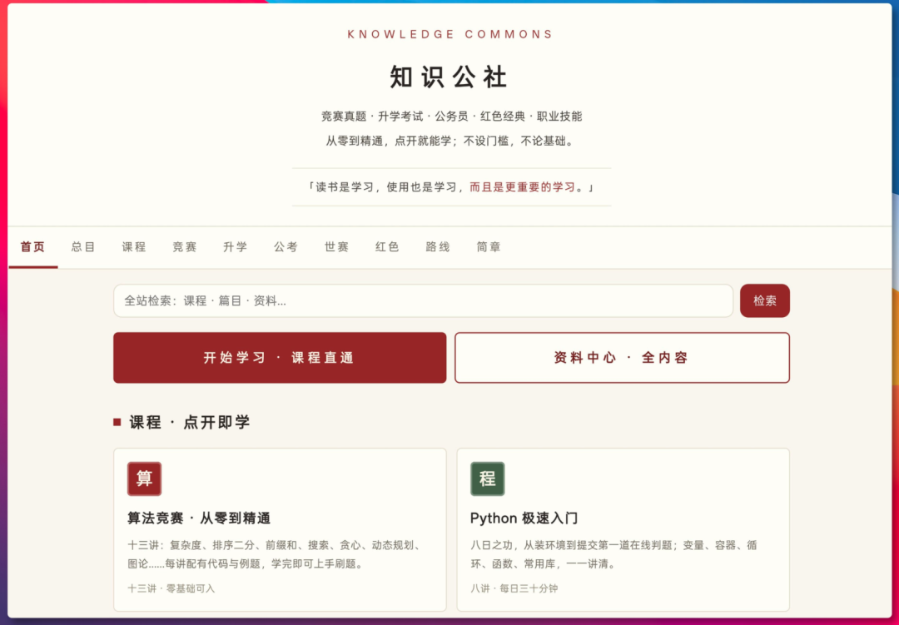
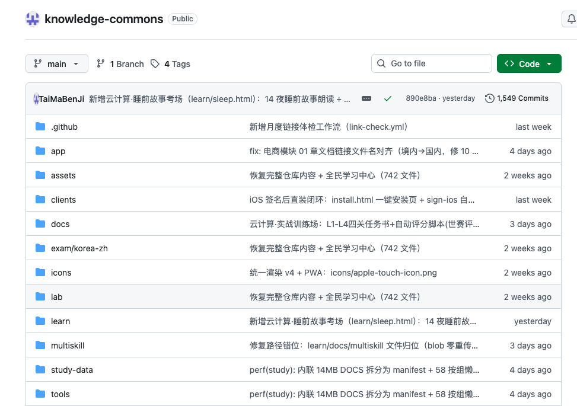

# Knowledge Commons：把散落网上的学习资料，直接塞进一个离线 App
> 💡 备注属性未写入，可能是备注属性名称或者类型被修改了，建议将字段类型设置为 rich_text，可以在小程序-操作-修改文章数据库页面进行调整
> 💡 原文链接:[https://mp.weixin.qq.com/s?__biz=Mzg4NTkyMDg1Mg==&mid=2247507017&idx=1&sn=ad206c5bf8733c72c0d2bab34d12c28e&chksm=cefd50c06a59b0d9a1cc1e0b5f9b90283dd26469e0e4a466bbd77fe709867b4432e8aa74a696#rd](https://mp.weixin.qq.com/s?__biz=Mzg4NTkyMDg1Mg%3D%3D&mid=2247507017&idx=1&sn=ad206c5bf8733c72c0d2bab34d12c28e&chksm=cefd50c06a59b0d9a1cc1e0b5f9b90283dd26469e0e4a466bbd77fe709867b4432e8aa74a696#rd)
最近刷到一个挺有意思的开源项目，叫 **Knowledge Commons**。
它解决的不是“没有学习资料”，而是很多人每天都会遇到的那个破事：资料太多，但根本不会整理。
想刷算法竞赛题，搜一圈全是过期网盘；准备专升本、公考，收藏夹塞满了各种 PDF 和课程，真开始学的时候反而不知道从哪下手。
这个项目的思路有点狠，直接把这些公开学习资源收集起来，分类整理，再做成一套学习路线，塞进一个 App 里。
里面目前整理了不少内容。

算法这块，Codeforces 有 1.1 万多道题，AtCoder 也有 9600 道题，都支持离线搜索。还有蓝桥杯题解、公考图形推理真题解析这些内容。
另外世界技能大赛 50 个赛项也被收进来了，每个赛项不是简单丢个目录，而是有总纲、视频课、模拟训练，还配了一节“第一课”，告诉你这东西是干嘛的，第一步该学什么。
东哥看到这种项目，第一反应一般不是“资源多牛”，而是看它有没有把学习路径捋顺。
因为开发者最懂这种痛点：资料下载一堆，最后卡在环境、版本、入口，学两天就放弃。以前折腾内部 demo 的时候，最烦的也是文档散、链接失效、没人告诉你下一步干啥。

Knowledge Commons 还有一点比较舒服，网页打开就能用，添加到手机主屏幕后可以像 App 一样离线访问。安卓、苹果、Windows、Mac、Linux 都提供安装包。
当然，这类项目最大的难点一直不是把资料搬进去，而是后面怎么维护。课程更新、题库同步、资源质量，这些都挺考验长期运营。
不过能把这么多学习内容整理成一个入口，这个工作量本身就不小。对于那些刚开始学编程、准备考试，或者想系统补基础的人来说，这种“先把路铺干净”的工具，确实省掉不少折腾时间。
**项目地址：**github.com/TaiMaBenJi/kno
