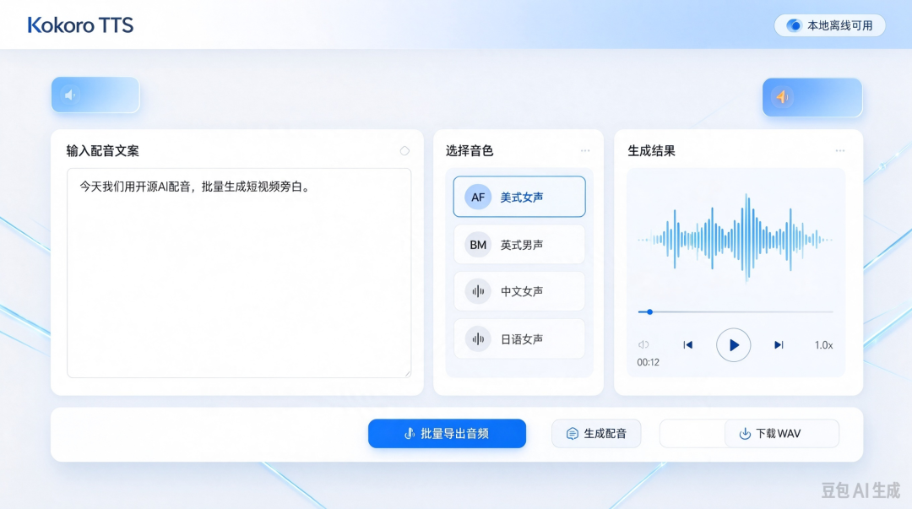

# Kokoro｜开源免费 AI 配音，批量做短视频，省下配音软件订阅费
> 💡 备注属性未写入，可能是备注属性名称或者类型被修改了，建议将字段类型设置为 rich_text，可以在小程序-操作-修改文章数据库页面进行调整
> 💡 原文链接:[https://mp.weixin.qq.com/s?__biz=MzY5MTM0MTI1MA==&mid=2247483721&idx=1&sn=b5a30cf6219859dbbce6ef604f3058a1&chksm=f5aaad2ccc87f509fa2ab148bf84cbffa68f6499c86f8b320269b45c856c11a2b48ba62cc03e#rd](https://mp.weixin.qq.com/s?__biz=MzY5MTM0MTI1MA%3D%3D&mid=2247483721&idx=1&sn=b5a30cf6219859dbbce6ef604f3058a1&chksm=f5aaad2ccc87f509fa2ab148bf84cbffa68f6499c86f8b320269b45c856c11a2b48ba62cc03e#rd)
 做短视频矩阵、知识科普、英语故事账号，很多人每个月要花钱买 AI 配音会员。批量产出几十上百条视频，配音订阅成本日积月累，开销并不小。
 今天分享开源项目Kokoro，Apache‑2.0 协议开源，可商用的轻量 AI 语音合成模型。本地离线运行，支持批量生成配音音频，做 10 条、50 条、100 条短视频都不用反复消耗付费额度，适合自媒体创作者。
项目地址：https://github.com/hexgrad/kokorocdn-avatar...
> 提示：适合短视频旁白、故事、科普配音；英文音色效果最优，中文、日语、法语等多语言也支持，适合外语类账号。
> 
### 🎤 Kokoro 是什么？

 Kokoro‑82M，仅 8200 万参数，模型文件约 350MB，体积很小，普通电脑 CPU 就可以跑，不需要高端显卡也能生成配音音频。区别于各类云端付费配音工具，可以完全本地离线运行，文本不上传到第三方服务器，支持批量脚本批量导出 wav 音频文件，协议允许商用，自媒体可以直接拿来做短视频内容。
 内置几十套预设音色，美式英语、英式英语、中文、日语、法语、西班牙语等多语言，男女声齐全，语调自然，不会机械生硬。
### ✨核心亮点
✅轻量模型，普通电脑就能跑模型体积仅 350MB，不需要高性能 GPU，笔记本 CPU 就可以推理生成音频，也支持 GPU 加速大幅提升速度。
✅支持批量生成，适配短视频矩阵支持批量脚本处理，一次性导入多篇文案，批量输出多条配音音频。不管是 10 条、50 条还是上百条短视频脚本，一次性批量导出，适合矩阵号高效生产内容，省去重复复制粘贴的操作。
✅多语言多音色，适合多种账号赛道内置 50 + 预设音色：美式 / 英式英语、中文普通话、日语、法语、西班牙语等。
- 英语故事、英语启蒙账号：英文音色表现力最好，叙事感强；
- 知识科普、短视频解说：选择沉稳男女旁白音色；
- 多语种账号，可以切换对应语种音色。
✅Apache‑2.0 开源协议，允许商用开源权重，个人、自媒体商用都合规，不用受云端平台版权约束，生成的音频归属自己。
✅本地离线，隐私可控全部文本、音频在本机完成，不需要把脚本上传第三方云端；也可以部署成 API 服务，供自己其他工具调用。
✅可调节语速、混合音色自由调整朗读速度；支持音色混合，调配出属于自己的独特配音风格，避免全网 AI 配音撞音。
### 🎯适合哪些创作者
- 短视频矩阵运营：大批量产出科普、解说短视频，不想按月买配音会员；
- 英语故事、外语启蒙账号：大量英文旁白，英文音色表现优秀；
- 知识科普、读书号、有声小故事，需要大量旁白音频；
- 技术爱好者：私有化部署，搭建自己内部配音服务。
> ⚠️重要局限
> 
1. 不支持声音
1. 克隆，只有内置预设音色，不能模仿真人声音；
1. 英文效果最佳，中文、其他语种音色数量较少；
1. 需要安装依赖，纯小白建议先体验 HuggingFace 线上 Demo 感受效果。
### 🛠️使用方式
#### 方式一：线上 Demo 体验（小白优先）
Hugging Face 在线演示，无需安装，直接输入文字试听音色效果。
#### 方式二：本地部署（适合批量生成，创作者首选）
> 环境要求 Python3.10‑3.12，推荐 uv 包管理器，需要系统依赖 espeak‑ng。
> 
```
# 1.安装uv
      
# Windows PowerShell
      
irm https://astral.sh/uv/install.ps1 | iex
      
# Mac / Linux
      
curl -LsSf https://astral.sh/uv/install.sh | sh
    
  
```
```bash
# 2.拉取项目
      
git clone https://github.com/hexgrad/kokoro.git
      
cd kokoro
      
# 3.创建虚拟环境
      
uv venv
      
# Mac/Linux激活
      
source .venv/bin/activate
      
# Windows PowerShell
      
.venv\Scripts\Activate.ps1
      
      
# 4.安装依赖
      
uv pip install -r requirements.txt
    
  
```
> 批量生成：运行项目提供的批量脚本，传入多篇文案，自动批量输出音频文件，一次性产出几十上百条短视频配音。
> 
#### 进阶玩法
1. 封装本地 API，对接剪辑工具，一键生成配音；
1. ONNX 版本，进一步降低硬件门槛，低配置电脑更流畅； 
1. 搭配脚本工具，读取 txt 文案文件夹，批量导出音频。
### ⚠️避坑提醒
1. 系统依赖 espeak‑ng 必不可少，Windows 需要手动安装，否则会报错无法生成语音；
1. Python 版本限定 3.10‑3.12，3.13 版本会出现依赖兼容问题；
1. 英文音色质量最优，中文效果不如英文，预期合理；
1. 协议允许商用，但不要用于违法、虚假内容；
1. 首次运行会自动下载模型权重，需要联网；下载完成后可以离线使用。
### 💡开源应用阁小结
市面上 AI 配音工具，大多按月按字符收费，批量做短视频矩阵，成本会持续累加。Kokoro 最大价值就是一次性部署，无限次生成配音音频，批量产出短视频旁白，适合自媒体降本。英文账号优先体验；中文账号可以先在线 Demo 试听，确认音色满足自己需求再本地部署。
> 项目仓库：https://github.com/hexgrad/kokoro
> 阅读原文填入上面仓库链接。
> 
👇点赞 + 在看，分享给做短视频的创作者朋友！
