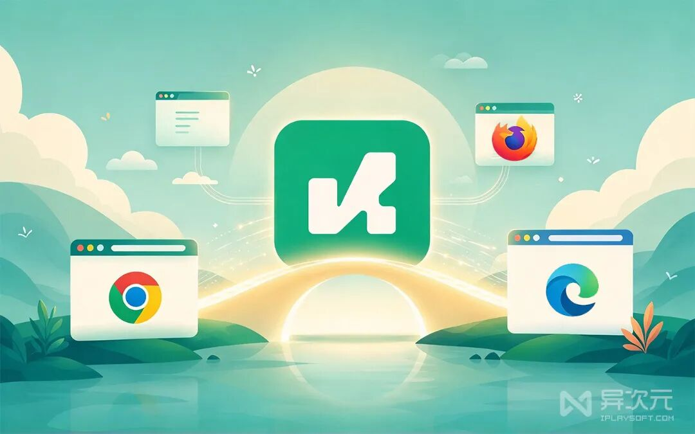
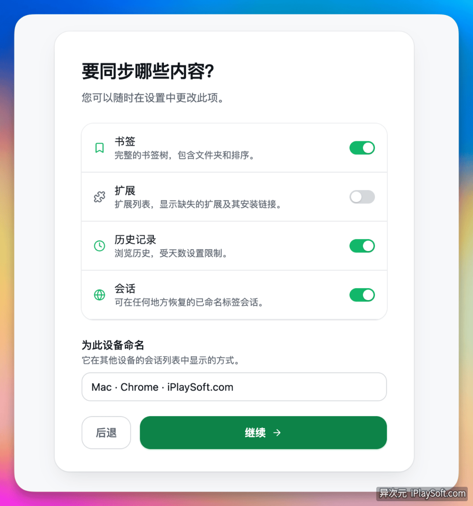
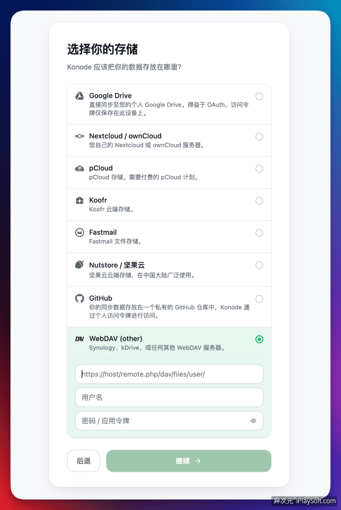
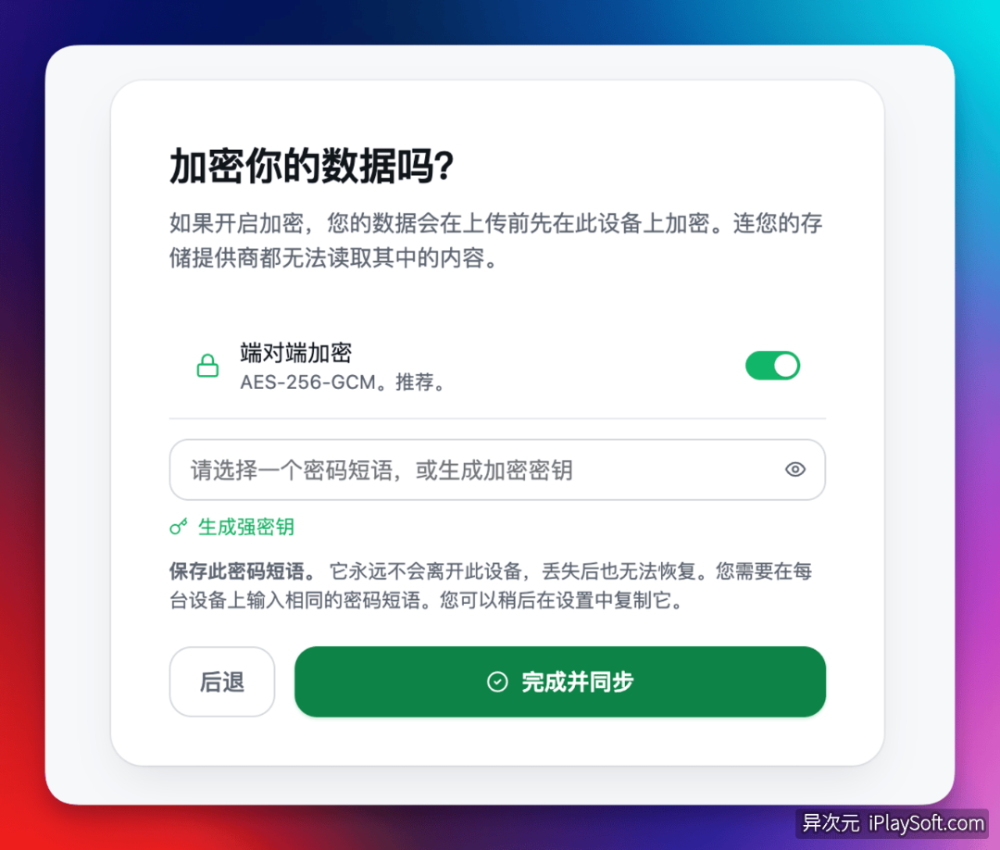

# Konode - 开源浏览器同步工具！跨 Chrome/Edge/Firefox 同步书签/标签页/历史
> 💡 备注属性未写入，可能是备注属性名称或者类型被修改了，建议将字段类型设置为 rich_text，可以在小程序-操作-修改文章数据库页面进行调整
> 原文链接:[https://mp.weixin.qq.com/s/RsLOMCCRNEnjNe4wQi6wxA](https://mp.weixin.qq.com/s/RsLOMCCRNEnjNe4wQi6wxA)

同时用 [Chrome](https://mp.weixin.qq.com/s?__biz=MjM5NjExODEyMA%3D%3D&mid=2247489103&idx=2&sn=df6253caa9c98a0f03feaa49dfd9ff30&scene=21#wechat_redirect)、[Edge](https://mp.weixin.qq.com/s?__biz=MjM5NjExODEyMA%3D%3D&mid=2247485131&idx=1&sn=52965416a4d79156dfa443b9ec8ea75a&scene=21#wechat_redirect)、Firefox 的人应该都懂这种折磨：书签各存各的，历史各记各的，标签页更是灾难现场。公司电脑 Chrome 打开过或收藏过的网页，回到家打开 Edge 一个都找不到。
谷歌 Chrome 同步必须 Google 账号 + 魔法，Edge、Firefox 等各自为营，账号独立不相通，非常烦人。很多人想找一种免魔法、能**跨浏览器 / 跨设备的同步**方案，把不同浏览器的收藏夹、标签页、浏览历史全打通，且数据保存在自己手里。[开源](https://mp.weixin.qq.com/s?__biz=MjM5NjExODEyMA%3D%3D&mid=2247497321&idx=5&sn=503c4acbb87fba2f48ce4c101d275089&scene=21#wechat_redirect)免费的 **Konode** 正好解决了这个问题……
**↓ 查看：支持 WebDAV 的网盘 ↓**

**https://iplaysoft.com/go/wangpan**
「或复制网址到浏览器打开」
---
**↓ PicSeed - 跨 APP 通用收藏夹 ↓**

**https://iplaysoft.com/picseed.html**
「或复制网址到浏览器打开」
**↓ Cubox - 网络内容收集+阅读器 ↓**

**https://iplaysoft.com/cubox.html**
「或复制网址到浏览器打开」
#### Konode - 免费跨浏览器同步工具，免注册！支持 WebDAV！
Konode 是一款开源免费的浏览器数据同步扩展，**可以让 **[**Chrome**](https://mp.weixin.qq.com/s?__biz=MjM5NjExODEyMA%3D%3D&mid=2247489103&idx=2&sn=df6253caa9c98a0f03feaa49dfd9ff30&scene=21#wechat_redirect)** 免魔法走自建私有同步！无需谷歌账号，国内无障碍直接同步**。同时，它还支持所有 Chromium 系浏览器 (如 Chrome、Edge、Brave 等) 以及 Firefox 系(包括 Waterfox) 的同步。

也就是说，Konode 好用的地方是，它不仅支持同一种浏览器跨设备同步，它还**可以在 Chrome 和 Firefox 之间跨内核互相同步**，这是任何一家官方自带同步都做不到的事。
Konode 所有数据都是加密后保存在你自己指定的[网盘](https://mp.weixin.qq.com/s?__biz=MjM5NjExODEyMA%3D%3D&mid=2247498912&idx=1&sn=6a0e9e7760f203085903bca196940e23&scene=21#wechat_redirect)、[VPS 服务器](https://mp.weixin.qq.com/s?__biz=MjM5NjExODEyMA%3D%3D&mid=2247508609&idx=1&sn=ce7c2749d23148e0e1d3133f9e9ffa0e&scene=21#wechat_redirect) (自建 WebDAV 服务)，不需注册账号，不需订阅付费，隐私和安全拉满！
Konode 能同步四类数据：书签 / 收藏夹、打开的标签页、浏览历史、已安装扩展列表。
- **书签 / 收藏夹: **会保留完整的文件夹层级和嵌套结构，增删改、移动、重排都能双向同步；
- **标签页: **以“会话快照”的形式保存，换设备一键恢复，相当于把整个浏览现场从一台机器无缝搬到另一台；
- **历史记录: **会去重合并，任意设备上都能搜到全部浏览记录，不再每台电脑各自记一本碎片账；
- **扩展列表**：只同步清单，方便新机器核对缺了哪些扩展，不会自动安装或卸载任何东西，全部由你手动确认。
要注意的是，密码、Cookie、自动填充等敏感数据它故意不同步。Konode 的定位是“浏览器场景同步”而不是“密码凭据管理”，这类数据官方建议交给 [Sticky Password](https://mp.weixin.qq.com/s?__biz=MjM5NjExODEyMA%3D%3D&mid=2247507601&idx=1&sn=3833fce429cf31537d3c6b4b0b74bf43&scene=21#wechat_redirect)、[Bitwarden](https://mp.weixin.qq.com/s?__biz=MjM5NjExODEyMA%3D%3D&mid=2247508641&idx=1&sn=a24864c82b10772771599ff5c00d6322&scene=21#wechat_redirect) 或 [1Password](https://mp.weixin.qq.com/s?__biz=MjM5NjExODEyMA%3D%3D&mid=2247489286&idx=1&sn=6ccced5cc78fac574dabdc47f8403778&scene=21#wechat_redirect) 这类专业**密码管理器**。这个取舍我认为更合理，专业事情交还给专业工具去做。

#### 支持 WebDAV，数据全在自己手里！没有中间商偷隐私
Konode 不提供云存储、不需要注册账号、数据不流经中间服务器，也不收集任何遥测数据。扩展只做管道，数据直接写进你指定的存储，比如在你自己 VPS 服务器上自建私有 WebDAV，或使用 [Koofr](https://mp.weixin.qq.com/s?__biz=MjM5NjExODEyMA%3D%3D&mid=2247509087&idx=1&sn=7b2c466c4d673079de2200d75ca90dec&scene=21#wechat_redirect)、[Scramble](https://mp.weixin.qq.com/s?__biz=MjM5NjExODEyMA%3D%3D&mid=2247509521&idx=1&sn=444ac977e0b476e63bf217569df62bee&scene=21#wechat_redirect)、坚果云、123 盘等支持 WebDAV 的[网盘](https://mp.weixin.qq.com/s?__biz=MjM5NjExODEyMA%3D%3D&mid=2247498912&idx=1&sn=6a0e9e7760f203085903bca196940e23&scene=21#wechat_redirect)。而如果你使用夸克网盘、百度网盘、115 网盘等，也可以借助[「OpenList」](https://mp.weixin.qq.com/s?__biz=MjM5NjExODEyMA%3D%3D&mid=2247506812&idx=1&sn=67b9e4c60f405bad1018b175d3de1649&scene=21#wechat_redirect)转换成 WebDAV。

目前 Konode 后端支持存储有这几类：
| **后端** | **说明** | **适用场景** |
| WebDAV | [VPS 自建](https://mp.weixin.qq.com/s?__biz=MjM5NjExODEyMA%3D%3D&mid=2247508609&idx=1&sn=ce7c2749d23148e0e1d3133f9e9ffa0e&scene=21#wechat_redirect)、[Koofr](https://mp.weixin.qq.com/s?__biz=MjM5NjExODEyMA%3D%3D&mid=2247509087&idx=1&sn=7b2c466c4d673079de2200d75ca90dec&scene=21#wechat_redirect)、坚果云、[Scramble](https://mp.weixin.qq.com/s?__biz=MjM5NjExODEyMA%3D%3D&mid=2247509521&idx=1&sn=444ac977e0b476e63bf217569df62bee&scene=21#wechat_redirect)、Nextcloud、pCloud 等 | NAS / 已有私有网盘用户 |
| GitHub | 指定一个私有仓库，每次同步产生一个 commit | 极客向，书签天然带版本历史 |
| Google Drive | 仅适合海外用户，省事 | 只申请 drive.file 窄权限，只能碰到 Konode 自己创建的文件 |
对于开发者来说，选 GitHub 后端也有个隐藏彩蛋：每次同步就是一次 commit，书签直接有了版本管理，可以 diff，甚至可以手动回滚。这个设计估计能戳中很多开发者的心。
#### 加密同步：存储商只能看到乱码
加密是可选的，在设置向导里开启，选完之前不会上传任何数据。开启 `AES-256-GCM` 端到端加密后，存到网盘里的就是密文。实测把书签加密同步到网盘后，打开里面的 JSON 文件全是乱码的。所以，开启加密后，就算你不小心把 GitHub 仓库设成了公开，别人拿到的也只是一堆密文，完全读不出你的任何数据。

代价是密钥一旦丢失，加密数据就永久无法恢复。所以密钥一定要备份进密码管理器，或者离线存到安全介质，这一步偷懒不得。
#### 几个使得 Konode 变好用的细节
- **墓碑机制**：两台设备同时操作书签时，删除操作会被记录成“墓碑”事件，优先级高于普通更新，这样旧设备就不会把已经删掉的书签“复活”。很多同步工具恰恰就栽在这一步上，删掉的书签过几天又自己冒出来。
- **恢复点 (Restore Points)**：如果检测到异常的大批量删除请求，会自动阻断并提供安全恢复，防止整个书签树被误删。这种防呆设计做到位了。
- **冲突解决**：Konode 提供 4 种冲突策略，日常使用推荐“最后一次写入为准”，两台设备同时改同一个书签，时间戳晚的赢。重度编辑书签的用户可以再研究合并、手动等其他策略，普通用户完全不用纠结。
#### 架构上的讲究，更安全
Konode 的数据链路是“浏览器扩展 + 本地同步端 + 云盘”三层。扩展只负责调用浏览器 API 读写书签、历史和标签页；本地同步端常驻运行，监听 `127.0.0.1` 端口，负责加密、压缩、追加写入云盘日志文件，同时定期拉取其他设备产生的新事件。云端文件采用事件日志加定期快照的组织方式，增量上传，不会每次全量重写把流量打穿。
这样分层还有个额外好处：WebDAV 账号密码放在同步端里配合系统密钥环管理，比塞进浏览器扩展安全得多；存储后端随时想换就换，浏览器端基本无感知。
#### 支持的浏览器
| **浏览器** | **支持情况** |
| [Chrome](https://mp.weixin.qq.com/s?__biz=MjM5NjExODEyMA%3D%3D&mid=2247489103&idx=2&sn=df6253caa9c98a0f03feaa49dfd9ff30&scene=21#wechat_redirect)、[Edge](https://mp.weixin.qq.com/s?__biz=MjM5NjExODEyMA%3D%3D&mid=2247485131&idx=1&sn=52965416a4d79156dfa443b9ec8ea75a&scene=21#wechat_redirect)、Brave、Helium、ungoogled-chromium | 完整支持 |
| FireFox、Waterfox | 完整支持 |
| Firefox for Android | 仅支持标签页同步 |
| Orion (WebKit) | 可用，但非正式支持目标，Google Drive 登录不可用 |
| Safari | 不支持，需要原生 App 包装 |
#### Konode 和 Floccus、xBrowserSync 相比怎样？
市面上跨浏览器同步工具其实不少，但 **Floccus**、**xBrowserSync**、EverSync 只能搬运收藏夹，而且 EverSync、xBrowserSync 要收费还要依赖厂商的服务器，国内访问经常连不上。**Konode 额外支持同步已打开标签页、历史记录、扩展列表**，还带可选的「全量加密」和 GitHub commit 版本历史。

如果你只需要同步浏览器书签，已经有 Floccus 在用的朋友完全不用折腾；但想要“整个浏览现场”级别的同步，Konode 目前是开源项目里功能更完整的那个。
#### 上手要点和踩坑记录
第一次配置，强烈建议按这个流程来：
1. 折腾前先[备份](https://mp.weixin.qq.com/s?__biz=MjM5NjExODEyMA%3D%3D&mid=2247501511&idx=3&sn=08b4ba177aca9fc6d65b4bfb79f6982f&scene=21#wechat_redirect)，把原浏览器的书签导出一份存盘，给自己留好退路
1. 找一台不常用的测试机，只勾选“书签”做单项同步，确认云盘里生成了数据文件
1. 换另一款浏览器接入，确认书签已经跨浏览器出现
1. 整条链路没问题后，再逐步开启历史记录和标签页同步
1. 无法访问谷歌 Chrome 商店的用户，或使用任意 Chromium 内核的浏览器，可从 Github 下载 .zip 插件载入 ([Chrome 安装扩展教程](https://mp.weixin.qq.com/s?__biz=MjM5NjExODEyMA%3D%3D&mid=2247489286&idx=2&sn=583e8b5d36f4019632636ae2d719dc56&scene=21#wechat_redirect))
**几个实测踩过的坑提前说：**
**WebDAV** 连不上，九成是密码问题。很多网盘的主登录密码不能当 WebDAV 密码用，要去设置里生成“应用专用密码”，比如坚果云会在安全选项里生成一长串随机字符串，粘贴时如果混进一个空格，就会一直报错，排查半天查不到原因。
本地同步端默认监听 `127.0.0.1`，不要改成 `0.0.0.0`，否则局域网内其他设备也能读写你的云盘数据。首次同步历史记录是一次大量写入，配置有误轻则失败重则冲掉云端旧数据，所以第一条说的备份一定要做。
#### 总结：
如果你同时用多个不同浏览器，需要同步数据；或者公司、家里多台电脑需要跨设备同步，并且想要将收藏夹、标签页、浏览记录甚至扩展插件都同步，那么 Konode 是绝佳选择。
Konode 不仅[开源](https://mp.weixin.qq.com/s?__biz=MjM5NjExODEyMA%3D%3D&mid=2247497321&idx=5&sn=503c4acbb87fba2f48ce4c101d275089&scene=21#wechat_redirect)完全免费，无需注册账号，而且**所有数据都是保存在自己指定的 WebDAV** (可以是[自己的 VPS](https://mp.weixin.qq.com/s?__biz=MjM5NjExODEyMA%3D%3D&mid=2247508609&idx=1&sn=ce7c2749d23148e0e1d3133f9e9ffa0e&scene=21#wechat_redirect)、NAS 也可以是[各大网盘](https://mp.weixin.qq.com/s?__biz=MjM5NjExODEyMA%3D%3D&mid=2247498912&idx=1&sn=6a0e9e7760f203085903bca196940e23&scene=21#wechat_redirect)) 或 Github 上，隐私安全更加让人放心。如果你也受够了浏览器各自为政，这玩意儿值得一试。
**↓ 获取下载地址 ↓**
---
异次元网站：https://www.iplaysoft.com
微信公众号：iplaysoftcom
关注微博：https://weibo.com/xforce
#### ↓↓ 点阅读原文
