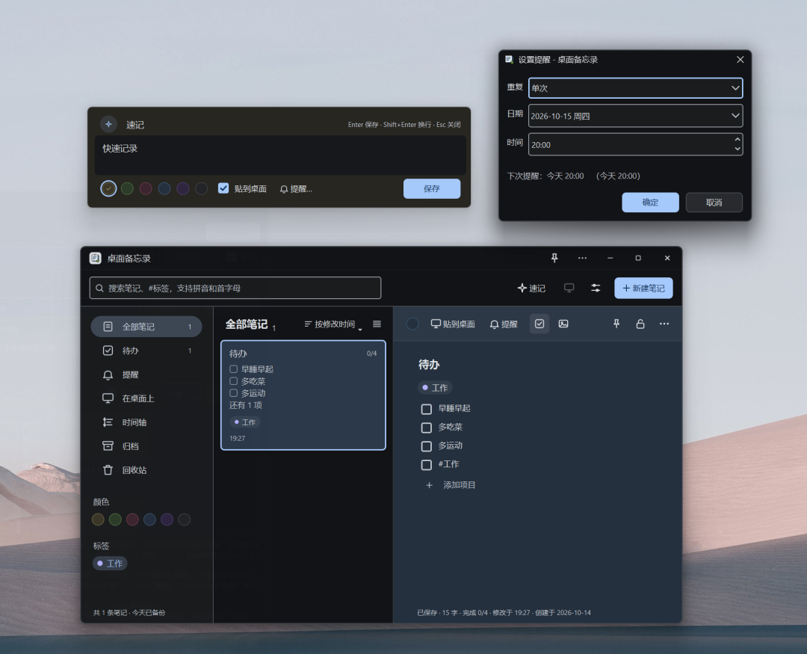
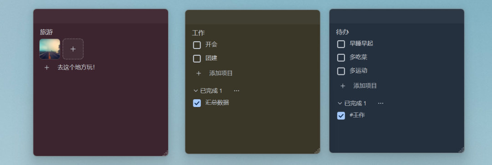
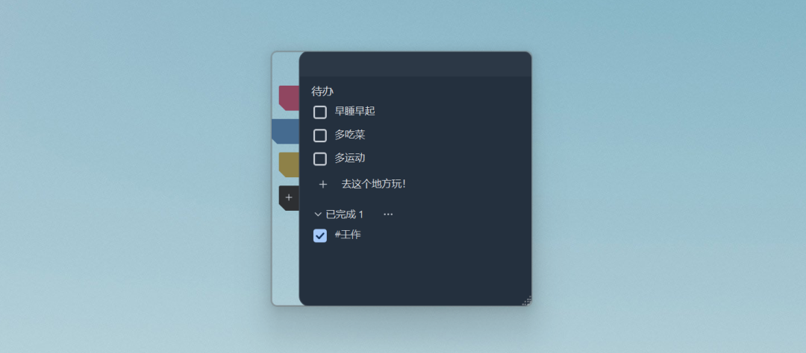
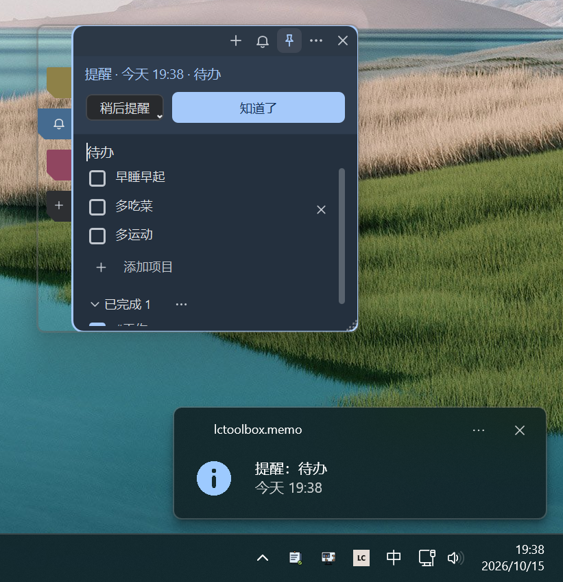

# LC 工具箱｜桌面备忘录：记下来，贴桌面，到点提醒
> 💡 备注属性未写入，可能是备注属性名称或者类型被修改了，建议将字段类型设置为 rich_text，可以在小程序-操作-修改文章数据库页面进行调整
> 💡 原文链接:[https://mp.weixin.qq.com/s?__biz=MzA3MDUwODczMA==&mid=2247483675&idx=1&sn=282a7b9e2fa4fd168d40252ac99147d3&chksm=9e668b590796a1b6e39801080bcd72d76a8473f2cd4c3d54464912b75a3a6191931710b3706a#rd](https://mp.weixin.qq.com/s?__biz=MzA3MDUwODczMA%3D%3D&mid=2247483675&idx=1&sn=282a7b9e2fa4fd168d40252ac99147d3&chksm=9e668b590796a1b6e39801080bcd72d76a8473f2cd4c3d54464912b75a3a6191931710b3706a#rd)
临时想到的事、会议要点、购物清单，记在哪儿最顺手？最好是抬眼就能看到的地方。
LC工具箱 v0.0.21, 这次上线了一个新工具：**桌面备忘录**。它做三件事：随手记下文字、清单和图片，把要紧的几张贴在桌面上，到点准时提醒。
便签贴多了，还能合成一个**便签集**，左边伸出一排彩色书签，点哪枚翻到哪张。
### 01 随手记
- 速记框：在设置里给它配一个全局快捷键，在哪儿按一下都能弹出来。写一句「明天下午 3 点开会」，它会认出时间，保存时顺手设好提醒
- 文字、清单、图片都能记：一条笔记可以转成清单逐项打勾，截图直接粘贴进去
- #标签和搜索：正文里写 #工作 就成了标签；搜索支持拼音首字母，搜 zbsx 也能找到「周报事项」

### 02 贴在桌面上
- 在列表里双击笔记，它就变成一张桌面便签；也可以把笔记从列表直接拖到桌面上
- 便签可以保持在最前、调不透明度，双击标题栏折叠成一条
- 拖到屏幕左、右、上边缘会吸附，鼠标离开后缩进去只留一条细边，鼠标停一下再滑出来，不挡视线
- 主窗口里一键暂时隐藏全部便签，再点一下全都回来

### 03 便签集：给便签夹上书签
合成便签集后，便签左侧靠上会伸出一列书签，一张便签一枚。
- 颜色跟着便签走：黄便签就是黄书签，换了便签颜色，书签跟着变
- 正在看的那枚最长，鼠标移上去的那枚也会往外探一点
- 带记号：私密便签的书签上有一把锁，到点提醒的那张会亮出铃铛
- 最后一枚灰色「+」 ：点一下就在这个便签集里新建一张，自动挑一个集里还没用过的颜色

#### 点一下切换，拖一下整理
整理便签集的操作都在书签上完成，不用翻菜单。
| 想做什么 | 怎么做 |
| 切换便签 | 点书签；或按 Ctrl+PgUp / Ctrl+PgDn |
| 调整顺序 | 按住书签上下拖，蓝线标出插入位置 |
| 拆成独立便签 | 把书签拖到桌面空白处松手，它就贴在松手的地方 |
| 合进别的便签 | 把书签拖到另一张便签上，对方描边时松手 |
| 拖到一半反悔 | 按 Esc |
| 更多操作 | 右键书签：拆出为独立便签、从桌面收起、删除 |
拖动时，光标旁会跟着一张小卡片，写着这张便签的标题，拖到哪里都知道手上是哪一张。
#### 藏在细节里的
- 书签是往便签左边长出来的，便签里的内容不会被挤窄
- 便签集折叠成标题条时，标题后面会注明「（共 3 张）」
- 贴在屏幕边缘自动缩进时，书签一起收起，只留一条细边；鼠标停一下，便签连同书签一起滑出来
- 不小心点了「+」，一个字没写就切走，那张空便签会自己消失
### 04 到点提醒
- 一次性、每天、每周等多种重复方式，还支持农历，比如每年八月十五
- 到点时，桌面上的那张便签会轻轻晃一下、亮出提醒条；没贴在桌面上的笔记会弹出提醒窗口
- 一时顾不上，点「稍后提醒」：10 分钟、30 分钟、1 小时或明天这个时候

### 05 私密和备份
- 私密便签：设一个密码，内容和图片都加密保存，15 分钟不用会自动锁上。密码不存在任何地方，忘了就无法恢复
- 版本历史：改乱了可以回到之前的版本
- 每日备份：数据每天自动备份一份，可以从备份恢复
- 导出 Markdown：连同图片一起导出
### 06 怎么用上
1. 在 LCToolbox 的工具列表里找到「桌面备忘录」，打开就能用
1. 想用速记框，先在设置里给它配一个快捷键（默认不占用任何按键）
1. 建便签集：在便签右上角「⋯ 更多」里选「合并到便签集」，或者从主窗口把笔记拖到某张桌面便签上
免费版可以同时在桌面上贴 5 张便签。便签集、私密便签、农历重复提醒、版本历史和导出 Markdown 属于 **Pro**；已经建好的便签集，即使 Pro 到期也照常能看、能切换。
用着有什么想法，欢迎在留言区告诉我。

## 摘要

（待补充）

## 我的笔记

（待补充）
