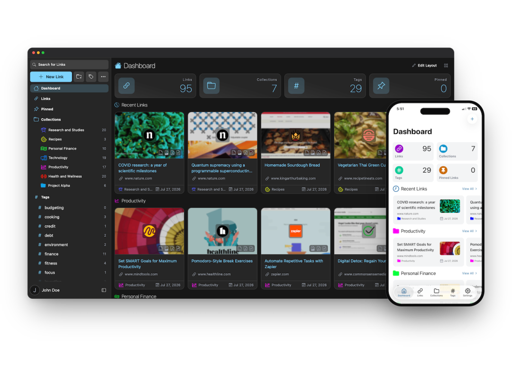
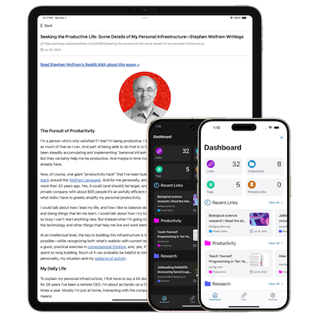

# Linkwarden：给书签存一份网页副本的开源书签工具
> 💡 备注属性未写入，可能是备注属性名称或者类型被修改了，建议将字段类型设置为 rich_text，可以在小程序-操作-修改文章数据库页面进行调整
> 💡 原文链接:[https://mp.weixin.qq.com/s?__biz=MjM5ODMwNjY0MA==&mid=2457902106&idx=1&sn=f6f7fd97a738966f71d59b0a65408512&chksm=b06bbfd54152690f3715ff262cc3bf881ef319faed67b1f503b3a98563f8989387edf19e1663#rd](https://mp.weixin.qq.com/s?__biz=MjM5ODMwNjY0MA%3D%3D&mid=2457902106&idx=1&sn=f6f7fd97a738966f71d59b0a65408512&chksm=b06bbfd54152690f3715ff262cc3bf881ef319faed67b1f503b3a98563f8989387edf19e1663#rd)
Linkwarden 是一个可以自己搭建、也可以直接用官方云端的开源书签工具。保存一个链接的时候，它会把网页在服务器上重新打开一遍，存下整页截图、单个网页文件、PDF，还有一份去掉导航和广告的正文。原来的页面哪天打不开、改了版或者被删掉，手里还有当时的那一份。

**01**
**核心功能**
- 保存链接时自动生成整页截图、PDF 和单个网页文件的副本
- 正文阅读视图，可以改字体、高亮文字、加注释
- 可选把地址提交给 Wayback Machine（archive.org）存一份快照
- 可选用 AI 按内容自动给链接打标签
- 用收藏集、子收藏集、名称、描述和多个标签整理链接
- 多人一起往同一个收藏集里收集链接，每个成员的权限单独设置
- 把收藏集和保存下来的副本公开分享
- 官方 iOS 和安卓客户端
- 全文搜索、筛选和排序
- 浏览器扩展，也可以用 Floccus 把浏览器自带的书签同步过来
- 单点登录（企业和自建用户可用）
- 访问令牌、批量操作、用户管理、多语言界面、图片与 PDF 上传、自定义图标、RSS 订阅
**02**
**保存下来的四种东西**
Linkwarden 存一份网页，做出来的是四种用途不同的副本。
- 正文：只保留文章的文字、标题和图片，导航、广告、侧栏都去掉。之后阅读和全文搜索使用的都是它。
- 网页文件：整页打包成一个独立的网页文件，样式和图片都在里面。
- 截图：整页的 JPEG 图片，不是只截屏幕上能看见的那一段。
- PDF：把页面按打印的方式存成 PDF。
另外还有一个 archive.org 快照，那份不是 Linkwarden 存的，它只负责把地址提交给 Wayback Machine，由对方保存。
新账号默认除了 archive.org 快照之外全部开启。**哪几种要做，可以在设置里的存档选项按全局或者按标签单独开关。**
**03**
**保存是排队完成的**
点保存的那一刻并不会立刻生成副本。链接先进队列，后台有一个任务程序一次取几条，用真实的浏览器打开页面，把你开着的那几种格式逐个做出来。所以新存的链接通常要过一会儿，副本才会陆续出现。
队列是所有人共用的，而且轮着来：后台会在不同用户之间轮转，不会先把一个人的几千条清空。一次导入几千条链接要等挺久，但不会把别人刚存的几条堵在后面。
等待期间，链接详情里会显示保存任务还在队列中。**格式做完一个出现一个，有可能先看到正文，网页文件和 PDF 还在排队。**
**04**
**阅读与批注**
保存下来的正文可以当阅读器用，字体能改，文字能高亮，也能在旁边写注释。阅读和收集在同一个地方完成，这部分就是为这个准备的。
全文搜索看的就是正文提取出来的文字，所以几个月前保存的文章，只要记得其中某段文字，也能搜出来。这一条有前提，下面注意事项里会写。
**05**
**自动打标签**
官方网站把这项叫“AI 自动打标签”，仓库 README 里写的是“本地 AI 打标签”。实际配置有两种做法：一种是接本机的 Ollama，模型在你自己机器上运行；另一种是填写云端服务的密钥，官方文档列了 OpenAI 兼容接口、Azure OpenAI、Anthropic、OpenRouter、Perplexity。同时配了多个的话，它会按这个顺序依次尝试。
功能开关在设置的偏好选项里。打标签有两种用法，新链接进来时按内容自动生成标签，或者先准备一组标签，让它从这组标签里选出对应的打上。
不配模型，这项功能就不存在，其余功能照常使用。
**06**
**收藏集与协作**
收藏集相当于文件夹，里面还能再套子收藏集。一个收藏集可以邀请朋友或者队友一起往里加链接，每个成员的权限单独设置，谁能加、谁能改、谁能删可以分开。
收藏集也可以直接公开分享，别人打开就能看到你收集的链接和保存下来的副本，适合做资料清单、选题库这类需要给别人看的内容。
**07**
**云端与自建**
两种用法都行，差别主要在谁维护。
云端按用户收费，年付每人每月 3 美元，官方页面标注比月付便宜 25%，有 14 天免费试用，每人可以存 30000 条链接，托管、更新、升级都由官方负责。
自建是免费的，核心功能都在，代价是服务器和维护都要自己来。官方的硬件建议是 4 GB 内存、2 核处理器、镜像约 1.5 GB，另加你自己的数据。最省事的是容器方式：下载官方的编排文件和配置样例，把三个密钥改成你自己的随机字符串，再启动就好了。手动安装要求 Node 20 以上、Postgres 16 以上，还要 Yarn 和 Monolith，步骤多出不少。

手机客户端要先有账号才能登录，账号来自云端订阅或者你自己的实例。不想使用应用商店的话，官方另有一个仓库提供安卓安装包。
**08**
**注意事项**
- 全文搜索要靠 Meilisearch 支撑。官方云端自带，自建的实例如果没有配，搜索只覆盖名称、地址、描述和标签，搜不到正文里的字。
- 服务器抓页面时是匿名访客身份。要登录才能看的页面、付费墙后面的内容，服务器看到的是登录页或者提示页，存下来的也就是那个。这种页面只能在自己已经登录的浏览器里存一份再上传。
- 重新保存会先删掉已有的副本，再去抓线上页面。页面已经不在了，抓回来是空的，原来那份已经删了，自己上传的那份也会一起删掉。这个操作需要收藏集的管理权限。
- 每种格式都有体积上限，PDF、截图、网页文件默认各 100 MB；单页抓取有时间上限，特别长或者特别慢的页面会做不完；指向内网地址的链接服务器抓不到。
- 副本属于对应的链接，删掉链接副本会一起删掉；删掉收藏集，里面的链接和副本全部删除。
**09**
**项目地址**
官方网站：https://linkwarden.app/
GitHub：https://github.com/linkwarden/linkwarden
文档：https://docs.linkwarden.app/
