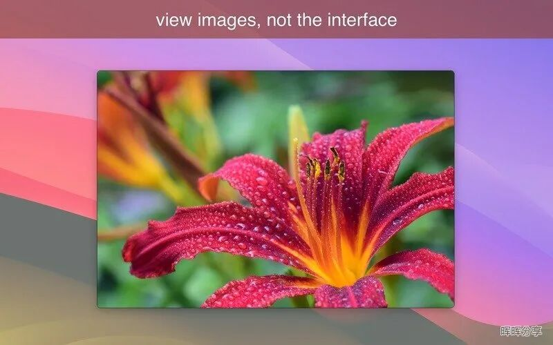
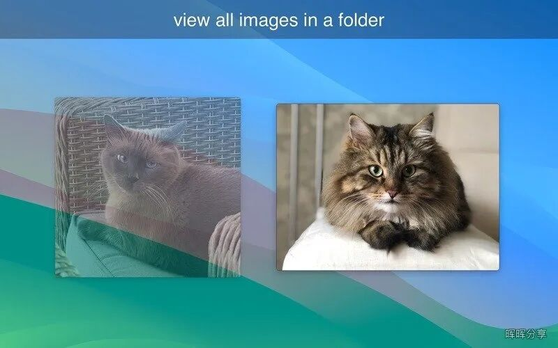
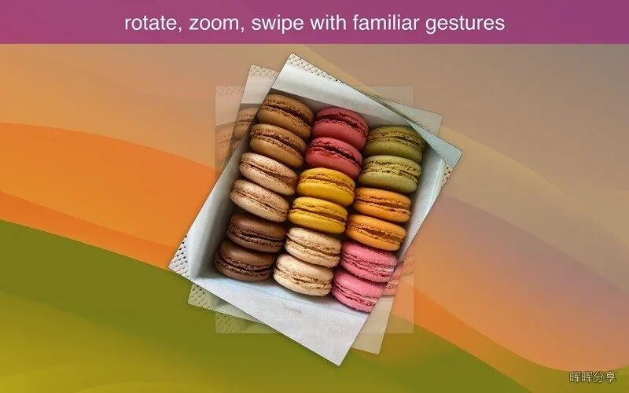

# Mac软件"LilyView for Mac v1.8.0 极简触控看图工具"
> 💡 备注属性未写入，可能是备注属性名称或者类型被修改了，建议将字段类型设置为 rich_text，可以在小程序-操作-修改文章数据库页面进行调整
> 💡 原文链接:[https://mp.weixin.qq.com/s?__biz=Mzg4NDEwOTg1MQ==&mid=2247487053&idx=1&sn=1197d367143d079127e9ad03dcc225e9&chksm=ce18f20d24f605f9347e17e8d8a54af3e1205a21b9491791f5790d5d07a53602098aa50f94cd#rd](https://mp.weixin.qq.com/s?__biz=Mzg4NDEwOTg1MQ%3D%3D&mid=2247487053&idx=1&sn=1197d367143d079127e9ad03dcc225e9&chksm=ce18f20d24f605f9347e17e8d8a54af3e1205a21b9491791f5790d5d07a53602098aa50f94cd#rd)
## Mac软件"LilyView for Mac v1.8.0 极简触控看图工具"

### 应用介绍
晖晖分享搜集到的 LilyView，是一款专门做"看图"这一件事的轻量看图工具。它不建图片库、不做滤镜、不管理照片，打开一张图就是一张图，界面上几乎什么都不显示，只留图像本身。适合不想被一堆相册、标签、编辑功能打扰，只想干净利落地翻图的人。
#### 点开即看，不建库不索引
LilyView 没有"导入照片库"这个步骤。你双击一个文件夹里的图片文件，它直接打开显示，不会像有些看图软件先花几秒钟扫描整个文件夹建索引。翻看下一张、上一张，用触控板手势滑动或者键盘方向键就行，和看相册 App 的手感差不多，但背后没有任何数据库在跑。比如你从相机里导出一堆照片丢进一个文件夹，想挑几张能用的，直接点开第一张滑着看就行，不用等它"加载图库"。
#### 无铬界面，控件躲起来
软件主打"无铬"（chromeless）设计，意思是正常看图的时候，窗口边框、工具栏、菜单按钮这些界面元素基本都不显示，屏幕上只有图片本身。只有你把鼠标移动到屏幕边缘、或者做出某个操作意图时，需要的控件才会短暂浮现，用完自动收回去。说白了就是尽量不让"软件长什么样"干扰"你在看的照片长什么样"，适合看图时不想被工具条分走注意力的人。
#### 支持触控板手势操作
LilyView 对触控板手势做了专门适配，官方的说法是可以"直接用手指触摸图像"。翻页、缩放、旋转这些动作大多能靠触控板的自然手势完成，无需特意去点按钮或者记快捷键组合。当然它也不是只认触控板，键盘和鼠标照样能用，习惯用方向键翻图、用鼠标滚轮缩放的人不必改变习惯，只是如果你的 Mac 带触控板，会多一种更顺手的翻图方式。
#### 看十亿像素级照片也不卡
官方特别强调了一点：即使打开的是"十亿像素"级别的超高分辨率照片，软件依然感觉快速、响应灵敏，不会因为图片文件巨大而卡顿或者长时间等待渲染。做摄影后期、处理大幅扫描图或者卫星图这类巨图的人，平时用普通看图工具打开大文件经常要等好几秒甚至转圈。LilyView 在这方面做了针对性优化，打开和缩放大图时不至于卡住。
#### 1.8.0 新增"适应屏幕"自动缩放
这个版本加了一个新的自动视图选项"适应屏幕"（Fit to Screen）：遇到比屏幕小的图片，它会自动放大拉伸填满可用的屏幕空间，省得你手动按快捷键缩放。原来那种"不拉伸、按原始比例显示"的选项还保留着，只是改名叫"实际尺寸（受屏幕限制）"。换句话说，小图不用再手动放大看，大图也不会被强行塞进窗口，两种需求都留了对应的选项。
**核心功能清单**
•浏览方式：点击即看 / 无图库索引 / 文件夹内直接翻页•界面：无铬设计，控件按需浮现•操作方式：触控板多点触控手势 / 键盘 / 鼠标•性能：十亿像素级大图流畅查看•视图模式：适应屏幕自动缩放 / 实际尺寸（受屏幕限制）
#### 适合什么人
•只想快速翻图，不需要相册管理功能的人•嫌看图软件界面太花、想要干净屏幕的人•触控板党，习惯用手势而不是菜单操作的人•经常打开超大分辨率照片或扫描图的人
#### 常见问题
•这软件会不会把我的照片整理成相册？不会，它不建库，只按文件夹浏览，关掉就什么都不留。•鼠标和键盘能用吗，还是必须用触控板？都能用，触控板手势是加分项，不是必需操作方式。•打开特别大的图片会卡吗？官方说即使十亿像素级的照片也能流畅显示，日常照片更不成问题。•更新到 1.8.0 后小图显示方式变了吗？新增了"适应屏幕"选项会自动拉伸小图，原来不拉伸的显示方式改名保留了，没有被替换掉。
#### 需要注意的地方
这软件界面是英文的，没有中文界面，纯靠几个简单图标和手势操作，英文不熟也大致能摸清按钮位置，但菜单文字看不懂。另外它定位很窄，就是"打开图、翻页、缩放"这几件事，没有裁剪、滤镜、标签分类这些功能，想找一个带编辑或整理能力的看图工具，这个不合适。
如果你平时只是单纯想快速翻看一个文件夹里的照片，不想要相册那一套管理逻辑，LilyView 这种"打开就是图"的思路挺省心；但如果你经常需要给照片打标签、分类归档，还是得配合专门的图库软件一起用。
### 应用截图

### 安装说明
下载完成后，打开镜像包，将左侧文件拖动到右侧应用程序中安装即可。
| 版本 | 大小 | 更新日期 | 兼容系统 |
| 1.8.0 | 4MB | 2026-10-09 | Apple Silicon M芯片 intel芯片 |
公众号后台回复以下**关键字**获取（不区分大小写）：
| 关键词 |
| **lilyview180** |
---
•App 打开报错，App 打开闪退，App 损坏等各种错误情况，解决处理方法请参考：【资源】->【视频及教程】内相关文章。•本公众号所有软件均收集于网络，仅供个人测试研究，请在 24 小时内删除，如需商用请购买正版。

## 摘要

（待补充）

## 我的笔记

（待补充）
