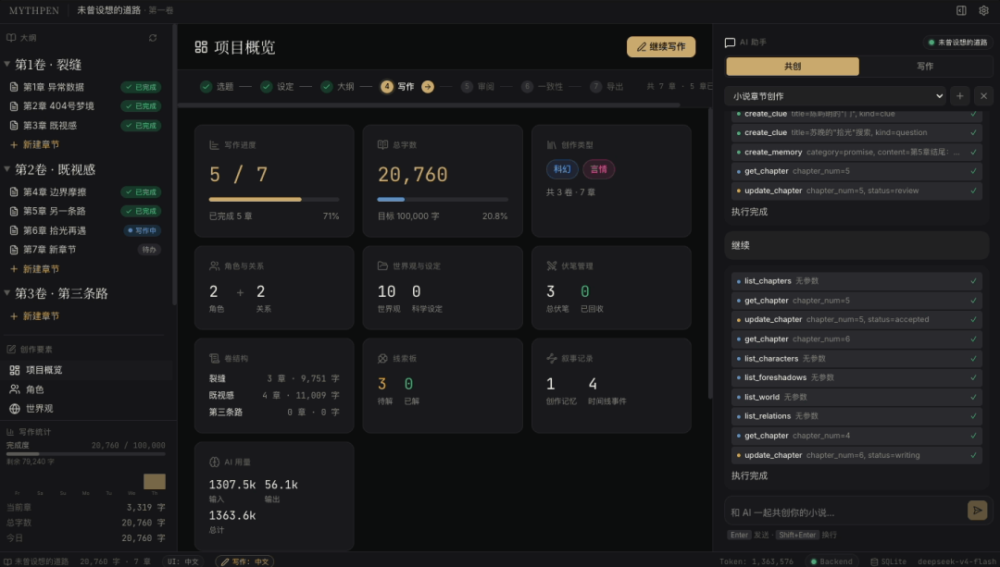

# Mythpen：AI 辅助小说创作的开源软件
> 💡 备注属性未写入，可能是备注属性名称或者类型被修改了，建议将字段类型设置为 rich_text，可以在小程序-操作-修改文章数据库页面进行调整
> 💡 原文链接:[https://mp.weixin.qq.com/s?__biz=MjM5ODMwNjY0MA==&mid=2457901934&idx=1&sn=dae6af29e7b676d58eeb94347aecb2e7&chksm=b04a807a1cf8d06d3f89498dc591a39d5b63dd547b3e56bb4b41e0507e4c2ba60dbda05e8d93#rd](https://mp.weixin.qq.com/s?__biz=MjM5ODMwNjY0MA%3D%3D&mid=2457901934&idx=1&sn=dae6af29e7b676d58eeb94347aecb2e7&chksm=b04a807a1cf8d06d3f89498dc591a39d5b63dd547b3e56bb4b41e0507e4c2ba60dbda05e8d93#rd)
Mythpen 是一款 AI 辅助小说创作软件，把角色、世界观、大纲、伏笔、时间线这些创作要素集中到一个地方管理，同时内置了一个能陪你一起写的 AI 助手。这个助手可以边生成边输出地续写正文，也能和你讨论情节走向，还能帮你检查设定前后是否对得上。所有项目数据都保存在你自己的电脑上，用苹果电脑、Windows 或 Linux 都能安装使用。
**01**
**核心功能**

Mythpen 的核心功能，是把小说创作要用到的各种要素和 AI 助手放进同一个软件。
- AI 辅助写作：与 AI 协作完成小说创作。流式生成、续写、共创，AI 以协作伙伴的方式参与，从不侵入你的创作空间。
- 写作与共创两种模式：写作模式带你按六步走完一章，分别是检查未完成章节、了解项目、准备大纲、正式创作、润色、审稿定稿；共创模式按四步来，先把设定聊清楚，再规划分卷，交付前三章，最后交给写作流程接手。
- 自选 AI 后端：可以接 OpenAI 兼容的接口，也可以接 Claude，用哪家、用哪个模型都在设置里修改。
- 角色管理：深入的角色设定与管理。管理姓名、外貌、性格、背景故事，以及角色间的复杂关系图谱。
- 世界观构建：按地点、组织、概念、事件等类别整理设定条目，写长篇时不容易前后打架。
- 大纲与五维叙事：给每一章写概要，另外单独记录认知框架、情感锚点、世界质感、具体悬念、人际张力五个维度。
- 伏笔管理：用看板盯住每一条伏笔，状态分为已埋、发展中、已揭晓、已废弃，可以标优先级和打算在哪一章揭晓，避免埋下的线一直没有下文。
- 时间线：把故事里的重大事件按年份排好，理清事件的先后顺序。
- 人物关系图：一张可以拖动的关系图谱，节点大小反映角色的出场次数，连线粗细反映关系的强弱，一眼能看出谁和谁走得近。
- 叙事记忆：把角色、地点、物品、事件、承诺等信息记成条目并且能搜索，写的时候随时回来翻。
- 科学设定：写科幻时可以用三种标签把设定分成已知、外推、假设，并给每条设定附上参考资料。
- 一致性检查：让 AI 扫一遍设定、时间线、伏笔和科学设定，把前后对不上的地方挑出来。
- AI 直接改资料：助手能直接使用软件内置的工具去读写角色、章节、伏笔这些内容，你在对话里提出的修改，AI 能落进对应的资料里。
- 导出：写完的作品可以导出成纯文本、Markdown、网页或电子书文件。
**02**
**本地数据与隐私**
Mythpen 把资料都留在自己的电脑里，不依赖云端服务。
- 项目数据存在电脑本地的数据库文件里，默认放在用户目录下的 .mythpen 文件夹中，用的是 SQLite 数据库。
- 每个项目对应一个独立的数据库文件，项目之间互不干扰。
- 数据不上传云端，只有 AI 功能需要联网，其他功能断网时也能正常使用。
- 编辑器大约每 30 秒自动保存一次，另外还留有崩溃恢复用的内容快照。
**03**
**创作流程**
Mythpen 把一部小说的创作拆成七个阶段，项目概览页上有一条进度条告诉你现在走到哪一步，也可以手动往前推。
- 选题：确定故事方向。
- 设定：搭建世界和角色。
- 大纲：规划情节走向。
- 写作：和 AI 一起把正文写出来。
- 审阅：修订和润色。
- 一致性：让 AI 检查有没有矛盾。
- 导出：把完成的作品导出。
**04**
**安装和使用**
- Mythpen 支持 Windows、苹果电脑和 Linux 系统，下载对应系统的安装包，安装即可。
- 装好之后要在设置里填写 AI 服务的接口地址、密钥和模型名，AI 功能才能使用；不填写也能先拿来管理设定和手写正文。默认指向 DeepSeek 的接口，也可以换成别的兼容服务或 Claude。
从源代码构建
- 先准备好 Node.js 20 及以上版本，以及 pnpm（Node.js 的软件包管理器）9 及以上版本。
- 执行 pnpm install 安装项目依赖。
- 执行 pnpm dev:all 在浏览器里启动，会同时启动前端和后端，并写入示例数据。
- 执行 pnpm tauri dev 进入桌面开发模式。
- 执行 pnpm tauri build 打包桌面安装包，会产出苹果电脑磁盘镜像（dmg）、Windows 安装包（msi）和 Linux 的 AppImage 文件。
**05**
**注意事项**
- AI 功能需要自己准备模型服务和密钥，软件不附带。接口地址、密钥、模型名都在设置里填，填好 AI 才会工作。
- 数据都在本地数据库文件里，软件不会自动帮你上传到云端，换电脑或重装系统前记得自己把 .mythpen 目录备份出来。
- 界面支持中英文切换，写作语言是项目级设置，每个项目可以单独选中文或英文。
- 科学设定栏目主要给科幻题材用，写其他类型时用不上。
- 软件目前是 v0.0.9 这样的早期版本，功能还在快速迭代，界面和数据结构都可能继续变化。
**06**
**项目地址**
- 官方网站：https://niyongsheng.github.io/mythpen/
- GitHub 仓库：https://github.com/niyongsheng/mythpen
- 安装包发布页：https://github.com/niyongsheng/mythpen/releases
