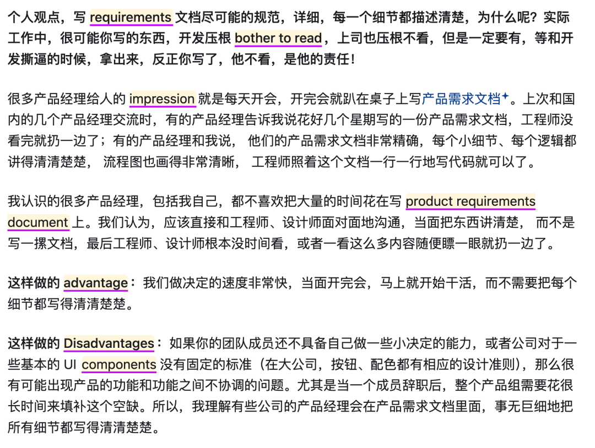

# NeonLingo中国版正式发布，刷知乎、看小说，也能顺手学外语
> 💡 备注属性未写入，可能是备注属性名称或者类型被修改了，建议将字段类型设置为 rich_text，可以在小程序-操作-修改文章数据库页面进行调整
> 💡 原文链接:[https://mp.weixin.qq.com/s?__biz=Mzk3NTU0NjQxMQ==&mid=2247484127&idx=1&sn=60ea8821eea172f08aa07f2208b333b5&chksm=c5549b41a2e933bc9a5aefc2b90f7facefb40f4e9ab43ffabdbb3f6e9f51efa47a7f89fd0bea#rd](https://mp.weixin.qq.com/s?__biz=Mzk3NTU0NjQxMQ%3D%3D&mid=2247484127&idx=1&sn=60ea8821eea172f08aa07f2208b333b5&chksm=c5549b41a2e933bc9a5aefc2b90f7facefb40f4e9ab43ffabdbb3f6e9f51efa47a7f89fd0bea#rd)
全文约 1683 字 · 预计阅读 5 分钟
**“**让外语多出现在日常里，让开始学习少一点准备**”**

10月25日，我们在WTCC正式发布了NeonLingo中国版。发布会的屏幕上，除了产品介绍，也放上了新的国内入口。
**www.neonlingo.cn**
这几天在展位上，外语学习是一个很容易聊起来的话题。大家希望自己能学好，也很清楚它为什么总被往后放。专门拿出时间去学，开始几天还行，时间一长，就不太好坚持。
我们把产品带到现场，也是在尝试回答这个问题。NeonLingo是一款Chrome、Edge浏览器扩展。如果学习可以从本来就会打开的网页开始，能不能少一点准备，多一点接触外语的机会？
### 01 中国版想让外语学习更贴近国内的日常浏览
这次发布，首先要照顾的是国内用户怎样开始使用。
海外版的入口是neonlingo.com，这次发布的中国版入口是neonlingo.cn。中国版面向国内使用场景，接入千问和DeepSeek，并针对国内使用优化响应速度，让阅读中的等待少一些。
这些变化最终要落到一页具体的内容上。你可以打开知乎，读一个自己关心的问题；也可以打开平时追的网络小说，继续看上一章之后发生了什么。双语混读会根据你设置的外语水平和密度，把部分内容换成正在学习的外语，周围仍然保留熟悉的中文。
如果平时就爱看爽文，也可以从这些网页开始。想继续追故事，本来就是往下看的动力。我们希望外语能跟着内容出现，先让人在熟悉的语境里接触一个词，再决定要不要查看它的意思。

这里介绍的是中国版要服务的日常场景。双语混读本身也是NeonLingo一直在做的方向，海外版同样有这套阅读思路。国内版进一步照顾国内的使用条件，让这些能力更贴近中文用户平时打开浏览器的习惯。
**选择自己愿意读的内容，能让接触外语这件事有一个更容易开始的地方。**
当然，浏览中文网页和主动读外文，练到的东西有所不同。混读适合先接触一些外语词语；完整外文材料还会带来句子结构和篇章理解的练习。两种方式可以接着用，按自己当天的精力选择。
### 02 读得下去，比一开始放入很多生词更重要
在一页中文里放多少外语，确实需要分寸。
读知乎时，如果每一句都有好几个陌生词，原本想了解的事情就容易被打断。看小说也是一样，情节刚推进，注意力却总停在词义上，读起来会累。起步时可以把密度调低，先保住阅读的连贯，再慢慢往上加。
近期的2.6.4版本把这一步做得更方便了。现在可以在插件弹窗或悬浮球里，调整当前页的外语比例和生词标注数量。觉得这一页难，就少放一点；觉得还有余力，再试着增加，不必把所有网页都设成同一个强度。
自动运行也有了更细的设置。你可以选择运行时段，给不同网站单独配置规则。需要专心处理工作时，让页面保持适合工作的状态；想在常看的内容里接触外语时，再按自己的安排开启。
**NeonLingo**
Chrome & Edge 外语阅读与生词复习
**从你今天本来就想看的网页开始**
NeonLingo的双语混读，会按你设置的水平和密度，把部分学习语言嵌入日常浏览的网页，保留周围熟悉的内容。可以先挑一篇知乎回答或一章小说，把比例调到能顺着读下去，再留意出现的新词怎样参与这句话的意思。

**它能帮你做什么**
**按水平选词**
根据自己的外语水平设置学习内容
**按密度混读**
选择日常网页里外语词语的嵌入密度
**保留原有语境**
在日常浏览中接触要学习的外语
**如何找到并开始使用**
**01.**在 Chrome 网上应用店或 Edge 加载项商店搜索“NeonLingo”
**02.**添加扩展并固定到浏览器工具栏，确认插件已经启用
**03.**在插件中设置学习语言、水平与密度，启用双语混读
商店搜索：**NeonLingo**
**让日常浏览多一点外语 →**
换到外文网页时，也可以选中不认识的词查看翻译。词汇自动进入单词本，之后在其他网页再次出现时高亮提醒。混读和外文阅读，给了不同起点的读者各自开始的办法。
> **“ 启发式总结 一页内容里放多少外语，要以还能读懂、愿意继续为准，先把接触留在日常，再慢慢增加难度。 ”
> **
### 03 近期更新也在帮助大家看懂自己的词汇积累
读过之后，词汇怎样留下来，也是我们这段时间持续在改的事情。
2.6.4的单词本支持自定义分组，可以批量管理，也能设置新收藏默认放进哪个组。工作里经常遇到的词和兴趣阅读中的词，可以按自己的习惯整理。想找回它们时，也能按主题、词性或来源网站浏览。
单词详情还增加了语境例句和遇见次数，例句保留来源网页。复习一个词时，可以回到当时那一段，看看它为什么出现在这里。只看中文释义容易混在一起的用法，放回原句里，会更有东西可以判断。

另一个更新是“学习轨迹”，用来查看词汇积累、复习趋势和不同领域的学习足迹。学习时留下的记录，可以帮助自己回头看看最近接触了什么。里面的熟悉度信号需要和实际阅读放在一起看，达到熟悉门槛并不等于已经掌握一个词。
**记录的价值，是帮助你找回读过的内容，并决定下一步还想读什么。**
这些更新都围绕很普通的使用过程。读的时候少被打断，查过的词方便找回，隔一段时间能看见自己做过什么。学习依然需要理解和复习，我们希望工具先把这些容易让人停下来的地方做顺。
谢谢这次在WTCC停下来听演讲、看演示的朋友，也谢谢在K23和我们聊外语学习的人。大家想学好，也觉得难坚持，这份困扰我们会继续放在产品里认真处理。
如果你想试试，可以从中国版官网进入，按网站指引添加浏览器扩展。第一天就用自己本来想看的内容，读到不舒服的地方，也欢迎告诉我们。你最想先把它用在知乎、小说，还是工作资料里？
**资料参考与学术背景**
[1]**NeonLingo团队**，10月25日国内版发布信息及WTCC现场照片
[2]**NeonLingo**，中国版产品介绍、帮助页与2.6.4更新日志，2026年10月27日核对
**NeonLingo**
从一页熟悉的内容开始，给外语留一点位置
