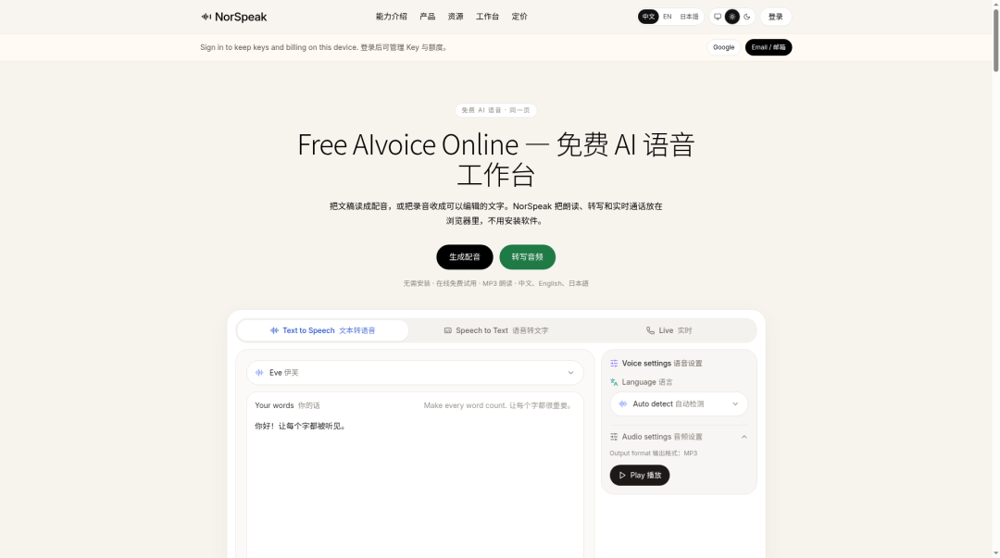
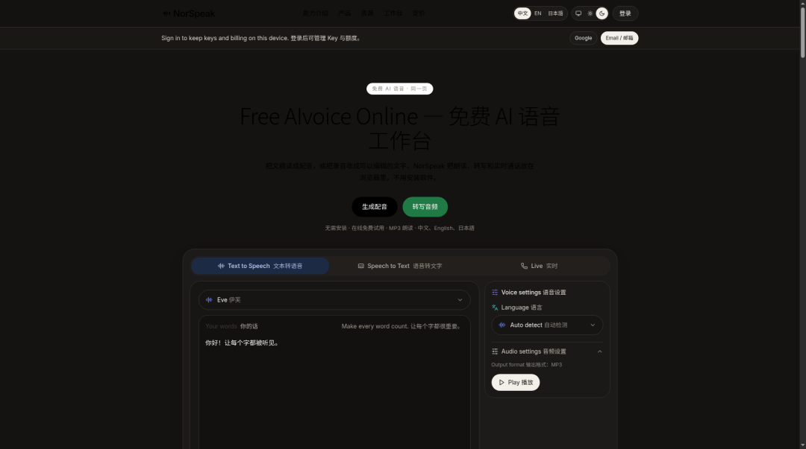
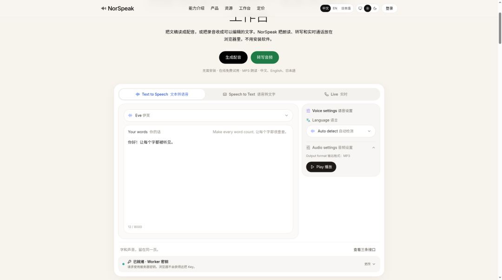
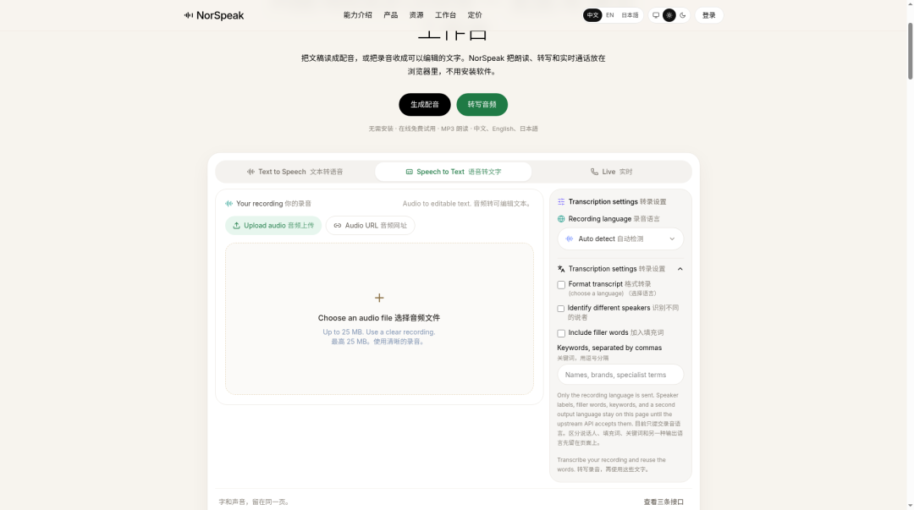
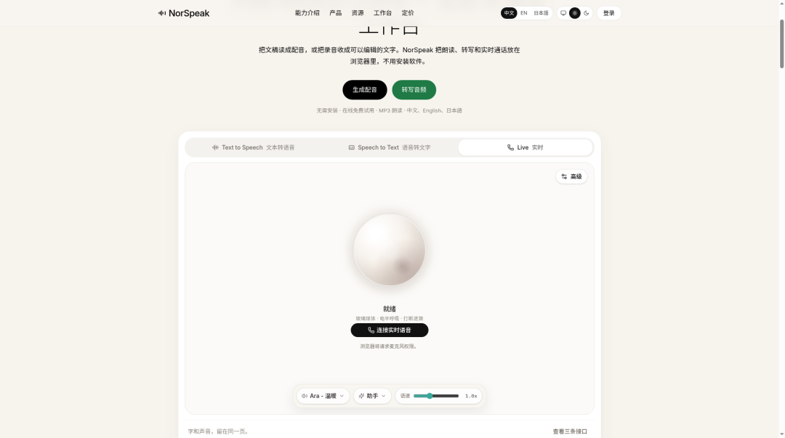
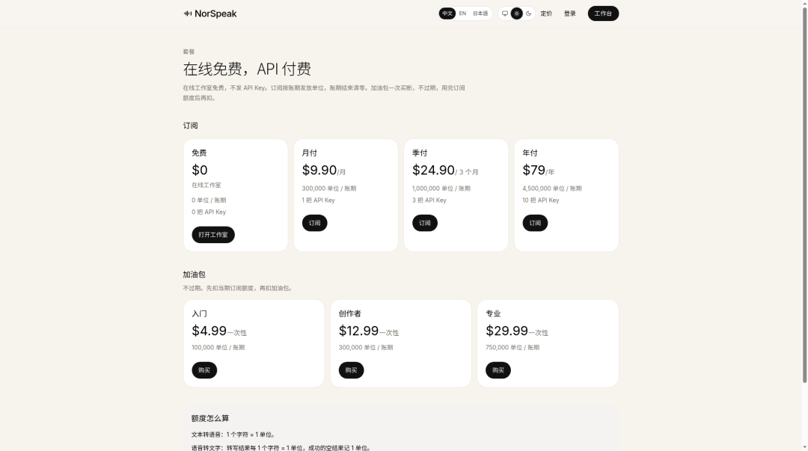

# NorSpeak刚刚上线！：免费的 AI 语音工作台，TTS/转写/AI口语陪练 一页搞定！
> 💡 备注属性未写入，可能是备注属性名称或者类型被修改了，建议将字段类型设置为 rich_text，可以在小程序-操作-修改文章数据库页面进行调整
> 💡 原文链接:[https://mp.weixin.qq.com/s?__biz=MzIxODA2MzY3OA==&mid=2247499706&idx=1&sn=25bcda0910cd0906298d351169d4e34e&chksm=968a4a04ce0009ee87d8d9d5e6d631fa47f3cafc9a32a7cf6ce5130c44553c3cf80f3988e01a#rd](https://mp.weixin.qq.com/s?__biz=MzIxODA2MzY3OA%3D%3D&mid=2247499706&idx=1&sn=25bcda0910cd0906298d351169d4e34e&chksm=968a4a04ce0009ee87d8d9d5e6d631fa47f3cafc9a32a7cf6ce5130c44553c3cf80f3988e01a#rd)
## NorSpeak刚刚上线！：免费的 AI 语音工作台，TTS/转写/AI口语陪练 一页搞定！
平时做产品视频想配个旁白、整理录音抓个字幕，或者仅仅是想听听模型音质再决定接不接 API——你往往得在几个工具之间来回横跳，折腾得心累。
NorSpeak 的思路非常干脆：直接把**文本转语音（TTS）、语音转文字（STT）、实时全双工通话**这三大件全塞进一个浏览器工作台。最爽的是，**开箱即用，在线免费**。你不需要下载任何客户端，更不需要一上来就填自己的 API Key，想怎么测就怎么测。等业务跑通需要更大额度时，再用同一套接口去接付费 API 也不迟。
### 打开网页，直接开工
网址：https://norspeak.com

打开首页，大标题直奔主题：**Free AIvoice Online — 免费 AI 语音工作台**。无论你是短视频创作者、客服主管还是独立开发者，所有语音交互逻辑全部在浏览器完成。
界面支持中/英/日多语切换，深浅模式随心选。细节加分项：顶栏点「工作台」，页面会丝滑滚动到首页的工作室区块（`#studio`），无需跳转路由，交互非常顺滑。

### 核心功能一：文本转语音（TTS）
工作室里的「文本转语音」模块极其简洁。直接粘贴文案（单次支持约 8000 字），选择你心仪的音色（如 **Eve 伊芙**），语种选 **Auto detect 自动检测**，导出 MP3 之前点一下 Play 就能试听。
注意底栏显示的「已就绪 · Worker 密钥」，这意味着页面直接调用了站点内置的 Worker 密钥，你根本不用手动配置任何环境，真正做到零门槛体验。

### 核心功能二：语音转文字（STT）
切换到「语音转文字」：支持本地 **Upload audio 音频上传** 和 **Audio URL 音频网址**，单文件上限约 **25 MB**。
展开进阶设置，功能覆盖非常全：**Format transcript 格式转录**、**Identify different speakers 说话人识别**（说话人分离），甚至还能勾选 **Include filler words 保留填充词**。如果音频涉及专业领域，直接在 Keywords 栏里填入术语，系统就能准确转写出规整的文档。

### 核心功能三：实时通话
切到「Live 实时」页面，迎面而来的是极具科技感的呼吸球体 UI。底下的默认音色 **Ara · 温暖** 表现出众，支持微调助手模式和语速。
只有当你点击「连接实时语音」时，浏览器才会询问麦克风权限。字幕实时滚动，模型调用（如 `grok-voice-latest`）隐藏在「高级」选项中，确保你在把玩时界面清爽，完全没有干扰。

### 灵活的收费模式：在线免费，API 付费
NorSpeak 的商业逻辑非常坦诚：**在线网页试用完全免费，不消耗你的额度**；当你需要将能力接入自己的系统或进行大规模生产调用时，才需要订阅或购买加油包。
订阅计划：
- **免费**：$0（即开即用）
- **月付**：$9.90 / 月（含约 30 万单位，1 把 API Key）
- **季付**：$24.90 / 3 个月（含约 100 万单位，3 把 Key）
- **年付**：$79 / 年（含约 450 万单位，10 把 Key）
加油包（一次性买断，额度不过期）：
- **入门**：$4.99（约 10 万单位）
- **创作者**：$12.99（约 30 万单位）
- **专业**：$29.99（约 75 万单位）
额度换算透明：TTS 按 1 字符 = 1 单位计费，STT 则按识别后的结果字符数结算。

### 怎么开始？
1. 访问 https://norspeak.com/
1. 点击顶栏「工作台」，直达工作室。
1. 先在 TTS 试听音质，再试一把转写或实时通话。
1. 确认体验无误后，再按需注册登录，获取 API Key 接入你的项目。
**(小贴士：在公共电脑上使用时，记得不要勾选“记住我”以保护个人密钥安全。)**
### 写在最后
NorSpeak 最打动人的地方，在于它不是强迫你先掏钱看文档，而是让你直接在浏览器里把「听、说、转」这一整套链路跑通。如果你正需要一个高效的 AI 语音处理助手，先打开工作台摸两分钟，你会发现这比看一堆枯燥的接口文档直观太多了。
网址：https://norspeak.com

