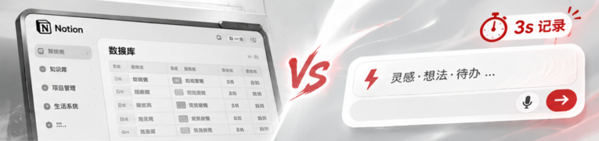
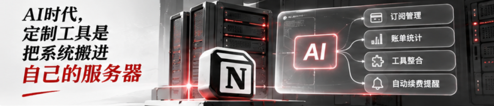
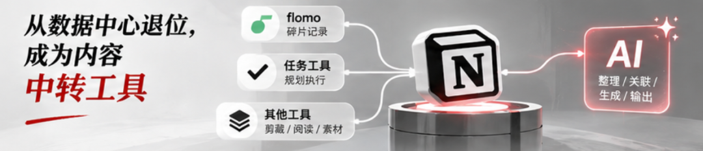

# Notion 正在失去它的时代：当 AI 开始接管我的一切，我为什么不再需要“超级工作台”？
> 💡 备注属性未写入，可能是备注属性名称或者类型被修改了，建议将字段类型设置为 rich_text，可以在小程序-操作-修改文章数据库页面进行调整
> 💡 原文链接:[https://mp.weixin.qq.com/s?__biz=Mzg3Mzg3NDQ0Ng==&mid=2247483861&idx=1&sn=349bec30bea6457d60f2fa740a758204&chksm=cfdc3e2287938086baf7fa9f2b5a9d470170107097bb46d33dfd30ebf9b0a70827d33e394a70#rd](https://mp.weixin.qq.com/s?__biz=Mzg3Mzg3NDQ0Ng%3D%3D&mid=2247483861&idx=1&sn=349bec30bea6457d60f2fa740a758204&chksm=cfdc3e2287938086baf7fa9f2b5a9d470170107097bb46d33dfd30ebf9b0a70827d33e394a70#rd)
## AI时代下知识库笔记软件究竟有没有存在的必要？

笔记、知识库、日程、订阅、项目管理……几乎所有能数字化的东西，我曾经都想办法塞进 Notion。那时候我甚至觉得，一个设计精良的 Notion 工作台，就是个人效率管理的超级形态。为了它，我研究数据库、设计标签体系、调整页面布局、折腾各种自动化。尤其是对当时不懂代码的我来说，能通过拖拽模块亲手搭建出一套像模像样的个人工作台，那种掌控感曾让我无比着迷。
但讽刺的是，当初让我爱上 Notion 的那些功能，如今恰恰成了我抛弃它的理由。
今年以来，我打开 Notion 的次数屈指可数。取代它的，是一个简单到近乎简陋的笔记软件 flomo（当然也有同类开源软件memo）；而我曾经花费大量时间搭建的各种管理系统，现在大部分都交给了 AI。
这不是因为 Notion 变弱了，恰恰相反，是它太重了。当每个人都能让 AI 为自己开发工具时，Notion 这种高度依赖人工搭建的重型工作台，正在变成一种巨大的时间内耗。
## 一、 记录的本质是无摩擦，而不是先建个知识库

放弃用 Notion 记笔记，原因其实很微小：启动前的摩擦力太大了。
以前我特别喜欢折腾工作台，今天给数据库加个属性，明天优化一下标签，后天又重新调整布局。结果往往是：明明只是想记下一闪而过的灵感，打开 Notion 却要先加载层级、选页面、填标签，最后花了半个小时研究它该放进哪个数据库。
尤其是在手机上。Notion 灾难级的移动端体验，往往页面还没加载完，念头早就飞了；甚至在等待的几秒钟里，手指一滑点开了短视频，刷了十几分钟才想起来自己原本要干什么。
现在的注意力比黄金还贵。我们每天被无数 APP 围猎，工具的第一要义应该是“用完即走”，而不是把人困在复杂的界面里。所以我转投了 flomo——没有花哨的排版，没有干扰视线的推荐流，打开、输入、保存、结束。用了一段时间后，我记录想法的频率反而越来越高。
更重要的是，人们的生活方式变快了。以前我们费尽心思建目录、打标签，是为了方便以后自己翻找；现在，分类、标签、关联、总结，甚至从过去几个月的记录中挖掘思维变化，全都可以交给 AI。
人负责产生想法，AI 负责整理想法。这才是我现在更顺手的工作方式。
## 二、AI时代， 定制工具是把系统搬进自己的服务器

笔记只是开始，真正让我彻底告别 Notion 的，是 AI 开始接管我的日常管理。
拿我最刚需的软件订阅管理来说。月付、年付、自动续费，各种日期混在一起，以前经常扣费了才想起来自己还订着某个会员。很早之前，我在 Notion 里搭过一套订阅看板，记录名称、费用、周期和到期日，虽然能把账单聚在一起，但本质上依然是在“削足适履”：我必须主动打开 Notion 才能看到；想增加一个自动计算开销的视图，或者想在扣费前三天发条提醒，都得严格按照 Notion 的公式和框架去死磕，很多需求甚至根本实现不了。
既然有了 AI，为什么还要在别人的框架里委屈自己？
我直接换了一种方式：让 AI 在自己的服务器上搭建了一套专属的订阅管理台。
所有订阅集中管理，随时打开随时看。最爽的是，软件不再是固定不变的模具，而是随我心意生长的粘土——想增加到期提醒？直接让 AI 加；想统计每月开销？让 AI 做；想改界面？直接说。配合服务器和通知服务，系统还能定时巡检状态，在扣费前主动发消息提醒我。
当然，自己维护系统需要服务器和一定的时间投入，但对于原本就在高频使用 AI 的人来说，这笔账极其划算。以前需要研究半天数据库、公式和自动化才能凑合实现的功能，现在用自然语言就能直接落地。
我想要什么功能，就让 AI 做出什么功能。这种跳出既定框架的自由度，是 Notion 再丰富的模板也无法替代的。
## 三、 成也数据库，败也数据库
回顾这段迁移，有一个很现实的规律：工具时代，成就你的核心优势，往往就是下一阶段淘汰你的包袱。
Notion 的一切逻辑都建立在“数据库”之上。在没有 AI 的年代，这叫降维打击——它让不会写代码的人，第一次通过拖拽拥有了搭建数字系统的能力；但在 AI 时代，这就成了繁文缛节。每当我想在 Notion 里新建点什么，大脑第一反应不是“我要解决什么问题”，而是“我的字段该怎么设？状态怎么分？表与表之间怎么关联？”
工具本该隐身，Notion 却在不断刷存在感。而它近年的重心也明显偏向了团队协作、企业知识管理和内置 AI。这条路线在商业上没有错，但对于个人用户而言，它正在变得越来越不合适——我不需要一套复杂的企业级管理系统，我只需要无摩擦的输入，和一个能主动处理信息的助手。
Notion 的功能越来越丰富，我真正需要的功能却越来越少。
## 四、 从数据中心退位为内容中转工具

当然，降级不代表彻底卸载。现在的 Notion，在我的工作流里依然占有一席之地，只是角色彻底变了。
以前我有一个执念，非要把所有东西都塞进 Notion，让它当唯一的“超级数据中心”。现在我彻底想通了：为什么非要把所有鸡蛋放进同一个重型容器里？
笔记放在 flomo，任务放在任务工具，订阅交给自己搭建的系统，而长篇成品文章、结构化知识库以及供 Agent 调用的 Skill 文档，依然保存在 Notion 里。每个软件只负责自己最擅长的那一小块，然后通过 AI 把它们连接起来。
得益于官方打通的 API 和 MCP 协议，外部的 AI 工具可以直接读取或写入 Notion 里的数据，不需要我再手动打开它的界面。它从原本高高在上的“前端主入口”，退居成了幕后的“静态数据节点”。
以前，我把数据手动集中到 Notion，再由自己去管理；现在，我把不同软件连接到 AI，让 AI 帮我调用和管理数据。整个工作流的重心已经彻底转移了。
## 五、 下一代个人数据中心，可能根本没有固定的界面

顺着这个思路往下看，未来我们使用软件的方式正在发生一次根本性的重构。
以前，每个软件都有自己的界面、操作逻辑和数据结构，用户必须主动点开一个个 APP 才能完成任务。但如果 AI 成为连接一切的中枢呢？
早上起来，直接问一句：“我今天有什么需要处理的事情？”AI 就会读取日程、任务、笔记和所有授权数据，给出一份整理好的安排；月底问一句：“这个月我在软件订阅上花了多少钱？哪些已经很久没用了？”它直接从数据库里拉出账单给出建议。甚至不用每次都问，定时脚本会在需要的时候主动向你汇报。
我们依然在使用各种软件，但打开它们界面的频率会越来越低。软件退居幕后负责保存数据、提供基本功能；AI 站在台前负责理解需求、调用工具和交付结果。
这就是我正在搭建的 Personal Agent（个人智能体）——一个长期运行、拥有记忆、懂你习惯的 AI 中枢。它不需要把全网数据搬进同一个软件里供起来，只要在授权范围内能找到、能调用就够了。
## 写在最后
前几年，我一直在寻找一款能管理全部数字生活的“完美软件”，最后把大量时间耗在了 Notion 里，以为只要把系统搭得足够漂亮，工作和生活就能井井有条。现在回头看，我从一开始就搞错了方向——我真正需要的从来不是一个功能无限丰富的工作台，而是一个能帮我减少重复劳动、把精力留给重要事情的系统。
Notion 曾经让我第一次拥有了搭建个人软件的能力，而 AI 正在让我彻底摆脱对任何固定软件的依赖。它不一定会衰落，在企业协作领域依然不可替代，但在个人效率管理这件事上，我已经不再需要它充当一切的中心。
十年前，我们学习如何使用软件。五年前，我们学习如何搭建自己的工作台。而现在，我们开始让 AI 学习如何替我们使用软件。
下一代个人数据中心，不会是 Notion，也不会是任何一款传统笔记软件，它就是那个每天与你对话、连接你所有工具的 AI。
当 AI 开始替你操作软件，软件本身还需要占据你多少注意力？这才是我觉得最值得思考的问题。
