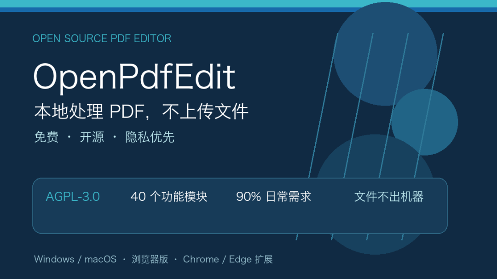
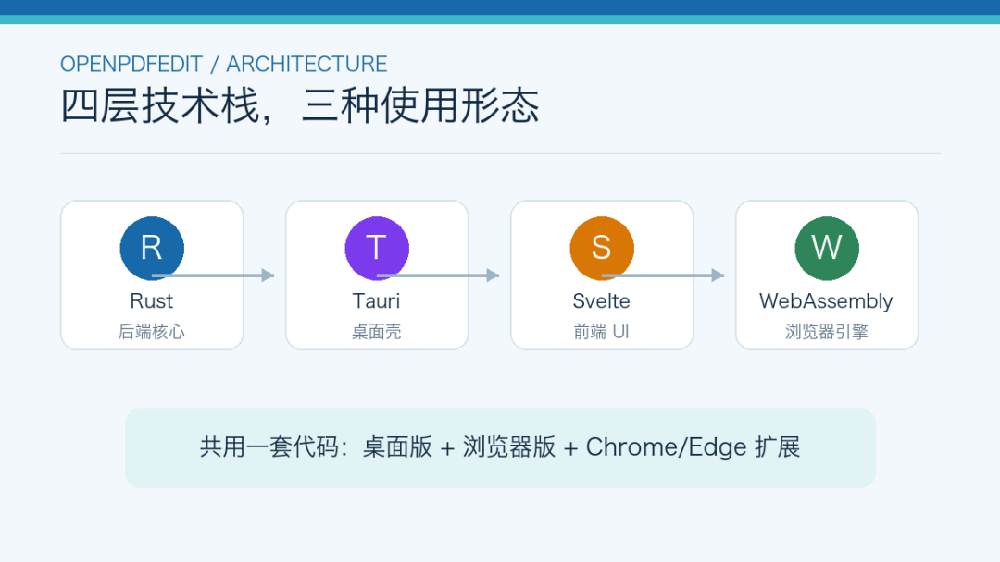
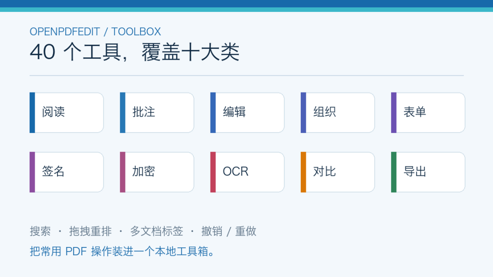
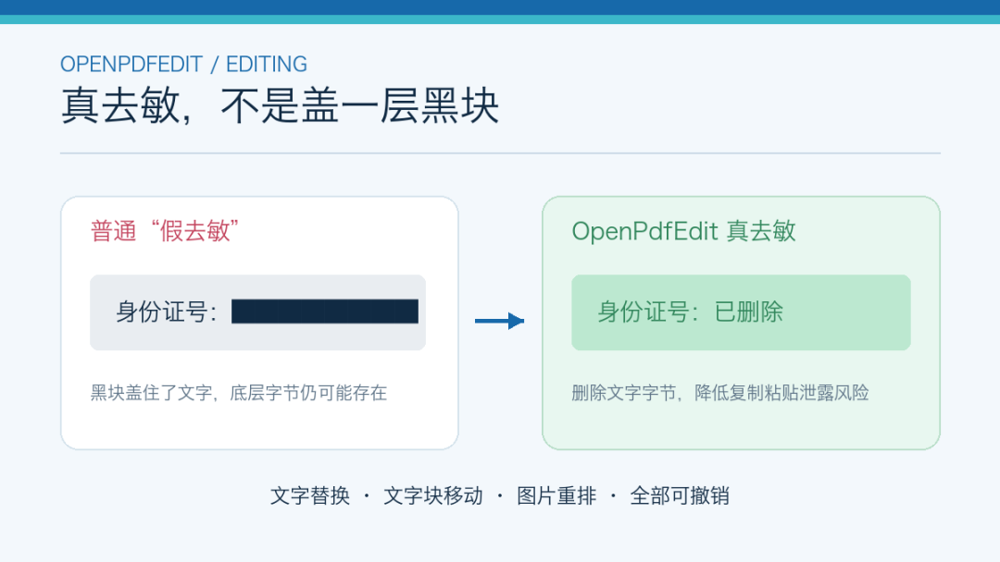
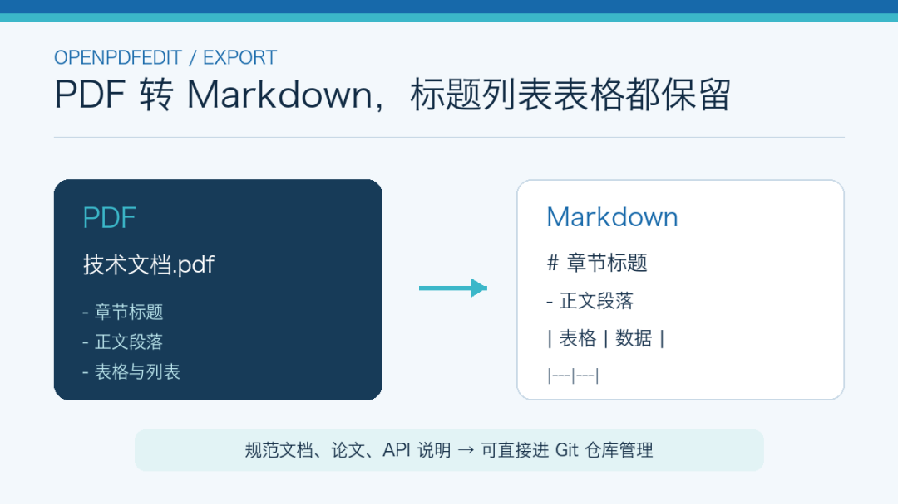
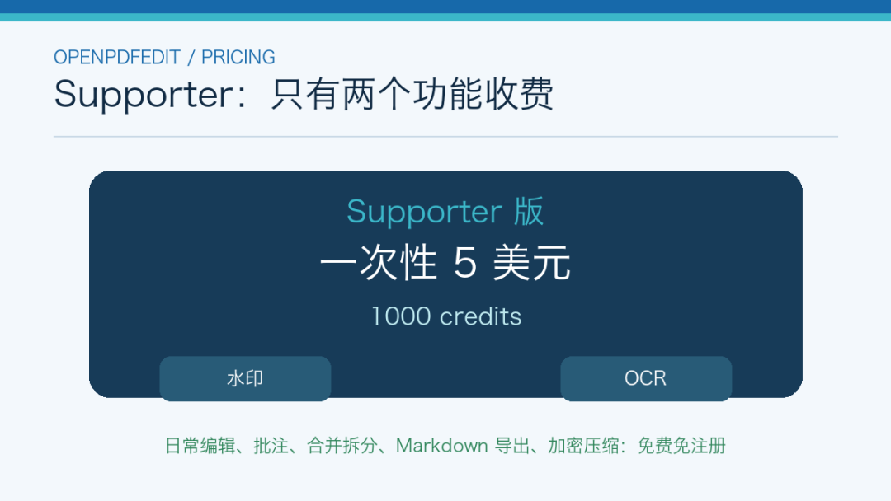
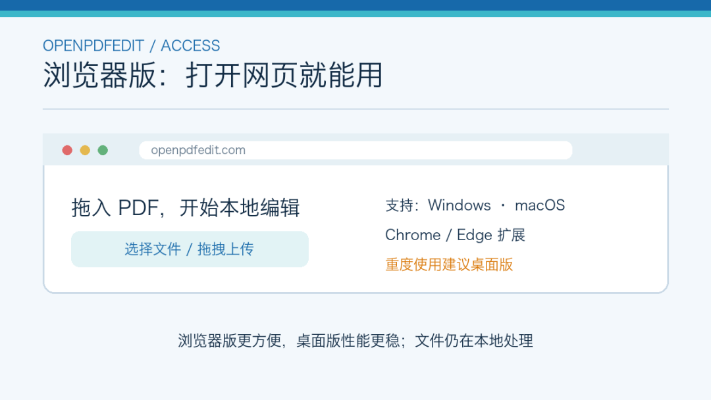

# OpenPdfEdit：本地处理 PDF，不上传文件还能导出 Markdown
> 💡 备注属性未写入，可能是备注属性名称或者类型被修改了，建议将字段类型设置为 rich_text，可以在小程序-操作-修改文章数据库页面进行调整
> 💡 原文链接:[https://mp.weixin.qq.com/s?__biz=MjM5ODc4MjY2MQ==&mid=2652105361&idx=1&sn=e2f8eba7a51d54aff2fbda4f90f53a8b&chksm=bc0f2192453c9d10e32d8aa49640e17a1fec6d408e29fbae4c38a37041fc7a1be7b2171eb456#rd](https://mp.weixin.qq.com/s?__biz=MjM5ODc4MjY2MQ%3D%3D&mid=2652105361&idx=1&sn=e2f8eba7a51d54aff2fbda4f90f53a8b&chksm=bc0f2192453c9d10e32d8aa49640e17a1fec6d408e29fbae4c38a37041fc7a1be7b2171eb456#rd)
网上编辑 PDF 的工具一大把，但用的人都知道痛处在哪。要么导出要交钱，要么免费版带水印，要么注册一堆账号才能用，要么把文件上传到别人的服务器——合同、社保、身份证扫描件往陌生的网盘一丢，心里总不踏实。

OpenPdfEdit 是把这一切反过来做的开源项目。 AGPL-3.0 协议， Rust+Tauri+Svelte+WebAssembly 技术栈，桌面版（ Windows/macOS ）、浏览器版、 Chrome/Edge 扩展三种形态。全部本地处理，文件不出你的机器。
### 一、它是个什么样的工具
OpenPdfEdit 的定位是"免费、开源、隐私优先的 PDF 编辑器"。项目在 GitLab 上托管，官网 openpdfedit.com 。截至 2026 年 10 月已有 5 个版本发布， 40 个功能模块。

技术上走的是现代组合： Rust 做后端核心， Tauri 打包桌面壳， Svelte 写前端 UI ， WebAssembly 跑在浏览器里。这意味着桌面版和浏览器版共用同一套代码，浏览器扩展和网页版也走同一套引擎。
### 二、核心功能

功能一共 40 个，覆盖阅读、批注、编辑、组织、表单、签名、加密、 OCR 、对比、导出十大类。
阅读部分。分块渲染，滚动流畅，缩放适配，全文搜索支持大小写敏感、整词匹配、跨行短语匹配。书签目录带当前章节高亮，页面缩略图可以拖拽重排，多文档标签切换。所有编辑都有完整撤销重做。
批注部分。文本高亮（跨行也可以）、下划线、删除线、便签、手绘墨迹（带平滑）、矩形、椭圆、橡皮擦。所有批注汇总在评论面板里，可以展平成页面的一部分。

编辑部分是重点。真去敏（ true redaction ）——删掉的是文字字节，不只是覆盖一层黑块。这一点比其他工具靠谱： PDF 假去敏是常见坑，你看到的黑块底下其实还有原文，复制粘贴就露馅。 OpenPdfEdit 是真的把文本字节从 PDF 里抹掉。
文字替换支持内联替换，但会披露替换字体（因为 PDF 里原始字体通常不可编辑）。文字块和图片都能移动重排。
页面组织。多文档合并、按页范围拆分、页面重排、 90 度旋转、删除页面、裁剪可见区域。表单部分支持填文本框、复选框、尽力支持单选按钮。静态文档里也可以加可填文本框和复选框。签名支持手绘复用签名，数字签名声明可查看但验证功能暂未实现。

导出部分是它相对独特的一点。 PDF 可以导出为 Markdown 或纯文本，标题、列表、表格都保留。这一点对技术文档、论文、 API 说明特别有用——PDF 版的规范文档转成 Markdown 后可以直接进 Git 仓库管理。
加密和收尾工具也不落下： AES-256 密码保护、按收件人授权、水印（ Supporter 版）、页码（四角任选字体起始号）、 Bates 编号（零填充前缀，诉讼文档常用）、压缩保存。
OCR 部分。扫描件 OCR ， Supporter 版功能， 12 种语言包括中英日韩俄阿。对比部分是并排文本+像素差异对比，做合同审核时用得上。
### 三、免费和付费

40 个工具中大多数免费免注册。只有两个是 Supporter 版功能：水印和 OCR 。一次性 5 美元，买 1000 credits 。也就是说，日常编辑、批注、合并拆分、导出 Markdown 、加密压缩，全部免费。
### 四、安装实测
桌面版支持 Windows 和 macOS 。浏览器版直接用 openpdfedit.com 在线体验， Chrome/Edge 扩展可以一键安装。

浏览器版的限制是部分功能依赖浏览器能力，性能比桌面版差一些。要重度使用建议装桌面版。
### 五、和其他方案的对比
跟 Adobe Acrobat 比， OpenPdfEdit 最大的差异是免费和开源。 Acrobat 功能更强但收费高， OpenPdfEdit 覆盖 90% 日常需求，剩下 10% 高级功能（比如真正的 PDF/A 归档、专业表单生成）需要付费版。
跟在线 PDF 工具（ iLovePDF 、 Smallpdf 等）比， OpenPdfEdit 的差异化是本地处理。在线工具要把文件上传到服务器，隐私风险客观存在。 OpenPdfEdit 桌面版和浏览器版都在本地跑，文件不出机器。
跟 pdf.js 这类开源库比， OpenPdfEdit 是完整的应用，而不是库。库要自己写 UI ， OpenPdfEdit 直接给你成品。
跟 LibreOffice 的 PDF 编辑比， LibreOffice 主要做格式转换， OpenPdfEdit 专注 PDF 编辑本身，功能更细。
### 六、几个注意点
OCR 和水印是 Supporter 付费功能， 5 美元一次性买断。介意的话可以用其他工具替代（比如 Tesseract 做 OCR ）。
数字签名查看但没有验证功能。要看签名真实性需要其他工具。
项目比较新（ 2026 年 10 月创建），功能仍在迭代。部分场景（复杂嵌套表格、扫描件 OCR 准确率）可能不如老牌工具成熟。
导出 Markdown 在复杂排版上会丢一些格式细节，标题层级识别基本没问题，但表格嵌套、图片位置可能要对一下。
### 总结
PDF 编辑这件事，如果你受够了"导出要收费""文件上传到陌生服务器"， OpenPdfEdit 值得试。 40 个工具免费覆盖 90% 日常需求，本地处理+导出 Markdown 两个点是它相对独特的优势。
GitHub/GitLab 地址： https://gitlab.com/openpdfedit/OpenPdfEdit
 官网： https://openpdfedit.com
PDF 编辑器不一定要收费、不一定要联网，也不一定要把文件上传到别人服务器。
