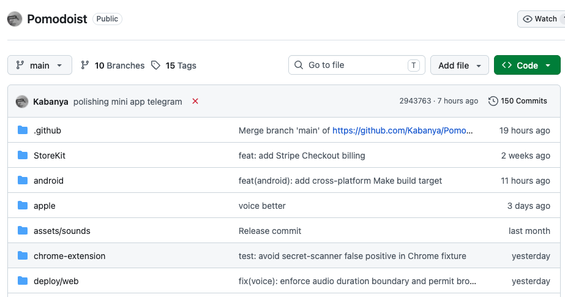
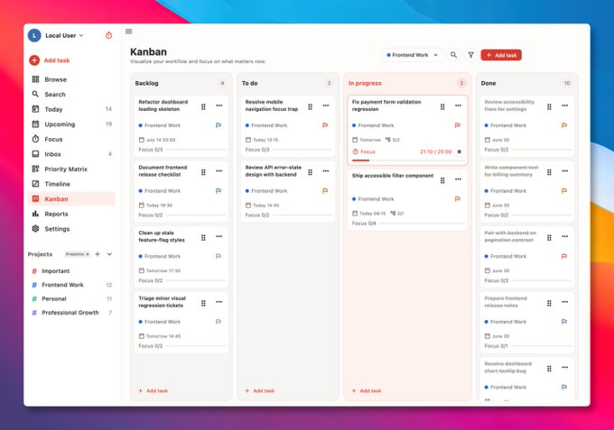

# Pomodoist：把待办清单和番茄钟焊在一起，GitHub 又冒出一个效率神器
> 💡 备注属性未写入，可能是备注属性名称或者类型被修改了，建议将字段类型设置为 rich_text，可以在小程序-操作-修改文章数据库页面进行调整
> 💡 原文链接:[https://mp.weixin.qq.com/s?__biz=MzkxMTYzMDcyNw==&mid=2247497547&idx=1&sn=ce0ed3b8bfd8c9029507404a598db1b0&chksm=c08f95f443117250a56ec2bbb94743035c5c9c1f0c97ff45aebe5a4a8c103434827a4776e177#rd](https://mp.weixin.qq.com/s?__biz=MzkxMTYzMDcyNw%3D%3D&mid=2247497547&idx=1&sn=ce0ed3b8bfd8c9029507404a598db1b0&chksm=c08f95f443117250a56ec2bbb94743035c5c9c1f0c97ff45aebe5a4a8c103434827a4776e177#rd)
最近刷 GitHub 看到一个挺有意思的小工具：**Pomodoist**。
它干的事很简单，把 Todo List 和番茄钟直接绑一起。
以前很多人的工作流是这样的：Todoist 记任务，另开一个番茄钟 App 开计时，切来切去。任务完成没完成，专注了多久，最后基本靠自己猜。
Pomodoist 直接把这几个东西揉成一个 App。
任务管理这块没偷懒，收件箱、今天、即将到来、项目、时间线、看板、优先级矩阵，再加搜索，一共 8 种视图。
东哥看到这种工具，第一反应一般不是功能多不多，而是“它有没有减少我的操作次数”。

这点 Pomodoist 处理得挺顺。
选中一个任务，直接开一轮番茄。25 分钟、休息多久，都能自己调。深度专注时间会跟任务绑定记录下来。
这个思路其实挺实用。
单独的计时器最大的问题是：你今天专注了 4 小时，到底在干啥？写代码？改 Bug？刷网页？最后一团乱。
任务和时间绑在一起，复盘的时候才有点东西看。
它还有周报，可以看每周完成量和专注时长走势。哪天效率掉下来了，翻记录基本能找到原因。
平台覆盖也比较全，macOS、iOS、Android、Windows、Linux、Web 都有。

不过东哥提醒一句，这类效率工具最容易踩的坑不是功能不够，而是建了一堆任务，然后花半小时整理任务。
我自己看开发工具会特别关注这种细节：数据怎么存、同步稳不稳、离线怎么办。毕竟以前折腾项目时，最烦的不是写代码，是配置、token、环境变量这些小地方突然给你来一下。
Pomodoist 这种定位比较明确，适合本来就有待办习惯，又想顺手统计专注时间的人。
不想两个 App 来回切的，可以去 GitHub 看看。这个方向确实挺对开发者胃口。
**项目地址：**Kabanya/Pomodoist。
