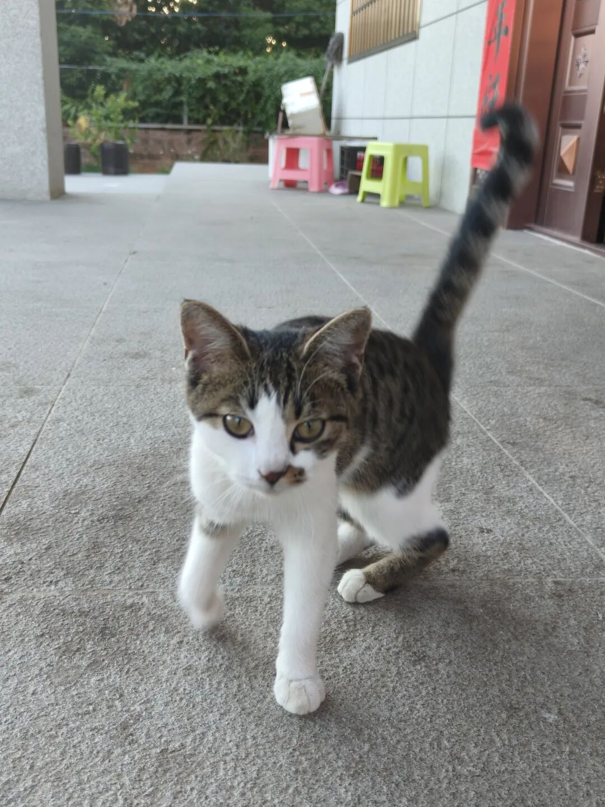
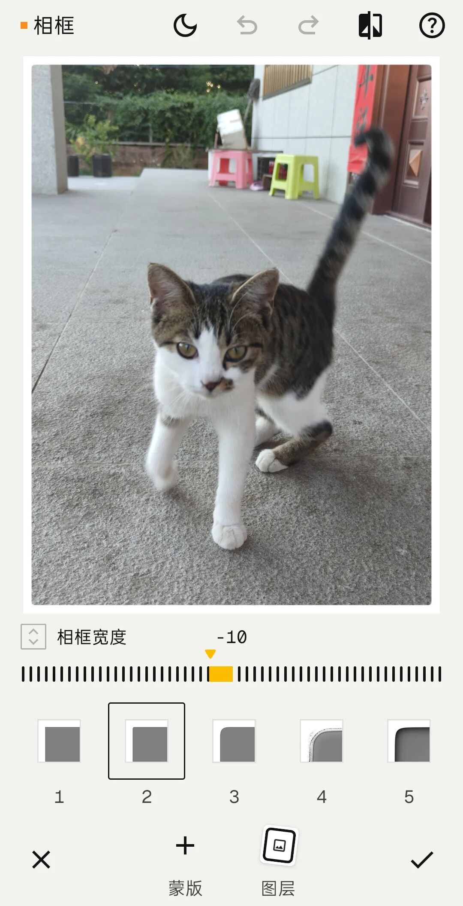
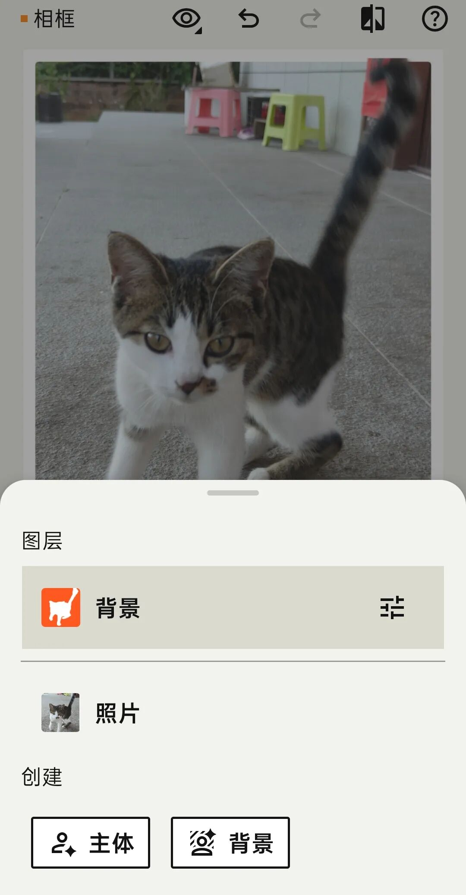
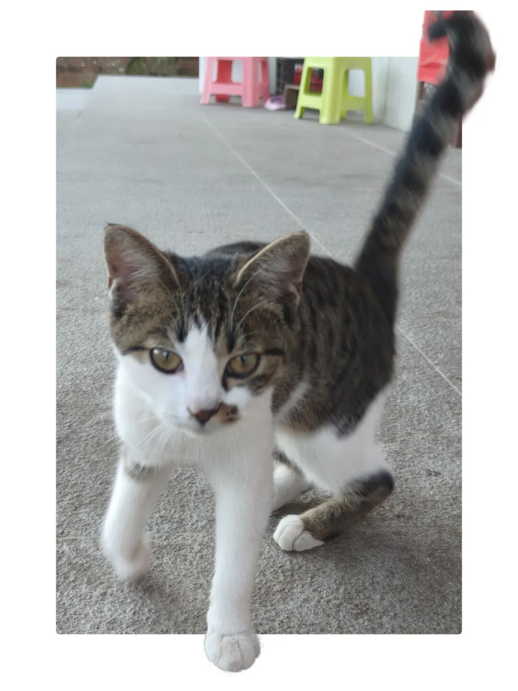

# Snapseed 4.1.9升级！免费解锁相框+蒙版，扫街照片氛围感拉满
> 💡 备注属性未写入，可能是备注属性名称或者类型被修改了，建议将字段类型设置为 rich_text，可以在小程序-操作-修改文章数据库页面进行调整
> 原文链接:[https://mp.weixin.qq.com/s/IcdhuYYKasYRnNQRQPPy_w](https://mp.weixin.qq.com/s/IcdhuYYKasYRnNQRQPPy_w)
扫街，挑选照片修图。
我的修图软件用过oppo自带的图像处理软件，用过醒图，修图软件light room，像素蛋糕，后面这几款软件功能都很强大，不过要收费，免费功能不够用。
最近Snapseed升级到4.1.9.986960696，功能强大，全免费。
就用了起来。

今天跟大家分享下我照片加框功能。
打开Snapseed，点击添加照片。

编辑好照片后，点击工具。
点开相框，有23个相框格式，选择其中一个。

调整相框宽度。
点击保存。有3个选项，选择你需要的进行保存。
升级了的Snapseed还有蒙板功能。

还以相框举例，选择图层，选择背景，调整相框宽度。
猫脚在相框内，蛮有味道。
相片有了立体感。

## 摘要

（待补充）

## 我的笔记

（待补充）
