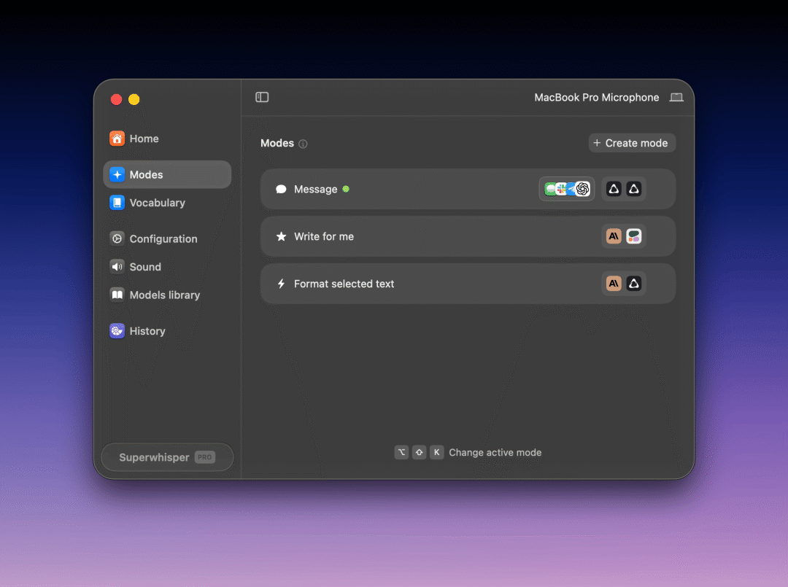
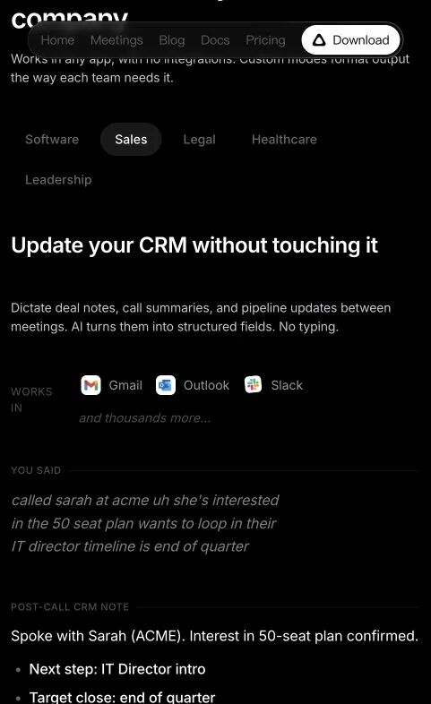

# Superwhisper：听写免费，整理收费
> 💡 备注属性未写入，可能是备注属性名称或者类型被修改了，建议将字段类型设置为 rich_text，可以在小程序-操作-修改文章数据库页面进行调整
> 💡 原文链接:[https://mp.weixin.qq.com/s?__biz=MzIxODIzMDM5OQ==&mid=2650351755&idx=1&sn=67e3d486bcca30c787f4e305c690bf04&chksm=8e7192e3ef40fd2eae609c617255dbe02faa200c65b9633d3735a169464cf6a5eddd095638f8#rd](https://mp.weixin.qq.com/s?__biz=MzIxODIzMDM5OQ%3D%3D&mid=2650351755&idx=1&sn=67e3d486bcca30c787f4e305c690bf04&chksm=8e7192e3ef40fd2eae609c617255dbe02faa200c65b9633d3735a169464cf6a5eddd095638f8#rd)
季度董事会报告交上来，英国旅游企业Holiday Extras的CEO Matthew Pack不再只靠键盘逐段修改。他用Superwhisper口述意见，再把原文和意见结合起来，整理成下一版报告。
这款工具做的事并不陌生：按住快捷键说话，把文字输入正在使用的应用。但在Pack这里，输入的不只是几句话，而是他对一份报告的判断。按Superwhisper公布的客户案例，产品先由他采用，随后扩展到约30名高管，再向这家905人公司的更多员工推广。[1]

**Superwhisper的模式设置。来源：官方文档。**
有意思的是，Superwhisper后来把一部分原本收费的能力放开了：2026年8月26日，Mac上的全部本地Whisper模型向免费用户开放。它没有取消Pro，而是把“听写”和后续的“AI整理”划进了不同档位。[2]
基础听写免费以后，Pro还剩什么值得买？先看它试图省掉的另一道工序。
### 听清楚了，不等于写好了
在官网的销售场景演示里，一位销售口述刚结束的通话：他联系了ACME的Sarah，对方对50席方案感兴趣，希望让IT负责人参与，时间安排在季度末。原话是连着说的，中间还夹着口头停顿。
整理后的文字则分出了客户意向、下一步和目标时间。下面按官网展示的含义译述，英文原文见截图。**这是官方输入输出演示，不是本文作者的实测。**[3]
| 口述里混在一起的信息 | 整理后的通话记录 |
| 联系了谁、对什么感兴趣 | Sarah，ACME；对50席方案感兴趣 |
| 希望谁加入讨论 | 下一步：引荐IT负责人 |
| 时间安排 | 目标成交时间：季度末 |

**官网销售场景演示。来源：Superwhisper。**
销售口述了意向、参与人和时间，页面把它们拆开列出，便于接手的同事扫读。不过，“季度末”被归入了目标成交时间，这个归类实际使用时仍要核对；联系IT负责人也没有因为生成一条记录就自动完成。
普通听写完成的是识别；这里展示的第二步，是按照任务重新组织文字。官方文档也将两者分开：纯转写模式不做AI处理；消息模式清理口头冗余，邮件模式补齐邮件结构，笔记模式整理要点与行动项。[4]
这些整理当然也可以交给另一个聊天工具。Superwhisper争取的便利在于，把处理方式设成模式，并在指定应用里自动启用，不必每次先复制转写稿、再解释一次要什么格式。[5]
但这也是它必须经得起检验的地方：如果每次都要检查、改写一大遍，单有“AI整理”四个字并不足以支持订阅。
### 先让CEO用顺，再让同事装上
Holiday Extras的故事，比一份功能清单更能说明产品怎样进入组织。
起点是AI工程负责人Jason Jack把工具介绍给Pack，而不是一次面向全公司的统一采购通知。Pack先在自己的工作里使用，再带向管理团队。
修改董事会报告恰好是一个适合展示价值的任务：报告已经存在，负责人也有明确意见，难的是把脑中的判断写完整。口述让他先把意见表达出来，原文则给后续整理提供依据。这里不需要AI替CEO作判断。
推广随后要解决的是安装和习惯。客户案例记载，公司通过内部软件服务提供安装，还培训员工适应在开放办公室里说话。约30名高管采用，是案例给出的阶段性进展；905是公司总人数，不是已购席位。[1]
这个培训细节很容易被忽略。语音输入省了打字，却要求人开口：在办公室里说什么、是否打扰同事、哪些内容适合口述，都不是模型识别率能解决的。
对工具创业者而言，这条采用路径值得借鉴的，不是“找到CEO就能卖进公司”，而是让一个有影响力的使用者先做成一件真实的工作，再给同事提供安装入口和使用方法。
### 企业还要问：内容发到哪里？
个人觉得顺手，离企业愿意部署还有一段距离。报告里有商业信息，客户沟通里也可能有敏感内容。
据客户案例，Holiday Extras通过本地处理，以及公司已有的OpenAI、Anthropic企业账户使用模型；API密钥接入的是受管理的企业账户。厂商将这套数据处理方式列为安全审批较快通过的原因。**这不是所有处理都离线，而是企业能选择和控制处理路径。**[1]
企业版还提供统一账单、单点登录、员工账号配置和模型访问控制。员工入职离职时，权限可以随企业目录管理；哪些模型能用，也不必完全交给个人决定。[3]
这些设置不一定让一次听写更准确，却决定了工具能否从个人电脑进入公司管理体系。产品兼容企业已经购买的模型服务，也减少了“为了试一款输入工具，再开一套数据处理流程”的阻力。
### 免费版留下什么，Pro又收什么钱？
Superwhisper给免费用户留下的并不是几分钟演示：本地Whisper听写不限量，还包括自定义词汇、文字替换，以及最多两个不带AI处理的模式。Pro增加AI处理、上下文感知、云端模型和文件转写等能力。
官网报价是每月8.49美元、每年84.99美元，或249.99美元买断。新用户有3000词的Pro试用，用完后回到免费档；已有内容不会因此被删除。[6]
这个设计让用户可以用自己的任务比较两档，而不是只看一张权益表：每天口述几条短消息，本地听写可能已经够用；如果经常要把长段口述变成邮件或工作记录，值得比较的是整理后还剩多少修改。
Holiday Extras则展示了另一层门槛：让一个人愿意开口，靠的是具体工作变轻松；让更多人能够使用，还需要安装、培训和数据管理。企业版要解决的，是后半段。
点击文末「阅读原文」，前往Superwhisper官网下载体验。
### 资料来源
1. Superwhisper｜Holiday Extras客户案例https://superwhisper.com/blog/holiday-extras
1. Superwhisper｜Mac免费听写更新https://superwhisper.com/changelog
1. Superwhisper｜销售场景演示与企业方案https://superwhisper.com/for-enterprise
1. Superwhisper文档｜听写与AI模式https://superwhisper.com/docs/modes/built-in
1. Superwhisper文档｜模式与自动启用https://superwhisper.com/docs/modes/modes
1. Superwhisper文档｜免费版与Pro定价https://superwhisper.com/docs/billing/plans

## 摘要

（待补充）

## 我的笔记

（待补充）
