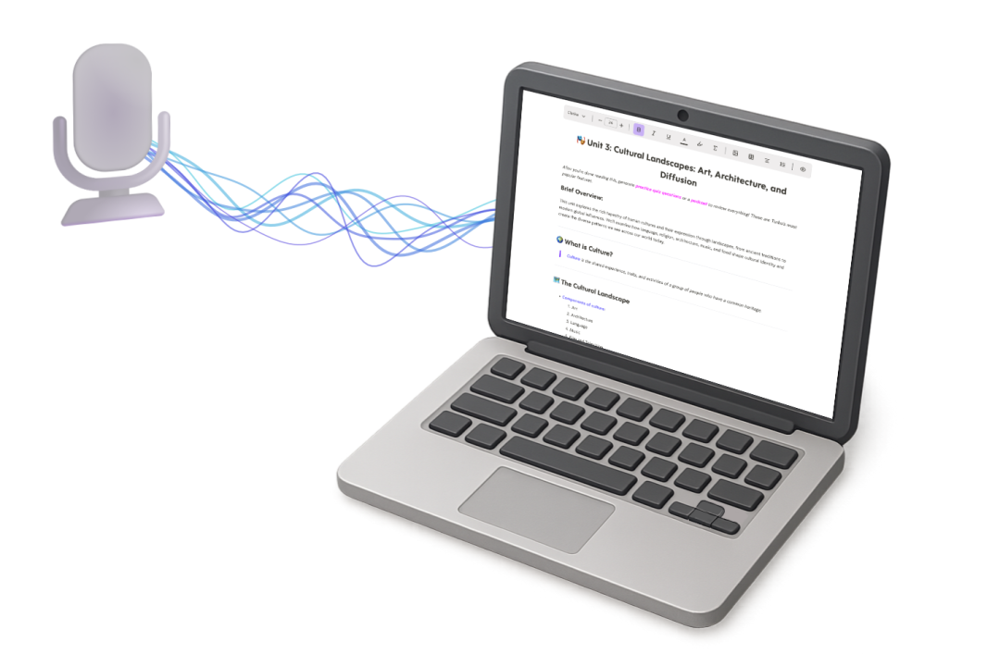
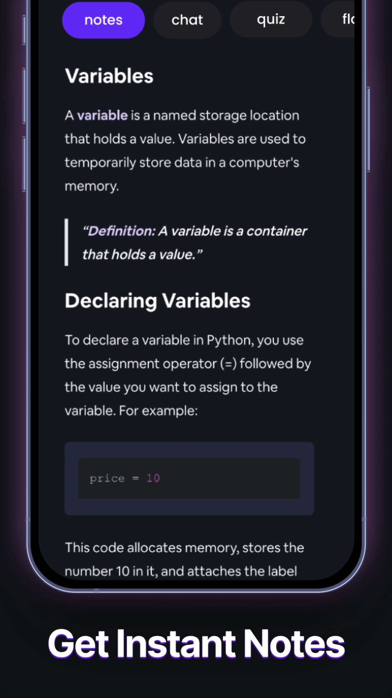
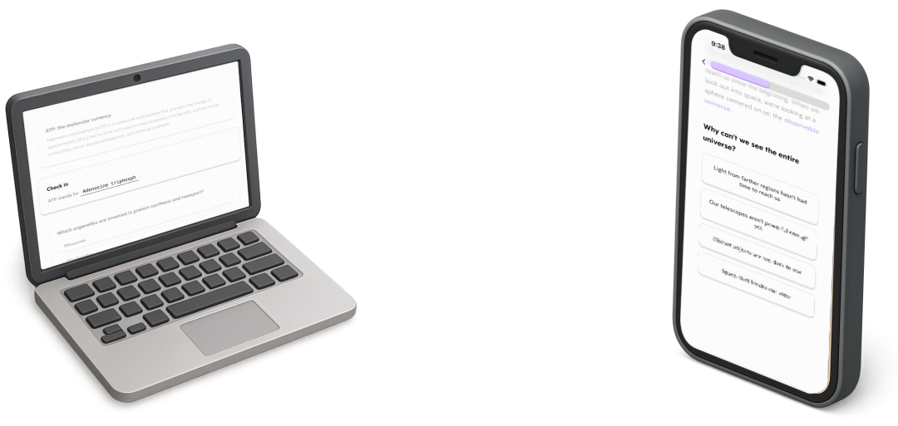

# Turbo AI：课堂笔记，累计收入1300万美元
> 💡 备注属性未写入，可能是备注属性名称或者类型被修改了，建议将字段类型设置为 rich_text，可以在小程序-操作-修改文章数据库页面进行调整
> 💡 原文链接:[https://mp.weixin.qq.com/s?__biz=MzIxODIzMDM5OQ==&mid=2650351684&idx=1&sn=1972e44f1d48bcccf05bcbaa5b3c7e84&chksm=8ecc3f65b707a3d862560280ef39a93fdb4c70922111a6054fface2d055ca26ebc85ad695ad1#rd](https://mp.weixin.qq.com/s?__biz=MzIxODIzMDM5OQ%3D%3D&mid=2650351684&idx=1&sn=1972e44f1d48bcccf05bcbaa5b3c7e84&chksm=8ecc3f65b707a3d862560280ef39a93fdb4c70922111a6054fface2d055ca26ebc85ad695ad1#rd)
把课堂录音和PDF交给AI，生成笔记、闪卡和测验，再把这套过程拍给同学看。Turbo AI这款学习App靠这个学生一眼就懂的场景，做出了超过1300万美元的累计收入。据《Inc.》2026年7月的创始人访谈报道，当时公司只有10名全职员工。这里的1300万美元是累计收入，不是年收入，更不是利润。[1]

**课堂录音转成笔记。图片来源：Turbo AI官网。**
一款笔记工具，为什么能卖出这笔收入？答案不能只看它用了什么模型，还要看它如何让学生第一次愿意试、下一次继续用，以及什么时候开始收费。
### 第一批用户，是拿饼干换来的
创始人Sarthak Dhawan在杜克大学读书时，看到同学在图书馆反复手抄笔记。他和搭档Rudy Arora做出的早期版本很粗糙，但已经能把PDF变成笔记和学习材料。
Dhawan在官方回顾中写道，为了找到最初的100名用户，他们在新生食堂发甜甜圈和饼干，还把传单贴进厕所隔间。到2025年10月，Turbo AI宣布用户达到500万。[2]
这段经历的价值，不在于“送饼干也能创业”。他们最初接触的不是泛泛的AI爱好者，而是正在上课、整理资料、准备考试的人。用户手里有现成的材料，拿来就能检验输出是否有用。
对于这类产品，第一次体验不必从空白对话框开始。学生不需要先学会写提示词，只需拿出自己的讲义：**能不能少花一小时整理，打开结果就知道。**
### 短视频起量，不等于获客永远免费
《Inc.》报道，Turbo AI最初的30万用户和50万美元收入，出现在投放付费广告之前。Arora从自己拍使用视频，逐步转向找朋友和小创作者制作内容，早期每条支付5美元，再给爆款奖励。到报道时，创作者费用已达每月数十万美元，是公司最大的支出，高于工资和模型推理费用。[1]
所以，不能把它写成“没有营销预算，白捡1000万用户”。更准确的路径是：先由创始人找到能传播的演示方式，再付钱扩大内容供给。
这个场景适合短视频，有一个产品层面的原因：前后变化能看见。输入是一段冗长录音或一叠讲义，输出是分好层次的笔记和可直接作答的题目。观众不必理解模型，就能判断“这是不是我今晚需要的东西”。
但传播效率与商业效率不是一回事。播放量可以证明内容吸引人，只有后续付费和留存，才能说明流量买得值。创作者成为最大费用项后，团队仍要回答同一个问题：新增订阅带来的收入，能否覆盖持续制作内容的成本？
### 收费之前，先让学生拿到结果
Turbo AI官网提供免费层，包含笔记生成、闪卡和测验，再用付费升级解锁更多能力。美区App Store列出的内购项目包括14.99美元和19.99美元的月度方案，以及多种年度方案；这些是商店展示的不同项目，不代表每个用户都会看到同一报价。[3][4]
这种设计把第一次判断留给用户：先用自己的材料生成一份结果，再决定是否为后续使用付费。

**生成的笔记可切换至聊天、测验等功能。图片来源：App Store。**
这里与通用聊天工具的差别，不宜夸大成“别人做不到”。它做的是把分散操作收进一个地方：不用每次重新上传、交代课程背景、再要求换一种题型。
| 学生现在要做的事 | 产品提供的形式 |
| 补回上课没记全的内容 | 录音生成笔记 |
| 记住关键概念 | 闪卡 |
| 判断自己会不会 | 根据材料生成测验 |
| 通勤时继续复习 | 音频播客 |
这些形式见于官方功能介绍。它们不是四个独立卖点，而是同一份课程材料在不同时间的用法。课堂只是获取材料的入口，课后复习才给了用户再次打开App的理由。[4]
### 用户认可结果，也会反感付费墙
App Store用户Mpatel32在2025年7月1日的一条评价里，同时留下了两种很直接的反应：
> “the notes it gave me were spectacular amazing I understood very well”
> 
> “it wouldnt let me upload another vid”
> 
前一句认可生成的笔记，后一句抱怨再次上传视频被拦住。原文拼写保留。这是一名用户的反馈，不代表全部用户，却把免费转付费的矛盾说得很清楚：**第一次结果越有用，第二次限制越容易被感受到。** [4]
对创业者而言，付费墙不是简单放在“用户最需要”的地方就结束了。额度、续费和取消方式是否清楚，同样决定这次购买留下的是认可，还是投诉。Turbo AI条款允许取消订阅后用到当前计费周期结束，并对退款设置了限制。[5]
### 1000万用户之后，不只等着下一节课
2026年7月8日，Turbo AI官方宣布用户达到1000万，并介绍新的Learn Mode：从简短的主题输入生成结构化课程。这个1000万是公司披露的用户总量，不是付费订阅人数。[6]
这个变化，把使用前提往前推了一步。以前要先有课堂录音或PDF，现在可以先有一个想学的主题。对产品而言，这是在尝试突破课程材料的限制；是否因此改善假期留存，还不能仅凭功能上线得出结论。

**同一学习工具覆盖电脑与手机。图片来源：Turbo AI官网。**
网页和手机同步，则让它能覆盖不同场景：电脑上整理资料，手机上继续作答。这里的移动端价值，是随身接住学习时间，而不是把网页版缩小一遍。[3]
当然，录得下来不等于有权上传。Turbo AI自己的条款要求遵守学校和教师规定，对受版权保护的材料取得许可，并禁止利用产品作弊。不能把“全自动记笔记”宣传成跳过课程规则的通行证。[5]
Turbo AI这笔生意最值得注意的，是产品演示与获客内容高度一致：视频里展示的，就是学生买回去要做的事。
而它的成本结构也提醒了后来者：AI让学习材料更容易生成，却没有让用户自动找上门。把“录音变笔记”做出来，只是开始；把它持续卖给正在需要的人，仍是一项要花钱、要反复验证的工作。
### 资料来源
1. Inc.创始人访谈：Turbo AI的累计收入、团队与获客方式（2026年7月27日）https://www.inc.com/diana-bocco/student-founders-entrepreneurs-ai-startup-venture-capital-funding/91380311
1. Turbo AI创始人回顾：从校园获客到500万用户（2025年10月16日）https://www.turbo.ai/blog/october-2025-announcement-5-million-users
1. Turbo AI官网：免费层与学习工作流https://www.turbo.ai/
1. Turbo AI官方App Store页面：功能、内购项目与用户反馈https://apps.apple.com/us/app/turbo-ai-learn-faster/id6502794561
1. Turbo AI服务条款：订阅、取消与课堂材料使用规则https://www.turbo.ai/terms-of-service
1. Turbo AI：1000万用户与Learn Mode更新（2026年7月8日）https://www.turbo.ai/blog/july-2026-announcement-10-million-users

## 摘要

（待补充）

## 我的笔记

（待补充）
