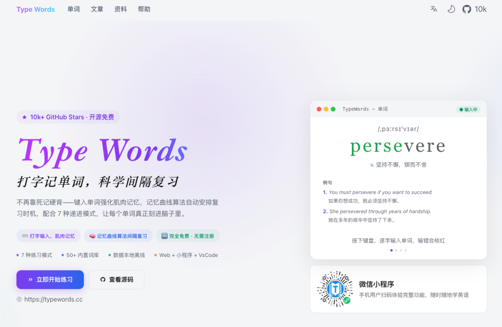
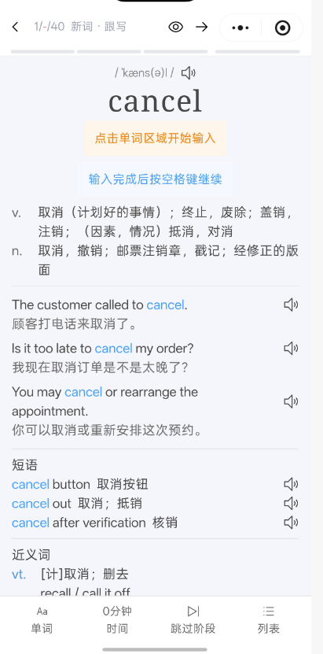

# TypeWords：背单词界最高的山
> 💡 备注属性未写入，可能是备注属性名称或者类型被修改了，建议将字段类型设置为 rich_text，可以在小程序-操作-修改文章数据库页面进行调整
> 原文链接:[https://mp.weixin.qq.com/s/HGFZeO-3x-V_mwDVDAgmIg](https://mp.weixin.qq.com/s/HGFZeO-3x-V_mwDVDAgmIg)
背了忘、忘了背，是大多数人的痛。
最近挖到一个神器：**TypeWords**——一个完全开源、免费的背单词项目，在 GitHub 上口碑极高，被很多人称为背单词界"最高的山"。

它最不一样的地方：**不是让你"选"单词，而是让你"打"单词**。
- • **打字记拼写**：跟打 → 听写 → 默写，难度一级级加上去，单词真敲进脑子
- • **FSRS 记忆算法**：不用自己排复习表，系统到点自动把该复习的推给你
- • **50+ 内置词库**：四六级、考研、雅思托福 GRE 全有，也能自己导入
- • **完全免费开源**：GitHub 上能看源码，支持自己部署，没有隐藏收费
而且**多端都能用**：
- • **网页版**：直接打开 https://typewords.cc ，不用注册
- • **微信小程序**：搜「TypeWords」，通勤碎片时间随时背

想自己搭同款、或看源码，去 GitHub 搜 **zyronon/TypeWords** 就行。
**背单词没有捷径，但好工具能让路好走一点。**
