# UU远程要收费了，它成了我手机上必装的「AI 工具」 | 附速通指南
> 💡 备注属性未写入，可能是备注属性名称或者类型被修改了，建议将字段类型设置为 rich_text，可以在小程序-操作-修改文章数据库页面进行调整
> 💡 原文链接:[https://mp.weixin.qq.com/s?__biz=MjM5MjAyNDUyMA==&mid=2651117958&idx=1&sn=52ca7fdfb1b75587204d3bbd144cf1c5&chksm=bc993f88273f0597ab4aaa71343b28b9439da0de4b6248e5d984633ffd8e52f48c8f60433191#rd](https://mp.weixin.qq.com/s?__biz=MjM5MjAyNDUyMA%3D%3D&mid=2651117958&idx=1&sn=52ca7fdfb1b75587204d3bbd144cf1c5&chksm=bc993f88273f0597ab4aaa71343b28b9439da0de4b6248e5d984633ffd8e52f48c8f60433191#rd)
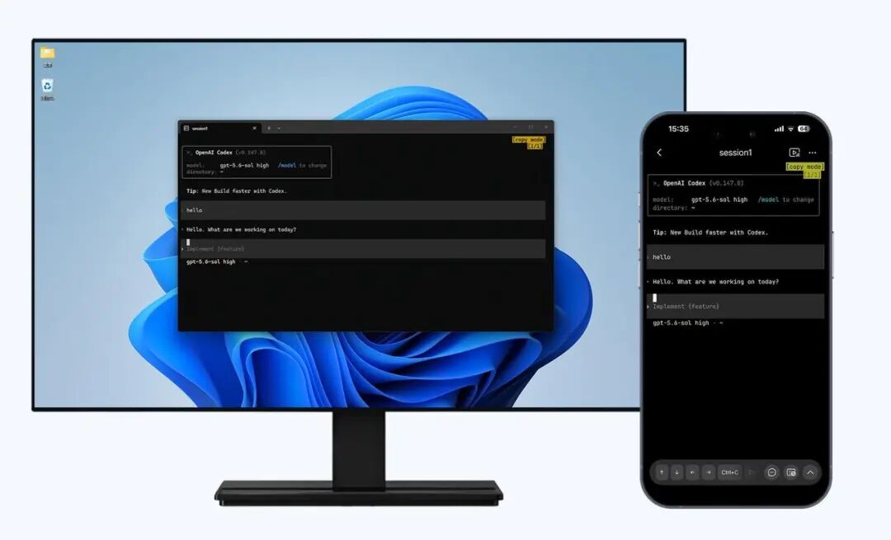
今年我最爱用的一个 AI 工具，下个月要开始收费了。
严格说它不是 AI 工具，但我的 AI 工作流已经离不开它——网易 UU 远程，一个远程控制软件。
这一年我打开它的次数，比打开很多 AI 应用还多。
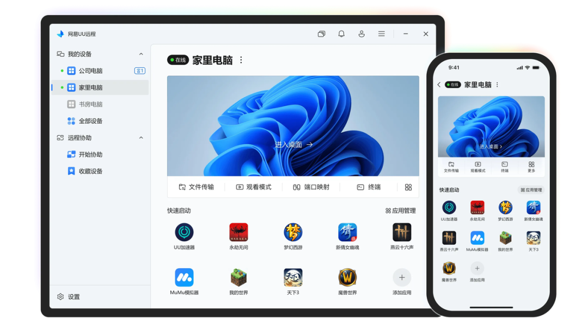
这年头让 Claude Code、Codex 干活，一个任务丢下去，经常一跑就是半小时，中间动不动就停下来问你要不要继续。
关键是人总不能一直守在电脑前啊，我的电脑放在实验室常年开着，人出门了，就拿手机连回去看一眼，回它一句。身边用 AI 写代码的朋友差不多都这么干，一问起用什么连，答案多半是 UU。
因为 UU 用下来流畅，没有广告，给写代码的人准备的功能也越做越细。
下面把我这一年的用法从头捋一遍，分享点经验。有几个小设置藏得比较深，不常用很难发现，enjoy~
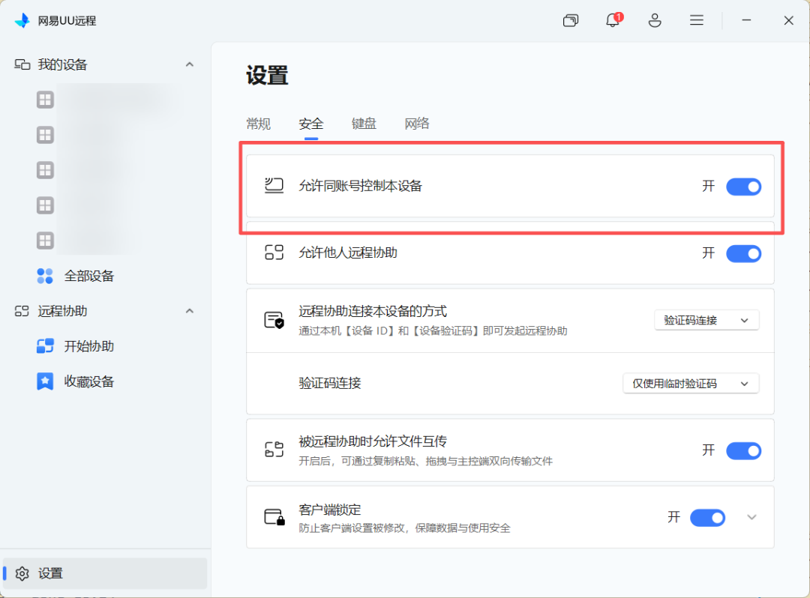
用手机接管电脑上的 Claude Code
咱先在电脑和手机上都装好 UU 远程，两边登录同一个账号。
官网能下到 Windows、macOS、iOS 和安卓版本，电视也有，不过电视只能当控制端，不能被控制。
装好以后，还得在电脑端打开「设置」，切到「安全」，把「允许同账号控制本设备」打开。
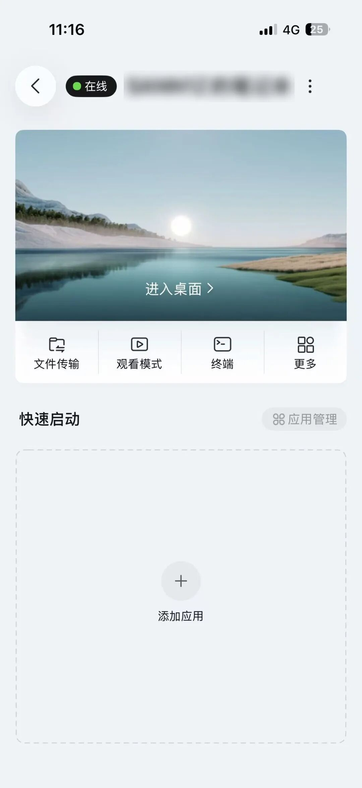
设好以后，手机的设备列表里就能看到这台电脑。显示「在线」就能连，点进去是这样一个页面。
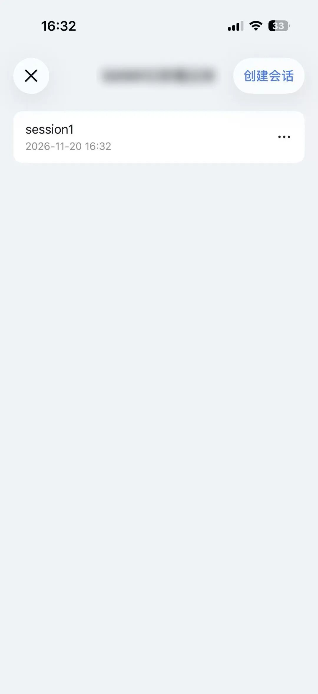
再点「进入桌面」，电脑屏幕就到了手机上，手指立马化身鼠标。旁边的「文件传输」「终端」后面都会用到。
下面的「快速启动」可以放几个常用软件，点一下就一键在电脑上打开。
如果你是拿 UU 来管 AI 干活的，我建议少点「进入桌面」，多点「终端」。
远程桌面要把整个屏幕的画面传过来，终端里的字缩到手机上小得看不清，得一直放大拖动。
终端这个适配就非常得劲了，只传文字，手机上就是一个干净的命令行窗口，4G 网络下也很丝滑。
点「终端」进去，右上角有个「创建会话」，点一下就建好了，第一个会话叫 session1。
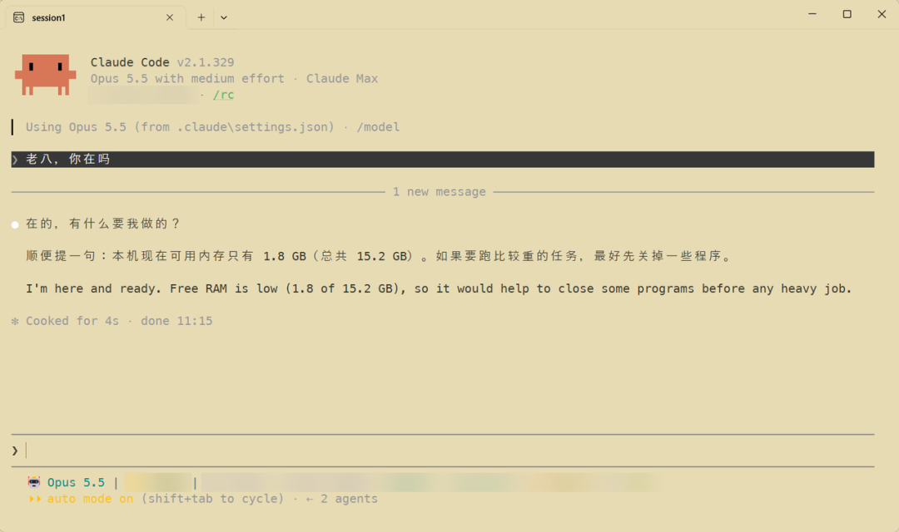
好玩的是，手机上建好会话，电脑上会同时弹出一个同名的窗口。两边是同一个会话，手机上敲的字，电脑屏幕上跟着出现。
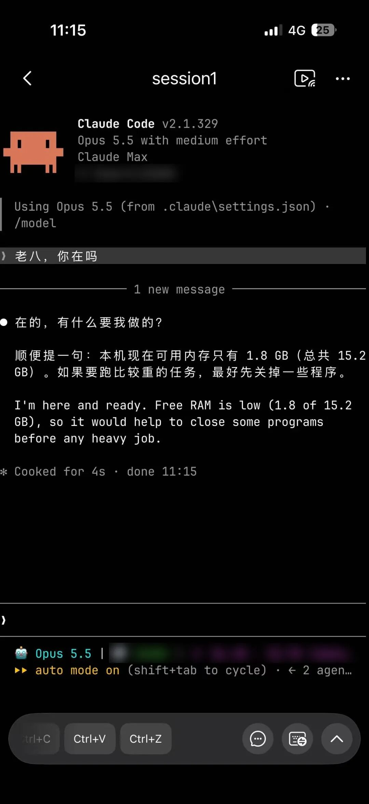
进到会话里，就跟在电脑上开 Terminal 一样，输 codex 或者 claude 就能把 AI 叫起来。我在 Wi-Fi 和 4G 下各试了一次。
进入 Claude Code，问一嘴「老八，你在吗」。
它回「在的，有什么要我做的？」，还顺手提醒我电脑可用内存只剩 1.8 GB，跑重任务前最好关掉一些程序。
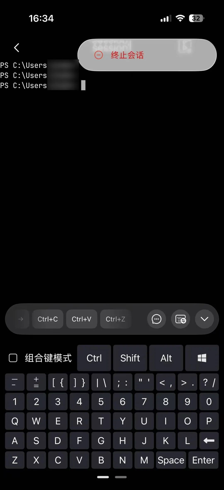
在手机上敲命令行，其实最怕缺功能键。
UU 在键盘上方排了一行快捷键，方向键、Ctrl+C、Ctrl+V、Ctrl+Z 都在。下面还能调出一整块电脑键盘，Ctrl、Shift、Alt 和 Windows 键都有，勾上「组合键模式」就能按组合键啦~

这几个键用 AI 时几乎离不了手。AI 弹出几个选项让你挑，靠方向键上下翻。它跑偏了，赶紧按 Ctrl+C 停下来。想贴一段报错的信息当 prompt，就按 Ctrl+V，CV 大法好啊！
快捷键那一行里还有个对话气泡的按钮，点开是一个单独的输入框，用的是手机自己的输入法。给 AI 提需求时打中文、打长句子，或者直接语音输入，都方便得多。（这里墙裂推荐语音输入，我在外面经常口头交代我的老八干活。）
需求提完以后，直接点左上角的返回就行，那只是暂时离开，会话还在电脑上跑着，回头还能点进去接着干。
等任务真做完了，再从顶部的菜单里点「终止会话」，这个会话才会关掉。我经常是把任务交代完就锁上手机去干别的，过一阵再打开，看它做到哪了。
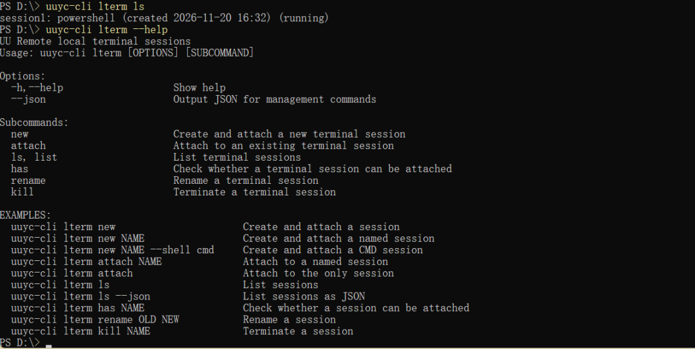
我最早用过 Claude Code 自己的远程控制，在手机的 Claude App 上接着操作电脑上的会话，到现在我都觉得那是最舒服的。
后来我的 Claude 账号被封过一次，之后就不太敢在手机 App 上这么连了，基本都换成了 UU 加终端。UU 不挑工具，Claude Code、Codex 都能跑。
体感也已经很接近官方的体验，而且还稳定。
坐在电脑前的时候，可以用 UU 自带的命令行工具 uuyc-cli 新建一个会话，在里面把 Claude Code 跑起来。出门以后打开手机上的终端，这个会话就在列表里，点进去接着看。
要新建会话，敲 uuyc-cli lterm new 加一个名字就行，之后想接回某个会话，就用 uuyc-cli lterm attach 加名字。想知道本机开着哪些会话，敲一句 uuyc-cli lterm ls 就能列出来。
我在电脑上敲了一下 uuyc-cli lterm ls，下午在手机上建的那个 session1 就列在里面，状态是 running，说明它一直在电脑上跑着。再加个 --help，能看到这一组的全部命令，改名、查询、关掉会话都有。
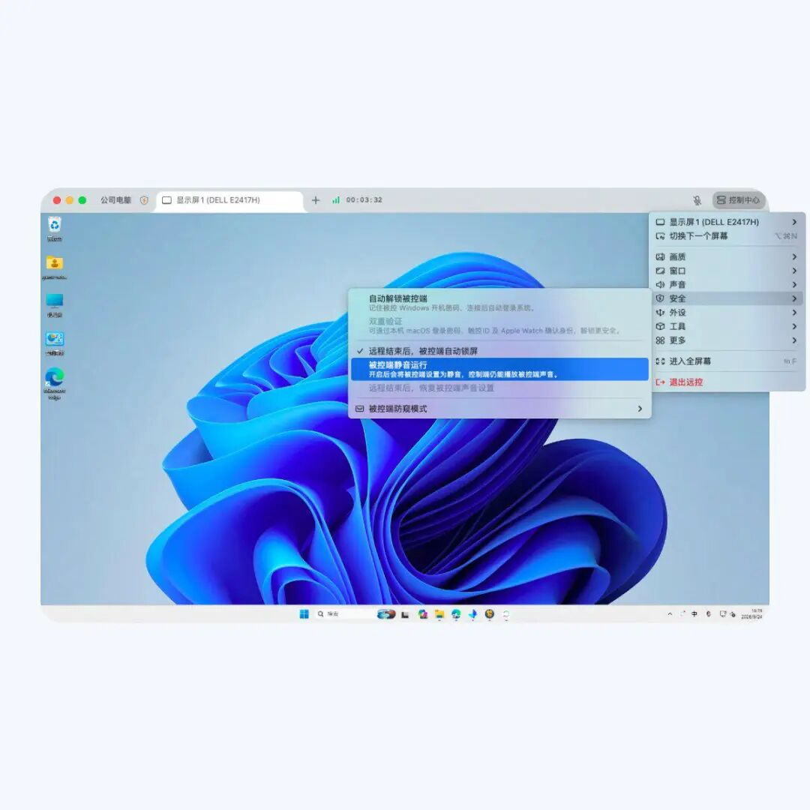
这里还有个小细节挺好玩，网易给的帮助文档里还专门写了一句，脚本或者 Agent 查询会话时用 list 和 has 这两条命令，看得出这个工具本来就打算让 Agent 自己来调。
几个藏得比较深的小功能
我的电脑在实验室，接着一块大显示屏，大家座位挨得很近。电脑上经常挂着我微信，人不在，用手机远程操作的时候，屏幕上在干什么，旁边的人一抬头就能看到。
所以连上以后，我都会先去安全设置里看一眼。手机上在底部的「操作」里找「安全」，电脑上在右上角的「控制中心」里。
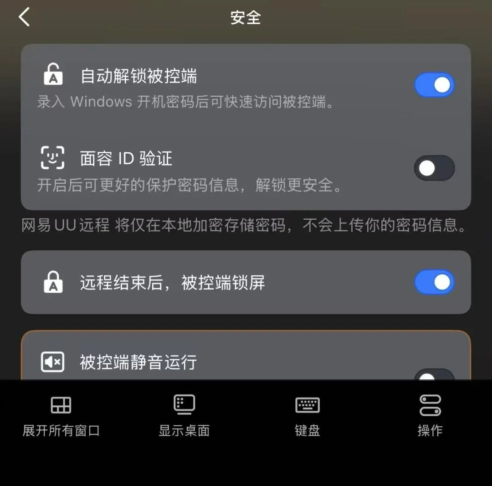
最先要开的是「被控端防窥模式」。打开以后，实验室那块显示屏会黑掉，我在手机上照常操作，屏幕前的人什么也看不到。
防窥模式管的是正在操作的时候，我还会顺手打开「远程结束后，被控端锁屏」。一退出远控，电脑就自动锁上，不用担心走之前忘了锁，别人坐过来就能用。
不过电脑锁着，每次连上都得重新输开机密码也麻烦，干脆把「自动解锁被控端」也开了。录一次 Windows 开机密码，以后连上锁着的电脑，就不用再在手机上输一遍密码。
UU 说这个密码只在本地加密存着，不会上传，介意的话还可以加一道面容 ID 验证。
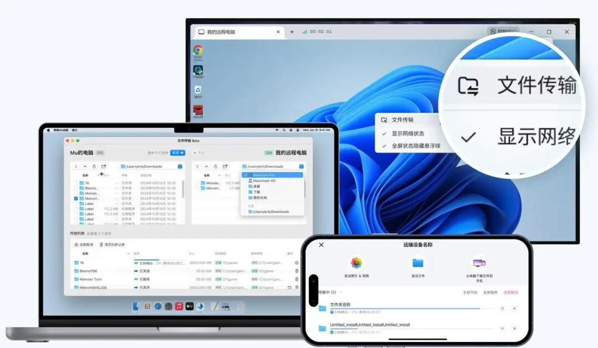
自动锁屏和自动解锁配在一起，手机退出软件的时候锁上，连上的时候打开，我自己基本不用管。
电脑端的设置里还有个「客户端锁定」，设一个安全密码，别人坐到你电脑前，也改不了 UU 的设置，退不掉客户端，你照样能远程连进来。
除了防窥和锁屏，剪贴板也能同步，这个功能超级实用。
手机上复制一段报错，想贴进电脑上的终端，远控时在「操作」里找到「安全」，打开「同步剪贴板」就行，第一次连接时也会弹窗问你。手机往 Windows 电脑同步只支持纯文本，上限 6 万字，贴一段提示词绰绰有余了。
传文件走设备页上的「文件传输」，手机相册里的截图、电脑上 AI 生成的文件，都能直接来回传，不用再发给自己的微信。

再进阶一点的是端口映射。我有个同学，她在实验室放了一台台式机，用自己的笔记本远程连回去，重活都交给实验室那台。
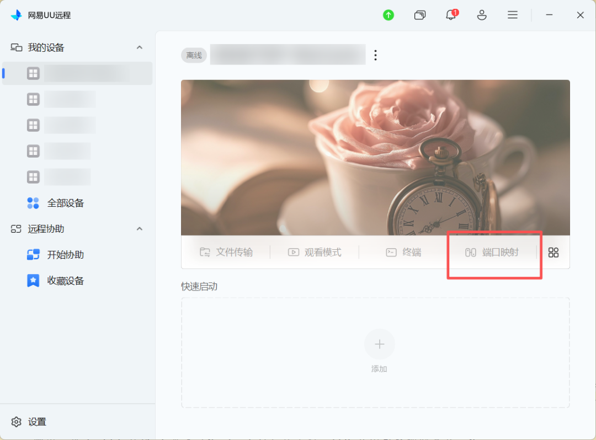
这时候如果实验室那台电脑上跑着网页服务或者 Jupyter，隔着远程桌面去点浏览器很别扭。UU 有个端口映射功能，能把那台电脑上的服务搬到眼前这台电脑上。配好以后，在自己的浏览器里输入 127.0.0.1 加端口号就能打开，不需要公网 IP，也不用动路由器。
它能干的事不少，让 AI 在实验室电脑上写的网页，开发服务一跑起来，在自己笔记本的浏览器里就能预览。Jupyter、数据库啥的。映射的目标还可以是那台电脑所在局域网里的其他设备，比如家里的 NAS。
我自己也借它打过一次洞。
之前我在苏州放了一台不用的笔记本，想把它接进自己的网络，那台机器在内网里，外面直接连不进去。调试那几天，我就是用 UU 的端口映射，把它上面的服务端口映射到手边的电脑上，省了自己搭内网穿透。
设置在电脑端。点开目标设备，新版的设备卡片上直接就有「端口映射」按钮，旧版本在「更多」里。
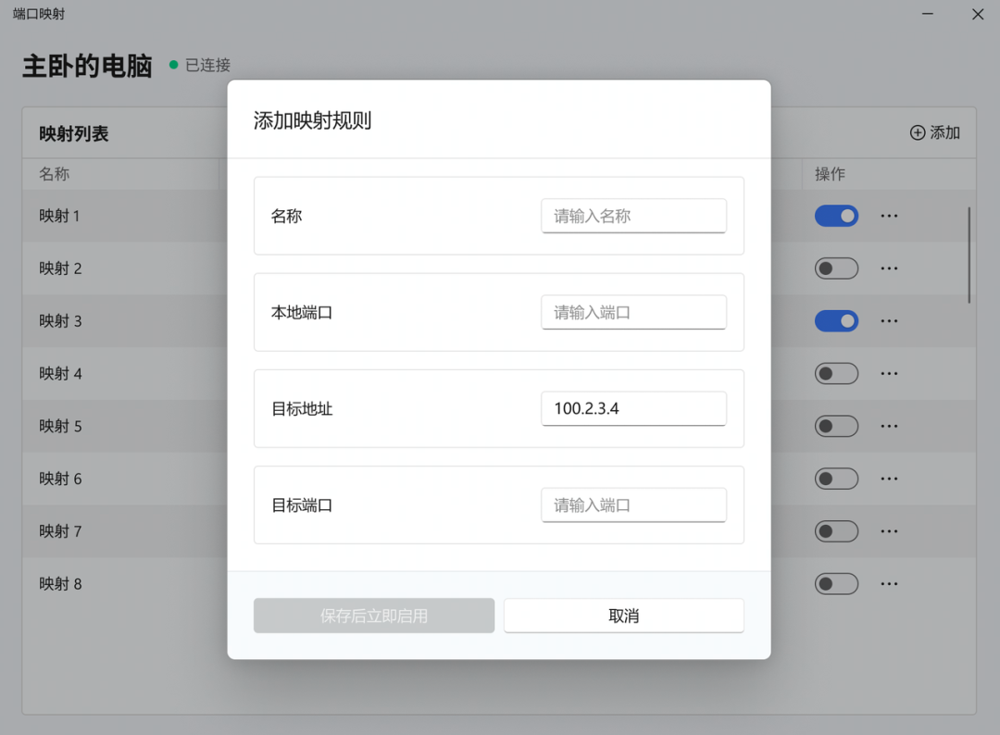
新建一条规则，填名称、本地端口、目标地址和目标端口，点「保存并启用」。
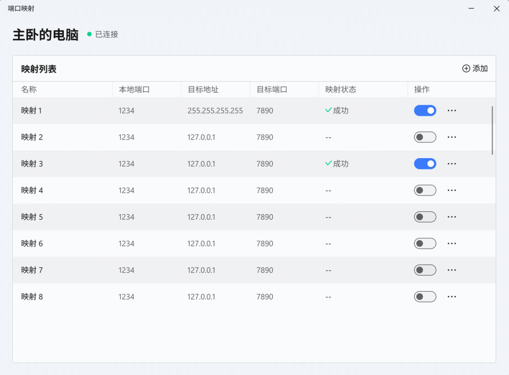
列表里显示「成功」就能用了。端口映射只在两台电脑之间用，Windows 要 4.21.0 以上，macOS 要 4.32.0 以上，只支持 TCP。映射窗口一关，映射也就停了。
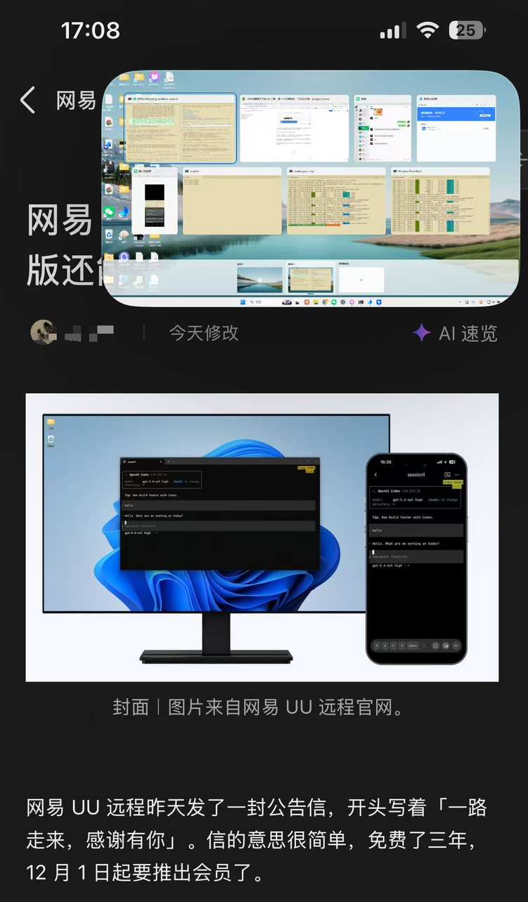
写这篇稿的时候，我把 UU 的帮助页和更新记录从头翻了一遍，又挖出几个平时根本没注意到的用法，写完自己也新学会几个小技巧。
比如设备页上一直有个「观看模式」，我之前一次都没点过。打开以后只能看电脑画面，碰不到鼠标和键盘。拿手机看 AI 跑到哪了，最怕手一滑点到别的地方，用它看就踏实多了。
不想一直占着整个屏幕的话，还可以切到「小窗模式」。电脑上是一个悬浮的小窗，手机上是画中画，切去和女朋友聊天的时候，也能在角落里盯着那边的进度。新版本里，手机上的 UU 退到后台时会自动开小窗。
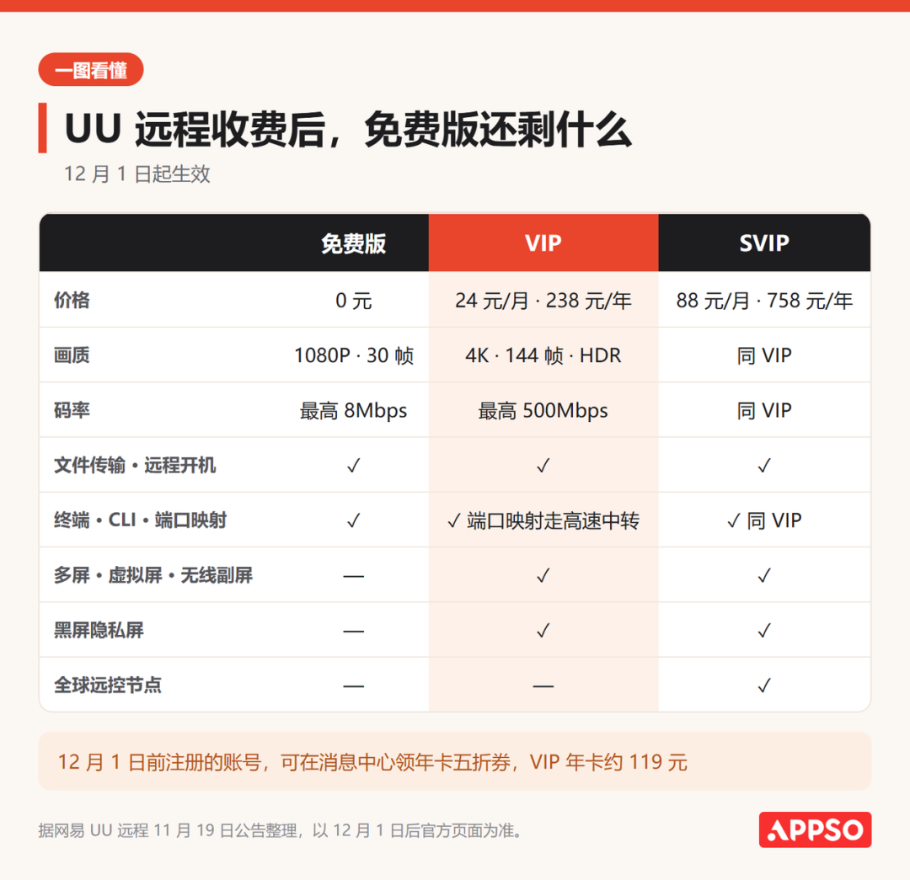
要是在图书馆或者咖啡馆远程，还有个「老板键」能派上用场，按一下就能把 UU 的主窗口和所有远控窗口一起藏起来。它默认没设快捷键，Windows 上要自己去「设置」里的「键盘」录一个。
前面那几个隐私设置护的是被控的电脑，这个护的是你手边这台。
收费以后，还值得用吗
12 月 1 日起，UU 推出会员，基础的远程控制还是免费，不限次数、不限时长、不排队、没广告。免费版的画质最高 1080P、30 帧，码率最高 8Mbps，4K、144 帧、多屏和虚拟屏这些进了付费档。

如果只是像我现在这样主要用终端，免费版其实够用了。终端、命令行工具、端口映射都留在免费版里，隐私屏保和远程结束后自动锁屏也在。终端只传文字，30 帧不碍事。受影响大的，是拿 UU 串流打游戏的人。
不过就算收费，我也愿意为它付钱。
哪天远程桌面成了每天的主力，比如换了新电脑，整天连回实验室那台干活，1080P 30 帧盯久了会吃力，会员里的 4K、多屏和虚拟屏功能绝对值得冲一波。
而且暂时也确实找不到能替代它的。向日葵和 ToDesk 以前用过，不太顺手，Claude Code 自己的远程控制只管 Claude 一家，而且我现在也不太敢这么连。
转了一圈，能天天用下去的还是 UU。
打算买的话，12 月 1 日之前注册的账号，能在客户端的「消息中心」里找到「老友五折福利」，领一张年卡五折券。VIP 年卡 238 元，打完折 119 元，一个月不到 10 块。

还有一点要留意，被控端在海外，或者系统检测到你在用 VPN，可能会被要求开全球会员，年卡 758 元。我平时用海外节点，目前用 UU 一切正常，12 月以后再看。
用了这一年，我最大的感受是，电脑放在哪已经不太重要了。
以前写代码，人得坐在电脑前一行一行敲。
现在活大多交给 AI，人要做的是交代需求，在它卡住的时候拍个板。Claude Code 在实验室那台电脑上跑，我走到哪，掏出手机就能看它一眼、回它一句。
我最近在攒钱换 Mac，可一想到要把这台游戏本上的环境整个迁一遍就头大。现在的打算是，环境都留在游戏本上，以后拿 Mac 用 UU 操控这台又笨又重的机器。
远程软件以前是运维和打游戏的人才装，现在只要用 AI 干活的人，基本是手机的「必装软件」了。
**我们正在招募伙伴**
**📮 简历投递邮箱**hr@ifanr.com
**✉️ 邮件标题**「姓名+岗位名称」（请随简历附上项目/作品或相关链接）
[更多岗位信息请点击这里🔗](https://mp.weixin.qq.com/s?__biz=MjgzMTAwODI0MA%3D%3D&mid=2652396877&idx=2&sn=dfef25453a6bf0dca147b0adca3deaf7&scene=21#wechat_redirect)

