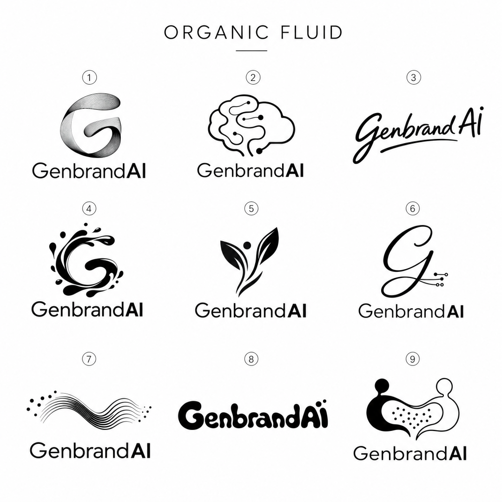
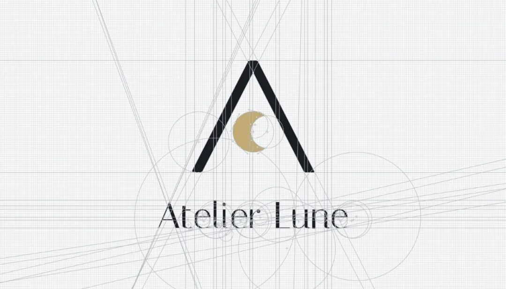
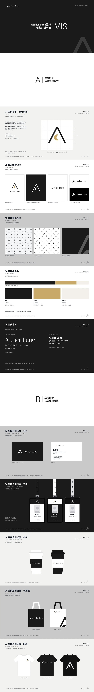
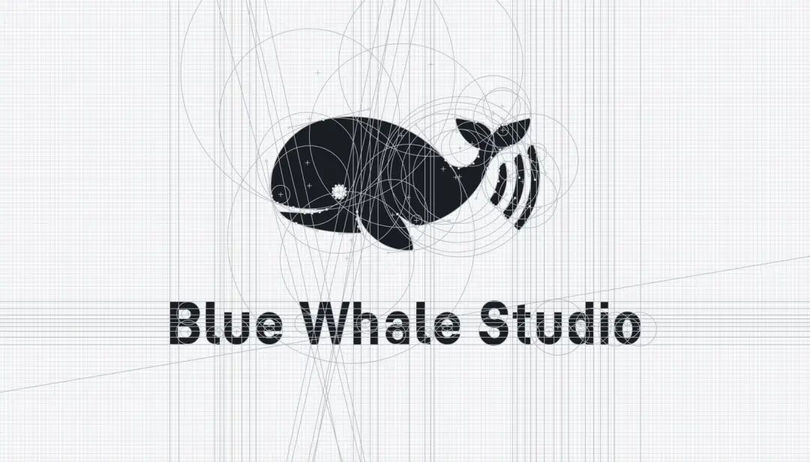
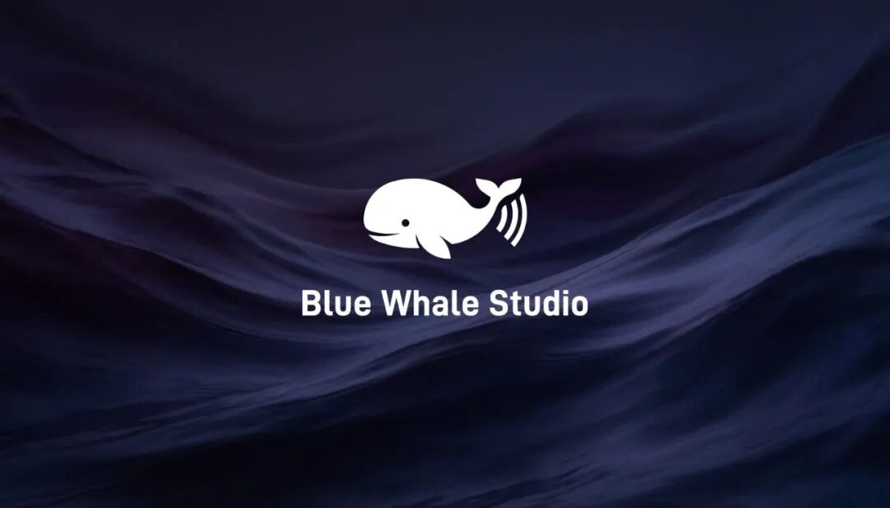
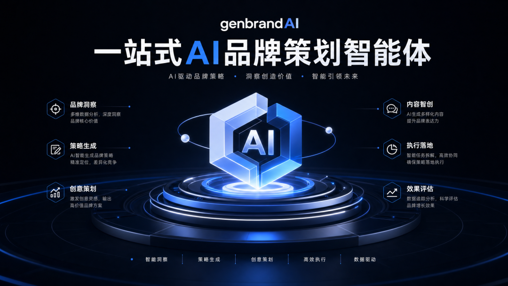
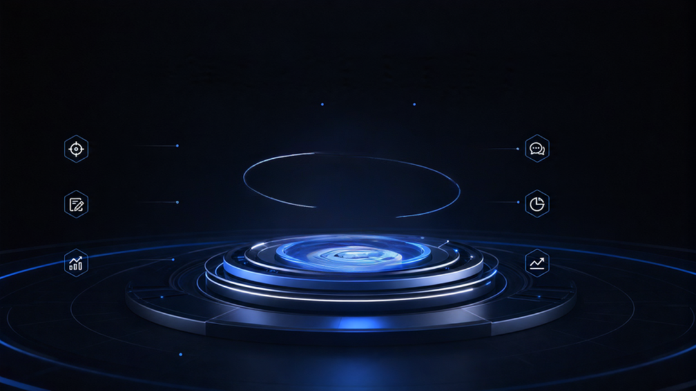
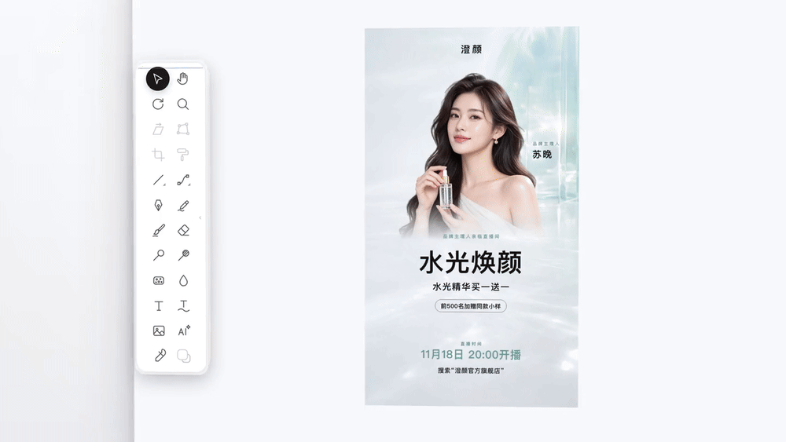
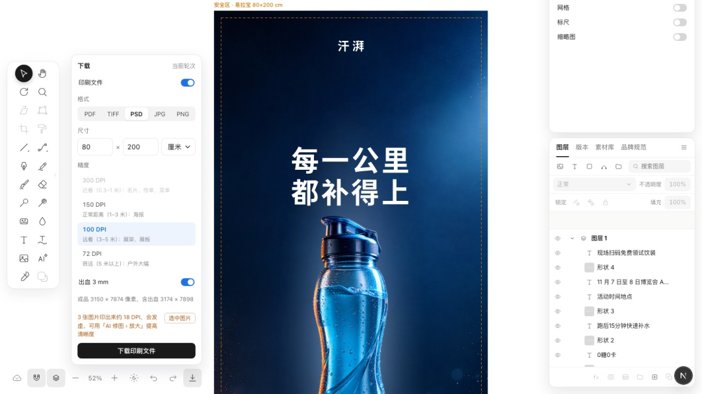

# VibeMuse与Lovart案例实测对比｜从 Logo 到整套品牌物料，真正拉开差距的是交付效果
> 💡 备注属性未写入，可能是备注属性名称或者类型被修改了，建议将字段类型设置为 rich_text，可以在小程序-操作-修改文章数据库页面进行调整
> 原文链接:[https://mp.weixin.qq.com/s/vUBWrlE3-d-93-cIVheOlw](https://mp.weixin.qq.com/s/vUBWrlE3-d-93-cIVheOlw)
你以为 AI 做设计，最难的是生成一张好看的图？
真正做过品牌项目的人都知道，出图只是开始。客户说「标题再短一点」，运营说「活动日期改了」，印刷店问「源文件和出血呢」——这些才是每天都要面对的工作。
这次，我们把 VibeMuse 与 Lovart的案例实测进行对比。结论很明确：**VibeMuse 的优势，不只是把图做出来，而是把设计继续往下做。**
从一个 Logo，到一张能改的海报，再到一整套品牌物料，它想替用户省掉的，是生成之后那些反复搬运、重建和返工的时间。
**01 / LOGO 交付**
### 做 Logo，不止给你灵感，更给你能落地的标志
先看 Lovart 生成的Logo 方案。
几何科技风里，有电路、六边形、立方体和网络节点；有机流体风里，有线条、手写字和植物形态。九宫格铺开，能快速看到多种视觉方向。

Lovart：几何科技风 Logo 方案
但从设计成稿呈现来看， Lovart 停在了「方案展示」。真正进入商用，还要继续回答：图形比例如何规范？细节如何调整？后续做名片、门头、包装和 VIS，拿什么文件接着做？
**VibeMuse 在案例中直接把这些答案放进了交付。**
Atelier Lune的字标不是一张孤立的成图。圆弧、直线、节点和网格被完整展示，标志的几何关系清晰可见。

VibeMuse： Logo 标准制图网格
这就是 VibeMuse 的第一个优势：**它不只帮你想一个标志，还在为这个标志后续真正被使用做准备。另外，还它可以直接在logo的基础上延展一套vis手册！**

Blue Whale Studio 也是一样。鲸鱼图形与字标背后，有完整的辅助线和制图结构，完全是按照专业设计师的手法进行创作。

之后，拿到Logo的矢量文件后，做门头时可以直接放大字标，做名片时可以取用图形元素，不需要重新描图。对创业团队和品牌方来说，这比多一版视觉灵感更靠近真实交付。
**02 / 原生可编辑画布**
### 改海报，不是把图片拆开，而是让设计真的能改
如果说 Logo 考验的是落地能力，海报修改考验的就是日常效率。
发布会材料中，Lovart 先输出一张完整品牌主视觉，再提供局部分层图。可以看到，它是在整图生成之后，再把其中的内容拆出来。但是拆出来的图层，依然还是存在部分元素无法独立编辑。

VibeMuse 走的是另一条路：**生成和编辑使用同一份设计数据。**
海报进入画布后，文字仍然是文字，图片仍然是图片，版式元素也没有失去结构。你可以选中内容继续调整，也可以直接告诉 Muse 要改什么，不需要先把成稿当成一张图片，再重新猜它由哪些部分组成。

这件事的价值，只有改过稿的人最清楚。
活动日期变了，改文字；产品图换了，换图片；标题长了，调版式。你不必因为一个小改动重做整张图，也不必在「拆图—修补—重排」之间来回消耗。
所以，VibeMuse 的第二个优势不是「多一个编辑器」那么简单。**它让 AI 生成第一次真正接上了后续设计流程：成稿之后，工作没有断。**
**03 / 连续品牌工作流**
### 做一个品牌，不用在五个工具之间从头再来
真实项目从来不是只要一张海报。
一家新店开业，前面要做市场研究、品牌命名和广告语，后面要做 Logo、VIS、开业海报、公众号封面和印刷物料。最麻烦的往往不是单点任务，而是每换一个工具，都要把品牌背景重新解释一遍。
VibeMuse 在发布会中展示的是一条连续工作流：
**市场研究 → 品牌命名 → LogoVIS → 海报**
这些任务发生在同一会话里。前一步确定的品牌信息，可以直接成为下一步设计的基础，不必反复复制资料、重建上下文。
这意味着，VibeMuse 交付的不只是单张物料，而是在尽量保持同一个品牌的策略、语言和视觉一致性。
对创业团队，它减少了从 0 到 1 搭建品牌的协调成本；对门店和电商卖家，它让上新、促销和节点物料可以接着已有品牌继续做；对设计师，它把重复性的延展和修改交给 AI，让创意判断留给人。
从命名到海报，同一套品牌信息一路沿用。你不需要在五个工具里，反复解释一遍「我是谁」。
**04 / 源文件与印刷交付**
### 最后一步也不掉链子：源文件能拿走，印刷文件能送印
设计做到这里，还差最后一关：文件能不能真正交出去？
VibeMuse 支持的导出能力覆盖了实际交付中的不同对象：
**方案文档**　Word、PDF、PPT
**常规图片**　PNG、JPG
**继续设计**　PSD 分层文件、可编辑矢量
**印刷交付**　PDF、TIFF、PSD，并支持出血设置
易拉宝、X 展架、传单、名片等物料，可以按实际尺寸导出印刷文件，带 3mm 出血。设计不再只是屏幕里的预览，而是可以继续进入制作环节的成品文件。

这也是「一张效果图」和「一项设计交付」的区别：前者让你看见结果，后者让结果真正进入使用。
### VibeMuse 真正要替代的，是生成之后的重复劳动
**一张效果图只能展示结果；VibeMuse 交付的是一套能继续改、能延展、能送印的设计文件。**
它解决的不是「AI 会不会画」这个老问题，而是一个更接近商业现场的问题：**画完以后，能不能少返工、少重建，直接接着做？**
**创意阶段看可能性，交付阶段看可改性。**VibeMuse 把更多功夫花在了后半句，也正因为如此，它更像一位能陪你把项目做完的 AI 品牌助手，而不只是一台出图机器。
如果你正在筹备品牌、门店或下一次上新，不妨拿一件真实任务来试：从一句需求开始，看看它能否一路走到你需要的成稿。
**让下一件品牌物料，从 VibeMuse 开始**
访问 www.vibemuse.art开始你的第一次完整品牌交付。
