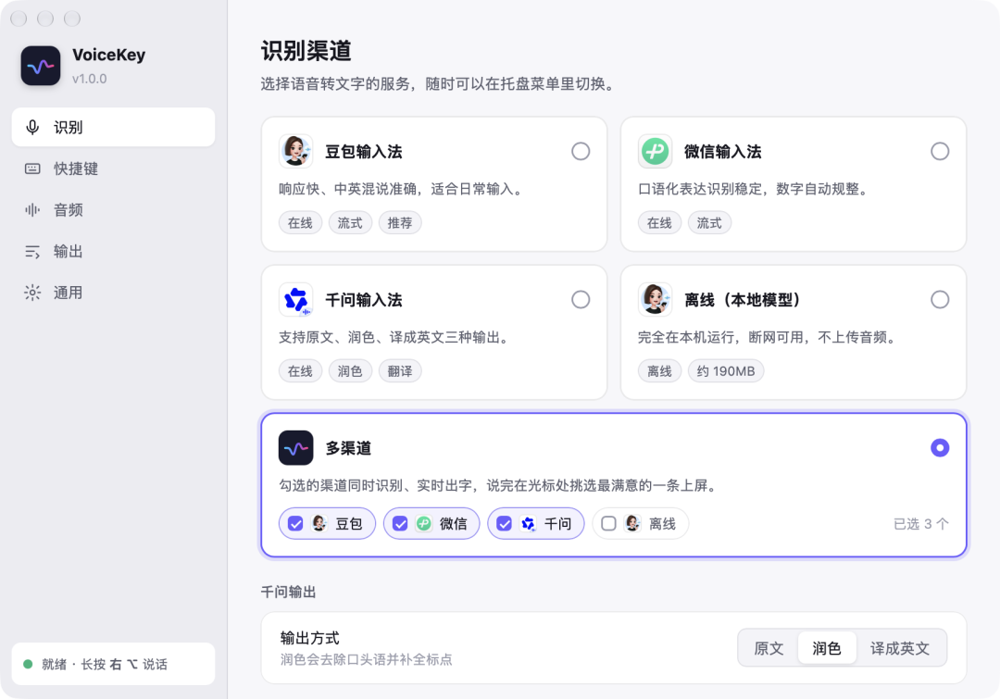
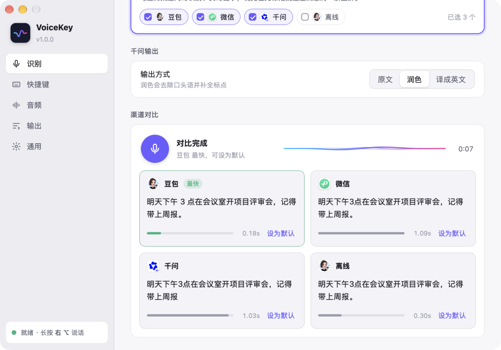
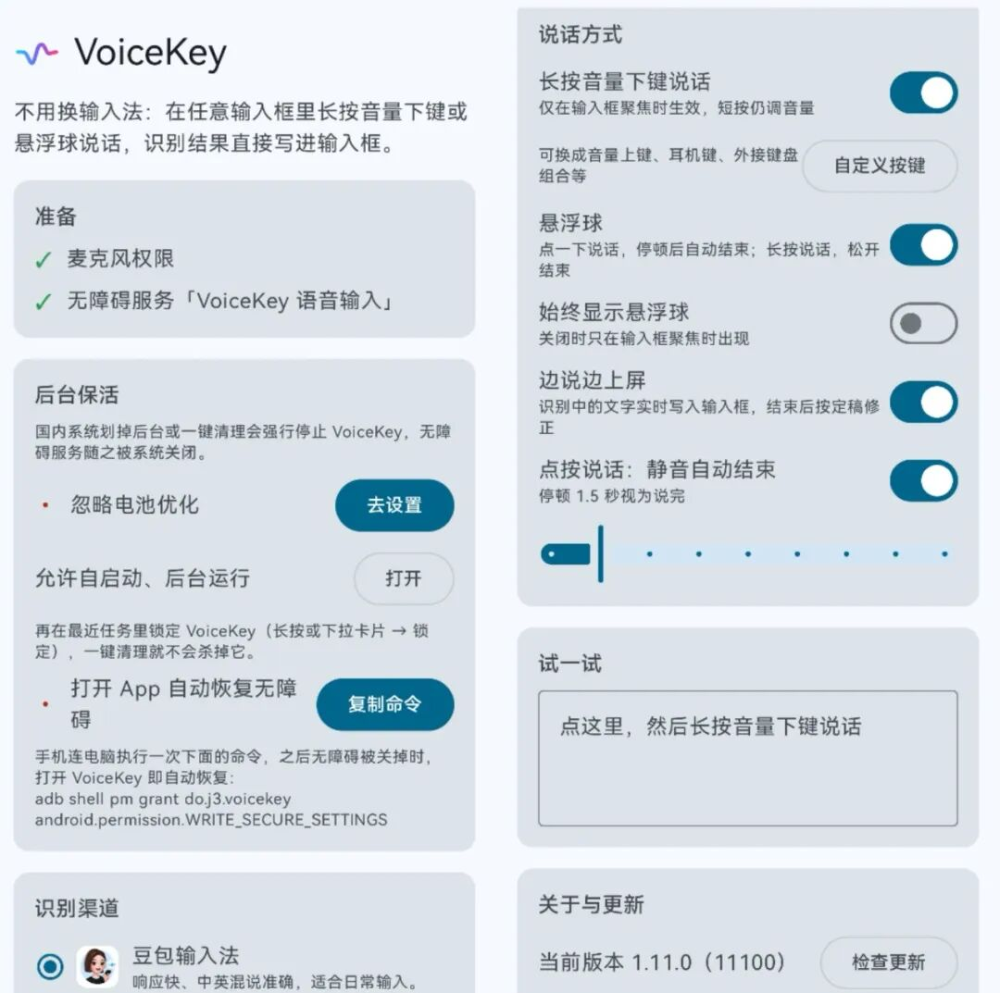

# VoiceKey免费开源！轻松实现电脑语音输入
> 💡 备注属性未写入，可能是备注属性名称或者类型被修改了，建议将字段类型设置为 rich_text，可以在小程序-操作-修改文章数据库页面进行调整
> 💡 原文链接:[https://mp.weixin.qq.com/s?__biz=MzUxOTk2Njc0OQ==&mid=2247502392&idx=1&sn=25607d394f95f6ab361698b3a06d4c07&chksm=f8fba335c190086f0ba28bc8d1b283f7f51a7f6bb62c2033258299fda1421c5814574da9c658#rd](https://mp.weixin.qq.com/s?__biz=MzUxOTk2Njc0OQ%3D%3D&mid=2247502392&idx=1&sn=25607d394f95f6ab361698b3a06d4c07&chksm=f8fba335c190086f0ba28bc8d1b283f7f51a7f6bb62c2033258299fda1421c5814574da9c658#rd)

VoiceKey支持Windows、macOS、Android 语音输入。桌面端按住或点按快捷键说话；Android 不替换输入法，识别结果写进当前输入框。iOS端是带语音的中文键盘，需从源码构建。
**桌面端**
- 多个识别渠道：豆包/微信/千问/百度/搜狗/讯飞/Chatterfly/叭哥说云端识别（后两个需登录官方账号），以及完全本地运行的离线识别：微信离线（macOS / Windows）、豆包离线（仅 Apple 芯片 Mac）
- 边说边上屏：识别中的文字实时打到光标处，结束后按定稿修正；关闭后改为结束时一次性粘贴
- 麦克风选择、开机启动、浅色 / 深色主题、应用内自动更新
可选择多渠道的语音识别 

候选框：说话时各渠道实时出字，松开后逐条定稿并显示耗时，数字键或回车选一条上屏
**说话时**

**松开后**

渠道对比：录一段话，比较各渠道的结果和速度

单渠道模式下，屏幕底部显示声波浮层和实时文字

默认右边的 Alt 键是按住说话，而右边的 Ctrl 键为按一下说话再按一下输出，也可自定义
**手机端**
- 渠道：豆包/微信/千问/百度/搜狗/讯飞，以及微信离线（约 100MB，本机推理）
- 多渠道候选、边说边上屏、点按静音 1–5 秒自动结束
- 长按音量下键只在输入框聚焦时生效，短按仍调音量
给予麦克风和无障碍权限后即可使用

默认长按音量下键或点击悬浮球说话激活识别

软件在Github免费开源
—End—
喜欢就点一下推荐呗
**👇去下载**
