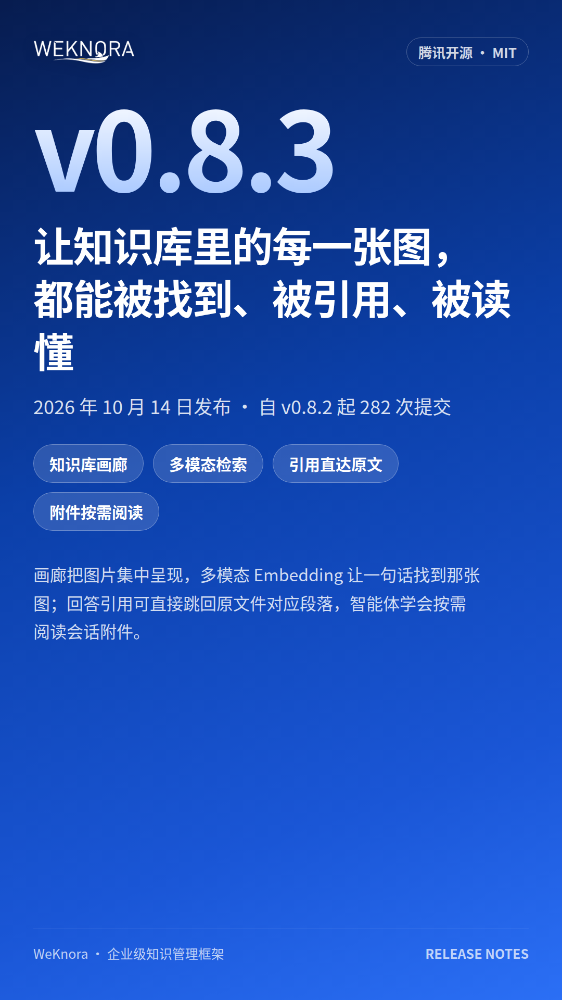

# WeKnora v0.8.3 发布｜让知识库图片可检索、可引用、可追问，RAG 证据链闭环
> 💡 备注属性未写入，可能是备注属性名称或者类型被修改了，建议将字段类型设置为 rich_text，可以在小程序-操作-修改文章数据库页面进行调整
> 💡 原文链接:[https://mp.weixin.qq.com/s?__biz=Mzg5NTA0MTEyNw==&mid=2247484885&idx=1&sn=927f66a934b1b0e2edd472fc6b3dc542&chksm=c18ab0bd1e58b598c6fd759a363191de7891d465031b451836bd5e3220285889554be4a8a97a#rd](https://mp.weixin.qq.com/s?__biz=Mzg5NTA0MTEyNw%3D%3D&mid=2247484885&idx=1&sn=927f66a934b1b0e2edd472fc6b3dc542&chksm=c18ab0bd1e58b598c6fd759a363191de7891d465031b451836bd5e3220285889554be4a8a97a#rd)

文档中的核心信息大量藏在架构图、截图、图表里。传统 RAG 仅依靠图片周边文字与 OCR 检索，图片本身长期处于 “隐身” 状态：无法检索、不能直接定位原文、AI 无法直接读图参与推理。
WeKnora v0.8.3 正式发布，本次版本核心补齐**多模态知识检索与精准原文引用能力**，同时强化 Wiki 图谱、Agent 会话附件、团队平台管理、多数据源同步与检索稳定性，完成从个人知识库向企业知识基础设施的演进。
### ✨ 核心更新亮点
#### 1. 知识库画廊：文档图片统一资产管理
新增画廊页签，自动提取文档内图表、截图，集中可视化展示。
- 支持按 OCR 文本、图片描述检索，按来源文档筛选过滤；
- 图片详情页展示原图、OCR 识别内容、来源文档溯源；
- 无需开启向量检索即可启用，适合研发架构图、报告图表、质检截图追溯场景。
#### 2. 多模态 Embedding：以文搜图，图片参与 RAG 推理
将图片与文本编码至同一向量空间，支持文字查询直接匹配相关图像。
- 原生支持腾讯 WeMM Embedding、Qwen3-VL Embedding，内置模型预设与 Transformers 部署脚本，兼容 vLLM 推理服务；
- 检索命中图片可送入重排模型评估相关性，并交给视觉大模型参与回答生成；
> 提示：图片向量检索默认关闭，启用后需要对存量文档重新解析；PDF 整页扫描图仍依靠 OCR 文本检索。
> 
#### 3. 引用直达原文：从 “标注来源” 升级到 “定位片段”
回答内引用支持一键跳转至 PDF/Office/Markdown/EPUB 等原始文档，并自动高亮对应段落，音频引用支持跳转至对应时间节点，大幅降低人工核验成本。
#### 4. Agent 会话附件：按需读取，无需沙箱
会话上传文件后台异步解析，智能体采用**清单优先、按需分页读取**的策略：先获取附件清单，再按需读取正文与图片。
- 支持attachment://资源访问，图片观测结果可缓存复用，减少模型开销；
- 文件随会话生命周期保留，支持后续追问持续复用附件内容；
- 聊天框支持截图粘贴上传，@资源菜单新增全局搜索，快速跨知识库选取资源。
#### 5. Wiki 知识图谱升级：分组视图，大规模图谱可读
重构 Wiki 图谱可视化，页面关系自动分组并附带主题描述，解决大图节点重叠混乱问题。
- 支持全局概览与分组聚焦切换，隐藏无关节点，配套筛选、搜索；
- 新增跨知识库 Wiki 检索 API；修复表格丢失、反向链接、后台写入任务稳定性问题。
#### 6. 企业平台能力补齐：模型目录、邀请注册与用户管理
面向团队运维场景，平台控制台新增系统用户管理：账号启停、密码重置、管理员权限管控；新增**仅限邀请注册**模式，控制团队成员准入。
- 模型目录控制台：编辑、预览、版本回滚模型配置，内置模型厂商扩充至 30 家；
- 新增 Hugging Face TEI、Pinecone Inference、Cohere v2 重排协议接入，增加 Claude 5.5 系列模型预设。
#### 7. 数据源、解析、检索与 MCP 生态迭代
- 新增 Seafile 数据源，支持目录增量同步；优化飞书、Notion、语雀、Confluence、钉钉文档同步，钉钉可直接摄取钉盘 PDF/Office 文件；
- 文档解析升级 AnyDoc 至 0.2.4，支持自建 MinerU 4.0 V1 API；修复 Excel、PPTX、EPUB、Markdown 表格解析异常；
- 检索体系统一重排逻辑，增加检索诊断信息，优化向量库（Qdrant/Milvus/Weaviate/SQLite/ES）批量写入、索引复制的错误处理，杜绝静默失败；
- MCP 协议升级，支持 OAuth 授权、无浏览器客户端授权、会话重连，隔离慢连接故障，不影响其他服务；Docker 沙箱支持交互式终端。
### ⚠️ 升级注意事项
1. 升级前**备份数据库、文件存储、密钥配置**，保留 SYSTEM_AES_KEY、JWT、签名密钥；低于 v0.8.2 版本需先查阅 v0.8.2 升级文档。
1. 数据库迁移：PostgreSQL 迁移 000111–000118；SQLite 迁移 000031–000036，大表可提前并发创建 embedding 索引，缩短迁移耗时。
1. ParadeDB 镜像升级至 v0.25.11-pg17，镜像与数据库扩展版本必须匹配，避免数据库报错。
1. 配置项变更：注册模式语义更新；Agent 工具参数不再代表默认工具。
1. 图片向量检索开启后，存量文档需要重新解析；更换 VL embedding 模型后，旧向量需重建。
### 相关链接
- 项目源码：https://github.com/Tencent/WeKnora
- 版本文档：https://weknora.weixin.qq.com/docs/07-releases/v0.8.3
- 官网：https://weknora.weixin.qq.com/
> 💡 一句话定位：WeKnora v0.8.3 让知识库里的图片第一次变得可检索、可引用、可追问。 开发者视角：多模态 Embedding + 原文精准引用 + Agent 按需读取附件，RAG 证据链闭环。 管理者视角：用户管理、邀请注册、完整模型目录，从个人知识库升级为团队知识基础设施。 #WeKnora #WeKnora知识库

## 摘要

（待补充）

## 我的笔记

（待补充）
