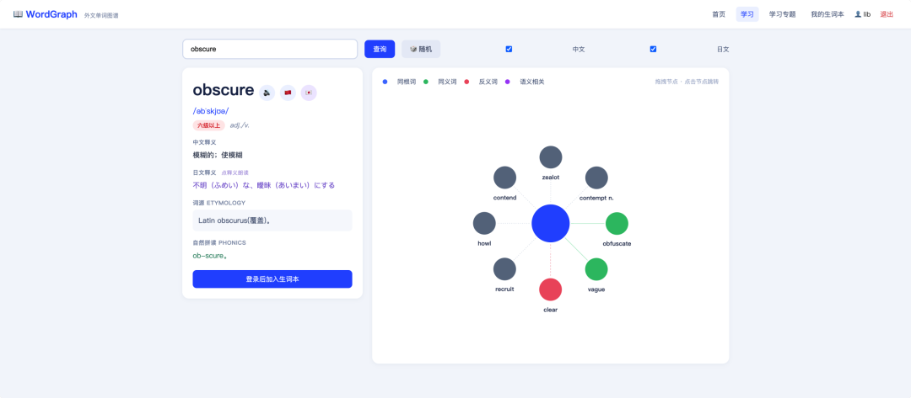
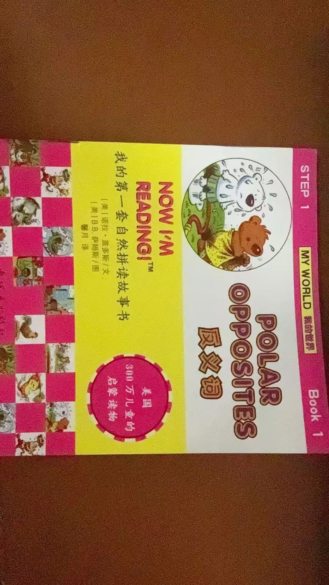

# WordGraph外文单词图谱
> 💡 备注属性未写入，可能是备注属性名称或者类型被修改了，建议将字段类型设置为 rich_text，可以在小程序-操作-修改文章数据库页面进行调整
> 💡 原文链接:[https://mp.weixin.qq.com/s?__biz=MzA5NzA2MzQzNA==&mid=2650755589&idx=1&sn=fee6a3b1cb13bf09b8a5f87866251d3f&chksm=89fe3178fd85f3f99ed7d2ca41b2b902b57bedbdc12e9c59ecac505417dd12295f0adcf4edb2#rd](https://mp.weixin.qq.com/s?__biz=MzA5NzA2MzQzNA%3D%3D&mid=2650755589&idx=1&sn=fee6a3b1cb13bf09b8a5f87866251d3f&chksm=89fe3178fd85f3f99ed7d2ca41b2b902b57bedbdc12e9c59ecac505417dd12295f0adcf4edb2#rd)

AI的进步举世瞩目，且惠及大众，最近用豆包工作做了好几款个人实用工具，目前几乎只有有想法，Ai 都可以实现了。 上图是我最近做的一个外语学习工具，缘起是最近每天晚上陪儿子读英语自然拼读，儿子是纯小白起步，这套拼读书很有个性，不是从简单单词开始，第一本的封面就有我不认识的单词了。

要教儿子，就得自己会读吧，虽然能基本拼读出来，但怕误我子弟呀，所以一般就百度一下，或者浏览器翻译插件搜一下。浏览器翻译插件的读音很奇怪，据说是mac系统下的问题（后来在做WordGraph时也遇到了）；百度对单词其实挺好用，但有时查两个词，或者一个短句，它就出搜索结果了，除非去百度翻译上，但我不喜欢百度翻译，界面不喜欢，没有相关词。所以我就想做自己做一个，就有了WordGraph。
打开WordGraph就会随机生成一个单词，让你学习，查询框可以方便地查询任何单词、句子、中文、英文、日文均可。WordGraph自带一个几千个单词的词库，首先在词库内匹配查询内容，词库没有的话会进行 Ai 解读。右侧图谱中展示了同义词、反义词、同根词等相关单词，便于联想学习。并且带英语、中文、日文发音，遇到不会的单词可以加入生词本。
完美符合我的个人预期，感谢 AI。
如果你也想用，可以访问：
WordGraph：
https://www.zxlib.com/study
。
