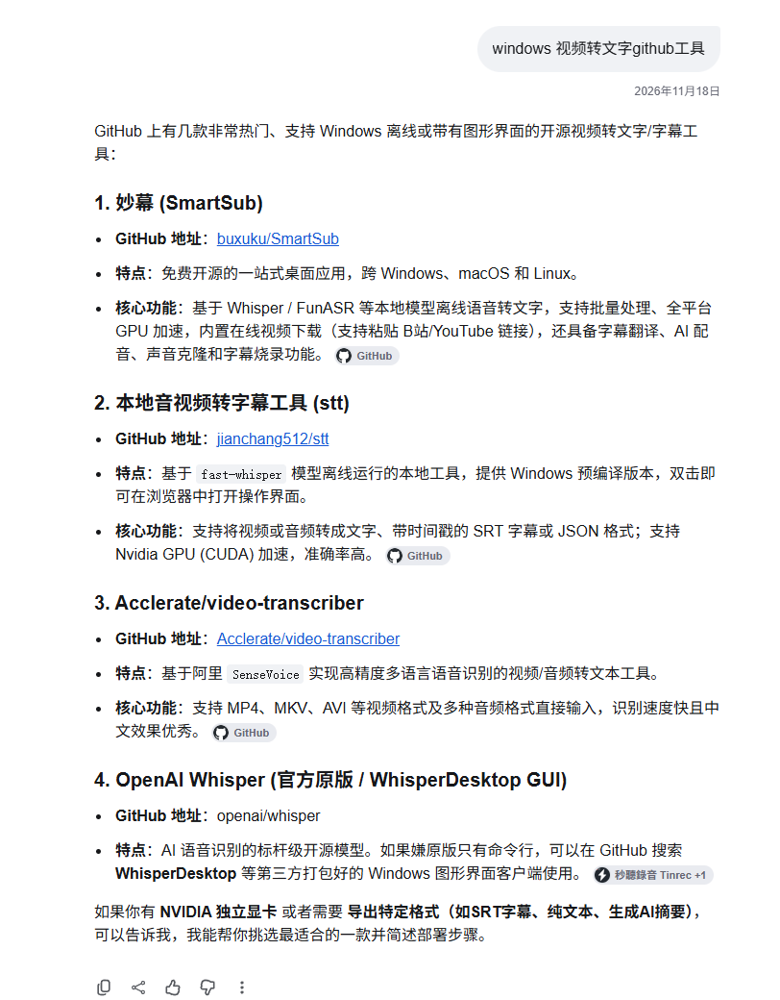
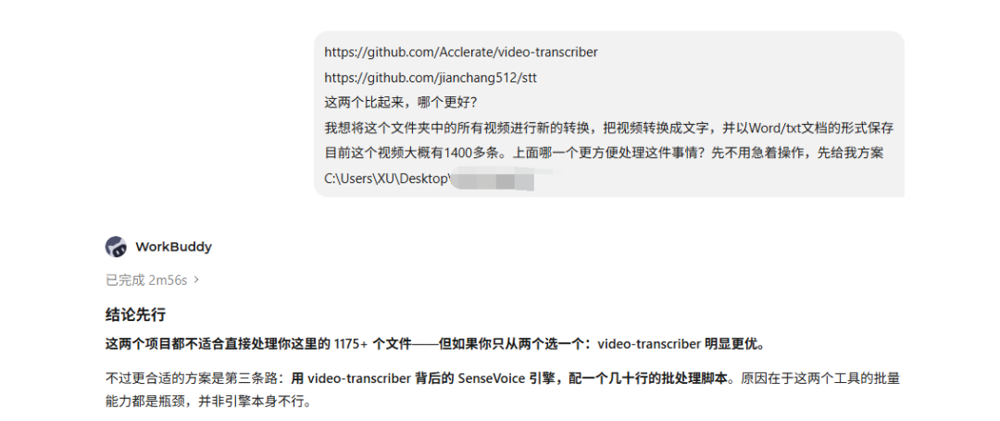
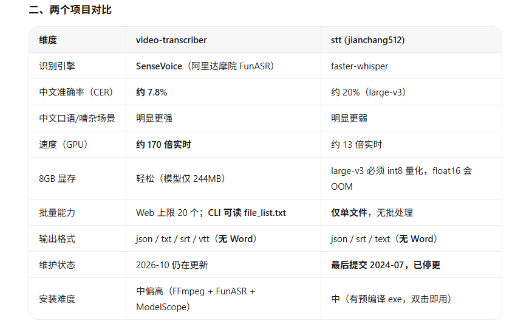
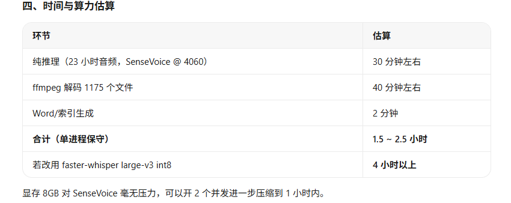
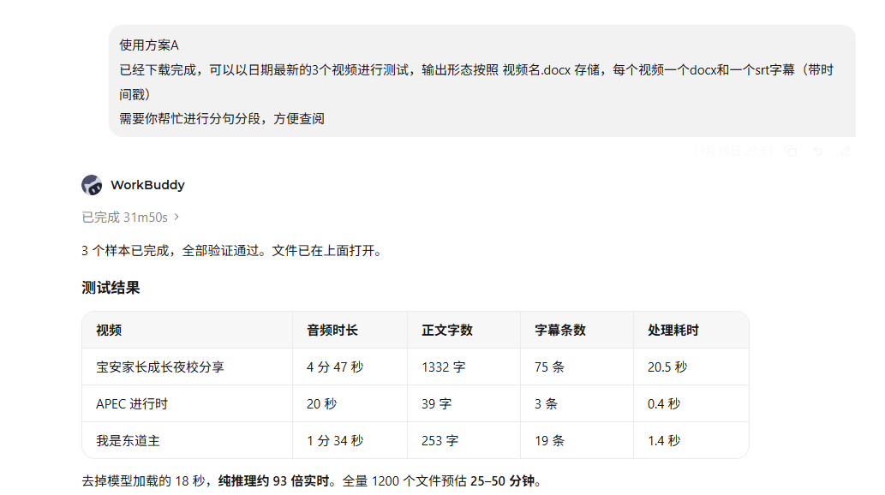
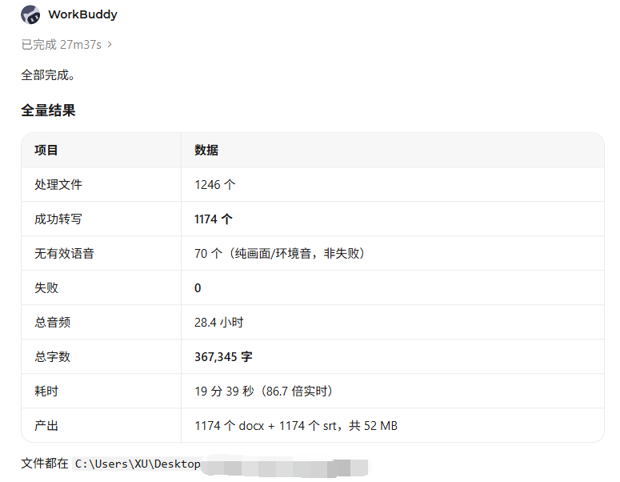
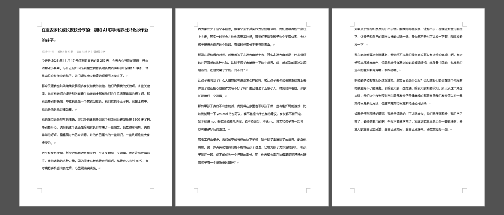

# WorkBuddy 用 20 分钟，把 1246 条视频变成 36 万字
> 💡 备注属性未写入，可能是备注属性名称或者类型被修改了，建议将字段类型设置为 rich_text，可以在小程序-操作-修改文章数据库页面进行调整
> 💡 原文链接:[https://mp.weixin.qq.com/s?__biz=MzU5NzAwODgzNw==&mid=2247491983&idx=1&sn=8d7752b480c8faa98eb0ea9e97c27062&chksm=ff16b3aa46c63603beb942143935bd927c7d65f82cf28b8eca942ee982a580cf35bca5741b9a#rd](https://mp.weixin.qq.com/s?__biz=MzU5NzAwODgzNw%3D%3D&mid=2247491983&idx=1&sn=8d7752b480c8faa98eb0ea9e97c27062&chksm=ff16b3aa46c63603beb942143935bd927c7d65f82cf28b8eca942ee982a580cf35bca5741b9a#rd)
接上回，之前用视频号下载了 1246 个视频。
[没想到WorkBuddy还可以批量下载视频号视频](https://mp.weixin.qq.com/s?__biz=MzU5NzAwODgzNw%3D%3D&mid=2247491968&idx=1&sn=d43b31979afb5ed15a4d16055ebf86f0&scene=21#wechat_redirect)
但拿到视频之后，其实正经事一件都做不了。
**不可能一个个点开去看，1246 条听下来，几十个小时就没了。**
所以真正的问题只有一个，怎么把它们变成文字。
变成文字之后，才能检索、能统计、能看出这个账号几年下来到底讲过什么。
这件事过去的解法是讯飞听见这一类工具，识别率确实高，但有两个坎。
一个是收费，1246 条算下来成本不低。另一个是批量上传有上限，没法一次丢进去一千多个文件。
再加上人工盯着的时间，半天就没了。
**所以思前想后，还是得另辟蹊径。**
既然现在 AI 来了，我想走另一条路。不买服务，自己搭一条能跑的流水线。
还是跟之前一样的方法论，先去 GitHub 找现成的，再看能不能改成自己顺手的样子。

我先让 AI 把 GitHub 上 Windows 视频转文字的工具拉了个清单。
回来四个。
妙幕 SmartSub、jianchang512 的 stt、Accelerate 的 video-transcriber，还有 OpenAI 官方的 whisper。
**四个名字摆在一起，反而更难选。**
每一个的简介都写着支持批量、支持 GPU 加速、中文效果好，光看 README 根本分不出差别。
所以这一步我没有自己判断，直接把两个候选链接丢给 WorkBuddy，附上真实条件。
**这个文件夹里一千多条视频，全部要转成 Word，先别急着动手，先给我方案。**

它用了 2 分 56 秒，第一句话就把我的选择题否了。
这句话是整件事的转折点。
我原本以为自己在做一道选 A 还是选 B 的题。
它告诉我 A 和 B 都不该直接用，该用的是 A 里面的那个引擎，再自己补一层调度。
**瓶颈不在识别引擎，在批量调度**。这一句把我后面的所有动作都定了性。

它的依据是一张对比表，几个数字直接把选择锁死。
Video Transcriber 用的是阿里达摩院的 SenseVoice，中文 CER 差不多 **7.8%**。
stt 用的是 faster-whisper large-v3，CER 差不多 20%。
**三倍的错字率。**
速度上是 170 倍实时对 13 倍实时，差了十几倍。
显存一个 244MB 轻松跑，另一个必须做 int8 量化，不然直接 OOM。
还有两个细节我自己看不出来。
stt 最后一次提交是 2024 年 7 月，已经停更。Video Transcriber 到 2026 年 10 月还在更新。
而两个工具的输出格式都不含 Word，只有 json、txt、srt、vtt。
这也解释了后面我为什么要额外要 Word。**工具本身不产 Word，是我自己加的**。
它顺手把账也算了。这批音频总共约 23 小时。
纯推理 30 分钟，ffmpeg 解码一千来个文件 40 分钟，Word 生成 2 分钟，合计 1.5 到 2.5 小时。
要是换 faster-whisper，光推理就要 4 小时以上。

方案定了，但我心里其实没底。
这件事我之前没做过，最担心的就是它到底能不能输出完整的文档。
**所以我没有一次性放开跑，先拿日期最新的 3 个视频做样本，把输出形态固定下来。**
以日期加视频名命名，每个视频一个 docx 加一个 srt。
为什么要 SRT，因为它保留每句话的起止时间，能看出一个人讲到哪一句会停、停顿多久。
按分钟切和按句切，出来的东西不是一回事。
总之信息越全越好，而这一步几乎不额外花时间。

3 个样本的结果。
4 分 47 秒的音频，出了 1332 字、75 条字幕，处理耗时 **20.5 秒**。
20 秒的短视频 0.4 秒，1 分 34 秒的 1.4 秒。
把模型加载那 18 秒去掉，纯推理差不多是 **93 倍实时**。
三个样本能跑通，结果还不错，我对它的信心就是从这里来的。
不是看起来能跑，是数字已经摆在那儿了。

全量放开之前，它又主动给了一份预期。
1242 个媒体文件，总音频约 25 小时，纯推理 17 分钟，连文件读写一起算，预计 30 到 45 分钟。
产出 1242 个 docx 加 1242 个 srt，约 60MB。
还有一个我没想到的设计，**跑到一半关了，重跑会跳过已完成的**。
1246 个文件，任何一次意外都不能让进度清零。

全量跑完的结果是这样，处理 1246 个文件，成功转写 **1174 个**，失败 0 个。
剩下 70 个是纯画面或者只有环境音的视频，没有有效语音，不算失败。
总音频 28.4 小时，总字数 **36.7 万字**，总耗时 **19 分 39 秒**，86.7 倍实时。
产出 1174 个 docx 加 1174 个 srt，一共 52MB。
1174 个文档摊在文件夹里，我随机点开几个跟原视频对了一遍，**识别准确率在 95% 以上**，简直惊为天人。
28.4 小时的音频，19 分 39 秒跑完。
按讯飞听见的报价，这批活的价格是以千元计的。按人工听，是一个月的量。

打开其中一个文档，开头一行备注，2026-11-17 晚，4 分 47 秒，正文 1332 字，语音段 75 个。
时间、时长、字数、语言段数量全在顶上，扫一眼就知道这份稿子值不值得细看。

SRT 是另一种信息密度，每一条都带起止时间，从 00:00:07,465 到 00:00:11,963，能精确到几秒开始讲、几秒收尾。

最后文件夹里有 2350 个条目。
除了 1174 组 docx 和 srt，还有两份后面要用的清单，敏感词库、低质量清单。
这才是转成文字的真正目的。
1246 条视频靠听是听不完的，转成 36 万字之后，就可以用脚本筛了。
原本要花时间和金钱的事，现在变成了一次配置、二十分钟等待。
所以遇到大批量处理的事情，先别想着自己造轮子。
**先去 GitHub 搜一圈，把候选丢给 AI 问一句，哪个不能直接用、缺的那一步是什么**。
缺的那一步，通常就是几十行脚本。
补上这一步，别人的工具才真的变成你的工具。
