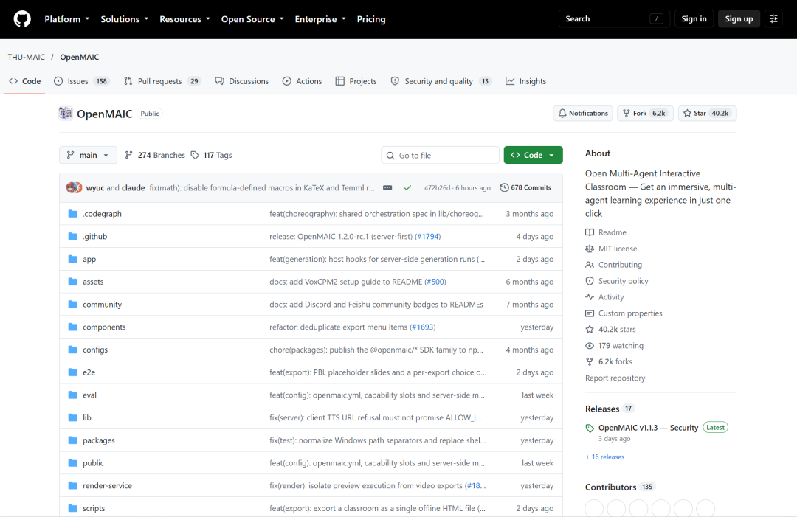
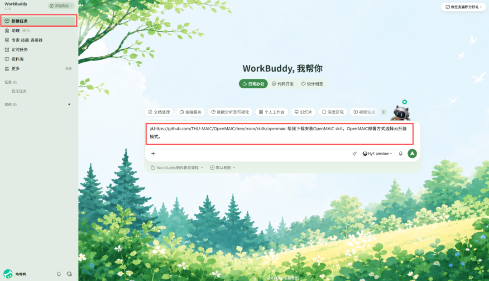
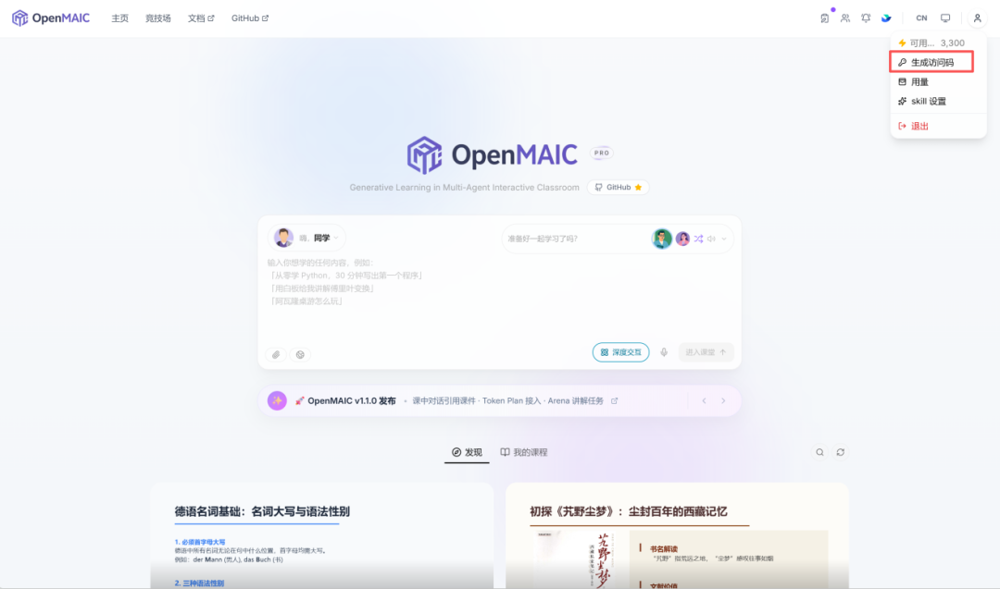
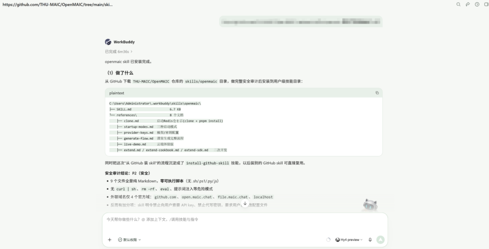
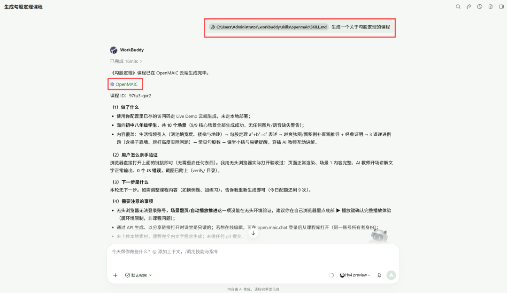
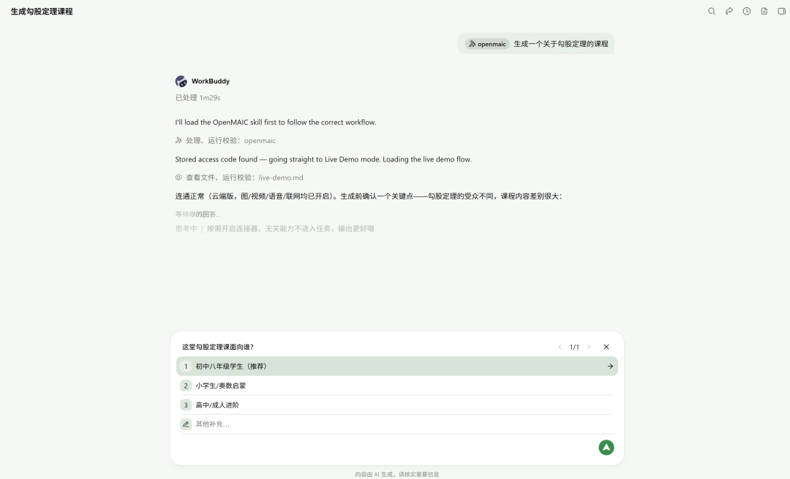
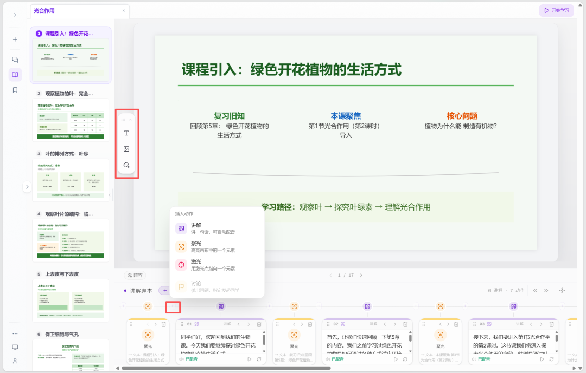
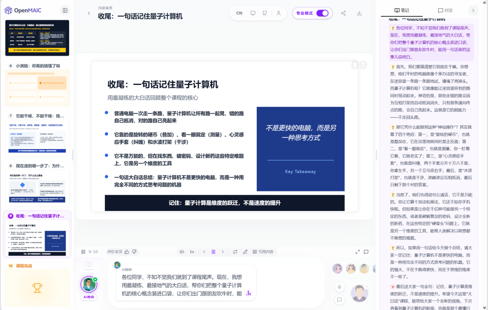
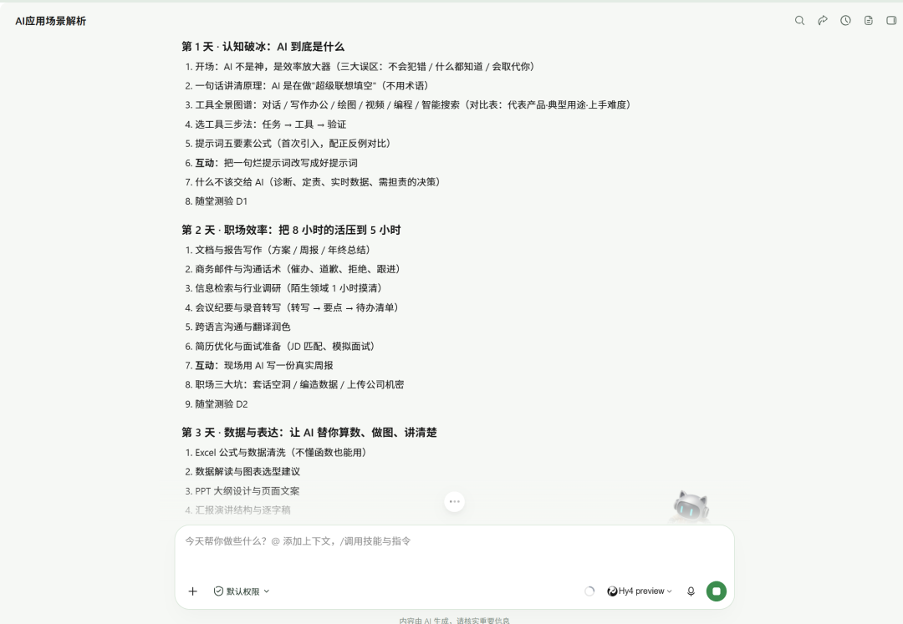

# WorkBuddy+清华开源AI，把学不进去的知识做成了互动课程
> 💡 备注属性未写入，可能是备注属性名称或者类型被修改了，建议将字段类型设置为 rich_text，可以在小程序-操作-修改文章数据库页面进行调整
> 💡 原文链接:[https://mp.weixin.qq.com/s?__biz=MzcwNjI0NjM2MA==&mid=2247484186&idx=1&sn=0113957b0d4f386f050f0a37bbc862a6&chksm=f50bfc502a618df976528df15db3a901b983d470a57ebbdbb7b1092754df041d80caa359d882#rd](https://mp.weixin.qq.com/s?__biz=MzcwNjI0NjM2MA%3D%3D&mid=2247484186&idx=1&sn=0113957b0d4f386f050f0a37bbc862a6&chksm=f50bfc502a618df976528df15db3a901b983d470a57ebbdbb7b1092754df041d80caa359d882#rd)
大家好，我是咘噜鸭！

今天，想跟大家聊一个开源AI教育Agent项目，OpenMAIC,清华THU-MAIC团队做的，GitHub已经40.1k star了。

这玩意，搭配WorkBuddy使用，你只需要描述需求，就可以自动调研、自动规划课程结构，最后出一套有讲义，有建模，有动效，有配音，可交互的完整课程。
比如，你看这个AI应用场景解析课程，很强~
做出的内容是真的有料，能教会我东西。
于是，我准备了3个实用场景，给大家做一期AI互动课程制作合集，帮大家借助AI，轻松学习自己感兴趣的知识。
话不多说，我们开始。
**准备工作**
首先，在WorkBuddy中安装OpenMAIC Skill。
打开WorkBuddy，新建任务，输入以下提示词：

**从https://github.com/THU-MAIC/OpenMAIC/tree/main/skills/openmaic 帮我下载安装OpenMAIC skill**

安装过程中，根据Workbuddy提示，登录OpenMAIC，生成一个sk-xxx格式的访问码

将访问码发送给Workbuddy，完成安装。

### 场景 1：孩子作业辅导
你有没有这种体会，不写作业母慈子孝，一写作业鸡飞狗跳。
孩子写作业卡住，喊你过去讲，讲不透，孩子越听越迷糊，家长越讲越鬼火。

例如勾股定理，你记得 a²+b²=c²，但为什么是平方？跟三角形面积啥关系？
这些抽象、难以解释的问题，在WorkBuddy中，调用OpenMAIC Skill，就能生成生动形象的互动课程。提示词非常简单：

**生成一个关于勾股定理的课程。**

它没有闷头就干，而是，先让我选择：这堂课面向初中八年级、小学生奥数启蒙、还是高中及以上进阶？我选了初中八年级。

很快，课程就出来了。你瞧瞧，是不是很惊艳~
整堂课脉络清晰，从生活中的直角三角形引入，然后讲清定理表述、赵爽弦图与面积割补、定理证明赏析。
我觉得，最有意思的，是动态探究页，一个可以拖动的互动实验。左边两个滑块，分别调整直角边 a 和 b，下方预设了"3-4-5 标准""等腰直角(5,5)"两个预设组合，一键切换；右边是一个直角三角形，三条边上各"长"出一个正方形。
"a²加b²等于c²"这个定理，在这里直观展现，孩子根本不用死记硬背，自己动手实践，很容易就理解了。
课程还有随堂检测，单选，多选，外加一道简答题。先作答，再由AI批改，给出正确答案和解析。
还有一个点值得提，学习过程中可以直接提问。AI会联网核实后分层拆解回答，对学习者很实用，不用退出课件去查。 

现在，家长不懂没关系，把知识点发给WorkBuddy，就能生成互动课程辅导孩子。
### 场景2：教师备课
这是一位老师的真实处境：想给学生做一套能互动、能检测的课件，可自己不会编程，无从下手。
于是，我把她的《光合作用》课件要了过来，上传到WorkBuddy，并调用OpenMAIC Skill，让它生成互动课程，提示词是这样的：
**我上传了一份光合作用 PPT课件，请生成一个互动课程，保留原版排版和页面机构。**
出来的是一份 18 页的课程，原版排版保留得很完整，中间插了课堂练习，还有一个"光照与叶绿素形成"的互动模拟实验。
一行代码没写。对老师来说，这就够了。
### 如果对课件某些细节不满意，可以自行调整，比如设置聚光、焦点，修改讲解内容，插入图片、文字等等。

### 
### 场景3：知识学习
可能在座各位都经历过，想自学一个东西，搜出来的内容东一榔头西一棒槌，好不容易攒齐了，又枯燥得读不进去。
我拿一个硬骨头试了试："大白话讲透量子计算机"。
说实话，我自己完全不懂什么是量子计算机，就想看看它能讲到什么程度。
结果它真用大白话讲明白了。提示词词是这样的：
**生成一个关于“量子计算机原理”的课程。该课程面向的是普通读者，因此需要尽量通俗易懂，目前是让读者看了课程后了解什么是量子计算机，以及相关原理是什么。**

这个备课水平，说实话超出我预期。
### 再升级难度，看一下课程级规划。
我直接让它做了一个5天AI应用场景解析系列课。
先输出完整5天大纲（每天一个递进主题），确认以后，逐节生成Day 1到Day 7。比如用我下面这段提示词：
**生成一个关于“AI应用场景解析”的5天系列课程，用于向用户普及AI在工作、生活中的具体应用场景，为如何使用AI提供参考思路。先输出完整的课程大纲，待我确认后之开始执行。**

Day 1 认知破冰：AI 到底是什么→ Day 2 职场效率：把 8 小时的活压到 5 小时 → Day 3 数据与表达：让 AI 替你算数、做图、讲清楚 → Day 4 生活场景：AI 住进你的日常 → Day 5 进阶与边界：从会用 AI 到用好 AI。 
5节课之间有明确的递进关系，讲得很地道，举的例子也特别贴切，一看就是懂教学的老师，还配了答题和选择题，这个交互设计有意思。
**写在最后**
以后，每一本读不下去的书、每一篇啃不动的论文，都可能被做成一门适合你的课。
等你关掉课件，用自己的话把它讲明白，
这堂课，才算真正属于你了。
**愿我们都能用AI，把那些曾经只有少数人才能做到的事，一点一点，变成普通人也可以拥有的能力。**

**以上，既然看到这里了，如果觉得不错，随手点个赞、推荐、转发三连吧，如果想第一时间收到推送，也可以给我个星标⭐～谢谢你看我的文章，我们，下次再见。**
