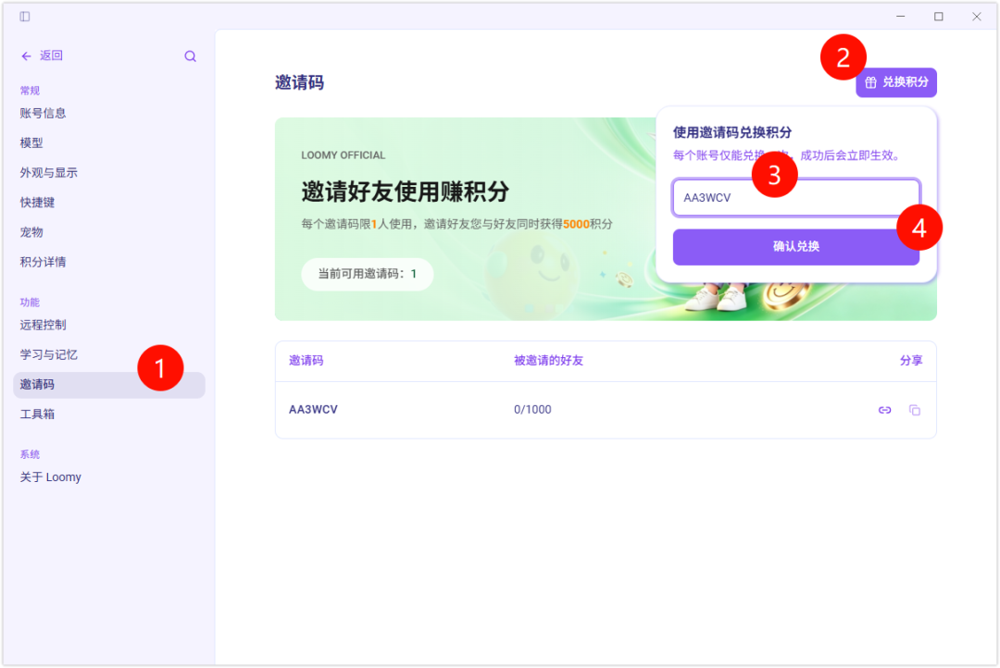
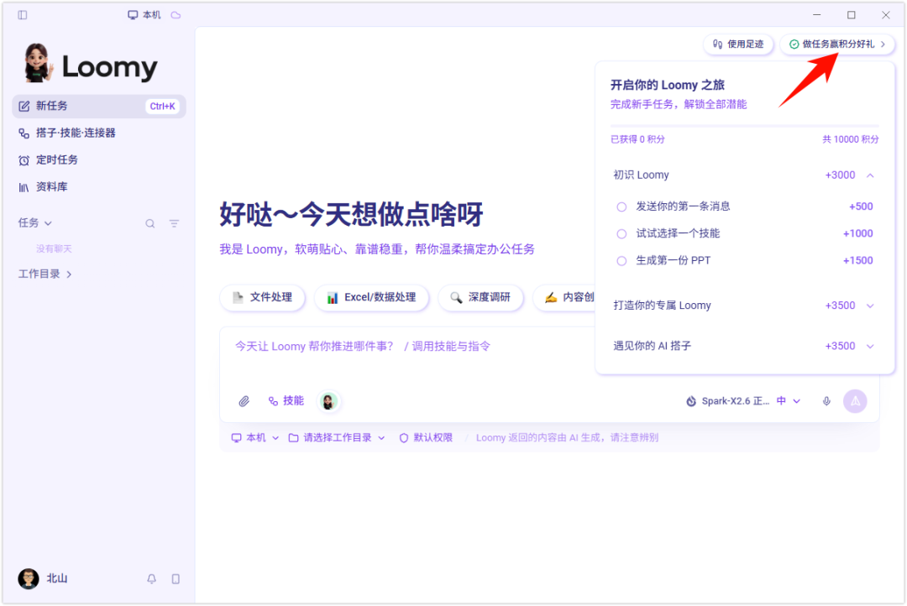

# WorkBuddy最大的竞争对手来了！直接送25000积分，根本用不完
> 💡 备注属性未写入，可能是备注属性名称或者类型被修改了，建议将字段类型设置为 rich_text，可以在小程序-操作-修改文章数据库页面进行调整
> 💡 原文链接:[https://mp.weixin.qq.com/s?__biz=MzIxMDczNDU2MQ==&mid=2247500530&idx=1&sn=6d1ea11f90aaa6c044414a725250c6a9&chksm=968ef69648523c07f3e23ec045d8591d1a8ae18d3f7b93a2810bda92edbed02902063a5999a5#rd](https://mp.weixin.qq.com/s?__biz=MzIxMDczNDU2MQ%3D%3D&mid=2247500530&idx=1&sn=6d1ea11f90aaa6c044414a725250c6a9&chksm=968ef69648523c07f3e23ec045d8591d1a8ae18d3f7b93a2810bda92edbed02902063a5999a5#rd)
自从用上 WorkBuddy，每天积分都不够用！
本期分享一款类似的智能体 —— Loomy，新用户注册使用后即可获取 25000 积分，每日签到还可以自动获取 5000 积分。
直接实现积分自由，根本用不完。
Loomy 是科大讯飞推出的一款桌面 AI 助理（AI 工作搭子），主打本地办公自动化，能帮你自动处理文件整理、内容创作、数据分析、邮件处理等多步骤任务。
按照下面 4 个步骤操作，2.5 万积分一次性拿全。
| 获取方式 | 积分 | 说明 |
| 注册登录 | 5000 | 永久有效 |
| 每日签到 | 5000 | 每日登录后自动刷新 |
| 邀请码 AA3WCV | 5000 | 一次性兑换 |
| 完成任务 | 10000 | 对话页右上角「做任务赢积分」 |
| **合计** | **25000** | 用完还能每天续 5000 |
· · ·
### 1永久积分
第一步，去官网下载安装 Loomy，然后使用微信或手机号注册登录，即可获取 5000 积分，且永久有效。
官网下载地址：https://loomy.cgref.cn/loomyai

· · ·
### 2每日签到
每日登录后签到，还可以获取 5000 积分。
需要注意的是，每日赠送积分会在你每日登录后自动刷新为 5000。消耗长期积分时，会优先使用活动或兑换码获得的积分，再使用普通长期积分。
· · ·
### 3邀请好友
下载安装后，输入我的专属邀请码 **AA3WCV**，还可以获取 5000 积分。
邀请码输入流程，分两步：
第一步，依次点击「头像」→「邀请好友」。
第二步，点击右上角的「兑换积分」，输入 **AA3WCV** 后点击确认兑换，即可获取 5000 积分。
如下图示例：

· · ·
### 4做任务得积分
另外，在对话页面点击右上角的「做任务赢积分」，完成所有任务后，可以获取 10000 积分。

· · ·
### 5核心特点
**开箱即用**：相比需要手动配置环境的开源工具，它降低了使用门槛，下载安装并授权后就能用。
**本地安全**：采用「目录级隔离」机制，AI 只能访问你明确授权的文件夹，敏感文件默认留在本地，不传云端。
**远程操控**：已适配飞书、钉钉、QQ 等工具，你可以在手机上发指令，远程让电脑端的 Loomy 干活。
**模型可选**：支持切换讯飞星火、DeepSeek、通义千问等不同模型，来应对不同任务。
· · ·
### ✓适合谁用
它主要面向有大量重复性办公需求的人群，比如自媒体运营、办公室白领或小团队，旨在把 AI 从「聊天演示」变成真正能干活的工具。
**专注office** · 北山
专注 Office 技巧与办公效率，每周更新
觉得有用，点个「在看」让更多人看到
