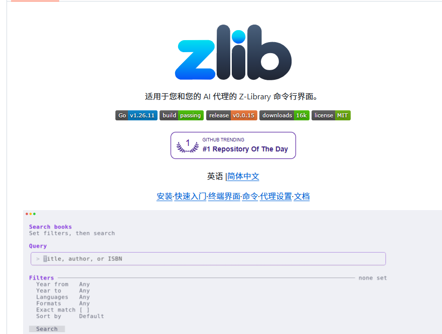

# Z-Library 也有 AI Skill 了：找书、下载、导入微信读书，终于串起来了
> 💡 备注属性未写入，可能是备注属性名称或者类型被修改了，建议将字段类型设置为 rich_text，可以在小程序-操作-修改文章数据库页面进行调整
> 💡 原文链接:[https://mp.weixin.qq.com/s?__biz=Mzg3MTc3MzEzNA==&mid=2247485680&idx=1&sn=5b6a224fcf19509557e2bfdbcbd46321&chksm=cf1292e06b16c374352e361492e38d2e4d0bfc1c1bb2564a82be98bf6d311037a0ac5860e912#rd](https://mp.weixin.qq.com/s?__biz=Mzg3MTc3MzEzNA%3D%3D&mid=2247485680&idx=1&sn=5b6a224fcf19509557e2bfdbcbd46321&chksm=cf1292e06b16c374352e361492e38d2e4d0bfc1c1bb2564a82be98bf6d311037a0ac5860e912#rd)

有没有发现，读电子书最麻烦的，有时候不是读，而是开始读之前的那一串操作。
搜书名、找版本、挑格式，下载之后，还得想办法传到手机或阅读器里。
步骤不难，但来回切换，确实磨人。
最近，GitHub 上一个叫 **zlib** 的开源项目，把这些环节接到了一起：
**在终端里搜索和下载电子书，再发送到 Kindle，或者导入微信读书。**
更有意思的是，它还能通过 **MCP 和 Skill 接入 Claude Code、Codex 等 AI 工具**，让 AI 参与找书和整理电子书的流程。
截至本文核对时，项目页面显示约 **3.6K Stars**。不过，比起星标数，更值得聊聊的是：它究竟把哪些事变简单了？
### 01 不只是换个地方搜书
先说明一下，这里的 zlib 是一个第三方 Z-Library 命令行项目，不是大家熟悉的同名压缩库。
它支持 macOS、Windows 和 Linux，搜索、下载 Z-Library 资源需要相应账号。
搜索方式比较直接：**书名、作者、ISBN 都能用。**
如果结果太多，还可以按年份、语言、文件格式筛选，并对结果排序。
这解决的是一个很具体的问题：
**找到一本书，和找到适合自己的那个版本，是两回事。**
同一本书可能有不同语言、不同出版年份，也可能同时存在 EPUB、PDF 等格式。先把条件限定好，比下载之后再检查省事得多。
不喜欢记命令，也可以使用它的终端交互界面：浏览结果、查看详情、选择下载目录，都能在里面完成。
此外，项目还提供收藏、推荐、热门图书、下载历史，以及每日下载额度查询等功能。
它不是凭空增加了书源，而是给已有服务换了一套更适合终端和自动化的操作方式。
### 02 真正省事的，是下载之后
这个项目最容易让人心动的，其实不是搜索，而是后半程。
**书下好了，怎么送到平时真正读书的地方？**
#### 微信读书：少一次手动搬运
按照项目文档，zlib 支持把本地电子书导入微信读书书架，也支持在下载时衔接导入操作。
微信读书账号需要先扫码登录，支持导入的格式包括 EPUB、PDF、MOBI、AZW3 和 TXT。
这里有个实用细节：**导入已有的本地文件，不需要登录 Z-Library。**
也就是说，即使你只是想整理自己有权使用的电子书，也可以单独使用这一功能。
但别把“支持导入”理解成“官方稳定接口”。
项目文档明确说明，微信读书导入依赖的是**非公开接口**，可能因平台调整而失效，也可能触发验证；格式、大小、会员权益和导入数量等限制，仍以平台实际规则为准。带 DRM 的文件也不能导入。
方便归方便，边界得提前知道。
#### Kindle：把邮件投递接进流程
Kindle 用户也有对应入口。
配置好 Kindle 收件地址、发件邮箱和 SMTP 服务，并将发件邮箱加入亚马逊认可列表后，就可以发送本地电子书，或者衔接下载后的投递。
不过，**邮件服务器接收成功，不等于阅读器已经收到书。**
最终能否送达，还取决于亚马逊的发件人和文档检查。
这不是“零配置魔法”，但首次配置完成后，确实能减少重复操作。
### 03 接入 AI，变化在哪里？
如果只看搜索和传书，zlib 已经算是一个实用工具。
而 MCP 和 Skill，让它多了一种使用方式：**不再由你逐条操作，而是让 AI 根据需求调用工具。**
两者可以简单理解为：
- • **MCP**：让 AI 能够调用搜索、下载、导入等工具能力。
- • **Skill**：给 AI 配套的操作说明，指导它如何使用这些能力。
项目提供了面向 Claude Code、Codex 等工具的接入方式。
配置完成后，你可以用自然语言描述需求，例如：
按书名和作者搜索，优先列出中文版 EPUB，先把候选版本给我确认。
重点在于，AI 不只是回答“你可以去哪里找”，而是有机会参与实际操作，把需求转换成搜索条件，再整理结果。
当然，**接入工具不等于 AI 就能保证找对版本，更不等于所有步骤都适合无人确认地执行。**
书名相近、版本不同、格式不合适，这些问题依然存在。更稳妥的流程是：先看候选，再确认下载和上传。
项目还提供只读 MCP 模式，可以隐藏下载、投递、导入和元数据编辑等操作。只想先体验 AI 搜书的人，可以从更小的权限范围开始。
### 04 它适合谁？
如果你经常在电脑上查资料、管理电子书，也已经在用 Claude Code、Codex 这类 AI 工具，zlib 值得关注。
它的价值，是把原本分散的操作接起来：
**提出需求 → 筛选版本 → 确认文件 → 下载 → 导入阅读工具。**
但如果你只是偶尔读一本书，不习惯终端，也不打算配置 AI 工具，那它未必比现有方式更省心。
工具有没有用，最终取决于它能不能减少你每天重复做的事，而不是功能列表有多长。
### 05 最后，几个提醒
体验之前，有几件事值得记住：
**第一，开源不代表书籍内容获得授权。**
项目代码的许可证，与电子书本身的版权是两回事。请仅获取、使用和传输你有权使用的内容，优先选择正版、公共领域或明确授权的资源。
**第二，不要把密码交给聊天窗口。**
项目文档建议在本地终端完成登录，避免把密码发给 AI。登录凭据和会话文件也应妥善保管。
**第三，自动化不是无限制。**
账号额度、网络状态、平台接口变化，都可能影响实际体验。“一条龙”意味着流程可以串联，并不意味着没有前置配置和失败可能。
---
从 zlib 身上，能看到 AI 工具的一种务实用法：
**不是再多生成一段文字，而是替人少做几次搜索、切换和搬运。**
不过，找书更快、传书更顺，终究只是准备工作。
真正重要的，还是书进入书架之后，你有没有打开它。
**项目地址：**
https://github.com/heartleo/zlib
