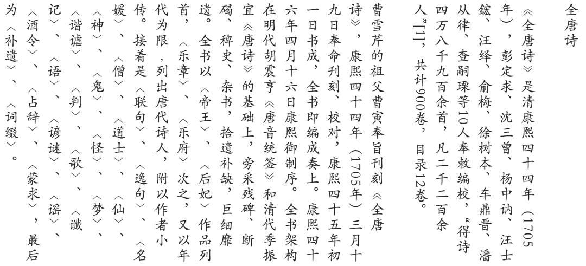

# chinese-poetry 把 5.5 万首唐诗、26 万首宋诗、2.1 万首宋词整理成 JSON，拿来就能做产品
> 💡 备注属性未写入，可能是备注属性名称或者类型被修改了，建议将字段类型设置为 rich_text，可以在小程序-操作-修改文章数据库页面进行调整
> 💡 原文链接:[https://mp.weixin.qq.com/s?__biz=MzY5MTM2MjA5OQ==&mid=2247484959&idx=1&sn=3cabf4e7e31e69212bf48ec32f91a2a2&chksm=f5e96590e00bd95d4538d72293bed2ae2fdb9b02362398694d79a87b059528a589f7596693d5#rd](https://mp.weixin.qq.com/s?__biz=MzY5MTM2MjA5OQ%3D%3D&mid=2247484959&idx=1&sn=3cabf4e7e31e69212bf48ec32f91a2a2&chksm=f5e96590e00bd95d4538d72293bed2ae2fdb9b02362398694d79a87b059528a589f7596693d5#rd)
📜
**chinese-poetry**
最全中华古诗词数据库
54k★5.5万唐诗26万宋诗MIT
### ✨ 它是谁
**chinese-poetry**（chinese-poetry/chinese-poetry）是**最全的中华古典文集数据库**：包含**5.5 万首唐诗、26 万首宋诗、2.1 万首宋词**和其他古典文集，诗人含唐宋两朝近 1.4 万古诗人、两宋时期 1.5 千古词人。实测仓库**54k Star**、10882 fork，**MIT**，2016 年创建、长期维护。
数据通过**JSON 格式分发**，克隆仓库就能直接用——专门为了让开发者方便、快速地构建诗词类应用。

官方《全唐诗》介绍页（清康熙年间编校，共 900 卷，得诗四万八千九百余首）
### 📚 收录了哪些文集
除了唐诗宋诗、全宋词，还收录：**五代·花间集、南唐二主词、论语、诗经、幽梦影、四书五经、蒙学、纳兰性德诗集、御定全唐诗**——诗词、经学、蒙学一站式覆盖。
### 🧪 能做什么
社区已经用它做出了一堆东西：
🖥️ **诗词网站/小程序**：中文诗歌主页（浏览器端，含唐诗三百首、宋词三百首）、诗词墨客小程序。
📱 **离线应用**：离线全唐诗 Android。
🤖 **AI 写诗**：pytorch-poetry-gen（char-RNN）、可生成藏头诗的 pytorch-book、PaddleNLP 基于 ERNIE-GEN 的深度学习写诗。
🗄️ **数据库整合**：chinese-poetry-db-web 做 MySQL 整合 + Web 展示检索；还有诗词桌面、诗词周历等。
### 🚀 怎么用
克隆仓库，数据以 JSON 组织在对应目录（全唐诗/宋词/诗经/论语 等），直接用你的语言读取即可。
git clone https://github.com/chinese-poetry/chinese-poetry
社区鼓励贡献：提交 PR 完善数据（诗句纠错请标明出处）、或通过爱发电 / Patreon 赞助维护者。
### ❓ 常见问题
**Q：数据是什么格式？**
JSON，克隆仓库直接可用，方便接入任何语言/框架。
**Q：能商用吗？**
MIT，可自由使用、修改、商用（保留版权声明）。数据来自互联网整理，用途上请注意注明来源。
**Q：能做 AI 写诗吗？**
可以，社区已用 char-RNN、PaddleNLP 等在此数据上训练出写诗/藏头诗模型。
**Q：数据会更新吗？**
长期维护，古诗歌体（非宗教类）欢迎提交 PR 补充，有争议数据社区投票决定。
**📎 GitHub 地址：https://github.com/chinese-poetry/chinese-poetry**
关注「AI工具匠」获取更多实用开源工具
