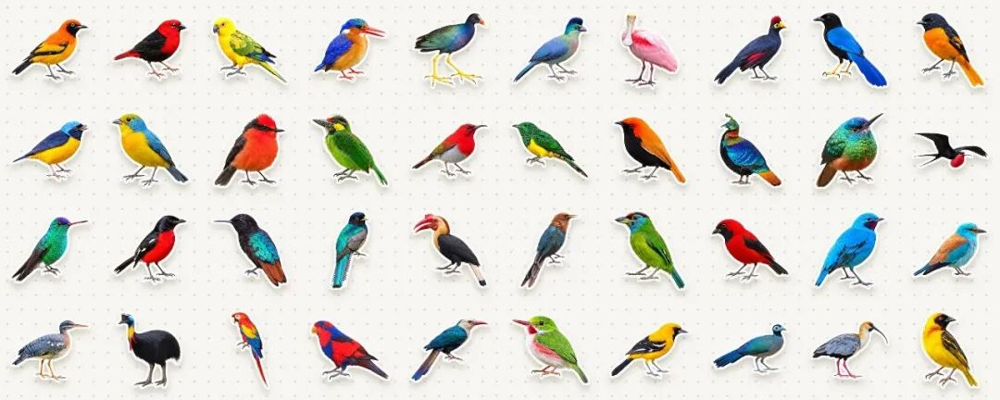
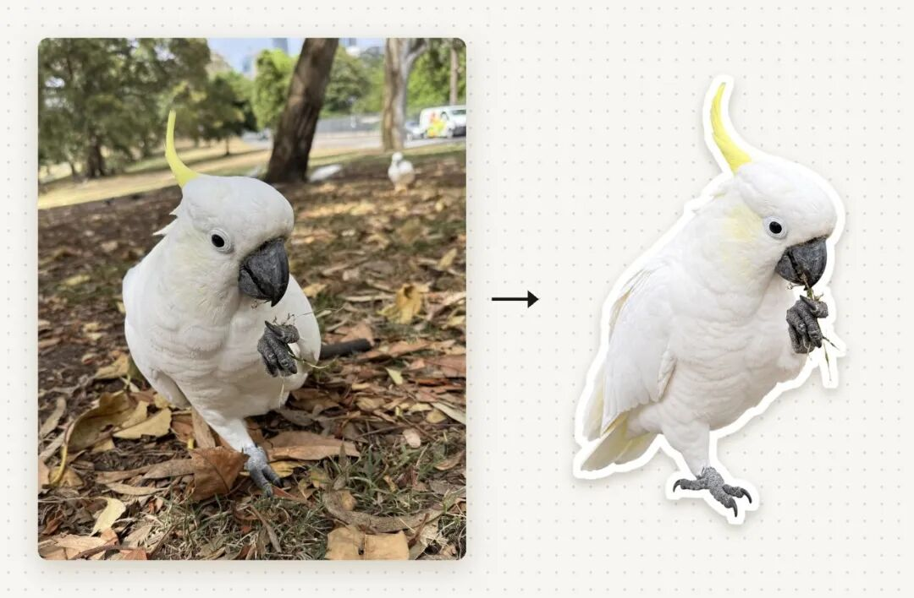
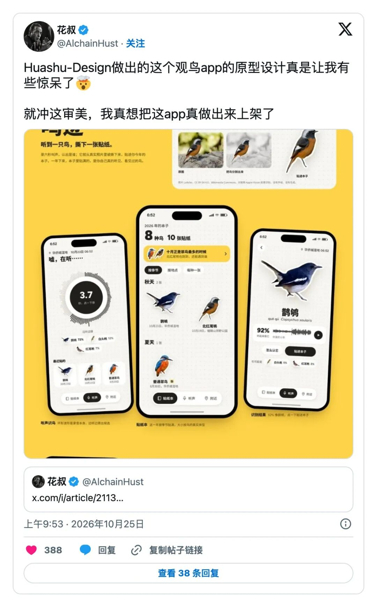
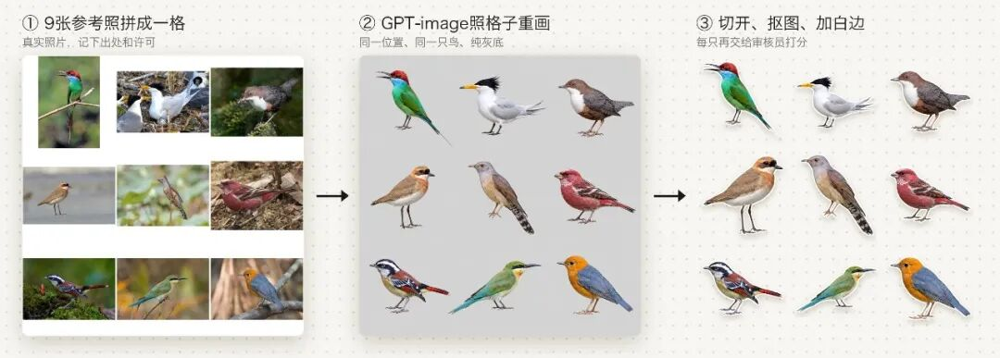
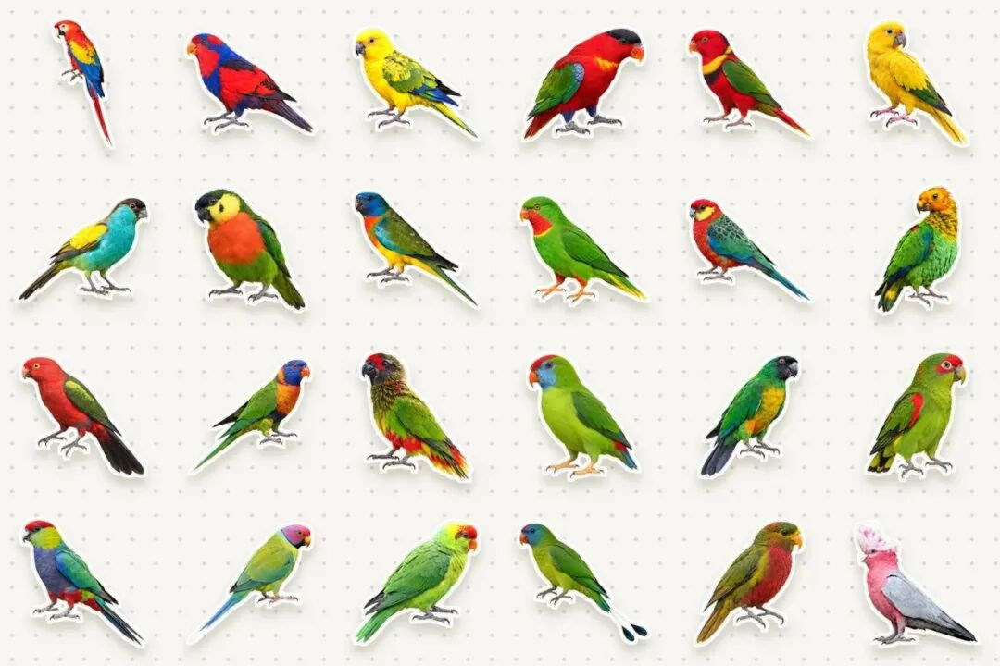
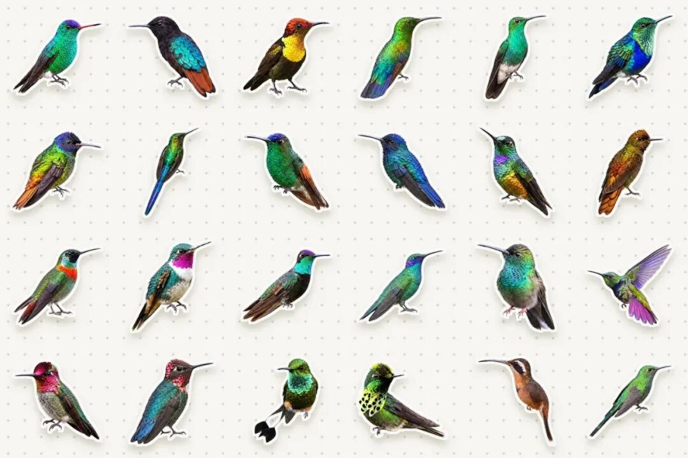
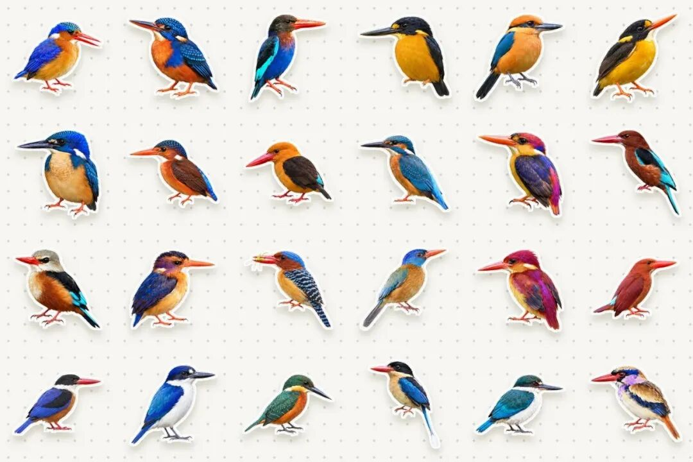
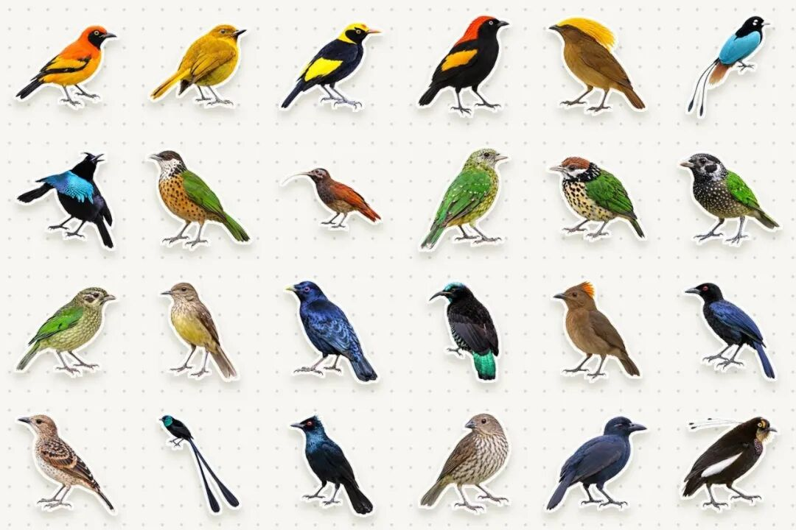
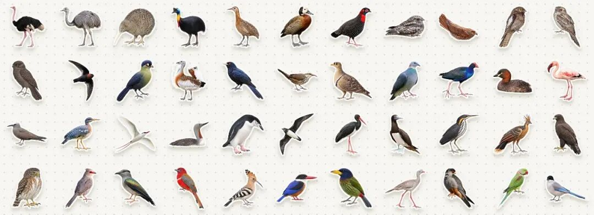
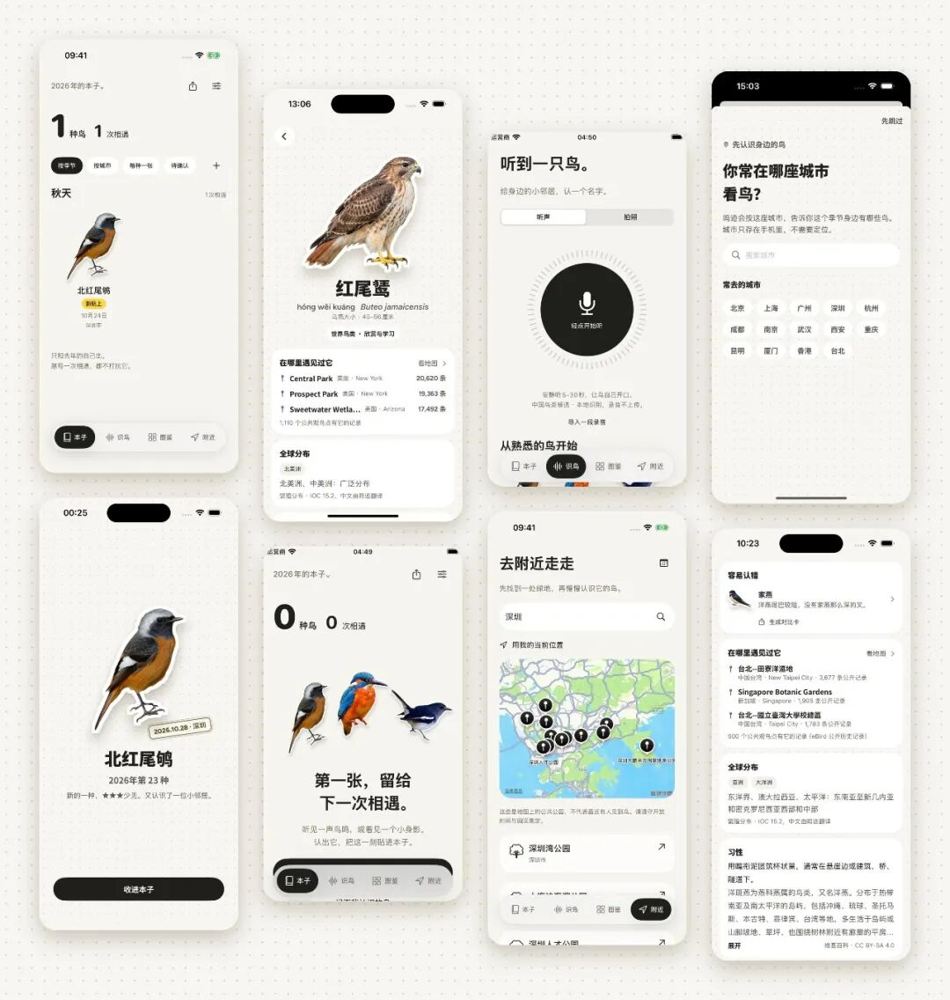

# huashu-bird-sticker正式开源!花叔把全球11064种鸟类做成了贴纸
> 💡 备注属性未写入，可能是备注属性名称或者类型被修改了，建议将字段类型设置为 rich_text，可以在小程序-操作-修改文章数据库页面进行调整
> 💡 原文链接:[https://mp.weixin.qq.com/s?__biz=Mzg2OTA1OTAxNA==&mid=2247492678&idx=1&sn=1d197d91586f84b7b097ecd2c0b15b00&chksm=cf09746e76cb025a190fc1e0a554bf335504f104e4f83122053198c5d11ca943995295f8fcec#rd](https://mp.weixin.qq.com/s?__biz=Mzg2OTA1OTAxNA%3D%3D&mid=2247492678&idx=1&sn=1d197d91586f84b7b097ecd2c0b15b00&chksm=cf09746e76cb025a190fc1e0a554bf335504f104e4f83122053198c5d11ca943995295f8fcec#rd)
我最近干了个超超超大工程的事！！！
我把全世界**现存的11064种**鸟，全都收集整理完善，并且做成了绝美的、格式统一的贴纸！！！
并且，连带着贴纸和所有的数据，全部开源放到了GitHub上。
这一万多张贴纸，除了34张是真实照片抠图，剩下的11030张都是AI画的，为了画完它们，并且保证准确和高质量，我花掉了**10亿以上的TOKEN**。跑光了1次Claude Code200美金会员周额度，三次Codex200美金会员的周额度！！
先看30秒的宣传片：
仓库地址：
https://github.com/alchaincyf/huashu-bird-sticker

对鸟类有兴趣，或者有收集癖想直接拿贴纸的朋友，可以往下翻到第三部分「鸟友能拿它做什么」，那里有怎么在手机上保存单张贴纸的方法；
如果你对鸟类不感兴趣的话，其实也可以再看看，**我会借这次的实践经验告诉你，Vibe Coding该如何保质保量搞出这么大体量的工程。**
### 一、从蒜苗鸡缘起
说起来，去年12月我在悉尼待了一阵子，那段时间我在即刻上发过不少鸟。
我当时把蒜苗鸡（葵花鹦鹉）排到了我最喜爱鸟类的第一位，于是便一发而不可收，开始真的注意起了生活中遇到的鸟类，然后才发现，原来城市生态远比我们想象的有趣和丰富。
悉尼的皇家植物园还有一棵长满了彩虹吸蜜鹦鹉的大树，我坐在树下感觉太美妙了；以及在公园里被垃圾鸟（澳洲白鹮）狠狠拍了一下头，大概是有人在投喂薯条，它们疯了似的赶过来，顺路给我撞了。
发那条即刻的时候，我配了几张在公园里拍的葵花鹦鹉。后来做贴纸，葵花鹦鹉那一张的参考照，用的就是其中一张：它一只爪子抓着刚拔起来的草，正往嘴里送。

左边是我在悉尼的公园里拍的，右边是仓库里的那张贴纸，审核打了86分，过线。
然后，最近在迭代我的Huashu-Design 3.0的时候，为了测试，我让Claude Code帮我去生成app原型，然后，卧槽！这个app的效果太出色了。以至于我不得不起心动念想把这个美妙的app真的做出来！

鸣迹的样子是一本贴纸本：每认出一种鸟，就把它的贴纸贴进自己的本子里，盖一个日期和城市的邮戳。这样一来，每一种鸟都得有一张贴纸。
一开始我们只做中国的鸟，后来加进了一部分外国的鸟，扩到5232种。到了10月28号下午，我跟Claude Code说的是：「11,227种鸟,我们都要接入!!!!你可以并行调用多个codex窗口去执行」。IOC的11227种里有163种已经灭绝，剩下的11064种，就是这次一张不少画完的数字。
为什么不直接用照片？我们其实给每一种鸟都找了参考照，但按物种算，用上开放许可照片（CC0、公有领域、CC BY、CC BY-SA）的只有1986种，另外46种是全开放许可的参考板或者只有文字描述；其余的要么是非商用、禁止演绎，要么保留所有权利，还有2017种当时没记下许可（而且照片的角度、背景、光线五花八门，放进同一本贴纸本里会非常乱）。
所以最后的路线是：照片只当参考，贴纸由AI重新画。
### 二、一万多张贴纸是怎么做出来的
整条流水线可以拆成四步：找参考图、照着参考图画、打分审校、画不好怎么办。分工上，找图和审图交给Claude Code的子代理，画图交给Codex（Codex里调用的是GPT-image）。其中最核心的点就是1、要获得权威合适的数据做规划，并且有个主agent负责整体的工作；2、不要相信生图模型的创造，尽量通过参考图等方式减少幻觉；3、要有审校流程，审校最好让非制图的agent独立运行；4、对于不同的审校结果，需要有不同的处理策略。一整套系统打通之后才能形成完整的loop。
#### 第一步：给每一种鸟找参考
AI画鸟最容易凭印象画，喙的弯度、眼睛的颜色、脚趾的数量，都很容易画错。所以每一种鸟，都先要有一张真实的照片当参考。
参考照主要来自iNaturalist和Wikimedia Commons，来源页面、作者和已知的许可都记在仓库的`sticker.reference`字段里。
有些冷门的鸟，我们当时没找到一张合用的照片（只有远景、只有背影，或者只拍到一半）。这时候就拼参考板：把2到4张不完美的照片拼在一起，再配一段文字描述，告诉画图的模型哪些辨识特征必须画对。这样处理的一共有453种，当时我定的原则是「完成大于完美」。
#### 第二步：把参考照交给Codex，让它照着画
主力是一条批量路线，一次画9只：
1. 把9种鸟的参考照拼成一张3×3的参考格（1254×1254像素，每格418像素）；
1. 把这张参考格交给Codex里的GPT-image，要求它在同样的格子位置重画这9只鸟：写实摄影质感、鸟占格子的50%到60%、纯灰色背景、脚趾数量要对、不要水印；
1. 画完切成9格，每格用BiRefNet抠图，补一圈白边，一张贴纸就做好了。

用参考板的鸟不走九宫格，是一只一只单独画的。
如果一只鸟上一轮被审核员打回来了，下一轮重画时，这批的提示词里会多一段特别注意，把上次的问题原样写进去，比如脚趾要画成二前二后的对趾、虹膜要画成红色，画完还要专门检查这几条有没有改对。
光是九宫格这一条路线，我们前后一共跑了2760批、画了16339只次（含重画）。10月30号凌晨，我们同时开着8路Codex在画、8个审图员在审、10个找图员在给195种没有参考照的鸟拼参考板。
中间也踩了不少坑，比如抠图用的BiRefNet内存一路涨到22GB，整台Mac直接卡死；Codex的会话日志每画一张图大概要存7MB，不知不觉攒到了46GB。
#### 第三步：打分，80分才算过
每张AI贴纸画完，都要交给另一个审核员（一个独立的子代理，不是画图的那个模型），对照参考照打分，满分100，80分及以上才算过。
审核员手里有一张清单，逐项对：眼睛虹膜的颜色、喙的形状和长短、头部和身体的每一块颜色、腿脚和趾爪、尾巴的形状、羽毛质感和白边，还有上一轮指出的问题改没改对。任何一项错了，分数直接封顶在76到78分，也就过不了线。
拿不准的地方（比如参考照里眼睛看不清）不能往好处想，要写明无法核对；每只鸟都必须放大来看，因为很多错误不放大根本看不出来。
审核员交回来的是一段JSON，大概长这样（示意，不是真实记录）：
```
{"鸟的ID": {"name": "中文名", "score": 78, "verdict": "fail",   "plumage": "所画的性别/羽色",   "issues": ["特别注意：已改对", "虹膜：画成黑眼球，参考为红色", "……"],   "redoNote": "下一次重画要改哪里、改成什么颜色或形状"}}
```
没过的那只，`redoNote`会直接变成下一轮的特别注意。
#### 第四步：审核员本身也要被审
10月29号晚上，Claude子代理审过的270只贴纸，我们拿给Codex按同一套标准复核了一遍，结果是：Claude判过、Codex判不过的有88只，反过来只有23只。当时的判断是Claude审得偏松。
再看分歧集中的地方，几乎都是同一类问题：眼睛画成了全黑眼球（参考照里其实是红色、黄色或者蓝绿色的虹膜）、脚趾融成一块或者后趾没有爪、蜂鸟这种短腿小脚的鸟被画成了麻雀式的长腿站姿、延长的中央尾羽被画成了普通尾巴。
所以我们重写了一版严格的审图说明，把这些错误一条条写进清单，强制每只都要放大看。校准之后，在18只样本上和Codex的判断有13只一致，整体比Codex还略严一点。
#### 画不好怎么办
有些鸟就是画不好，参考照太差，或者模型怎么都画不对某个特征。
后来我们定的规矩是：每种鸟最多重画两次，还不过线，就接受得分最高的那一张贴纸，不退回用照片，也不留空。
所以仓库里的结果是这样的：
- 7676张达到质量线：80分及以上的AI贴纸，加上34张照片抠图（对照原照片盲审通过）；
- 3388张没有达到：其中3273张在70到79分，109张低于70分，另有6张初审80分以上但没通过盲审。
每一张贴纸的分数、是否达标，都写在数据里（`meetsQualityBar`字段），你可以只筛出达标的那部分来用。这些分数是模型对照参考照打的，不是鸟类专家的鉴定；这些贴纸也是插画，不是图鉴图版，当作一张友好的鸟的画像来用没问题，涉及细节辨识，还是请以图鉴为准。
#### 如果你想自己搭一条类似的流水线
把上面的方法换成别的物种（昆虫、植物、鱼），大概只需要守住四件事：
1. 一份权威名录做全集，每个物种一个稳定的ID，所有文件都挂在这个ID上；
1. 每个物种都要有真实参考，记下来源和许可，找不到就拼参考板加文字描述；
1. 审核员不能是画图的那个模型，手里要有逐项清单和封顶分，再拿样本让另一个模型复核审核员，分数刚好压线的那一档单独盲审；
1. 重画次数设上限，没过线的保留最高分，并在数据里标清楚。
### 三、鸟友能拿它做什么
先放几组我很喜欢的，每组挑了24张，后面的数字是这个类群的总种数。
鹦鹉，392种：

蜂鸟，365种：

翠鸟，116种：

极乐鸟与园丁鸟，69种：

以及全部44个目，每个目一只：

仓库里有这些东西：
- 11064张贴纸：透明底、白边，长边大约1000像素，按目、科、属\_种的文件夹放好；
- 每种鸟一条结构化数据：分类、鸟名（整个库一共涉及43种语言，冷门语言只覆盖一部分鸟）、Wikidata/eBird/GBIF/iNaturalist的编号、繁殖和越冬分布、亚种、体重和翼长等形态数据（来自AVONET）、IUCN红色名录等级、中国国家重点保护等级；
- 1596种鸟的中文图鉴文字：一句话印象、辨识要点、雌雄幼鸟、相似种、小知识。
可以怎么用呢？我想到的有这些：
- 做自己的观鸟手账、打印成实体贴纸；
- 做自然教育的课件、给孩子做鸟卡；
- 用多语种鸟名做卡片（比如同一只普通翠鸟，英文Common Kingfisher，日文カワセミ，德文Eisvogel）；
- 用eBird、GBIF的编号去关联观测数据，做自己的可视化。
手机上想存一张：打开上面的仓库地址，进stickers文件夹，按目、科一路点进去，点开那张贴纸就能下载。也可以直接引用单张的地址，比如这只雀鹰：
https://raw.githubusercontent.com/alchaincyf/huashu-bird-sticker/main/stickers/Accipitriformes/Accipitridae/Accipiter_nisus.webp
在电脑上想要全部：整个仓库大约700MB，如果只想要数据和某一个目（比如鸮形目，也就是猫头鹰），可以只拉一部分：
```
git clone --filter=blob:none --sparse https://github.com/alchaincyf/huashu-bird-sticker cd huashu-bird-sticker && git sparse-checkout set data stickers/Strigiformes
```
关于许可：
- 贴纸按PolyForm Shield 1.0.0授权，几乎任何用途都可以免费用，包括商用，唯一不允许的是用在和鸣迹竞争的产品里（也就是其他观鸟、识鸟、鸟类图鉴类的App和网站）。严格来说，PolyForm Shield不在OSI认定的开源许可里，它属于源码公开、除竞品外随便用的那一类；
- 我们自己整理的数据按MIT授权，第三方的部分保留原来的条款，比如IOC的多语种鸟名是CC BY 3.0，中文图鉴文字是CC BY-SA 4.0，具体看仓库里的数据说明；
- 参考照片的许可各不相同，照着一张照片画出来的画，是否受那张照片许可的约束，法律上还没有定论。如果这对你的用途很要紧，可以按每张贴纸的参考来源筛一遍。
最后，这个项目最需要的贡献，其实是鸟友的纠错。AI画的鸟一定还有画错的地方，你发现了，欢迎直接在仓库里提issue。
### 四、预告：观鸟App「鸣迹」
这些贴纸，本来就是为我在做的一个观鸟记录App「鸣迹」画的。

它大概是这样一个东西：
- 听声、拍照识鸟：听声用的是BirdNET，拍照用的是BioCLIP 2，都先在手机本地识别，录音不会上传到识别服务；照片本地认不出时，会先问你要不要交给云端识别，你同意了才会上传；
- 模型只给候选，你自己核对：我们不显示那种没经过校准的置信度百分比，认出来是哪只鸟，由你来确认；
- 贴进本子：每认识一种新鸟，就把它的贴纸贴进你自己的本子里，盖上日期和城市的邮戳；
- 图鉴和附近：查鸟的名字、分布和习性，也能看你所在的城市附近有哪些适合散步看鸟的公园；
- 分享只到城市：分享卡片只显示到城市，不带精确坐标、现场照片和录音，也不鼓励外放鸟叫去引鸟。
鸣迹1.0已经提交App Store审核，国内App Store上架还需要先办好App备案，预计还需要**半个月到一个月**正式发布，第一版免费。
如果你感兴趣，想提前用上，**可以在评论区留下你的邮箱**，我们会把你加到测试组里（目前只有iOS版）。
### 五、把它还给开源世界
做鸣迹的这一周里，我们用到了大量别人开放出来的东西：IOC世界鸟类名录和它的多语种鸟名、Wikidata、AVONET的形态生态数据、iNaturalist和Wikimedia Commons上许多摄影师的照片，还有BirdNET和BioCLIP这两个公开的识别模型。这些开放资料帮我们省下了大量整理和找图的工作。
所以这些贴纸和数据，我希望能还回去。
我们也查了一圈：能把全世界每一种鸟都画齐的，过去基本是出版社的纸质图鉴（比如Lynx的HBW插图名录，两卷两万多幅彩图）和Cornell Birds of the World这样的付费数据库；**在我们查过的这些免费可用的资源里，还没发现另一套把IOC名录里全部现生鸟种都画齐的鸟类插画。**
如果某张贴纸参照的是你拍的照片，而你不希望我们使用，可以提issue或者发邮件到alchaincyf@gmail.com，我们会在7天内替换或撤下。
仓库地址再放一次：
https://github.com/alchaincyf/huashu-bird-sticker
---
觉得有用的话，去仓库点个Star，或者转给你身边喜欢鸟的朋友；也欢迎关注我，接下来鸣迹正式上线，以及更多从零做产品的过程，我都会第一时间在这里分享出来。
