# huashu-design 3.0发布！让你的设计审美再提升100%！
> 💡 备注属性未写入，可能是备注属性名称或者类型被修改了，建议将字段类型设置为 rich_text，可以在小程序-操作-修改文章数据库页面进行调整
> 💡 原文链接:[https://mp.weixin.qq.com/s?__biz=Mzg2OTA1OTAxNA==&mid=2247492594&idx=1&sn=5cfad5679528172d2161af7be1cab801&chksm=cf514711b0c03704899c60f5d453fb4542a366f092872946dbd3cc6c6ae0640950990f3c2aa3#rd](https://mp.weixin.qq.com/s?__biz=Mzg2OTA1OTAxNA%3D%3D&mid=2247492594&idx=1&sn=5cfad5679528172d2161af7be1cab801&chksm=cf514711b0c03704899c60f5d453fb4542a366f092872946dbd3cc6c6ae0640950990f3c2aa3#rd)
huashu-design 3.0 发布了。
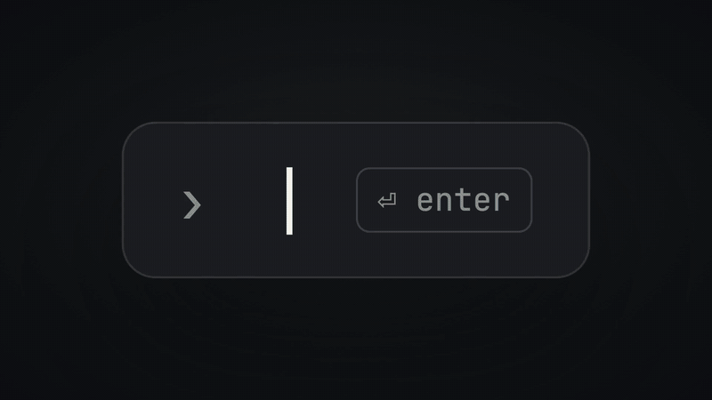
发布片里的每一页设计都是3.0自己做的（片子是用前几天开源的huashu-motion剪的）。这一版我改了三轮，前两轮都输给了旧版，第三轮才赢。没用过的朋友先花一分钟看看它是什么，用过的朋友可以直接跳到后面。
### 它是什么
今年4月17日Anthropic发布Claude Design，我玩到了凌晨四点。但几天之后我发现自己再也没点开过它，不是它不好，是我宁愿让agent在终端里帮我干活，也不愿意打开任何图形界面。
于是我让agent把Claude Design拆了一遍（社区流传的系统提示词、品牌资产协议、组件机制），再结合我自己的设计探索写成一个skill，4月21日开源，叫huashu-design。
装上之后，在agent里说一句「做个XX的网站」「做份PPT」「做个App原型」，它会自己找素材、出HTML，交给你网页、可点击的原型、能导出可编辑PPTX的幻灯片、动画或信息图。需求说不清也没关系，它会先摆三个方向的真实设计让你看着选。
发布9个小时1600多star，一周9k，6月发2.0的时候是16k。到今天（10月23日）是**25,802个star，2,874个fork**。
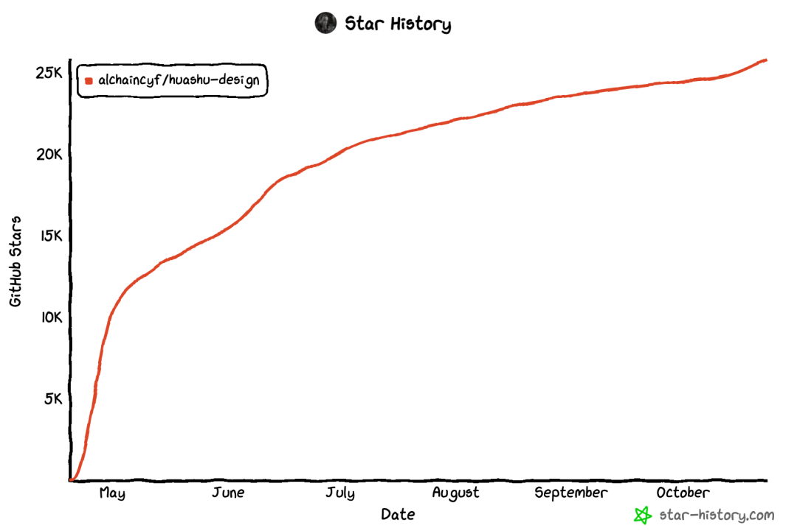
能装skill的agent基本都能用，MIT协议，商用也免费。
### 2.0留下的问题
2.0治的是「无聊」：v1做什么都收敛成米白底加大量留白，2.0改成三套逻辑并行（秒数轮盘随机抽风格、现实参照借获奖作品、最佳设计师从头想），三个方向拉开了。
但用了四个月，我发现了一个新问题：**单个项目看都不错，放在一起却长得像。**
暖纸底、衬线标题、一个陶土色点缀，这套外观在我的项目里反复出现。我回头查了旧版跑的测试题，5组里有3组三个方向撞了色、撞了同一个外观家族。根子在skill里原来写着一条默认外观，暖奶油底加衬线加陶土色，这是Claude家族的长相，也恰好是我封面和橙皮书的系列风格，结果所有题材都往这儿靠。
### 改了三轮
我定了4道固定题（落地页、众筹PPT、信息图、App原型），改前改后各跑一遍，打乱顺序贴成一面墙，我自己盲选。
**第一轮，新版4题只赢了1题。**那一版要求每个方向都有一个大隐喻，结果页面被做成了道具：众筹PPT做成一张借书卡，或者一整页高饱和撞色色块，App整个套进地铁线路图。

我当时说剖面图那版不错，另外两个「风格又过头了」。
**第二轮，2题全输。**这一轮我加了一份「2026年AI默认外观清单」和几道护栏，想把agent从常见长相里赶出来，结果三版一起变成浅冷色、整整齐齐。
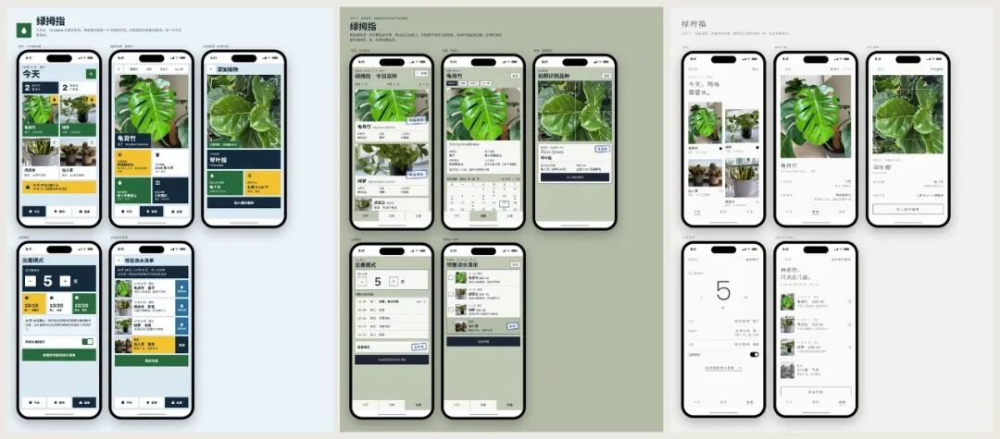
我的原话是「其实都一般，主要是太规整，太无聊了」。更打脸的是，我在旧版里认可的深色卡片加杏橙点缀、暖纸加原研哉留白，恰好就是被新规则劝退的。
**第三轮，2题全赢。**我把方向倒了过来：**加选项，不加禁令。**多出候选、给agent看得见的样张、让它真的去看参考作品，禁令一条不加。盲选完我说的是「我觉得这次明显变好了」，这一版就是3.0。
说起来这个教训挺反直觉的：你告诉agent不许做什么，它会躲到最安全、最整齐的地方去；你给它更多看得见的东西，它反而敢。
### 3.0到底改了什么
写到这里我嫌手上的案例不够好看，又用3.0新跑了6道题，网页、App、PPT各两道，每道一句话需求，方向是agent自己挑的，我没插手。
**一、先出六个候选，再挑三个做成真稿。**三套逻辑各出两个候选，先画缩略图，挑够好、彼此不一样、又不撞你最近项目的三版做完整设计。
「给葛饰北斋的《富岳三十六景》做一个线上展览网站」这题，三版分别是Rijksmuseum官网式的暗场展厅、田中一光式的三角窗、民国书衣式的题签框。体检报过一次撞车：两版首屏都用了《神奈川冲浪里》，它就把暗场那版换成了《山下白雨》：

往下一章讲普鲁士蓝，依据是大都会博物馆的光谱研究：
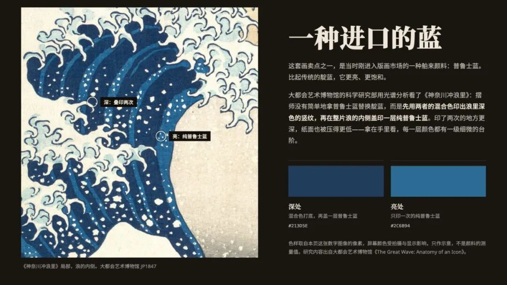
全46幅都来自芝加哥艺术博物馆和大都会的开放馆藏：
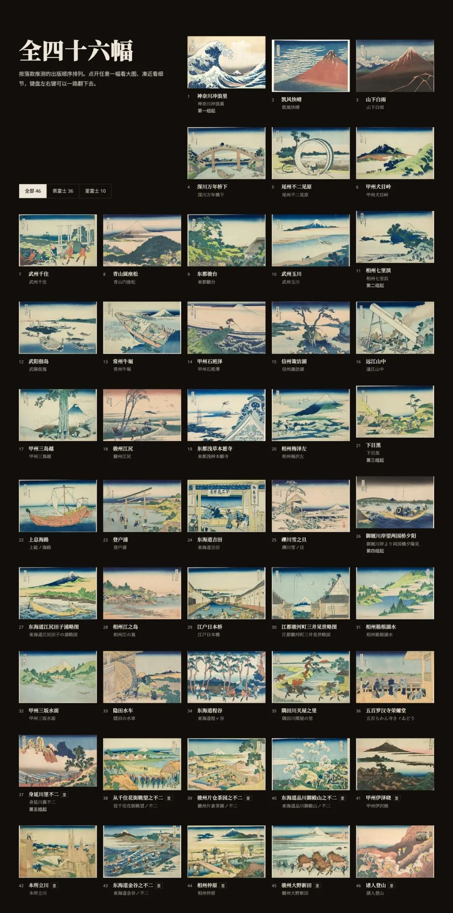
**二、现实参照改成同媒介，而且先截图。**做App就找获奖App，新加的ref_board.py会把参考作品截成参考板，agent亲眼看过再动手。「做一个观鸟记录App的原型」这题，它找的是拿了2025年苹果设计奖的CapWords：
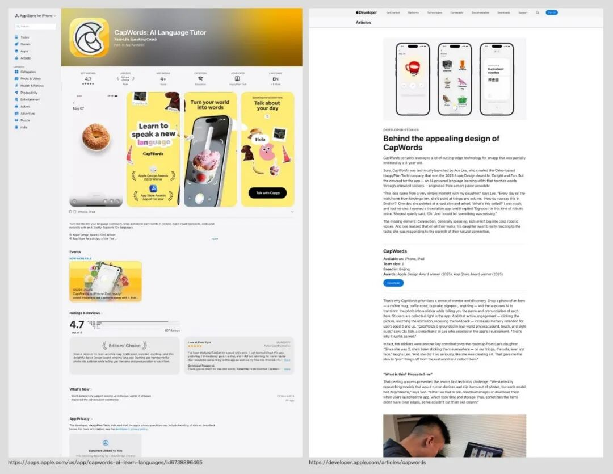
借来的是「从照片里撕下一张贴纸」，每只鸟都从Wikimedia的真实照片里分割出来，贴进一年的本子里，叫声波形是拿真实录音算的：
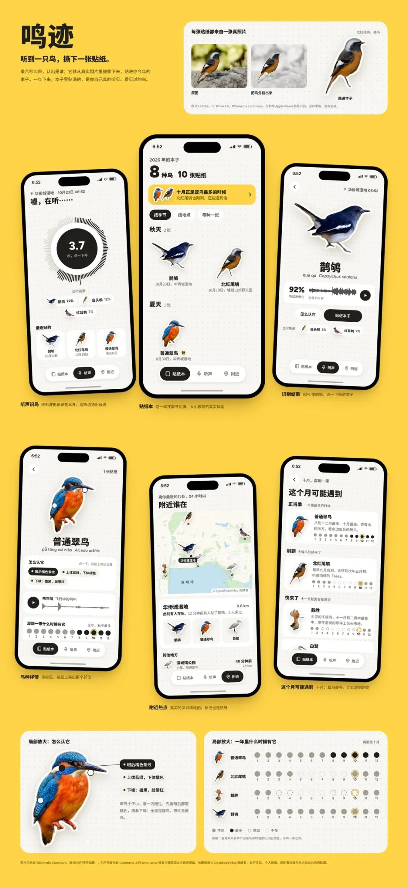
**三、风格库从60种扩到84种，每种都有一张样张。**新增App 12种和中文与东亚12种（吕敬人、宋刻本、民国书衣、上海摩登、香港街招、杉浦康平……），agent先看到做到位是什么样，再动手。
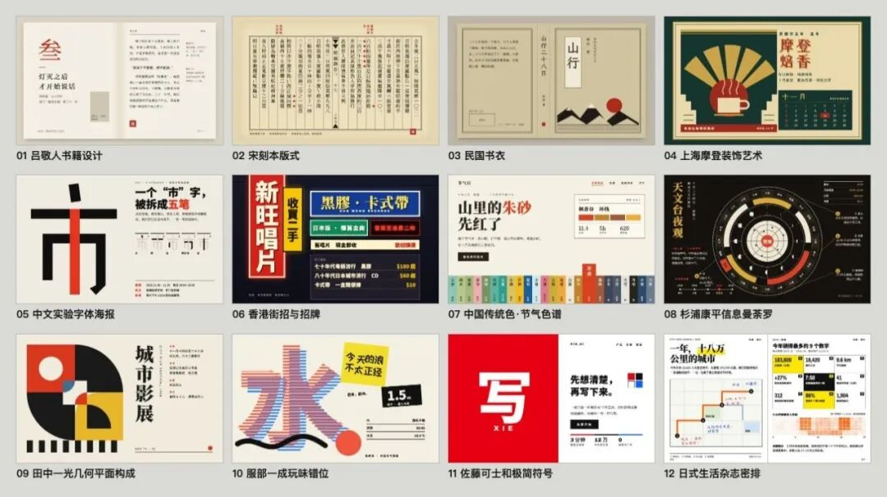
「做一个家常菜谱App」那题，秒数轮盘恰好抽到吕敬人书籍设计，最后做成了一本菜谱：一道菜一页方子，切口旁边留一条旁注栏，写「擦干再煎才不溅油」「老抽只要几滴」，朱砂只给「开做」这一方印：
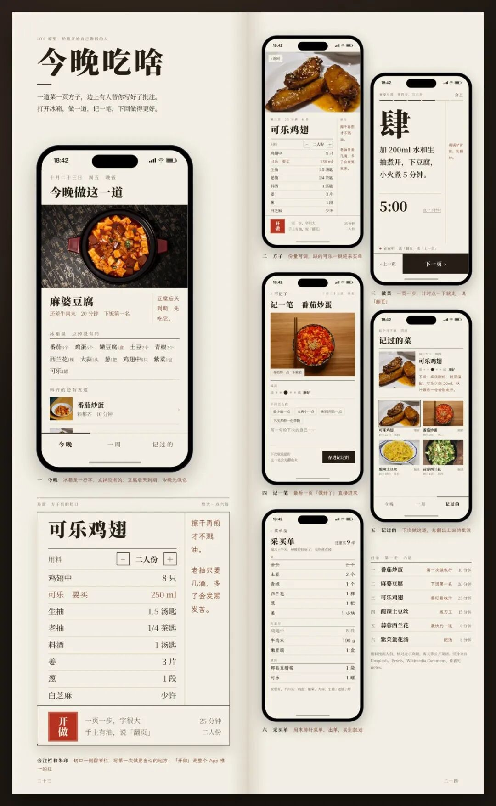
讲《千里江山图》的讲座PPT走的是另一套逻辑，最佳设计师Abbott Miller式的暗场展柜，暗底取的是绢地最暗处的颜色。封面底下那条细长的位置条就是整卷缩略图，框出这一页在11.9米长卷的哪一段：
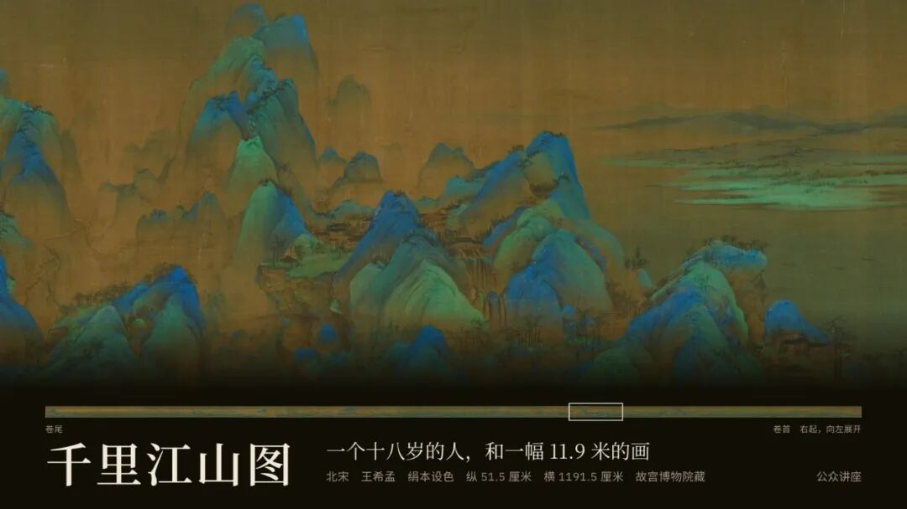
往后讲画有多大、「希孟年十八岁」、小如豆的人物和石青石绿：
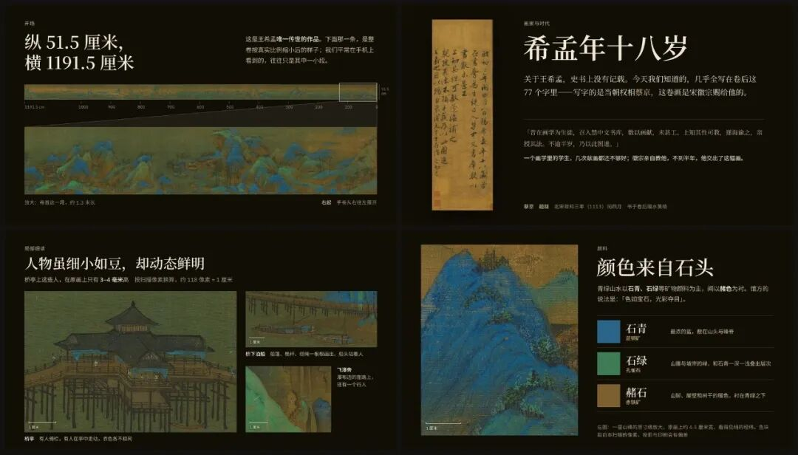
**四、App原型改成有构图的展示板。**一排等大的手机本身就无聊，上面两个App都是错落排的，第三轮赢的植物App也是，这张我觉得还可以：
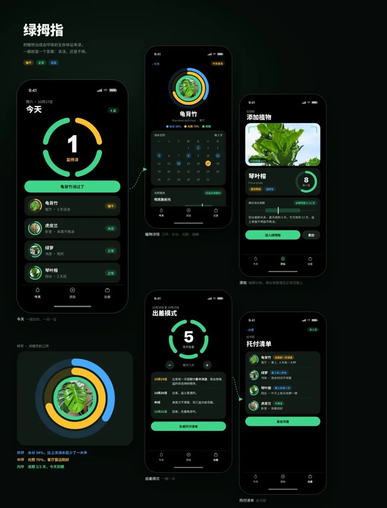
**五、越用越懂你。**这是3.0新加的一套本机记录，只存在你自己电脑的`~/.huashu-design/`里，不上传：
- 经验：开工前带出你说过的品味原话，收工时记下值得记的（会先告诉你）
- 外观账本：每次交付记一笔长什么样，下个项目主动避开
- 设计体检：design_lint.py只量能核对的事实，裂图、字太小、对比度不够是红灯，三版是不是换皮、和最近的项目撞没撞也能查，好不好看它不打分
这次外观账本看到我最近6个交付里5个是无衬线标题，菜谱挑了宋体那版，北斋展的巨字也换成了宋体。
发布后我拿它做了自己的旅居档案（三年里所有旅行照片的地图），选的是葛西薰式的白纸明朝体长卷，开头一张卫星地图串起所有旅程，往下一段旅程一章：
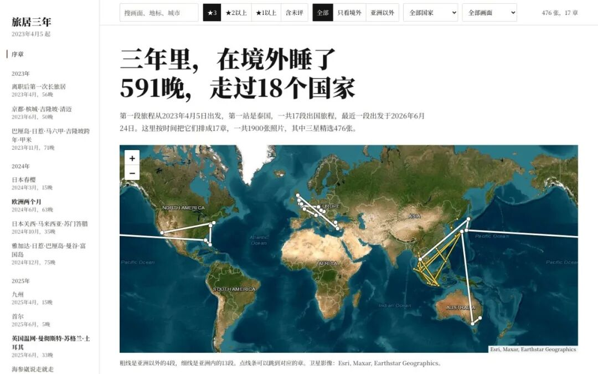
选完我顺口说了句「尽量不要遗漏」，它就记进了经验：个人回忆类档案照片要全，而且注明只适用于照片档案，不外溢到产品界面。
**六、事实还是先核实。**这是2.0就定下的规矩。韦伯望远镜那题，初稿把一篇研究里的「数量多约100倍」读成了「亮100倍」，被另开的核查agent对着原文抓了出来。黑洞这份科普PPT也一样，每页右下角都标了出处：
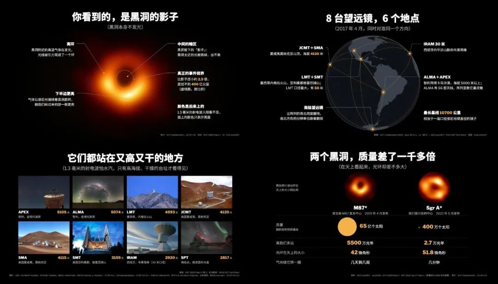
另外SKILL.md从593行压到215行，按网页、PPT、信息图、动画分模块按需读，顺手修了PPTX导出丢字的bug（#56）。
### 怎么装
没装过的：
```
npx skills add alchaincyf/huashu-design
```
装过的，重新跑一次上面这行，或者在huashu-design目录里`git pull`。新脚本要用Python版Playwright和Pillow，没装的话相关检查会跳过，不影响出设计。
GitHub：https://github.com/alchaincyf/huashu-design
3.0其实也不算完，好不好看最终还是你说了算。用了觉得哪里不对，欢迎在评论区或GitHub issue里告诉我，下一版接着改。
如果你觉得有用，帮我点个赞、转给身边要做设计的朋友，关注一下，下一版出来我第一时间写。

