# iOS、Android、macOS 近期值得关注的 6 个 App
> 💡 备注属性未写入，可能是备注属性名称或者类型被修改了，建议将字段类型设置为 rich_text，可以在小程序-操作-修改文章数据库页面进行调整
> 💡 原文链接:[https://mp.weixin.qq.com/s?__biz=MzU4Mjg3MDAyMQ==&mid=2247636621&idx=1&sn=e50fab52afe8dd11e204fdc86ddec538&chksm=fc705a7d5202d16fae4e473efe49d8efc6cd71129f634c113c70c24ff7b8f3fc4996198fa81c#rd](https://mp.weixin.qq.com/s?__biz=MzU4Mjg3MDAyMQ%3D%3D&mid=2247636621&idx=1&sn=e50fab52afe8dd11e204fdc86ddec538&chksm=fc705a7d5202d16fae4e473efe49d8efc6cd71129f634c113c70c24ff7b8f3fc4996198fa81c#rd)
**编注：**欢迎收看本期《派评》。你可以通过文章目录快速跳转到你感兴趣的内容。如果发现了其它感兴趣的 App 或者关注的话题，也欢迎在评论区和我们讨论。
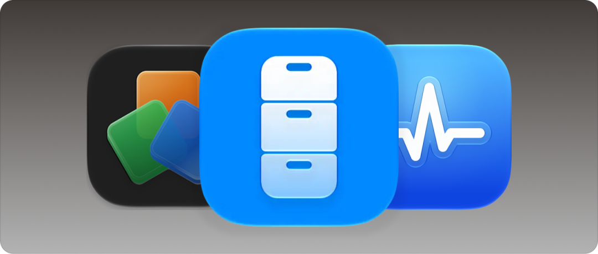
本期目录1️⃣ Vitals：Mac 系统监控数据整齐收纳2️⃣ Tapbar：让手机状态栏看着直观，用着好用3️⃣ Hoardware：给 Apple 硬件收藏者的设备档案库4️⃣ VMPal：AI 优先的 Mac 端虚拟化软件5️⃣ DroidDeck：把 SteamOS 和 PC 游戏装进 Android 设备6️⃣ 饭拍相机：演唱会、音乐节拍摄不求人
**▍Vitals：Mac 系统监控数据整齐收纳**
- 平台：macOS
- 关键词：系统、硬件、数据、监控
@ElijahLee：Vitals 是一款面向 macOS 的系统监控工具，它将 CPU、内存、磁盘、网络、GPU、电池等指标集中在一处，让你直观地查看电脑资源的消耗来自哪里。
Vitals 使用独立窗口和菜单栏常驻两种模式，相比 macOS 原生的「活动监视器」，Vitals 具有更加舒适的视觉呈现和优雅的动态效果，首页「概览」以卡片和仪表盘形式，呈现 CPU、内存、GPU、磁盘、网络和电池六项硬件的实时使用情况，每张卡片的详细指标维度，则根据不同的硬件组件设计，点击任意一张卡片即可进入详情分析，进一步列示相关资源的消耗。
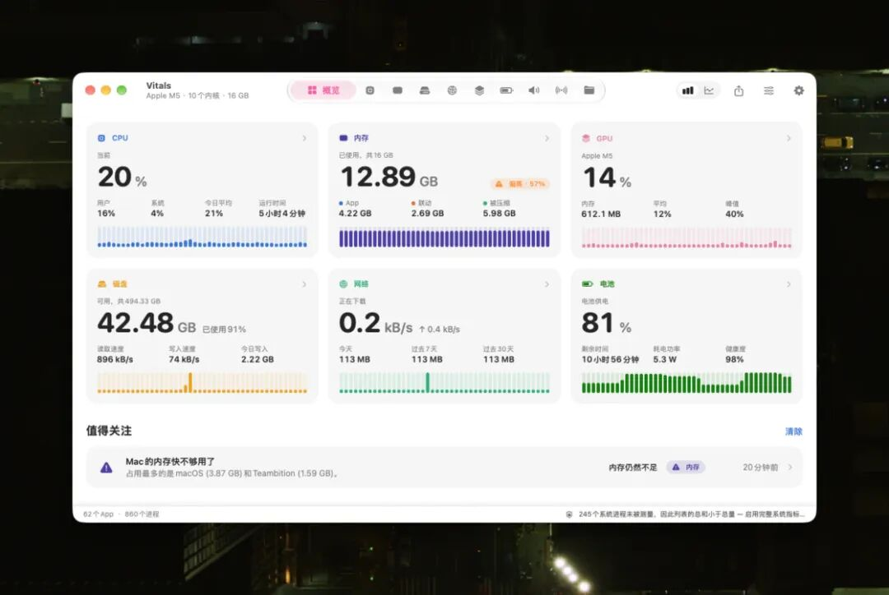
另一个与「活动监视器」不同的是，Vitals 会将相关进程归并到应用下，以应用为单位展示资源消耗。对于内存、CPU 和功率，Vitals 使用圆环占比图表来呈现各个 App 的硬件资源消耗情况。这种以应用为中心的监控方式，尤其适合经常同时打开多个应用的用户。当电脑突然变卡、风扇开始高速运转，或者内存占用异常升高时，可以更快找到排查方向。
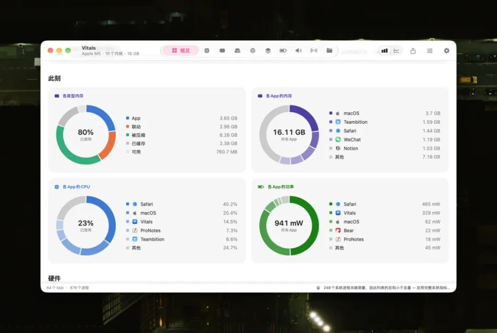
在 Vitals 中，我们还可以使用 AI 帮助了解 Mac 的运行状态与环境。在设置中开启集成后，Vitals 支持通过 MCP（模型上下文协议）连接 Claude、Codex、Cursor 等 AI 工具，让 AI 直接读取 CPU、内存、磁盘、网络等系统指标，查看应用的资源占用情况，也能检查开发服务器、后台进程和开放端口。用户只需通过自然语言提出问题，就能让 AI 协助排查电脑卡顿、定位高资源占用的应用，或识别闲置的开发服务。
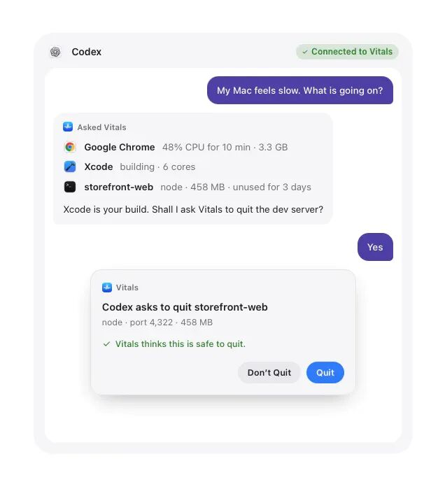
在菜单栏，Vitals 提供了轻量化的监控展示窗口。值得一提的是在应用设置中，我们可以通过 Vitals 将 CPU、内存、GPU、网络、磁盘、温度、电池、功率这几项指标常驻在菜单栏中。你关注哪个指标，就可以让哪个指标的使用情况常驻显示。资源使用来到高负载水平时，Vitals 还支持将读数使用红色高亮显示，提醒你及时维护。
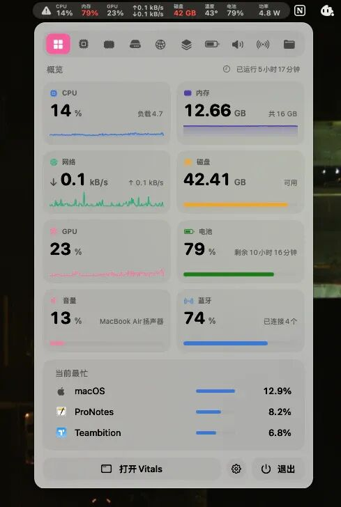
Vitals 还提供异常应用监控提醒、风扇速度监控、30 天历史记录等功能，你可以在应用官网购买 Vitals，当前价格为 15 美元（买断）。
官网：https://vitalsmac.com
---
**▍Tapbar：让手机状态栏看着直观，用着好用**
- 平台：Android
- 关键词：无障碍、快捷操作、效率
@Peggy_：手机状态栏大家想必都不陌生，它能展示时间、显示电量，说明当前的网络状态或是偶尔提醒我们某些应用正在发出通知。但即便现在有了灵动岛或类灵动岛功能加持，状态栏大多数时候的功能定位仍仅限于展示，而非交互。
向来如此便对吗？既然手机屏幕的其他区域都可以点击，状态栏这个长期占据屏幕空间的区域为什么不可以？Tapbar 便给出了这样一个解决方案：借助无障碍操作权限，将状态栏空间划分并允许我们重设点击操作。如此一来，点击时间就能打开时钟应用、点击电池区域就可以跳转应用耗电统计，这是不是就更加合理和便捷了？
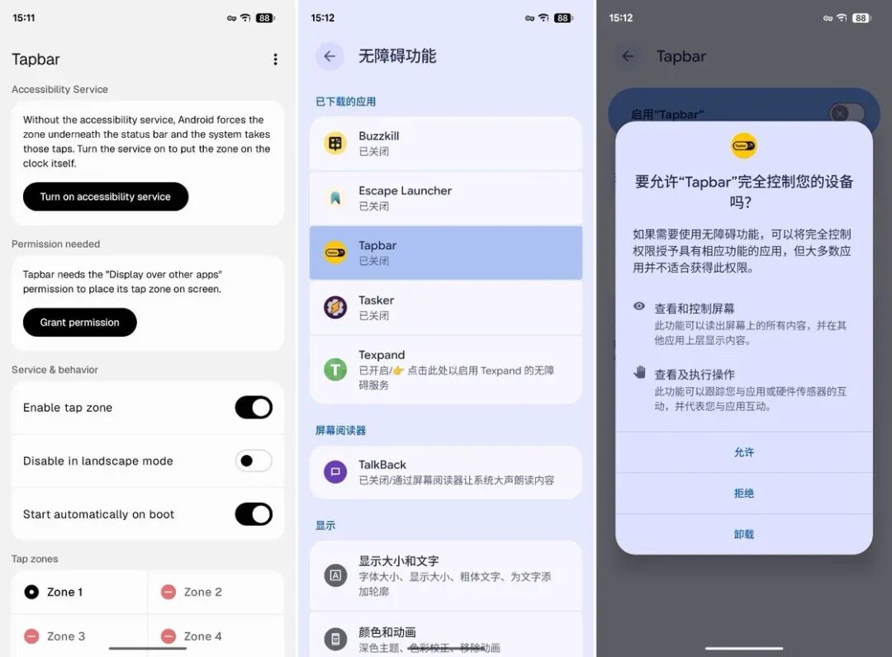
Tapbar 就是用来让状态栏变得更有用的。下载应用后，我们需要根据提示授予 Tapbar 相应权限，之后便可以设置「区域」的功能，应用最多允许我们设置 4 个区域，毕竟状态栏空间有限，划分太多的话手指点按其实也并不方便。区域对应的操作分为单击、双击、三击和长按，区域的具体位置、长宽均可以自定义。
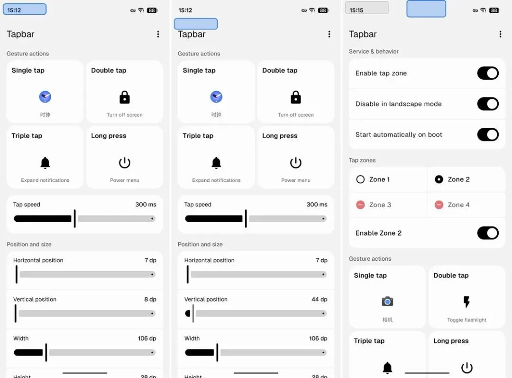
除了上面的点击时间设置为打开时钟，其余三种点击操作也可以分别对应不同的动作 —— 具体到动作，Tapbar 又分别支持了打开应用、打开系统某一操作、打开应用快捷方式。例如，我们可以将双击时间区域设置为打开系统设置内的「日期与时间」，将三击设置为打开待办清单类工具，总之选取的操作尽量和时间相关，否则后期记忆成本较大。
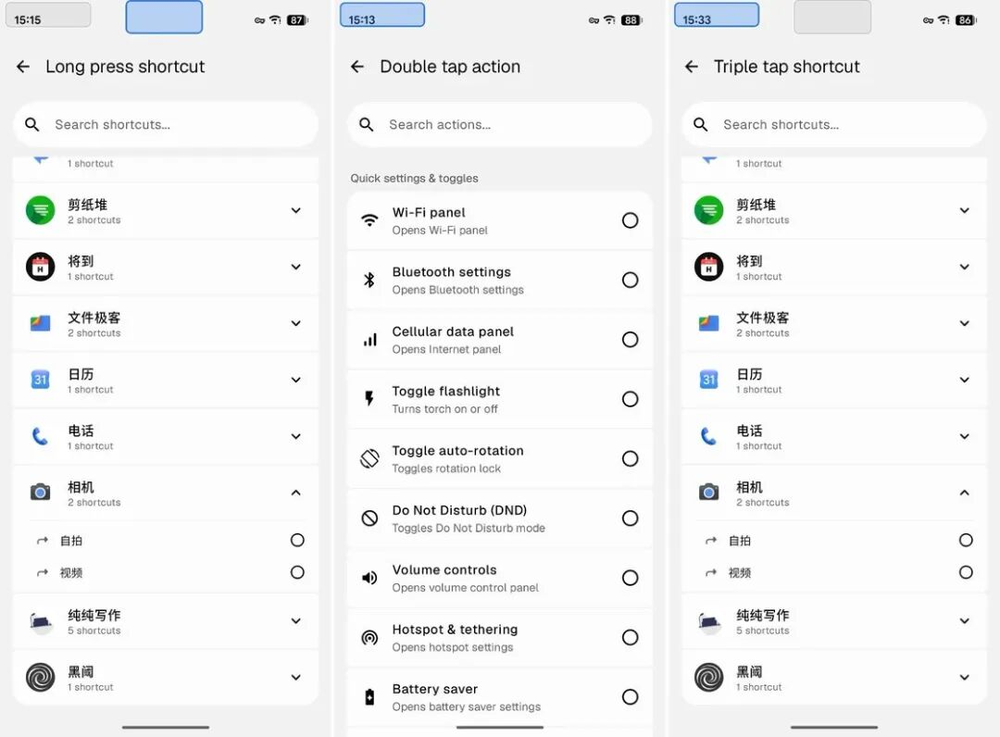
甚至连屏幕打孔区域，我都可以选择单击打开相机、双击打开自拍模式、长按则进入视频录制模式，让这个原本丑丑的挖孔也有了用武之地。其他设置就请大家自行探索。如果你担心在特定应用内误触导致频繁跳转，也可以通过 Tapbar 来设置应用黑名单，在黑名单应用内点击状态栏不会触发相应动作。对于游戏党和视频党，我们还可以在横屏模式下禁用 Tapbar。
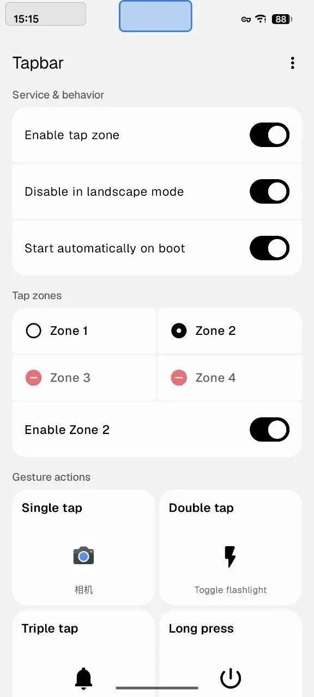
你可以通过 F-Droid 下载体验 Tapbar，应用开源且完全免费。
F-Droid 下载：https://f-droid.org/packages/com.earendel.tapbar
---
**▍Hoardware：给 Apple 硬件收藏者的设备档案库**
- 平台：iOS、macOS、iPadOS
- 关键词：硬件、Apple、档案、管理
@Vanilla：抽屉里躺着一台「还能开机」的 iPhone 4S，当年海淘的美版 iPad Pro 吃灰已久，外加一台当家庭中枢的老款 Apple TV —— 型号标识、系统版本、哪台还停在老版本固件，我以前全靠脑子硬记，记到最后往往变成一团浆糊。由独立开发者 Aaron Perris 打造的 Hoardware 正好盯住了这个小众却真实的痛点：把「我有什么」和「它现在跑着什么」放进同一个收藏库，它支持 Mac、iPhone 与 iPad 端，设备与固件信息来自社区数据库 AppleDB，不用另开账号，收藏库走 iCloud 实时同步。
打开应用，Hoardware 主界面是你的收藏列表，点右上角的加号按钮新增设备时，可以从 AppleDB 的目录里检索型号，覆盖 iPhone、iPad、Mac、iPod、Apple Watch、Apple TV、HomePod、AirPods、AirTag、Beats 等 —— 就算被收录的硬件本身不能安装这款应用，这些老机器一样可以通过 Hoardware 来完成建档。
进到单台设备的详情编辑界面，你能看到型号标识、正式名称、芯片、配色等硬件信息，再补上序列号、备注，以及自定义字段（成色、购入价、存放位置之类），建档工作就基本算是收尾了。
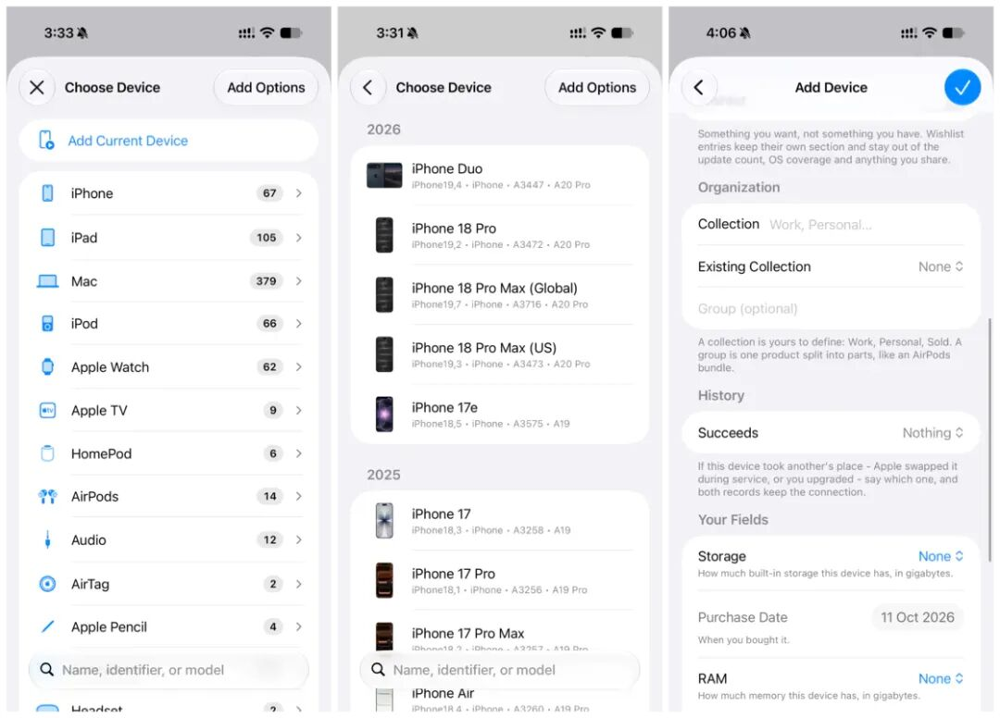
与其他同类工具不同，Hoardware 把软件版本当成了主角，在设备详情的 Software 区域，你可以记下当前安装的系统版本与 Build，对照查看已发布的正式版和 Beta 版本，相对较新的设备还可以选择打开新版本提醒。不管是需要刻意停在某一版固件的老设备还是仍在跟进 Beta 的新机器，都能通过 Hoardware 一站式管理。
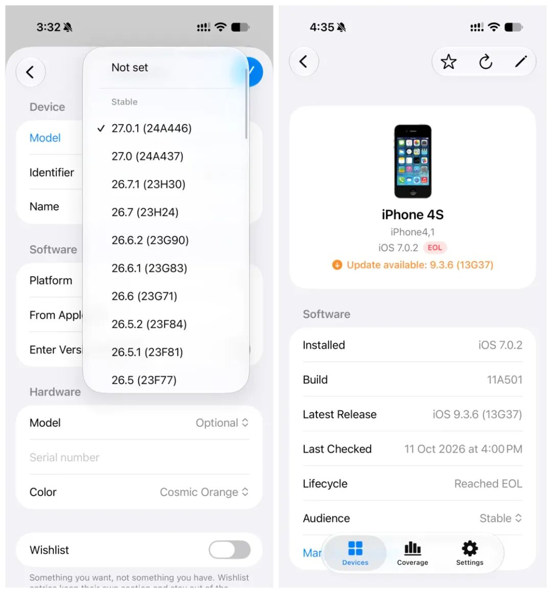
更有意思的是系统覆盖视图：它会汇总你的 iPhone、iPad、iPod touch 收藏，包括 iOS、iPadOS 设备的数量以及已经覆盖的系统世代。如果我想补齐某代 iOS 的实体机，或者只是想知道自己的「博物馆」还差哪几块拼图，这个视图可以帮我直观检视。
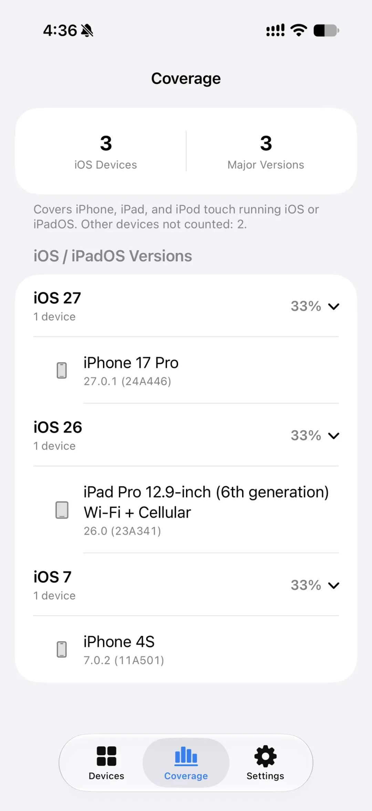
你也可以把设备丢进不同的收藏与分组，比如按日常机、收藏机、实验室等类别来切换管理；另外还有心愿单，用来记录下一次想淘到的型号 —— 从已经拥有到还想拥有，都可以在同一个应用里从容管理。
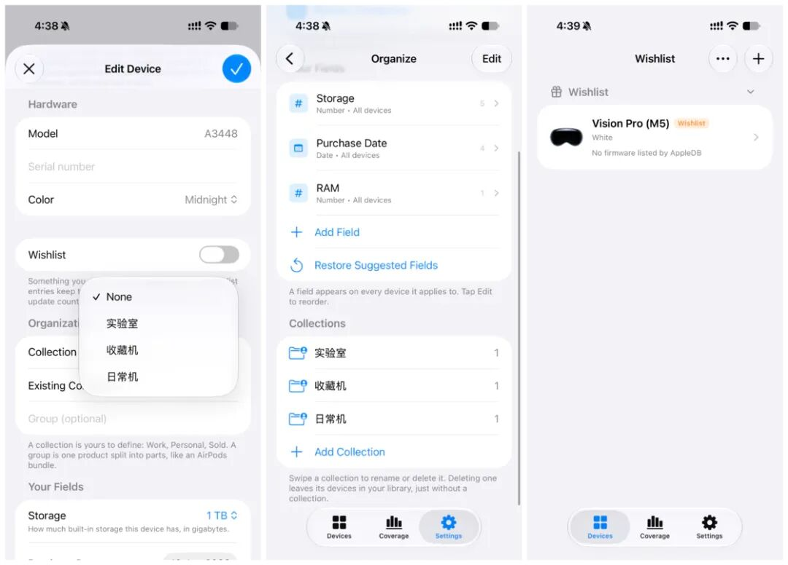
数据方面，Hoardware 支持把收藏导出为文本、JSON、PDF 或图片，也可以做完整备份再恢复。如果只想给别人看一部分，还能生成只读网页链接分享选中的收藏详情。
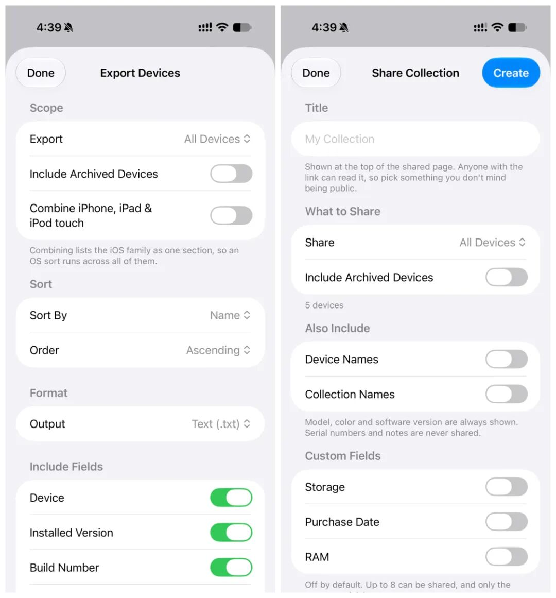
Hoardware 很清楚自己的受众：给那些爱攒 Apple 硬件、在意型号与固件细节的「果粉」朋友。如果你只有一两台主力机，它肯定就显得过重了，但如果你已经开始为某台「原版固件」设备命名、归档，它就是为这个场景量身做的趁手工具。
目前 Hoardware 在 App Store 可以免费下载，系统要求为 iOS 或 iPadOS 17.0 及以上、macOS 14.0 及以上，支持 visionOS。趁着开发者目前还没推出付费计划，你可以直接装上 Hoardware 试试，为抽屉里的老伙计们逐台建档。
App Store 下载：https://apps.apple.com/us/app/id6806893785
---
**▍VMPal：AI 优先的 Mac 端虚拟化软件**
- 平台：macOS
- 关键词：虚拟化、虚拟机
@化学心情下 2：提到 Mac 端的桌面虚拟化应用，我们首先想到的可能是 Parallels Desktop 或者 VMware Fusion，不过这两款体验上佳的桌面虚拟化工具都有些「不方便」—— 前者体验佳，但订阅服务和大版本买断都价格不菲；后者自从被博通收购后完全免费，但功能基本处于维护状态。
AI 时代，很多 AI agent 又有基于虚机系统开发或操作（比如前段时间非常火爆的 Grok Bot）的需求，有没有体验友好、费用低且支持 AI 的桌面端虚拟化管理应用呢？
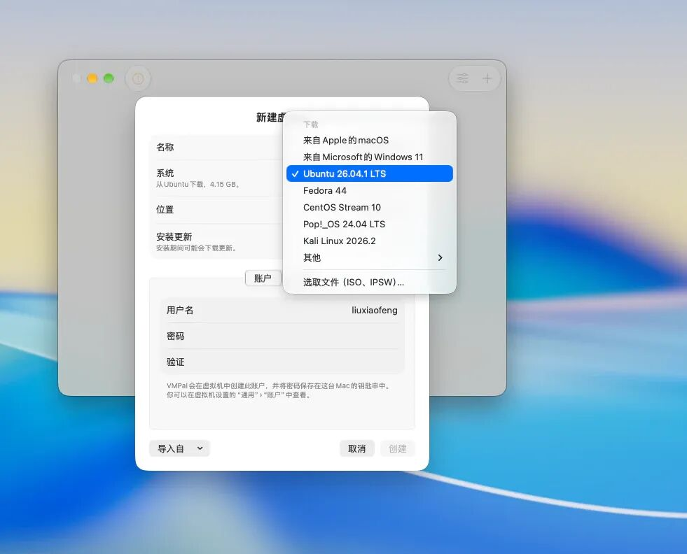
VMPal 或许是其中最为合适的一款，下载体验后我发现它可能真的是来抢 Parallels 用户的：采用一次买断授权（目前处于测试阶段，全功能不付费照样可用）、支持导入 Parallels 格式的虚拟机镜像。更重要的是，和 Parallels 一样创建虚机根本不需要提前下载镜像，打开新建虚拟机窗口后选择系统然后点击创建，VMPal 就会直接在系统官网下载合适的虚拟机镜像包，你只需要设置好用户名和密码，等待它按照默认模版创建并开机即可。
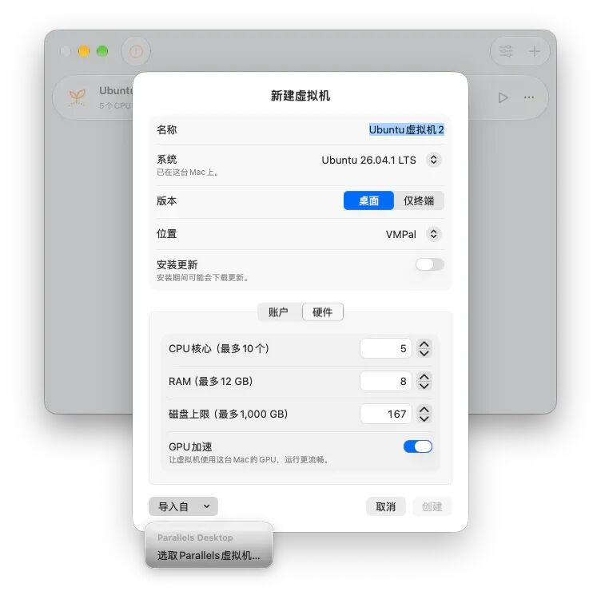
比如我现在安装的最新测试版（v0.67），支持下载 macOS、Windows 以及众多 Linux 发行版，此外 VMPal 对 Parallels 老用户也非常友好，你可以在新建虚拟机这个对话框左下角点击「导入自」选取 Parallels 虚拟机，之前用 Parallels Desktop 创建的虚拟机可以无缝接上；新建选项卡中也可以调整虚拟机的硬件配置，比较贴心的就是 VMPal 会默认加上 GPU 加速 —— 毕竟大部分时候我们在桌面开虚拟机就是为了通过图形化的界面使用。
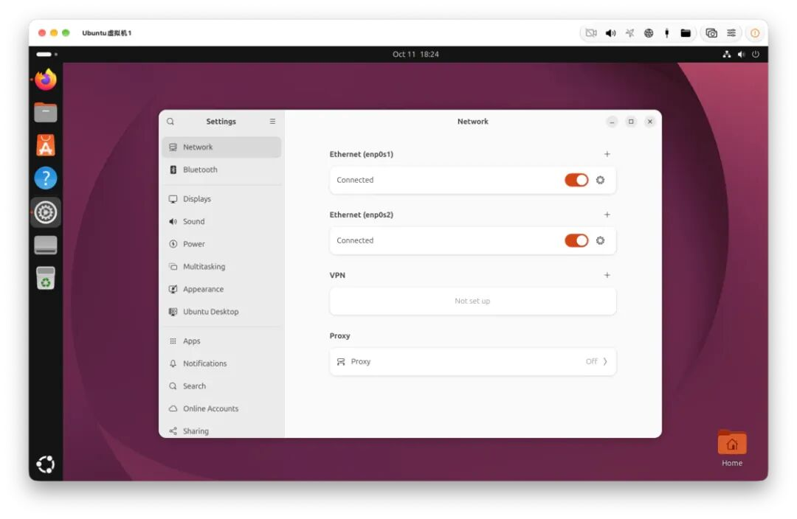
我在 VMPal 上开了一台 Ubuntu 虚拟机，整个桌面操作体验还是很丝滑的。你也可以按需求在虚拟机控制窗口这里开启如摄像头权限、声音、定位、网络访问以及外接设备的访问权限。另外 VMPal 的 Windows 虚拟机不支持 Parallels 的融合模式，也就是说虚拟机只能通过独立窗口运行 —— 看到这里你大概就能明白 Parallels 和 VMPal 之间最大的区别了。前者更像是方便我们在 macOS 上直接使用虚拟机上的某个应用（尤其是满足在 macOS 上运行某一个 Windows 应用），而后者则几乎不考虑这种场景，甚至真正使用系统的也不是人，而是 AI。
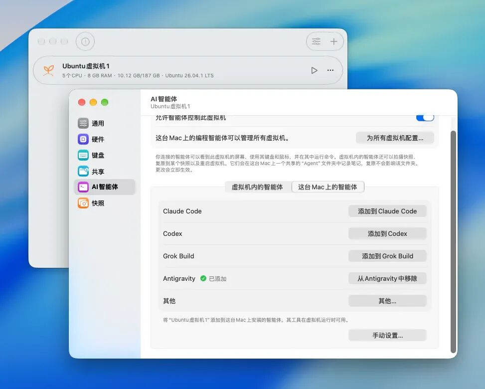
这也恰是 VMPal 最为重要的功能：允许 AI 来管理和控制这些虚拟机。
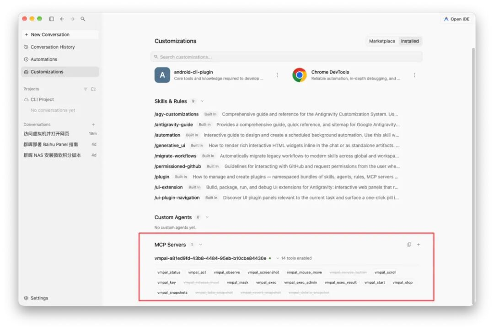
打开 VMPal 的设置，点击「AI 智能体」后就可以打开相关的 AI 控制选项了。比如我就将其添加到了 Antigravity 中，连接后 AI 智能体会调用相关 MCP 服务器连接到虚拟机，然后帮你完成计算机操作，后续作为 Grok Bot 平替也似乎完全可行。
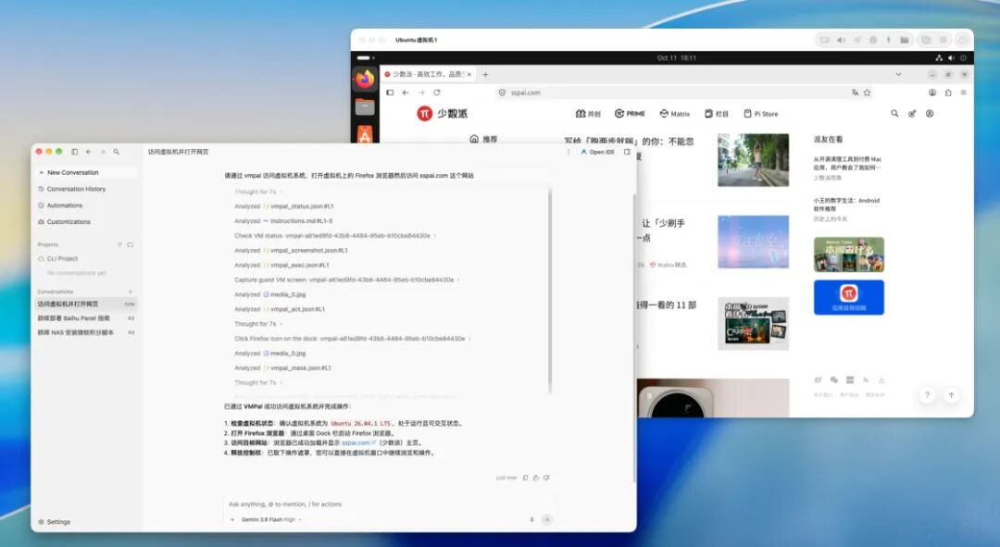
总的来说，作为 AI 时代的桌面端虚拟化软件，VMPal 虽然仍有不完善的地方，但也已经显露了自己的特色：既可以满足我们一般意义上的虚机软件使用需求，又能协助 AI Bot 完成一些系统操作任务。目前 VMPal 处于测试阶段，全功能暂时可免费使用，官方也推出了付费计划，目前个人版授权为 34.50 美元一台设备，购买后可解锁所有功能并提供一年的免费更新。你可以在其官方网站免费下载并使用当前的所有功能。
官网：https://vmpal.com
---
**▍DroidDeck：把 SteamOS 和 PC 游戏装进 Android 设备**
- 平台：Android
- 关键词：模拟器、Steam、PC、掌机
@大大大 K：最近在 Steam 里买了新游戏玩到上头，上班摸鱼、吃饭等上菜时都想随时随地搓两把。
虽然搭建一个串流很简单，但家里的电脑也不能 24 小时开机，我甚至为此萌生了买一个 Steam Deck 的念头 —— 但就在这个时候，GitHub 推送给我一个开源项目 DroidDeck，它解了我的燃眉之急。

DroidDeck 的运行原理是在 Android 系统中搭建一套 Linux 环境，在这个环境中以大屏模式运行 Steam Linux 客户端，并激活专为 Steam Deck 准备的「Jupiter UI」界面。同时它也能够加载 Proton 转译环境运行 Windows 游戏。
从原理上可以看出，DroidDeck 所需要占用的空间应该不小，根据项目介绍，Linux 环境大概需要 3 GB，Steam 客户端和 Proton 环境所需空间 1.1 GB 左右，这些环境还需要解压安装。

经过实测，在安装了一个 1.5 GB 左右的游戏之后，整个 DroidDeck 所占用的存储空间已经来到了近 12 GB，赶得上一个「小而美」了。另外，因为涉及到图形计算相关的功能，DroidDeck 要求设备支持高通 Adreno 730 或更高规格 GPU 并且运行 Android 9 以上版本，也就是说最早支持到第一代骁龙 8，2021 年或者 2022 年初之后的旗舰、次旗舰设备基本上都能运行。
虽然原理听起来比较复杂，DroidDeck 的易用性还是非常出色的。初次打开 app 会引导你下载并配置好运行环境，然后去开发者选项中关闭子进程限制。点击运行后，DroidDeck 还需要一点时间安装 Steam 客户端和依赖，在屏幕中看到原汁原味的 Steam 大屏模式，你就能登录 Steam 了。期间我们完全不需要去调整各种参数，只需要闭眼点击下一步就可以。

进入 Steam 界面后，我们可以通过触摸进行各种操作，DroidDeck 也会叠加一层虚拟按键模拟 Steam Deck 的物理按键，操作手机返回键时则会触发 DroidDeck 的侧边栏。对小屏设备来说，这层虚拟按键反而会让触摸操作不太方便，我们可以点击左下角按钮隐藏。当然了，如果你有 Android 平板设备或者折叠屏手机，使用 DroidDeck 的体验会更棒。

Steam Linux 客户端中已经内置了官方的 Proton 转译环境，支持的游戏可以直接运行。DroidDeck 还提供了额外的 2 个 ARM64 Proton 构建版本，如果某个游戏体验不佳，或许切换 Proton 版本能够解决。需要注意的是，由于是转译运行，所以并不是所有游戏都能支持，我们可以在每个游戏的兼容性支持信息中查看到具体兼容情况。就我个人实际使用体验来看，一些性能要求不高的游戏运行起来毫无压力，帧率稳定、响应快速，3A 游戏体验会差一些。

除了 Steam 游戏库之外，DroidDeck 也支持通过插件工具整合 GOG、Epic Games 平台，接入后同样可以使用 Proton 启动游戏（巫师三启动！），不过这一点可能需要折腾一下。此外我们还能在 DroidDeck 设置中打开 Linux 桌面并安装常用的工具和模拟器（比如 PPSSPP 等），进一步丰富了可玩性。
DroidDeck 本身的使用体验也非常可圈可点，UI 设计美观、操作动画流畅、界面逻辑清晰，不失为一个优秀的产品案例。如果你手头恰好有一台专门的高性能 Android 游戏掌机或大屏设备，也想获得与 Steam Deck 相似的随身游戏体验，可以前往 GitHub 下载尝鲜。
GitHub 下载：https://github.com/Droid-Deck/DroidDeck
---
**▍饭拍相机：演唱会、音乐节拍摄不求人**
- 平台：iOS
- 关键词：相机、演唱会、音乐节
@Snow：虽然 iPhone 的视频拍摄能力是手机里第一梯队的，但在演唱会或者音乐节这类人物不断变换位置，光线情况变幻莫测，还时不时被前排观众或道具影响拍摄的情景下，拍摄就不是一件只要按下录制键就能搞定的事了。
近期上架 App Store 的这款「饭拍相机」，或许无法在硬件上帮你补上 iPhone 长焦的短板，但可以帮你免去手动控制的慌乱。不用去小某书研读什么手把手设置教程，只要打开应用、选好模式，就可以安心欣赏舞台并录下回忆。
打开应用，顶部预设的「舞台均衡」「强聚光」「唱跳高速」和「柔光慢歌」四种模式基本可以覆盖演唱会可能遭遇的各种情况，如果追光灯追着人物跑，背景却一片漆黑，强聚光模式会自动拉低曝光补偿，确保「爱豆」的脸庞不会过曝；遇到动作密集的唱跳舞台则可以切换到唱跳高速模式，应用会自动切换至 60 fps 录制；如果现场开启了一轮舒缓的情歌合唱，可以调用柔光慢歌模式，提升画面曝光和色温，完整保留这一段温馨的场景。

选择好舞台预设后，你也不必再从一堆专业参数中摸索，饭拍相机的手动控制项克制地只开放了与演唱会拍摄高度相关的曝光补偿和色温，按需微调曝光和画面冷暖之后锁定参数，你就可以安心打 call 了，不用害怕玩得太嗨误触手机导致压根没录上的情况发生。遇到中场休息也不一定需要中断拍摄，可以点击录制键左侧的暂停按钮暂停拍摄，等下一趴开始时继续录制，应用会将所有段落自动拼合成一个视频。

当然，很多人并不会录制全场，可能只想保留一些特殊节点的记忆，因而饭拍相机也提供了拍照模式，并且在 1.1.1 版本中支持 Live Photo 拍摄，非常适合发到朋友圈和其他人分享。
饭拍相机的另一项重点功能是人物跟踪，它自然不可能像大疆那样操纵手机自动跟踪拍摄，但只需点一下画面里的人物，就能将焦点锁定在他身上，防止相机突然抽风失焦。如果你坐在看台远端，只能用长焦镜头拍舞台，建议在设置中关闭自动切换镜头，避免切镜造成的画面跳变。「设置 - 画面稳定」还提供了三档防抖，你可以根据自己跟拍或固定机位的情况进行调整。

除了画面，声音也是演唱会记录里很重要的一部分。演唱会现场音量很大且频繁波动，手机默认的自动增益和语音处理有时未必适合录制整场演出，你可以尝试打开设置中的增强音频选项，看看收音情况是否有所改善。
为了更好地记录下你的这段记忆，应用还支持自定义的双行水印，你可以写上演唱会主题、场次、日期或者是自己的心情，选择一个合适的摆放位置，水印就会直接录入照片或视频。

你可以在 App Store 上免费下载「饭拍相机」，饭拍相机包含一项 12 元每月的订阅制服务，付费后可以去除水印并解锁所有功能。建议在进入演唱会场馆前预拍一些素材看看效果，再决定是否开启订阅。
App Store 下载：https://apps.apple.com/cn/app/id6809112977
---
原文链接：
https://sspai.com/post/115934?utm_source=wechat&utm_medium=social
作者：少数派编辑部
**/ 更多热门文章 /**

**/ 产品推荐 /**

## 摘要

（待补充）

## 我的笔记

（待补充）
