# iOS限免汇总｜11月25日：12款应用限时免费
> 💡 备注属性未写入，可能是备注属性名称或者类型被修改了，建议将字段类型设置为 rich_text，可以在小程序-操作-修改文章数据库页面进行调整
> 💡 原文链接:[https://mp.weixin.qq.com/s?__biz=MzA4ODA0NDMwMQ==&mid=2458894134&idx=1&sn=59df0b9153f78eb627696b0675c5685a&chksm=862b4e471ffd2ac318559d85bb82264c667bb29194db49b9d184cfa7720ff668a54579b62c12#rd](https://mp.weixin.qq.com/s?__biz=MzA4ODA0NDMwMQ%3D%3D&mid=2458894134&idx=1&sn=59df0b9153f78eb627696b0675c5685a&chksm=862b4e471ffd2ac318559d85bb82264c667bb29194db49b9d184cfa7720ff668a54579b62c12#rd)
11月25日一共 12 款，全部逐款在 App Store 核过价（国区、美区）。限免随时可能结束，看到先领，领之前再确认一眼价格。
**一、本体限免（4 款）**
**Reclaim Scroll Detox**
**价格：本体限免 0 元 · 国区、美区都是 0 元**
打开 Instagram、TikTok 这类容易刷上瘾的应用之前，先出现一段舒缓的呼吸动画，停一下，再选继续前往还是取消、保持专注；图表和彩色日历追踪每个应用的打开频率，还能开启励志名言与正念提问。约 82.5 MB，需 iOS 26.0 以上，界面仅英文。
下载：App Store 搜索「Reclaim Scroll Detox」，认准开发者 Reza Firouzbakht
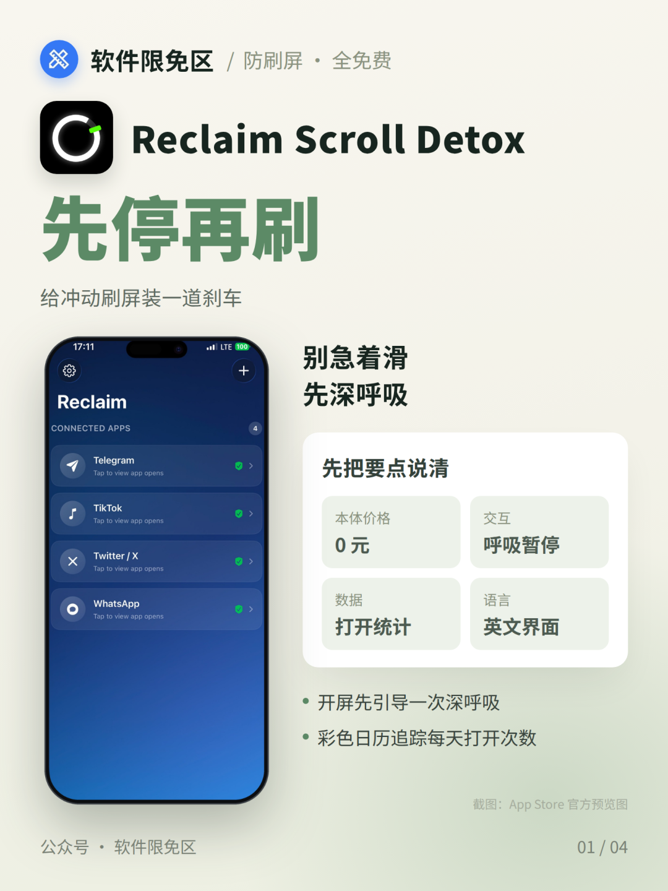
**Zhuzh Lite**
**价格：本体限免 0 元 · 国区、美区都是 0 元**
简单的现金流规划与记账本：工资、房租、买菜、应急基金、房贷和基金投资先规划好，每笔收支随手记，账户、基金、资产和债务一处看清；定期交易与计划、定时交易、提醒都有，交易与报表还能精细筛选。约 39.3 MB，iOS 15.0 以上，界面为英文。
下载：App Store 搜索「Zhuzh Lite」，认准开发者 ZHUZH LIMITED
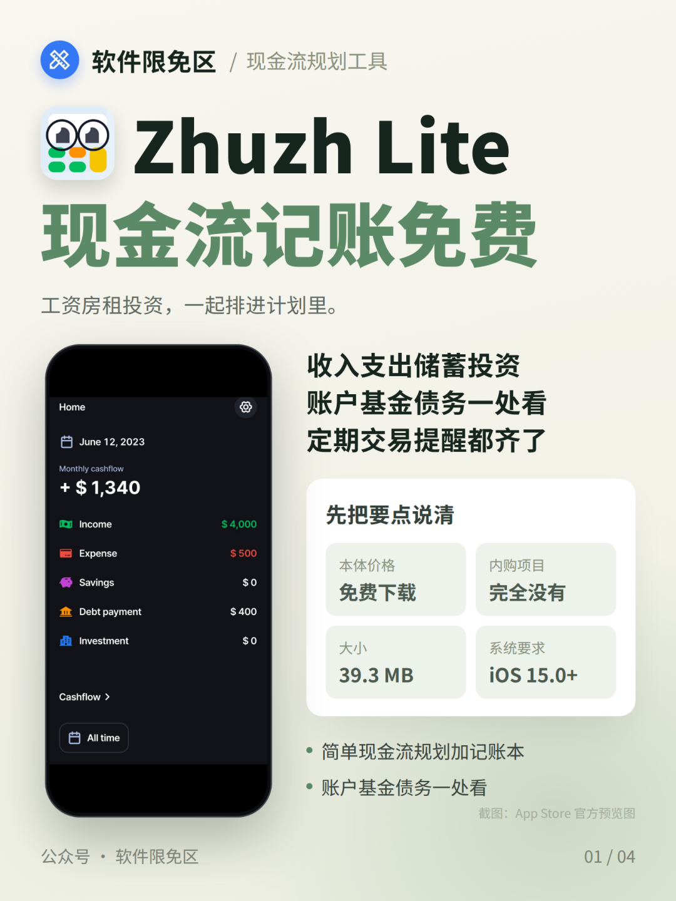
**Synqo**
**价格：本体限免 0 元 · 美区 0 元（国区未上架）**
每天早上看一眼恢复分：读 Apple Health 的数据，化成三个简单分数，告诉你今天恢复得怎么样、适合多大的训练负荷，帮你平衡训练、饮食、睡眠与恢复；支持 Apple Intelligence 的 iPhone 上，AI 教练在设备端运行。约 7.6 MB，需 iOS 17.0 以上，仅英文、德文界面，需美区账号。
下载：App Store 搜索「Synqo」，认准开发者 Robin Limprecht
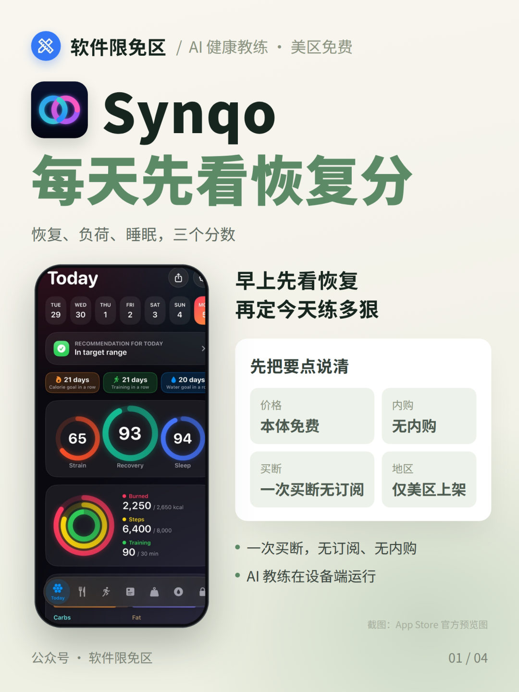
**玲珑记账**
**价格：本体限免 0 元 · 国区、美区都是 0 元**
语音记账、拍照识别录入发票、账单和收据，多账本分开管（个人、家庭、旅行、工作），预算提醒、月度年度收支图表分析、自定义分类、AI 智能分析都有，数据存在本地。专为 iPad 设计，iPhone 也可用。约 91.9 MB，iOS 17.0 以上，国区 5.0 分。
下载：App Store 搜索「玲珑记账」，认准开发者 大连鑫雨至软件开发有限公司
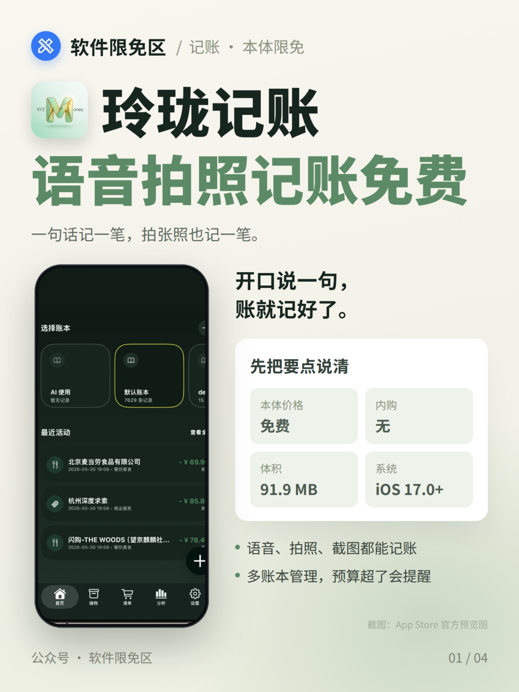
**二、内购限免（5 款）**
**OGZone**
**价格：「祈愿终端」内购 0 元 · 国区、美区都是 0 元（本体免费，其余内购仍收费）**
打工人的职场生存指南：赛博黄历按 12 种职业生成每日宜忌，还有今日记忆碎片、输入共振 ID 配对看相性的职场共振、老板回复助手、离职倒计时和助眠白噪音；本期 0 元的是「祈愿终端」抽签，其余内购各 1 元。约 6.5 MB，iOS 16.6 以上。
下载：App Store 搜索「OGZone」，认准开发者 Yue Song
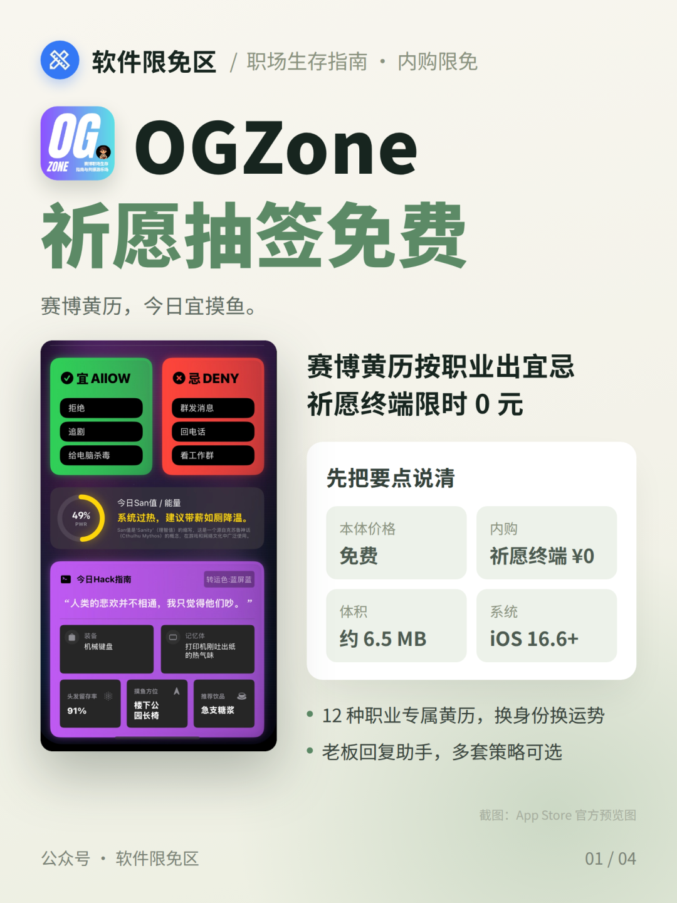
**PythonForge**
**价格：「PythonForge Pro」内购 0 元 · 国区、美区都是 0 元（本体免费）**
在 iPhone 上本地运行真实的 CPython 3.14，写、跑、调试 Python 都行；内置 AI Agent 帮你写代码、读报错自动修复，numpy、pandas、scipy、matplotlib、OpenCV 等 70 多个包可离线安装，断点调试、Git、SSH 终端、Jupyter Notebook、SQLite 一应俱全。无服务器、无账号、不收集数据。773.6 MB，iOS 16.0 以上。
下载：App Store 搜索「PythonForge」，认准开发者 敏飞 陈
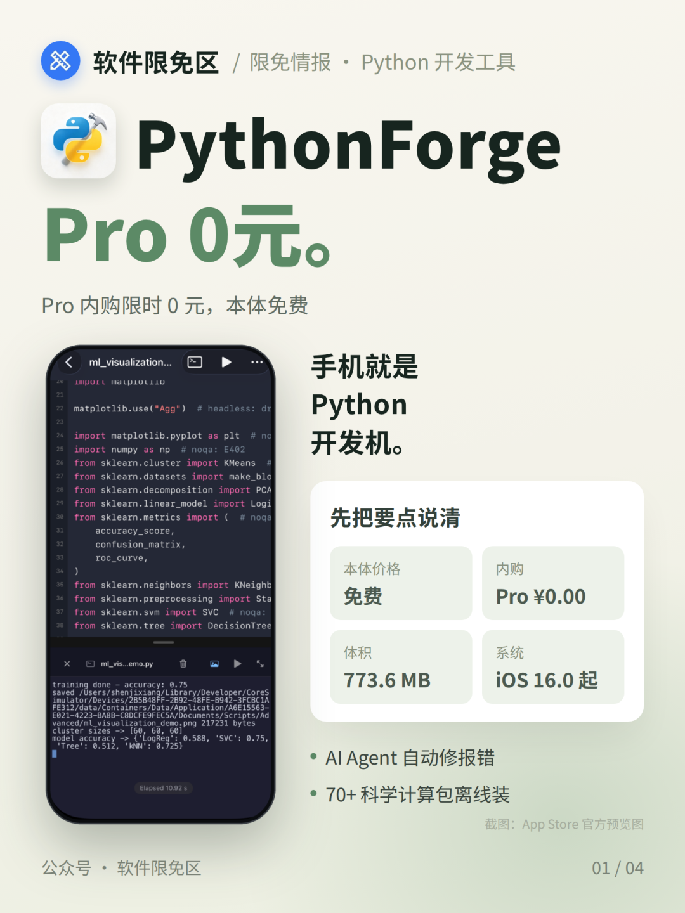
**眠屿**
**价格：「BalenWatch Pro 终身会员」内购 0 元 · 国区 0 元（本体免费，年度、月度仍收费）**
接 Apple Watch 的 HRV、心率、睡眠与活动数据，AI 分析压力与恢复趋势；睡眠时长、阶段与作息规律可以回看，还有表盘小组件与健康小组件，家人好友授权后能互相守护。约 63.8 MB，需 iOS 18.6 以上，国区 5.0 分。
下载：App Store 搜索「眠屿」，认准开发者 长沙界朔科技有限公司
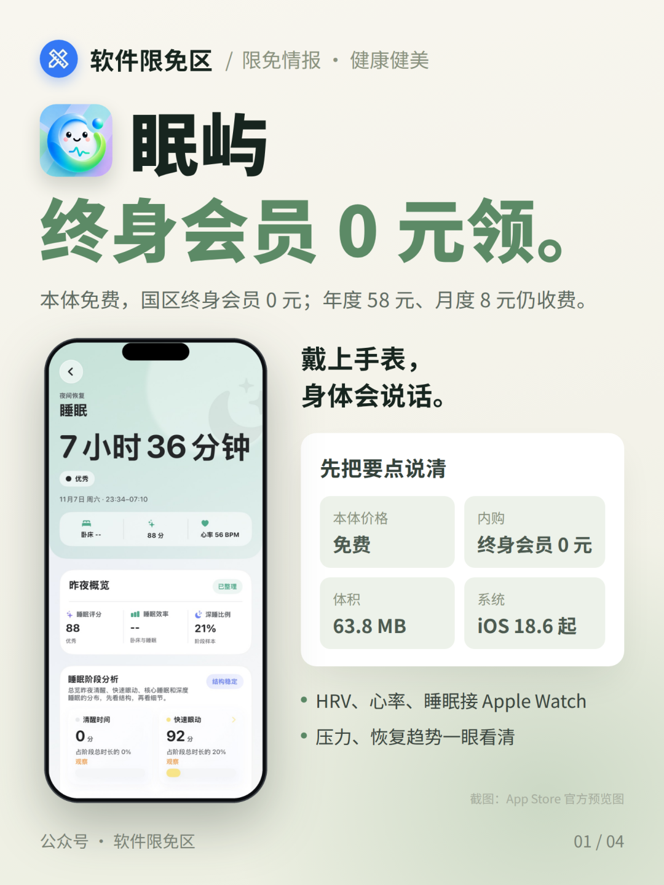
**自律锁**
**价格：「终身版」内购 0 元 · 国区、美区都是 0 元（本体免费，月付 Pro 仍收费）**
应用拦截器：一键闪电拦截应用和网站，定时自动拦截、强效应用限额都有；严格模式下无法取消或绕过自己设的定时器，拦截名单可自定义。用屏幕使用时间 API 拦截，数据不收集、不分享、不离开手机。约 19 MB，iOS 17.0 以上。
下载：App Store 搜索「自律锁」，认准开发者 彦辉 侯
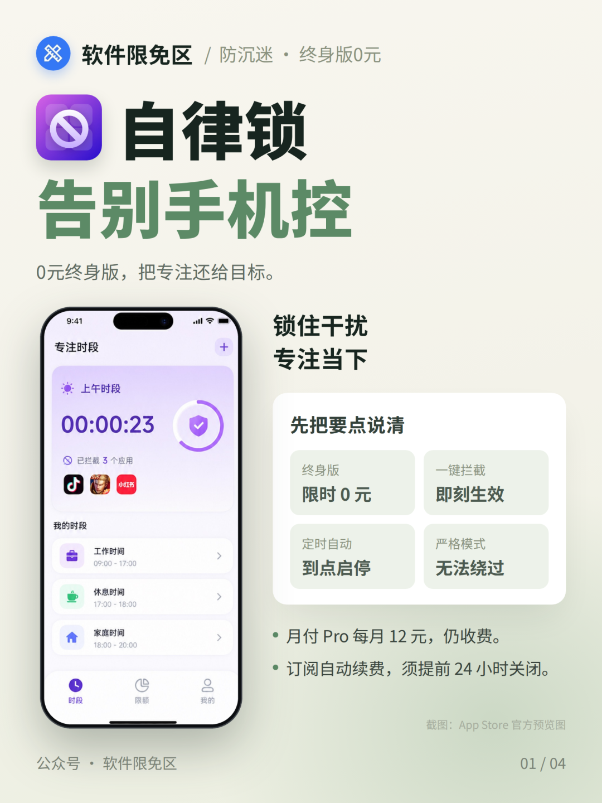
**Zenzz**
**价格：「Vip Lifetime」内购 0 元 · 国区、美区都是 0 元（本体免费，其余档仍收费）**
佛音伴眠：钟、钵、木鱼、水、风、风铃六种禅音自由混音助眠，每天敲木鱼抽一张小佛卡，还能按 90 分钟睡眠周期设晨钟、开睡眠定时。约 17.4 MB，需 iOS 16.6 以上。
下载：App Store 搜索「Zenzz」，认准开发者 Yue Song

**三、全免费 · 无内购（3 款）**
**Roam Control**
**价格：本体免费 · 无内购 · 国区、美区都是 0 元**
面向开发者和测试者的位置测试工具：在自己的设备上定点、搜坐标、画路线，步行、骑行、驾车三档速度可调，还能摇杆移动、导入导出 GPX，跑完停止就恢复真实位置。首次使用要先完成设备配对、安装 LocalDevVPN 并开启开发者模式。约 7.3 MB，需 iOS 27.0 以上。
下载：App Store 搜索「Roam Control」，认准开发者 Sean Howarth
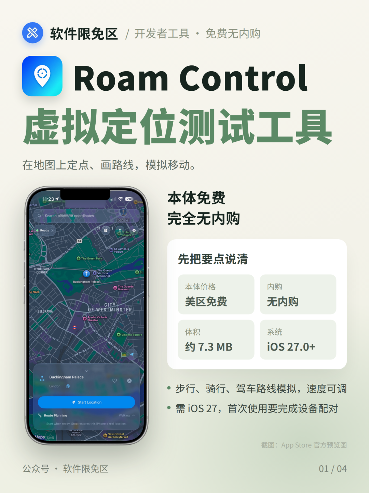
**经典便签**
**价格：本体免费 · 无内购 · 国区、美区都是 0 元**
招牌是分词编辑：把文字拆成一个个词块，选中、拆字、改完再存回便签，整理长文特别顺手；普通文本、富文本和 Markdown 都支持，图文一起保存，全文搜索、文件夹、加星、便签叠和批量管理齐全，拍照扫描识字在本机完成。本地保存、不用注册登录，支持 JSON 备份和桌面小组件。约 132.2 MB，iOS 16.0 以上，国区 5.0 分。
下载：App Store 搜索「经典便签」，认准开发者 健 胡
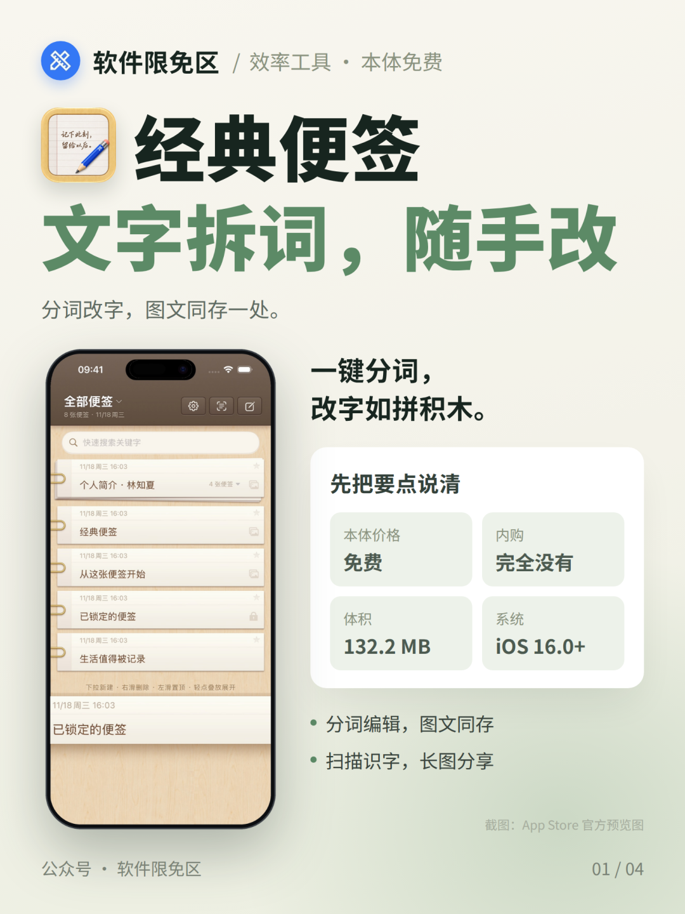
**Storm Circle**
**价格：本体免费 · 无内购 · 国区、美区都是 0 元**
天气爱好者的社交应用：看实时追风者、提交和查看天气报告、发 Flashes 天气短视频、加入 Storm Circles 天气事件群组、完成挑战，也能看实时天气。约 28.6 MB，需 iOS 26.0 以上，仅英文界面。
下载：App Store 搜索「Storm Circle」，认准开发者 Nathan Anthony
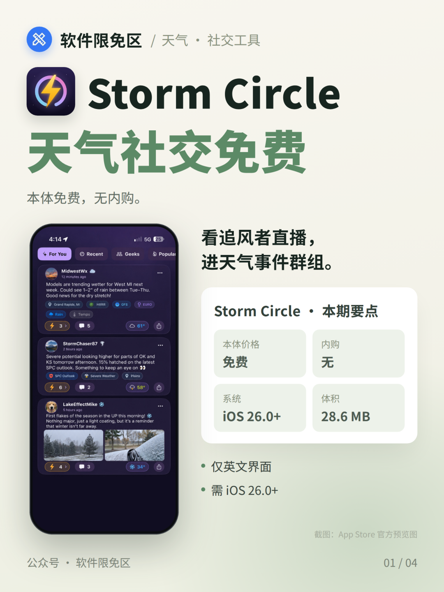
以上价格是 11月25日的核价结果，限免说没就没，先领为敬。
明天的汇总凌晨见。关注「软件限免区」，每天的限免不落下。
