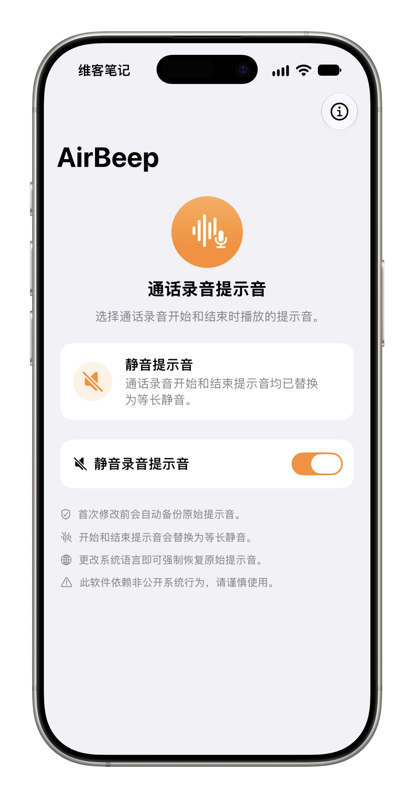
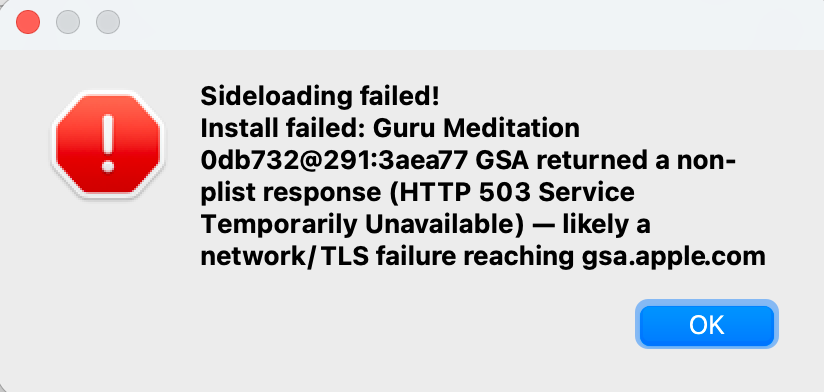
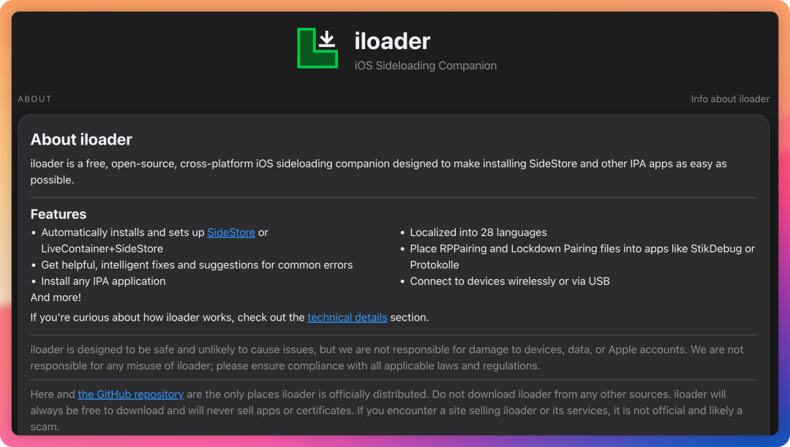
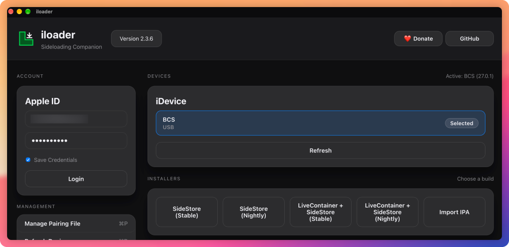
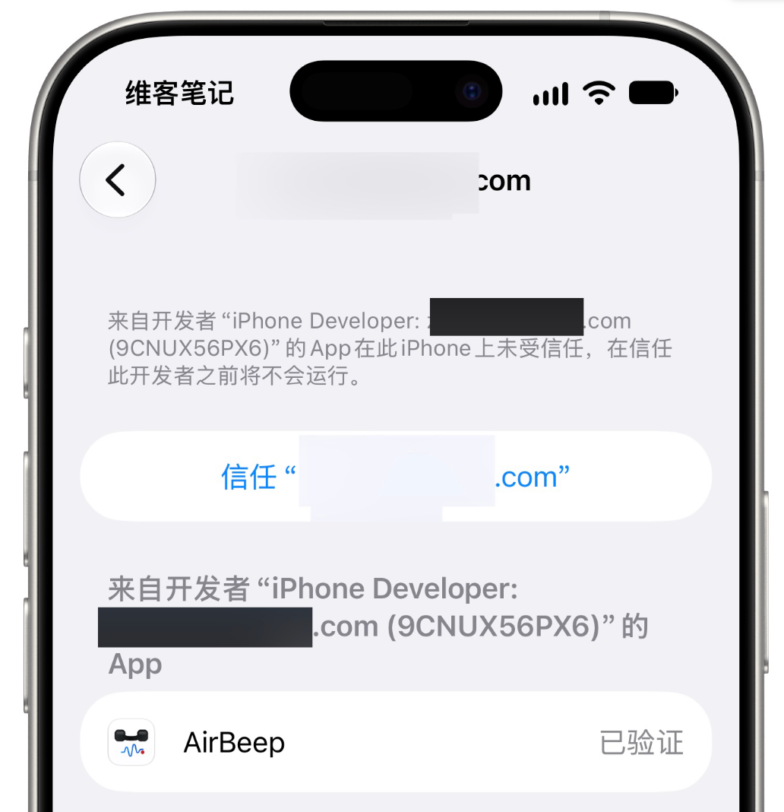
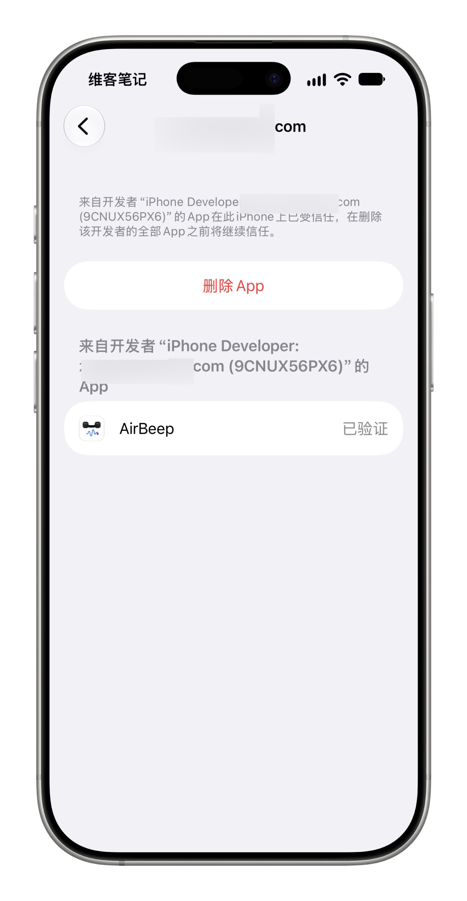
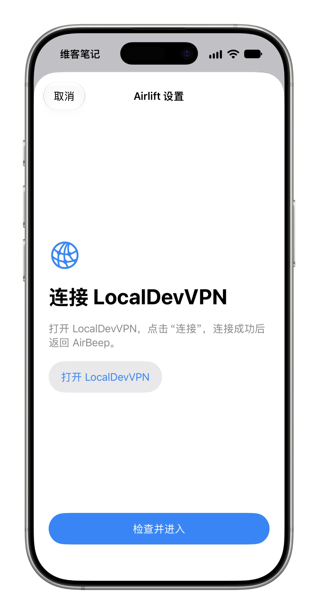

# iPhone 通话录音这个烦人的提示音，终于可以完全消掉了！开源免费～
> 💡 备注属性未写入，可能是备注属性名称或者类型被修改了，建议将字段类型设置为 rich_text，可以在小程序-操作-修改文章数据库页面进行调整
> 原文链接:[https://mp.weixin.qq.com/s/LL6m_6S9CJdcREFk-bTQ3w](https://mp.weixin.qq.com/s/LL6m_6S9CJdcREFk-bTQ3w)

大家好，我是来自1037号森林的维客！
💡
Tip
🎉 [写给大家的 AI 实战案例专栏](https://mp.weixin.qq.com/mp/appmsgalbum?__biz=Mzk2NDU0NDczMg%3D%3D&action=getalbum&album_id=4469519143632912386#wechat_redirect) 25+本人亲身实战案例
 🍀 [我的实用工具库分享](https://mp.weixin.qq.com/s?__biz=Mzg5Njk3MDUyMQ%3D%3D&mid=2247491296&idx=1&sn=07629f3b2a2915a0d13601ba46abcc43&scene=21#wechat_redirect)
## 01 写在前面
 
iPhone 有个让我一直很不满意的地方，**通话录音**。
以前的 iOS 系统，竟然连个原生通话录音功能都没有。
直到 iOS 18.1，Apple 才终于加入了这个功能，而且录音会自动保存在备忘录中，部分语言还支持语音转文字。
这本来是件好事。
结果 Apple 又搞了一个非常让人尴尬的设计。
当你开启通话录音时，系统会自动播放一段语音提示，告诉双方「此通话将被录音」。
就问尬不尬！？
虽然能够理解 Apple 这样做是为了保护用户隐私，但我个人确实不太喜欢这种设计。
ℹ️
Info
**为什么我这么在意通话录音？**
因为这几年，我自己经历了两场民间借贷官司，都是为我家人打的。
• 
[用 AI 辅助打官司](https://mp.weixin.qq.com/s?__biz=Mzk2NDU0NDczMg%3D%3D&mid=2247493210&idx=1&sn=4554e4188e64cbe96231e6877f878024&scene=21#wechat_redirect)
• 
[用 AI 模拟法庭](https://mp.weixin.qq.com/s?__biz=Mzk2NDU0NDczMg%3D%3D&mid=2247493261&idx=1&sn=adebcfb7e37419a469e195fb0ff01416&scene=21#wechat_redirect)
• 
[用 AI 撰写法律文书](https://mp.weixin.qq.com/s?__biz=Mzk2NDU0NDczMg%3D%3D&mid=2247493334&idx=1&sn=5a2244ef310be684ba877719b11dcaf4&scene=21#wechat_redirect)
• 
[在AI时代，绝不憋屈！我的二审上诉官司打赢了！](https://mp.weixin.qq.com/s?__biz=Mzk2NDU0NDczMg%3D%3D&mid=2247494396&idx=1&sn=8d82df724565f821303ec0f83f8ed355&scene=21#wechat_redirect)
之前有些钱借给了别人，结果到了约定的时间，对方迟迟不还。
有些借款的利息、还款安排等内容，当时也只是口头约定，没有留下完整的书面证据。
等真正打起官司，才发现证据有多么重要。
所以，现在对于一些重要的电话沟通，我都希望能够留下一份录音记录。
比如，对方是否承认欠款、什么时候还钱、之前到底是怎么约定的，等等。
当然，录音是否能够作为诉讼证据，还要看获取方式是否合法、内容是否真实完整，以及是否与案件有关。
但有一份完整、可信的沟通记录，总归比事后仅凭记忆去还原要好得多。
为了处理 iPhone 的通话录音提示音，我之前也了解过网上的一些方法。
比如将系统语言切换成对方听不懂的语言，或者通过实时语音播放其他声音，试图盖住录音提示。
但实操时我觉得这些方法都很别扭。
提示音依然存在，只是换了一种处理方式。
另外，这两年市面上也出现了一些支持通话录音的耳机，甚至可以自动转文字、AI 总结。
我不知道这些产品是不是专门针对 iPhone 的录音痛点设计的，但至少说明，这方面确实有不少需求。
就在前两天，我在 GitHub 上发现了一个很棒的项目，名为 **AirBeep**[1]。
而且完全免费、开源！
## 02 AirBeep 简介
 
AirBeep 是一款使用 Swift 开发的 iOS 工具。
它要解决的问题很简单：**将 iPhone 通话录音开始和结束时的系统提示音替换成静音文件。**
而且，它的设计也很简单。
打开软件，最核心的就是一个开关。

开启之后，软件会尝试将原来的录音提示音替换成等长的静音文件。
为了方便恢复，它还设计了几个不错的功能：
• 
首次修改前，自动备份原始提示音。
• 
支持从备份恢复系统原来的声音。
• 
修改后进行读取校验。
• 
支持中文界面。
我觉得这种小软件就挺好。
**功能不需要多，能把真正需要解决的问题做好就行。**
⚠️
Warning
另外AirBeep 依赖非公开系统行为，其兼容性可能随 iOS 版本更新而改变。移除通话录音提示可能会影响对方是否收到录音通知。请仅在本地法律允许且获得必要同意的情况下使用本应用。
我目前使用的是 iOS 27.0.1 系统。
接下来，分享一下我是如何把这个软件安装到 iPhone 上的。
## 03 安装 AirBeep，我折腾了好一番
 
如果之前没有接触过 iOS 侧载，可能会觉得安装 GitHub 上的开源软件比较麻烦。
因为 iOS 和 macOS 不太一样。
在 Mac 上下载一个 DMG，很多时候拖到应用程序文件夹就可以用了。
但在 iPhone 上，GitHub 下载的 IPA 文件通常不能直接安装，还涉及 Apple 开发者签名。
AirBeep 的开发者已经在 GitHub Releases 中提供了编译好的 IPA。
目前我使用的是 v 2.4.0，文件名为：**airbeep-v2.4.0-unsigned.ipa**
注意其中的 **unsigned**，表示这个安装包尚未签名。
最开始，我使用的是一款很有名的 iOS 侧载工具：**Sideloadly**。
结果折腾了好一阵子。
先是 Apple 登录接口返回 HTTP 503，后来又提示 Apple ID 验证失败。

我确定 Apple ID 和密码都没问题，官方网站也能正常登录。
切换认证方式、修改安装模式，甚至换了几种方法，依然没有顺利安装。
当时我都准备直接用 Xcode 编译安装了。
但仔细一想，为了安装这么一个小软件，还得打开 Xcode、配置签名，未免有点麻烦。
于是，我又找到了另一款开源软件，名为iloader[2]。
haha，这次顺利装上了！
## 04 一个很不错的 iOS 侧载工具
 
有幸的是，在 ChatGPT 的帮助下，我找到了 iLoader 这款开源免费神器！

它主要就是帮助用户在 iPhone 上安装第三方 IPA 应用。
它支持 macOS、Windows 和 Linux。
除了安装 IPA，还支持管理开发者证书、App ID、设备配对文件，以及安装 SideStore 等。
对于经常折腾 GitHub 开源软件的朋友来说，我觉得这款工具挺值得收藏的。
而且操作起来并不复杂。
下面直接分享一下我这次的安装过程。
### 4.1 下载 iloader 和 AirBeep
先下载两个文件到你的电脑上。
• 
**iloader**[3]
• 
**AirBeep**[4]
 Mac 用户可以下载 iloader 的 DMG 安装包。
我本次使用的版本是：
• 
iloader：v 2.3.6
• 
AirBeep：v 2.4.0
• 
iPhone：iOS 27.0.1
• 
Mac：macOS 27.0.1
注意：这里说的是我的实测安装环境，并不代表所有 iOS 版本都能正常运行 AirBeep 的功能。 iOS 26 好像是不支持的。
### 4.2 连接 iPhone，登录 Apple ID
安装并打开 iloader。
然后，通过 USB 数据线将 iPhone 连接到 Mac。
第一次连接时，记得在 iPhone 上点击「信任此电脑」。
接下来，在 iloader 中登录自己的 Apple ID，并选择要安装应用的 iPhone。

如果提示需要双重认证，按照软件提示完成即可。
### 4.3 导入 AirBeep IPA
这一步就非常简单了。
在 iloader 主界面，找到 **Import IPA**。
点击之后，选择刚才下载的 AirBeep IPA 文件。
接下来，iloader 会自动完成签名和安装流程。
等待软件显示安装完成即可。
我自己在这一环节没有遇到什么问题。
### 4.4 在 iPhone 上信任开发者
安装完成后，AirBeep 已经出现在 iPhone 主屏幕上。
不过第一次打开时，会显示未受信任，然后就不会运行。

别急，这个问题很容易解决。
打开 iPhone 设置，依次进入：**设置 → 通用 → VPN 与设备管理**
找到刚才用于签名的开发者账户，选择信任，并按照系统要求进行验证。
如果系统还要求开启开发者模式，则进入：**设置 → 隐私与安全性 → 开发者模式**
完成这些操作，再次打开 AirBeep 就可以了。

到这里，AirBeep 已经成功安装到了我的 iPhone 上。
**整个安装过程不需要越狱，也不需要自己编译源码。**
### 4.5 还有一步
AirBeep 已经成功安装，但如果想让它真正访问和修改系统录音提示音，还需要完成额外配置。
它使用了一个名为 Airlift 的组件，需要建立设备配对，并通过 LocalDevVPN[5] 提供本地通信连接。
大致流程是先连接 Wi-Fi，在 AirBeep 中打开 **Airlift Setup** 并完成设备配对，然后连接 LocalDevVPN，返回 AirBeep 检查连接状态。

 另外，AirBeep 会修改系统文件。如果准备尝试，建议提前备份重要数据，不要随意删除原始提示音备份。
**我目前已经实测 iloader 可以将 AirBeep 成功安装到 iOS 27.0.1 上。**
## 05 写在最后
 
这次还有一个意外收获，那就是iloader。
原本只是为了安装 AirBeep，没想到又发现了一款不错的开源工具。
以后再遇到一些 GitHub 上的 iOS 开源 App，就可以先考虑用它来安装了。
当然，关于通话录音，我还是想提醒一句。
**没有提示音，并不意味着可以随意录音。**
⚠️
Warning
涉及录音时，应遵守所在地法律以及必要的告知和同意要求。如果是为了诉讼取证，更要重视证据获取方式是否合法，以及录音是否真实、完整。
最后还想强调一点：
**无论是生活里还是工作中，重要的事情一定要留痕。**
至于 iPhone 的录音提示音，希望 Apple 以后能够提供更灵活的设置方式。
毕竟，用户的需求确实是多种多样的。
💡
Tip
非常感谢&欢迎大家订阅我花费了很多心思和精力打造的[写给大家的AI 实战案例专栏](https://mp.weixin.qq.com/mp/appmsgalbum?__biz=Mzk2NDU0NDczMg%3D%3D&action=getalbum&album_id=4469519143632912386#wechat_redirect)，每个案例都是我自己的亲身经历，目前已更新了 26 期，第 2 季正在打造中。
---
欢迎关注维客笔记，一起探索解决问题的极简方式！
 A better you, A bigger world！
非常感谢【点赞👍、推荐❤️、赞赏💰】，因为有你，所以坚定前行！
[1] AirBeep：https://github.com/LinkPass888/AirBeep
[2] iloader：https://github.com/nab138/iloader
[3] iloader：https://github.com/nab138/iloader/releases
[4] AirBeep：https://github.com/LinkPass888/AirBeep/releases
[5] LocalDevVPN：https://apps.apple.com/us/app/localdevvpn/id6755608044

## 摘要

（待补充）

## 我的笔记

（待补充）
