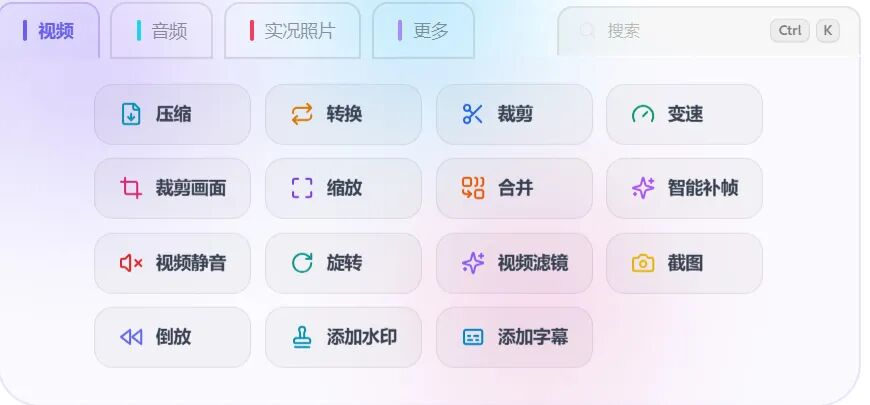
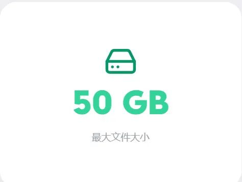
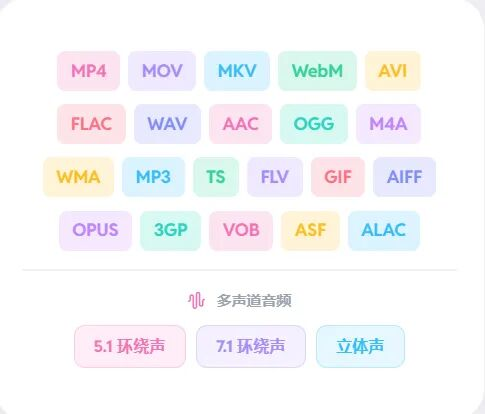

# tools.video：最快、最全能的在线视频工具
> 💡 备注属性未写入，可能是备注属性名称或者类型被修改了，建议将字段类型设置为 rich_text，可以在小程序-操作-修改文章数据库页面进行调整
> 💡 原文链接:[https://mp.weixin.qq.com/s?__biz=MzUxMzE3MjEyMg==&mid=2247484863&idx=1&sn=e65f04db432f02e23bec9c12fa85c151&chksm=f88e03a7f67f9642c04bd002dd52595a8242126a29459b486c151a2e02e88160046adbea0ec8#rd](https://mp.weixin.qq.com/s?__biz=MzUxMzE3MjEyMg%3D%3D&mid=2247484863&idx=1&sn=e65f04db432f02e23bec9c12fa85c151&chksm=f88e03a7f67f9642c04bd002dd52595a8242126a29459b486c151a2e02e88160046adbea0ec8#rd)
点击上方蓝字 ▲ 关注「AI上教学」
**先说它官网首页那句话：**
**最快、最全能的在线视频工具。**
下面这一行更实在：
支持 **50 GB**文件　·　极速处理　·　**100% 浏览器端**　·　**无需注册**
**对老师来说，这四个里最值钱的是最后一个——不用注册，打开就用。**

一**　全部 26 个工具，全部免费**
**从编辑、转换到分析处理，视频和音频工具一站配齐。**

二**　为什么说它"最全能"**
这 26 个工具覆盖的事，**基本就是老师做视频会遇到的全部：**
**① 做微课**
· **压缩**——录完的课压小，方便上传和分享
· **添加字幕**——给讲课视频配上字幕
· **裁剪**——掐头去尾，只留讲得好的那段
· **截图**——从视频里取一帧，当课件配图或封面
**② 做课件素材**
· **转 GIF**——一小段视频变成会动的图，直接放进 PPT
· **图片转视频**——几张照片串成一段小片头
· **纯色视频**——做转场、做背景
**③ 处理公开课和教研录像**
· **合并**——前后两段录制合成一份
· **添加水印**——打上学校或教研组名字
· **缩放 / 旋转 / 裁剪画面**——尺寸和画幅按需要调
· **媒体信息**——看清分辨率、码率、时长
**④ 音频处理**
· **音频提取**——从视频里单独抽出讲课音频
· **音频裁剪 / 变速 / 合并 / 转换**
**⑤ 班级活动**
· **实况照片合并**——把一堆 Live Photo 拼成一段
· **转实况照片**——让视频变成手机实况照片
· **倒放 / 视频静音 / 智能补帧 / 视频滤镜**
三**　快，是它敢说的第二件事**
**处理飞快。不是说说而已。**
由 **mediabunny 和 ffmpeg.wasm**驱动，多线程处理配合硬件加速，在浏览器里也能跑出很高的效率。
**指标就两个：**
· **最大 50 GB 文件**
· **10x 通过 WebCodecs 加速处理**

50 GB 是什么概念？官方是这么说的：
**4K 素材、8K 原片、长时间录制，体积再大也能稳稳处理。没有上传上限，没有服务器超时，也不用拿画质做交换。**
一节公开课录下来几个 GB，在它这里根本不是问题。
四**　格式也基本不用挑**
**常见格式、专业格式，基本都能搞定。**
MP4、MOV、MKV、WebM、AVI、FLV、TS、3GP、VOB、GIF、ASF
FLAC、WAV、AAC、OGG、WMA、M4A、MP3、OPUS、AIFF、ALAC
**多声道音频也能完整保留，5.1 和 7.1 环绕声不会丢，不用额外装插件。**

你从摄像机、手机、录屏软件里拿到的文件，基本都能直接丢进去。

五**　最关键的一条：全程在你的浏览器里**
**全程都在你的浏览器里。文件不会离开你的设备，处理过程也不经过服务器。无需上传、无需排队等待，你的数据始终掌握在自己手里。**

页面上就两个词：**零上传，100% 本地处理**。

六**　用它只要三步**
**不用下载，不用安装，也不用注册账号。打开页面，拖入文件，直接开始处理。**
① 打开 tools.video　→　② 选好你要用的工具　→　③ 拖入文件
它还专门强调了一句：
**每个工具只专注一件事，界面干净，操作直接。没有堆满选项的复杂菜单，也不用先研究半天，上手就能开始干活。**
**机房电脑不让你装软件？这一条正好。**
下次要处理视频，先别急着装软件——
**打开它看看。**
你平时用什么剪视频？欢迎留言 👇
