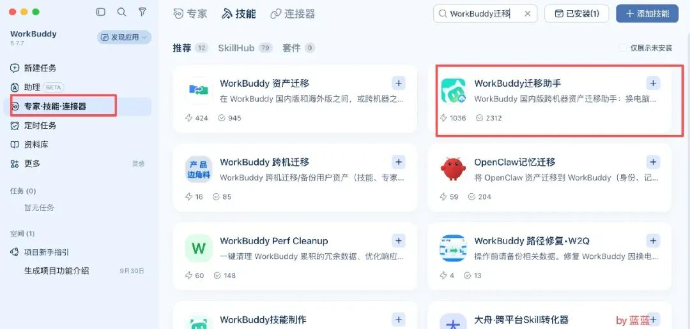
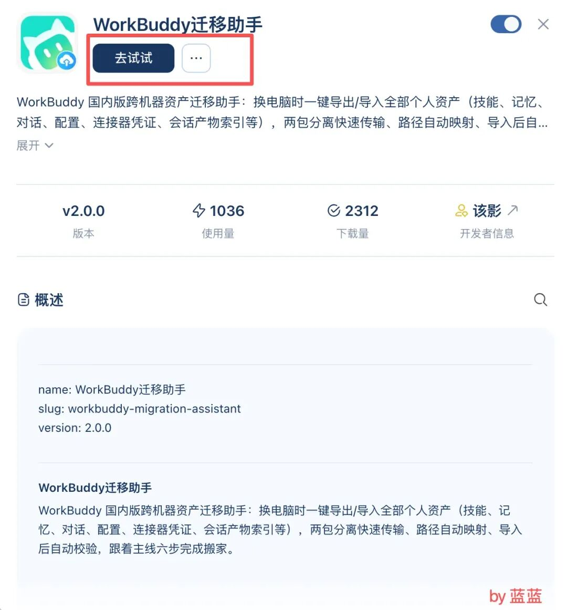
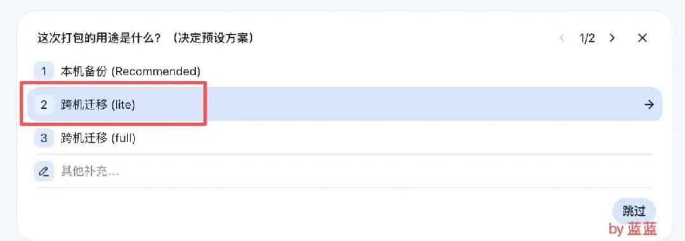
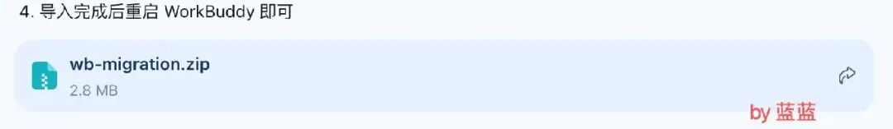
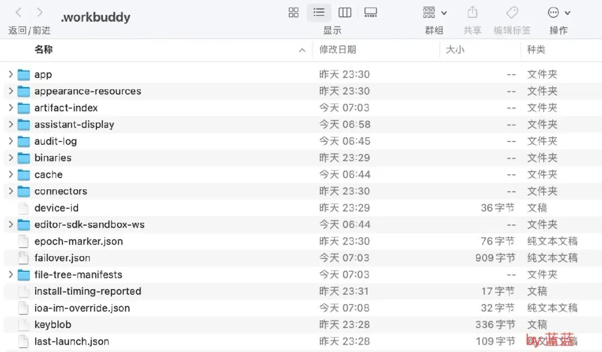

# workBuddy多设备同步
> 💡 备注属性未写入，可能是备注属性名称或者类型被修改了，建议将字段类型设置为 rich_text，可以在小程序-操作-修改文章数据库页面进行调整
> 💡 原文链接:[https://mp.weixin.qq.com/s?__biz=MzkxODczMTI3OA==&mid=2247485276&idx=1&sn=7020688ad361b5c7b92badf379083566&chksm=c09aa7b345b85ff0ffa83146c23f4fdd646bfecd3e71aa0ca80b6e411864de9a2c7b2bbcb6f8#rd](https://mp.weixin.qq.com/s?__biz=MzkxODczMTI3OA%3D%3D&mid=2247485276&idx=1&sn=7020688ad361b5c7b92badf379083566&chksm=c09aa7b345b85ff0ffa83146c23f4fdd646bfecd3e71aa0ca80b6e411864de9a2c7b2bbcb6f8#rd)
大家好！我是蓝蓝。
今天用了另外的一台电脑，打开workBuddy，同样的账号登陆，发现居然没有同步之前内容，这样就显得没有那么方便了。于是就有了今天的内容
### 1、数据迁移
估计不少小伙伴都有数据迁移的经验，尤其是咱们换了手机，只需下个软件就可以搞定。
那么在workBuddy中，我们需要在技能--搜索WorkBuddy迁移，随后进行添加即可

点击试一试

### 2、资产打包
选择刚才安装的【资产迁移】技能，直接大白话：请把数据资产打包

这个时候会根据你之前的回话内容进行压缩打包形成ZIP文件，并选择保存的位置

### 3、新电脑安装技能和恢复资产
在新的电脑，同样的安装技能【资产迁移】，提示词：资产文件存放在当前桌面，文件名叫【资产.zip】

此时就会进行数据拷贝，会比较花时间，耐心等待即可。
### 4、实现原理
我们安装完workBuddy后，所有的会话，技能其实默认都会在本地电脑上。

打包相关的内容生成zip后，记住相关的路径，完成拷贝工作即可。在拷贝的过程中，系统会自动的筛选掉没必要的内容。
这样我们在不同的电脑使用同样的账号开展工作了。
我们下一期再见。
[【AI教育融合】公开课的PPT数字人，一分钟搞定](https://mp.weixin.qq.com/s?__biz=MzkxODczMTI3OA%3D%3D&mid=2247485167&idx=1&sn=c7bce7f7ede6fefb6b9ee4789b0751ce&scene=21#wechat_redirect)
[【AI教育融合】老师，你离“准时下班”只差这一个宝藏收藏夹！](https://mp.weixin.qq.com/s?__biz=MzkxODczMTI3OA%3D%3D&mid=2247485166&idx=1&sn=df953206ee218eef86a2160b300b2d63&scene=21#wechat_redirect)
[【AI融合教育】5个AI工具让公开课更加出彩(精品，推荐)](https://mp.weixin.qq.com/s?__biz=MzkxODczMTI3OA%3D%3D&mid=2247485165&idx=1&sn=4ee03b5f1615c105c609725a5269a523&scene=21#wechat_redirect)
****

