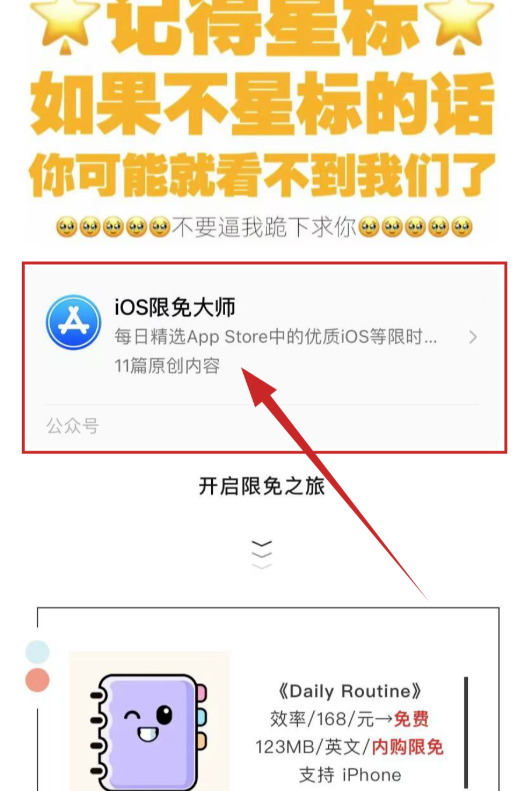
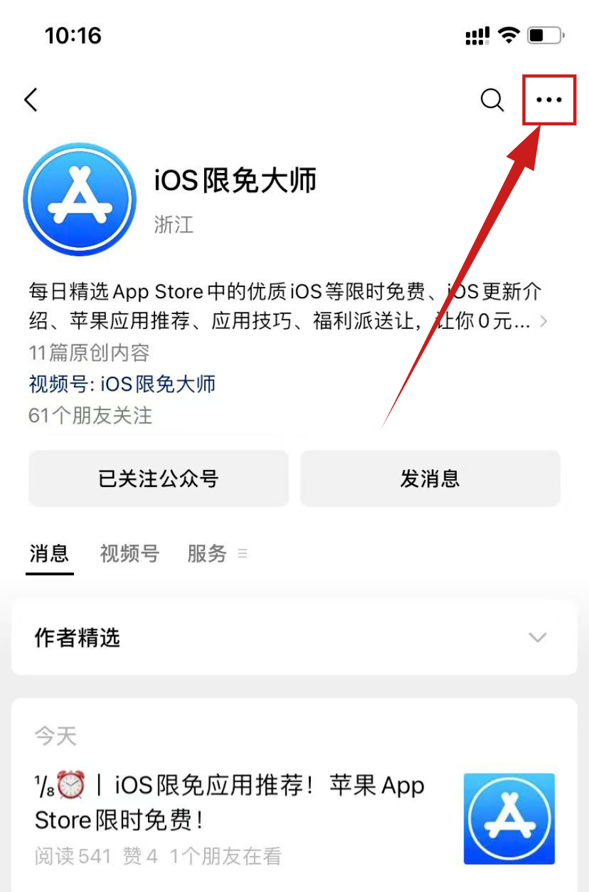
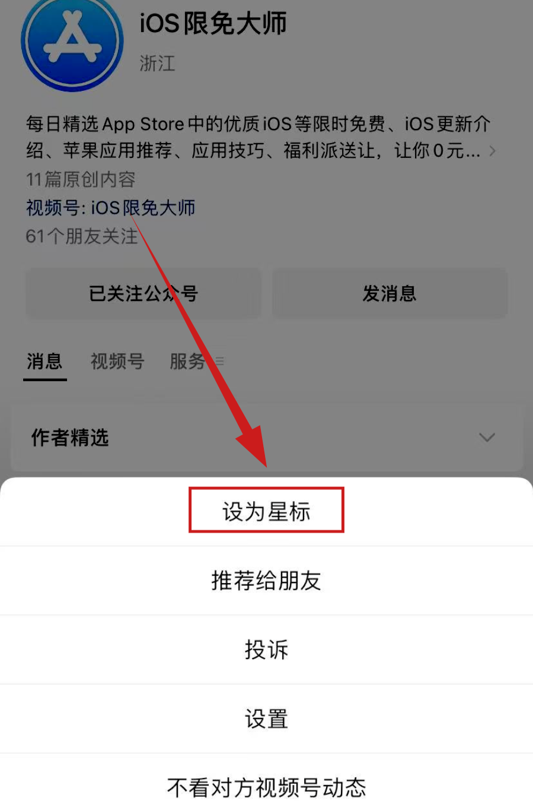
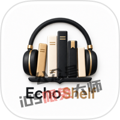
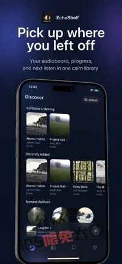
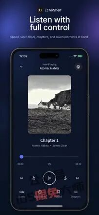
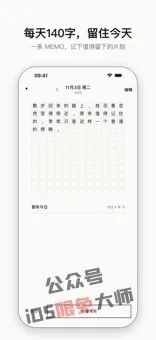
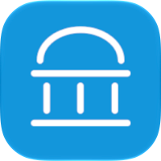
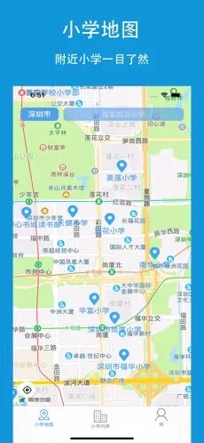
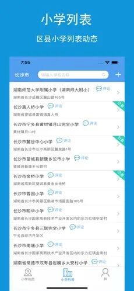

# ¹¹/₁₁⏰丨iOS限免应用推荐！苹果App Store限时免费！
> 💡 备注属性未写入，可能是备注属性名称或者类型被修改了，建议将字段类型设置为 rich_text，可以在小程序-操作-修改文章数据库页面进行调整
> 💡 原文链接:[https://mp.weixin.qq.com/s?__biz=Mzg3MTY2NzM0OQ==&mid=2247553716&idx=1&sn=b1e5972dd43a16bf83f7b02aca890a3a&chksm=cfd021f819decbc6ac16e9bdf6e488b1922321de81cbd47f075520b06a41ce612ff32e22a567#rd](https://mp.weixin.qq.com/s?__biz=Mzg3MTY2NzM0OQ%3D%3D&mid=2247553716&idx=1&sn=b1e5972dd43a16bf83f7b02aca890a3a&chksm=cfd021f819decbc6ac16e9bdf6e488b1922321de81cbd47f075520b06a41ce612ff32e22a567#rd)
**苹果iOS限时免费软件说明：**
- App Store限免有时效性，周期长短不一，有几天或几小时，时长由开发者决定，请确认免费再收！
- 限免获取的内购，相当于0元购买，当重新安装软件后，可以通过软件内的“恢复购买”重新免费获取。
- 部份App分本体和内购项目，可按需下载。如有顾虑，建议App Store解除支付方式，再获取限免。
- 点击下方账号名片查看往期苹果iOS限免（往期限免中可能也会有漏网之鱼）👇
**公众号推送改版★记得星标公众号**

非常感谢小伙伴们一直以来的陪伴，你们的支持便是博主坚持下去的动力。博主会一如既往的分享实用、有趣的限免软件给大家。希望大家能多多给予支持，在每篇的文章底部来个一键三连，**点赞、在看+分享。**
**开启限免之旅**

**《Inkveil》**
图书/18元→**免费**

99MB/中文/**内购限免**
支持 iPhone iPad
系统 iOS 15.0
**介绍：**

【Inkveil - 漫画阅读器】一款漫画书库阅读工具，支持导入CBZ、CBR、PDF、EPUB文件，支持仿真翻页、多种翻页方式和阅读设置。软件本身不提供内容，需连接你自己的服务器或自行导入。目前软件的内购正在限时免费，获取时注意确认价格，手慢无！

长按二维码
识别下载

**《EchoShelf》**
音乐/18元→**免费**
137MB/中文/**内购限免**
支持 iPhone iPad
系统 iOS 15.0
**介绍：**

【EchoShelf - 有声书播放器】一款有声书应用，提供章节浏览、倍速、快进快退、定时关闭等，软件本身不提供内容，需连接你自己的服务器。目前软件的内购正在限时免费，获取时注意确认价格，手慢无！

长按二维码
识别下载

**《GridMe》**
生活/58元→**免费**

15MB/中文/**内购限免**
支持 iPhone
系统 iOS 17.0
**介绍：**

【GridMe：人生格子日历，一句话日记】一款把人生可视化成网格的极简日记工具，用周、月、年、一生四个维度看时间，每天最多写140字记录当下。目前软件正在内购限免，获取时注意确认价格，手慢无！

长按二维码
识别下载

**《上学易》**
教育/8元→**免费**

17MB/中文/**无**内购
支持 iPhone iPad
系统 iOS 13.0
**介绍：**

【上学易-小学信息平台,幼升小升学必备】一款全国小学综合信息平台，提供小学学区划分查询、小学地图、教育局与招生入学及幼升小报名入口，支持学校评论点赞和添加修改学校信息。

长按二维码
识别下载

**《钓鱼声波》**
参考资料/38元→**免费**

9MB/中文/**无**内购
支持 iPhone iPad
系统 iOS 9.0
**介绍：**

【钓鱼声波：声波诱鱼上钩，声波防蚊虫叮咬】一款钓鱼声波应用，提供诱鱼、白天、夜钓和防蚊虫四种声波模式，通过手机播放不同声波来吸引鱼群或驱赶水边蚊虫。

长按二维码
识别下载

**《当地天气预报》**
天气/38元→**免费**

67MB/中文/**无**内购
支持 iPhone iPad
系统 iOS 15.0
**介绍：**

【WEATHERCAST 24 当地天气预报】一款天气预报应用，提供超本地精准天气、最多48小时详细数据和15天预报，覆盖全球百万气象站，界面设计精美、小巧简单，适合随时查看天气。

长按二维码
识别下载
