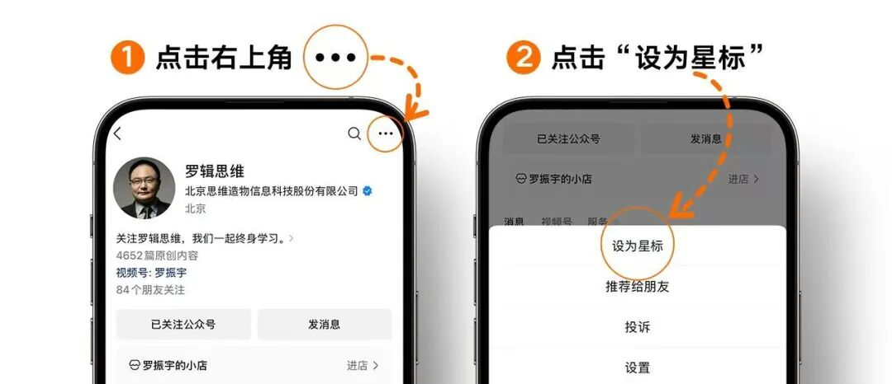

# “80后”最重的账单，终于要翻篇了？
> 💡 备注属性未写入，可能是备注属性名称或者类型被修改了，建议将字段类型设置为 rich_text，可以在小程序-操作-修改文章数据库页面进行调整
> 原文链接:[https://mp.weixin.qq.com/s/nY7791LwHvP_Et-hlXVCWQ](https://mp.weixin.qq.com/s/nY7791LwHvP_Et-hlXVCWQ)

今天我们从一个很有年代感的称呼说起，“80后”。确切地说，是关于“80后”的“钱”。而且我们要说的内容不只关系到“80后”这个群体，更关系到整个社会的消费趋势。
上周，青山资本发布了他们2026年的年度研究报告，主题叫做[《80后，从负重到重配》](https://mp.weixin.qq.com/s?__biz=MzI0ODA0OTc2OA%3D%3D&mid=2650024883&idx=1&sn=15274622f4ff0f46f9f30c4e6ff8ed39&scene=21#wechat_redirect)。报告的信息量很大，但核心很清晰，在于两个词，也就是标题里的“负重”和“重配”。
所谓“负重”，说的就是过去很长一段时间，80后的钱在很大程度上并不真正属于自己。为什么这么说？我们先从房子说起。
**作者：李南南**
**来源：得到App《得到头条》**
**01**
**80后：为家庭舍得花，为自己省着花
**
1998年，中国启动住房分配制度改革，福利分房逐步退出，商品房市场加快发展。这一年，第一批“80后”刚满18岁，正站在成年的门槛上。此后，中国房地产市场快速扩张。2003年前后，第一批“80后”开始进入职场。2008年之后，“80后”又陆续进入结婚、生育和置业阶段。
也就是说，“80后”的成长，几乎与中国房地产市场化、住房信贷普及和房价快速上涨的过程同步。
我们看一组数据。2003年，全国商品房销售金额是7956亿元。到了2021年，这个数字变成了17.02万亿元，扩大到原来的21倍多。同期，商品房销售面积扩大到原来的4.8倍。同时，销售金额的增长远远快于销售面积，住房单价也明显提高了。而“80后”恰恰是在这个过程中，陆续走到了需要买房的人生阶段。
而这些住房支出，也成了中国城镇化趋势的重要支持力量。1980年，中国的城镇化率只有19%左右。到2025年，已经接近68%。这几十年，中国修建了大量公路、铁路、地铁和城市基础设施，把数亿人的生活搬进了城镇。这些建设都需要钱。
在相当长一段时间里，土地出让、房地产开发和城市建设之间，形成了一套相互支撑的资金循环。基础设施改善了城市，也提高了土地和住房的价值，其中一部分建设成本，最终通过房价传导给了购房家庭。
换句话说，青山资本的报告认为，**“80后”既享受了城市化的红利，也成为这轮城市住房扩张的重要成本承担者。**
根据招商证券对中国家庭追踪调查数据的测算，“80后”家庭平均房贷支出为10.73万元，分别是“70后”的1.7倍，“60后”的2.1倍。而“80后”家庭的房贷支出与存款之比，也达到了106%。而这个比例，在“70后”是60%，在“60后”只有54%。
报告把这个特征叫做“重资产、高杠杆”。“80后”是中国全民信贷买房浪潮中，规模最大、被动承担住房债务的核心群体。
当然，房子只是账单的一部分。
“80后”刚还上房贷不久，孩子出生了。这一代人是独生子女政策最密集的一代，自己也大多只生一个，但育儿成本却完全不同于父辈。报告引用了北京大学中国教育财政科学研究所的数据：2022至2023学年，有在校生的家庭平均教育支出是15828元，占家庭总消费的17.2%。从学前教育到大学毕业，一个孩子的教育总花费平均大约28.7万元，高支出家庭接近58万元。
与此同时，父母在老去。**“80后”的父辈里，一部分人没有足够的养老储备，赡养成本相当程度上落在子女身上。**
房贷、孩子、父母。这三方面支出叠加在一起，就构成了报告里说的“家庭运营期”。“80后”的钱，有三分之一被房贷锁定，剩下的要优先保障家庭运转。真正属于自己的，非常有限。
所以报告里说，“80后”不是在做消费降级，他们是在做“预算约束下的分层升级”。日用品追性价比，延长手机和家电的换购周期，但在孩子教育、全家健康、时间效率这些地方，愿意付溢价。
换句话说，**他们为家庭舍得花，为自己省着花。**
在这个过程中，个人需求没有消失，只是被包裹进了家庭价值和长期价值里。买运动装备，是因为可以解释成健康管理；全家旅行，是因为同时承担了亲子陪伴；报一个学习课程，是因为兼顾了兴趣和职业发展。很多“80后”的“悦己消费”，往往要找到一个能向家庭也向自己交代的理由，才有资格进入预算。
**02**
**“80后”账单最繁重的时期正在过去**
但现在，情况在发生变化。这就要说到报告里的另一个关键词了，重配。“80后”账单最繁重的时期，正在过去。
**首先，房贷在陆续退出。**2023年，存量首套房贷利率调整涉及超过22万亿元贷款和五千多万户家庭。根据相关研究，这批贷款的加权平均剩余期限在12年左右。也就是说，一大批贷款将在2033至2035年前后进入尾声。月供退出，意味着每个月解锁了一大块此前被锁定的收入。
**其次，是子女教育支出的转型。**到2035年，多数“80后”的孩子将完成全日制教育，陆续进入就业。这不代表子女账单彻底清零。孩子刚毕业可能需要父母接济，比如，买车、结婚、购房首付。但那种年复一年、稳定流出的教育消费会大幅下降。
还有一个因素要稍微复杂一些，是父母端的照护关系。老人在世时，需要子女投入医疗和照护资源；但老人健在时，他们其实也在帮助这个家庭，帮忙带孩子、分担家务，提供情感支撑，有时还有经济支持。
调查显示，2021年仍有21.8%的老年人向子女提供经济支持，35.7%的老年人帮助照料孙辈。而父母的离去，意味着这部分隐性支持也会退出。报告在测算中已经考虑到了这些因素。
报告里的测算是，基准情景下，到2035年前后，随着房贷陆续进入尾声、子女逐步成年独立，住房和子女支出合计可能释放大约1.31万亿元的年度现金流。扣除父母端新增的照护和医疗负担，净释放大约1.21万亿元。假设其中约30%转化为自身消费，对应大约3640亿元的年度增量消费，那么，当“80后”的现金流重新自由，他们会把钱花在哪里？
报告提出了几个方向，我觉得最有意思的是两个。
**第一个，叫“初学者经济”。**
“80后”有大量年轻时想学，却没来得及学的东西。比如，以前没学过滑雪，现在开始学滑雪；以前没有机会练乐器，现在开始学钢琴；以前总觉得旅行要以孩子的时间为准，现在终于可以自己安排一次长途徒步。
其实，这种需求现在已经出现了。报告引用了一项2023年户外运动参与者统计，里面显示，“80后”占比达到37.13%，在各代际中最高。随着未来家庭预算逐步松动，这种需求还有可能进一步释放。
而且对于中年新手来说，他们需要的东西和年轻的运动发烧友未必一样。比如，滑雪，一个20多岁的滑雪爱好者，可能想挑战更陡的雪道。但一个四十多岁的初学者，首先考虑的是安全和体面，既不会受伤，也不至于摔得很狼狈。他们未必需要最专业的装备，却需要一套清晰的入门课程，以及一个不会因为我是新手就嘲笑我的环境。
**第二个趋势，是“怀旧消费”，但这不是简单地把旧产品重新卖一遍。**
报告里说，“80后”是中国最后一代拥有大规模共同文化记忆的代际。我们共同看过同一批电视节目、听过同一批磁带、玩过同一批街机游戏，在算法分发把所有人的注意力打散之前，我们的文化记忆是共享的。借用报告里的观察，怀旧消费不只是贩卖情怀，更是在帮助一代人确认自我的连续性。
这里面有一个值得留意的细节。报告说，“80后”对娱乐消费的价值判断，其实在童年就已经形成了。那个年代，内容稀缺，零花钱有限，一枚游戏币、一套租来的漫画、一张反复播放的光盘，要撑一个很长的下午。所以我们对“值得”的判断，不只是看瞬间刺激有多强，而是看能不能提供足够长、足够完整的沉浸体验。
这个价值标准延续到了今天。比如一场演唱会，不是两个小时的听觉消费，而是一次需要提前规划、专程前往、全程投入的“时间段”。
这两种消费，一个是学习过去没来得及学的东西，另一个是找回过去曾经喜欢的东西。一个指向未来，一个指向过去。但它们其实都在做同一件事，**让一个人重新把自己的兴趣和愿望，安排进日常生活。**
**03**
**钱的去处，开始有了新的选择**
青山资本这份报告的结尾，有一段话是这么说的。
舆论对“80后”的描述，总是在两种叙事之间摇摆。**一种是“很苦的一代”，另一种是“中流砥柱”。**前一种强调他们承受了多少压力，后一种强调他们承担了多少责任。但是，这两种说法都没有完整地呈现一个人真实的生活。
因为“80后”既不是被时代亏待的旁观者，也不只是为家庭和社会默默付出的承担者。他们也是这个时代发展的参与者和受益者。
他们享受过城市化带来的机会，也承担了住房市场扩张的成本；他们通过教育和工作改变了自己的生活，又为了下一代的教育投入大量资源；他们继承了父辈重视家庭、储蓄和稳定的观念，同时又越来越看重个人的选择和体验。
所以，**读懂“80后”的账单，不只是看一代人怎么花钱，而是在看，中国过去几十年的城市化、住房**市场和家庭结构变化，最终是怎样落到一个个具体的人身上的。
而现在，这份账单开始出现新的变化。过去二十年，“80后”最重要的任务，是把一个家庭安排好。而未来，他们可能更有机会，把自己的愿望也重新安排进生活里。
**钱的去处，开始有了新的选择。这也许是未来相当一段时间里，最值得关注的消费变量之一。**
---
青山资本报告原文：[80后，从负重到重配｜青山资本2026年度研究报告](https://mp.weixin.qq.com/s?__biz=MzI0ODA0OTc2OA%3D%3D&mid=2650024883&idx=1&sn=15274622f4ff0f46f9f30c4e6ff8ed39&scene=21#wechat_redirect)
得到秋季产品发布会要来了。

这是得到第一次做季度产品发布会，我们有一些新的“发明”，想跟大家见面。AI时代来了，很多事物都值得被重新发明：重新发明学校，重新发明工作、重新发明商业，甚至重新发明自己……你以为熟悉的那些事，在AI面前，可能都得从头做起。

来发布会，看在这个秋天，得到重新做了哪些事。

电商自然流成本下降50%的「支吾家居」我们给你请来了。
家具是个典型有品类无品牌的行业。万亿市场的行业，几乎没跑出过一个大众消费品牌。
支吾家居的主理人萍萍，用5年，从0做到年销售额破2亿。连续两年入选小红书RISE 100百大商家。
她没用低价走量，而是靠内容——让用户看见品牌审美，主动种草、主动下单。
想知道她怎么用内容跑出一个原创设计品牌？线上直播全程开放，现在就扫描海报二维码或点击下方卡片预约直播👇

**👆👆tips：敬爱的读者朋友，由于微信的推送规则，即使您关注了我们，可能也常常收不到推送，记得点击“罗辑思维”名片，设为星标⭐️，文章每天会自动推送哦！**

**点击“阅读原文”，订阅《得到头条》**

## 摘要

（待补充）

## 我的笔记

（待补充）
