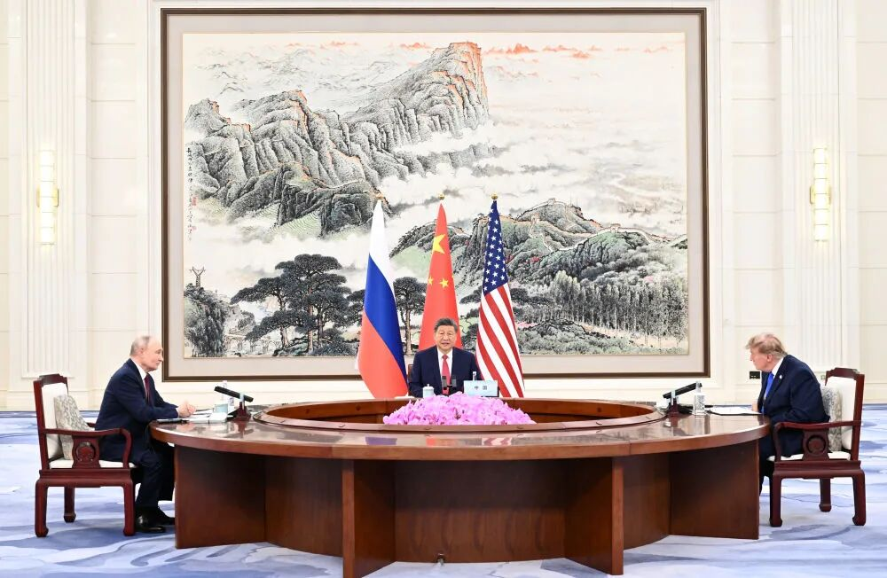
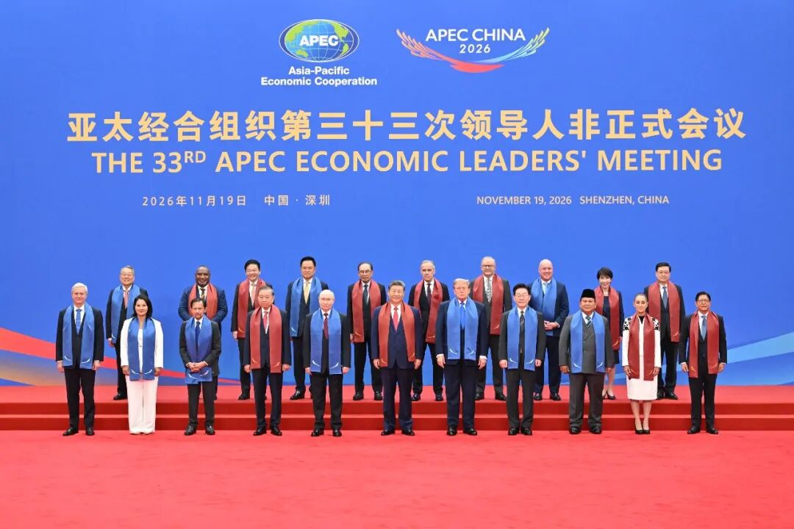
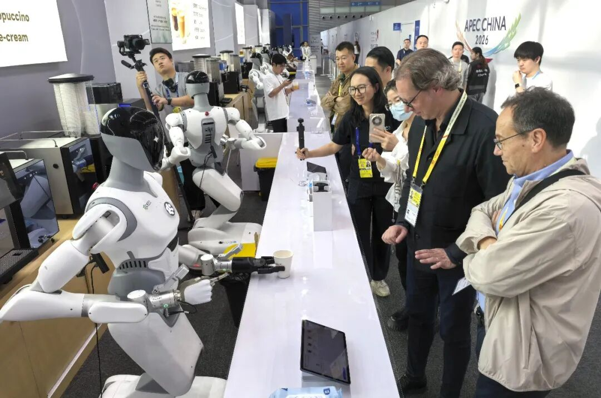

# “历史性同框”
> 💡 备注属性未写入，可能是备注属性名称或者类型被修改了，建议将字段类型设置为 rich_text，可以在小程序-操作-修改文章数据库页面进行调整
> 💡 原文链接:[https://mp.weixin.qq.com/s?__biz=MjM5MDU1Mzg3Mw==&mid=2651767958&idx=1&sn=c56d12849324cd6e955eae939aa7eece&chksm=bce550aadbb42ef00d20085acd88b0750dc00e9f42335283475abba6350101fd33f6400d2a3a#rd](https://mp.weixin.qq.com/s?__biz=MjM5MDU1Mzg3Mw%3D%3D&mid=2651767958&idx=1&sn=c56d12849324cd6e955eae939aa7eece&chksm=bce550aadbb42ef00d20085acd88b0750dc00e9f42335283475abba6350101fd33f6400d2a3a#rd)

中俄美元首会晤，为何在深圳实现？

## 11月19日下午，国家主席习近平在深圳同俄罗斯总统普京、美国总统特朗普举行中俄美元首会晤。俄美领导人感谢中方主办此次历史性会晤。三国元首就当前国际形势深入交换了意见，致力于维护战略稳定和国际安全。
习近平指出，今天的中俄美元首会晤是积极的、建设性的，也是富有成果的，三国在维护世界和平上看法是一致的。我们都记得二战期间并肩作战的历史，强调要珍惜来之不易的和平。我们都同意大国应该重视各国合理安全关切。我们都主张对话谈判是化解分歧的正确选择。只要对话不停止、大门不关上，和平就有希望。我们都认为合作是应对挑战的必由之路，要基于共同利益加强合作，以合作促和平、谋共赢。今天三国会晤播下的种子，必将生根发芽、开花结果。中俄美三国要落实好会晤共识，继续加强沟通，以对话聚共识，以担当迎挑战，以合作促和平，共同推动建设一个更加美好的世界。

11月19日下午，国家主席习近平在深圳同俄罗斯总统普京、美国总统特朗普举行中俄美元首会晤。图/新华
## 在《中俄美元首和平宣言》中，三国元首重申核战争打不赢也打不得。三国将就减少核风险、防止核扩散进行对话。
香港大学当代中国与世界研究中心（CCCW）创始主任、香港大学治理与政策学院教授李成对《中国新闻周刊》指出，中俄美元首会晤在全球安全议题上达成重要共识，符合国际社会的共同利益，也体现出中国在大国关系中发挥出积极的影响力。
## 李成曾担任美国顶级智库布鲁金斯学会约翰·桑顿中国中心主任，2023年来到香港后创建CCCW。2026年亚太经合组织（APEC）领导人非正式会议期间，李成在深圳接受了《中国新闻周刊》专访。
## “世界主要国家必须意识到，大国很强大，但同时也很脆弱，因为我们未来面临的打击并不一定来自传统意义上的‘敌人’。”李成说，“中俄美相互之间并非敌人，真正的敌人是未来世界的诸多不确定因素。”

11月19日上午，国家主席习近平在深圳国际交流中心主持亚太经合组织第三十三次领导人非正式会议，并发表题为《建设亚太共同体，续写“亚太奇迹”新篇章》的重要讲话。会议前，习近平同与会的各经济体领导人、代表集体合影。摄影/本刊记者 赵文宇
## “中俄美之间并非敌人”
**《中国新闻周刊》：你如何理解中俄美元首会晤的历史性意义？当前国际形势复杂多变，中俄美为何能相向而行？**
**李成：**在地缘政治发生巨大变化的今天，中俄美元首在中国的主场举行三方会晤，历史意义非常深远，也促使我们重新思考今天的国际秩序和大国关系。
首先，过去一个时期，围绕当前国际秩序，外界有种种说法。显然，今天的国际秩序不是“美国独大”，但也不是美方有些人喜欢说的“G2”或“G3”。这次中俄美元首会晤在亚太经合组织（APEC）领导人会议周期间举行，三国元首在APEC这个强调开放、创新、合作的多边舞台上相遇，承载着世界的希望，也体现出世界正在进入一个多边、多元、多极化的时代。
其次，就中俄美各自之间的关系而言，中俄是新时代全面战略协作伙伴关系。在当前的国际形势下，中俄的国家利益有很多契合之处，对国际秩序的理解也比较接近，而且中俄两国是邻国。在当前和未来一个时期，中俄关系的稳定是结构性的。
相较而言，中美关系、俄美关系经历过一些波折。中国第一次担任APEC东道主是在2001年。当时，在“9·11”事件之后，西方一度对国际秩序形成了超越阵营对抗的判断和理解。到2017年、2018年前后，西方很多人又重新回到地缘政治、阵营对抗的逻辑。
不过，在特朗普开始第二个总统任期后，美国同北约、欧盟国家的关系出现戏剧性变化。今年5月，中美达成了建设性战略稳定关系的新共识。如今，中俄美三国元首在深圳同框，进一步打破了一些人所持的“阵营对立”的观念。
## 《中国新闻周刊》：在《中俄美元首和平宣言》中，三国元首重申核战争打不赢也打不得。三国将就减少核风险、防止核扩散进行对话。达成这项重要共识，对全球安全秩序有怎样的意义？
**李成：**中国作为东道主的此次中俄美元首会晤，在全球安全议题上达成重要共识，符合国际社会的共同利益，也体现出中国在大国关系中发挥出积极的影响力。
正如我们刚才谈到的，这是一个国际秩序正在变化的时代，原有秩序不复存在，新的秩序还没有建立起来。在百年未有之大变局中，世界各国间存在一些分歧和矛盾，国家间冲突增多，而且不少冲突都有大国参与。
特别值得一提的是，AI技术发展的速度、介入武装冲突的深度，已经远远超过人类预期。人类社会能否承受AI失控的风险？如果AI被不当地使用，这会不会对人类社会、对地球本身造成毁灭性打击？我们从未像今天这样严峻地面对这个问题。
在此背景下，中俄美元首在本次会晤中就一系列和平与安全议题达成共识，非常必要也非常重要。世界主要国家必须意识到，大国很强大，但同时也很脆弱，因为我们未来面临的打击并不一定来自传统意义上的“敌人”。或者说，也许我们根本没有看清真正的敌人在哪里。
中俄美相互之间并非敌人，中俄美的关系不是零和游戏。真正的敌人是未来世界的诸多不确定因素。我期待，本次中俄美元首历史性的会晤，可以推动世界主要国家在未来的全球性危机到来之前，构建出更良性的国际秩序。

11月16日，在2026年APEC领导人会议周新闻中心，机器人为记者制作咖啡。图/新华
## 与中国合作是美国的“唯一选择”
**《中国新闻周刊》：本次“深圳之约”，是中美元首今年第三次见面。与前两次会晤时相比，美方的政治环境出现了一些新变化。特朗普领导下的共和党在11月的美国中期选举中失利、丢失国会两院的控制权，会对中美关系带来怎样的影响？我们应如何看待美国的政局变化？**
**李成：**11月的中期选举之后，有观点认为特朗普已经成了“跛脚鸭”，我觉得这是轻率的判断。特朗普现在面临的挑战，还不如他第一个总统任期的最后一年（2020年）遭遇的困境。当时，很多人都以为“特朗普时代”结束了，但后来的情况并非如此。
而且，特朗普不会因为中期选举失败就改变自己的政策路线。一个明显的信号是，他任命了作风强硬的斯蒂芬·米勒出任白宫办公厅主任，体现了一种不与民主党妥协的姿态。后续，他可能会做出一些政策调整，但不会放弃政策基调。
具体到对华政策上，至少在最近一个时期，特朗普更多将中国视为朋友而非对手。从今年5月、9月的两次中美元首会晤，到这次“深圳之约”，特朗普在整个周期内都很少指责中国。这在一定程度上形成了领导人间难能可贵的互信。这种互信会引领双边关系保持稳定，对中国、对特朗普、对美国、对国际社会都有积极意义。
现在美国确实有一些人，出于党派政治等需要，把中美关系的缓和说成是特朗普为了个人利益的行动。对特朗普来说，在中期选举失利之后赴“深圳之约”，有利于扭转国内外对他不利的舆论。但是，中美之间不要战争、防止人工智能失控、维护国际金融秩序稳定，哪件事不符合美国的国家利益？
总之，不管是在美国还是在中国，人们都不应该情绪化地分析特朗普。过去有一种观点，把美国的问题都归咎于特朗普个人，这是不全面的。现在，认为他所做的一切都是为了个人利益而非美国的利益，也值得商榷。包括一些民主党人士在内的美国有识之士已经表达过：虽然他们不喜欢特朗普，但他们同意特朗普在中美关系这件事上“做对了”。
进一步说，美国现在愿意接受中方首先提出的中美关系新定位，不是因为特朗普的个人意志，而是和我们刚才谈到的世界格局的变化、和中国综合国力的增强，都有关系。美国不得不尊重新的现实。而特朗普是较早拥有这种认知的美国领导人。美国国内舆论应该对此有更清醒的认识。
**《中国新闻周刊》：你曾在接受本刊采访时指出，今年以来，美国政商界对中美AI竞争的认知发生了一些改变，美方越来越认识到自己已经不具有绝对优势。但是，现在美方一些人是否依然在从对抗而非合作的角度看待中美间的AI问题？**
**李成：**对于中国实力的变化，特别是科技领域实力的增强，美国社会的认识转变有一个过程，其中有惧怕，这是可以理解的。本次中期选举也反映出，美国一些地方选区反AI的倾向越来越明显。这可能让那些力图推动AI发展的政商界人士更加焦虑。
但是，中期选举中兴起的反数据中心运动也体现出：过去美国总抱怨中国的发展夺走了美国中产阶级的饭碗，现在这件事越来越清楚，这其实是美国自身分配结构的变化。美国基层社会出现反AI的倾向，就是因为在这一轮科技创新中，美国依然处于一种“富人越来越富，大多数民众却没有得到好处”的发展状态。
这个问题其实也是全球性的。AI和工业革命、互联网不一样，工业革命和互联网给社会中的大多数人带来了好处，而AI可能会加剧两极分化。针对这个问题，本次APEC领导人会议周体现出，中方的态度是走开放、创新的路径，通过自由贸易、数字经济推动AI赋能经济社会发展，让世界变得更好，而不是让两极分化更加严重。
这种路径显然是正确的。如果美国因为当前的国内争议就陷入“向内收缩”，对AI时代的开放发展失去信心，只会造成恶性循环。
这也可以延伸到整个中美关系问题上。美国总会有一些噪声，有的其实跟中国无关，只跟党派撕裂有关；有的更多的是情绪，谈不上战略。但说到底，在这个变乱交错的时代，是中国在给国际社会带来确定性，带来和平、稳定、发展，带来国际公共产品，美方如何有理性地对待一个这样的中国？美国的有识之士应该看到，只有抓住合作、共享的机会，才是美国的“唯一选择”。
**要珍惜繁荣，更要分享经验**
**《中国新闻周刊》：在逆全球化、保护主义等问题依然严峻的背景下，APEC这个特殊的多边平台能发挥怎样的积极作用？**
**李成：**首先，在全球各地冲突频发、阵营对抗激烈的情况下，亚太地区近年来总体保持和平稳定，无论是整体经济增长还是推动中等收入群体的结构性变化，都走在世界前列。
这次会议的举办地深圳，城市发展史也就是40多年。40多年前，中国和东盟国家的中产阶级规模还很小，亚太地区还是战火纷飞。今天，这里能总体实现和平与发展，是弥足珍贵的。亚太各经济体应清醒地认识到，只有通过继续合作才能维持这样的和平与繁荣。
当然，亚太地区经济发展的过程，本身也是世界经济的一种再平衡。当前，APEC 21个经济体成员的人口约占全球36%，经济总量占全球六成以上，贸易额占全球近一半。面对全球其他地区面临的冲突和困难，亚太地区不应该“看笑话”，而是要把和平与发展的经验分享出去。
特朗普这次也谈道：“从贸易到投资，从地区问题到世界和平，美中共同推动这股潮流。”在逆全球化甚嚣尘上的背景下，中美作为世界前两大经济体，能够在这方面走到一起、形成一些共识，也体现出APEC这个平台、亚太这个地区对于世界经济复苏的重要意义。
记者：曹然
实习生：曾星诚
编辑：徐方清
运营编辑：王琳
